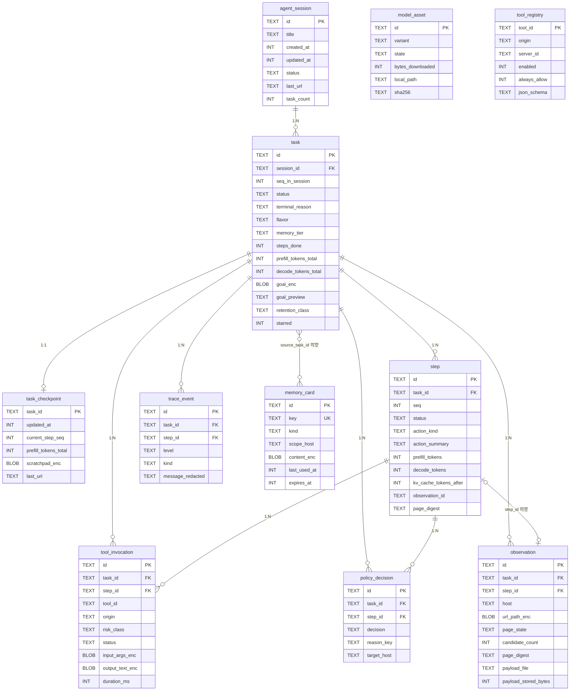

# 《本地端 GUI Agent》Android 应用 · Phase 1 本地持久化设计文档

| 项 | 内容 |
|---|---|
| 文档编号 | `02-database.md` |
| 版本 | v1.0（Phase 1 持久化基线） |
| 作者 | 宋砚秋（Cyrus Ledger），阿客实验室研发部 |
| 主理人 | 岑执衡 |
| 日期 | 2026-10-20 |
| 上游依据 | `01-architecture.md` v1.0（顾图南 Silas Frame，**唯一上游**） |
| 定位 | **设计文档**。含 Room `@Entity`/`@Dao` 级接口签名与关键实现骨架，不含最终业务代码。 |
| 技术基线 | Kotlin 2.x / Room 2.8.5 / androidx.sqlite 2.7.1 / DataStore Proto 1.2.1 / Android 17 (API 37)，minSdk 28 |

---

## 0. 阅读须知

### 0.1 本文与上游的关系

架构文档最后一节点名了三个给本文的输入：**§3.4 LoopBudget**、**§8.7 落盘脱敏**、**§12.1 的 `data/` 目录树**。我逐条读过全文（2128 行），结论是：

- §3.4 决定了**写入频率**（每步约 4.5 秒一个 Agent Step，每步固定产生若干类记录）；
- §5.1 决定了**单行大小**（`SERIALIZE_TARGET_BYTES = 12_288`，即每步的页面快照目标上限 12 KB）；
- §8.7 决定了**哪一列为敏感列**、以及"默认强制脱敏、不提供关闭开关"这条产品承诺；
- §12.1 的 `data/` 树给出了**载体清单**，但这份清单本身**不完整** —— 它只有 4 张实体，无法满足 A2 / A11 / §8.5 的验收条目。这是本文要补齐的部分，也是 §11 反馈章节的第 F4 条。

### 0.2 事实核实声明

本文沿用架构文档的两个标记。**核实日期统一为 2026-10-20**，来源见 §12.3。

**【已核实】** — 名称/坐标/数值取自 `developer.android.com`、`sqlite.org`、AndroidX API 参考原文。

**【需复验】** — 有间接证据但不够硬，工程师**必须在搭骨架当天用空壳 App 真机跑一遍**。清单见 §12.2。

本次核实的关键事实（后文反复引用，先列在这里便于核查）：

| # | 事实 | 来源 |
|---|---|---|
| 1 | Room 稳定版 **2.8.5**（2026-09-09），需 KSP；2.8.0 起 minSdk 由 21 提到 **23** | `developer.android.com/jetpack/androidx/releases/room` |
| 2 | 存在**并行的第二条稳定线**：`androidx.room3:room3-*:3.0.3`（2026-09-09）。Room 3 强制 KSP、只生成 Kotlin、DAO 必须挂起或返回响应式类型、**不再支持 `setQueryExecutor`/`setTransactionExecutor`**（改为 CoroutineContext），且必须配 `SQLiteDriver` | `/releases/room3` + 官方博客《Modernizing the Room》 |
| 3 | `RoomDatabase.Builder.setDriver(SQLiteDriver)` 自 **2.7.0** 起可用；`androidx.sqlite:sqlite-bundled:2.7.1` 提供 `BundledSQLiteDriver`，官方推荐，含从源码编译的 SQLite | `developer.android.com/kotlin/multiplatform/sqlite` |
| 4 | **Android 各 API 的 SQLite 版本**：API 28→3.22、30→3.28、31/32/33→3.32、34→3.39（该 API 内又升到 3.42）、35→3.44、36.1→3.50、37→3.50 | `/reference/android/database/sqlite/package-summary` |
| 5 | SQLite **UPSERT** 语法自 **3.24.0**（2018-06-04）起；窗口函数 **3.25.0**；`RETURNING` 与 `ALTER TABLE DROP COLUMN` **3.35.0**；STRICT 表 **3.37.0** | `sqlite.org/lang_UPSERT.html`、`/stricttables.html`、`/lang_returning.html` |
| 6 | SQLite 默认 page_size 自 **3.12.0** 起为 **4096**（此前 1024）；`SQLITE_MAX_PAGE_SIZE = 65536` | `sqlite.org/pgszchng2016.html` |
| 7 | 溢出页算法（page_size=4096、无保留字节）：`U=4096, X=U-35=4061, M=((U-12)*32/255)-23≈489`；载荷 > X 时前 M 字节留在叶子页，其余进溢出页，每溢出页载 `U-4=4092` 字节 | `sqlite.org/fileformat2.html` |
| 8 | WAL 模式下 `synchronous=NORMAL` **不会**损坏数据库（只可能丢掉掉电前最后几个已提交事务）；默认 `wal_autocheckpoint = 1000` 页 | `sqlite.org/wal.html`、`/pragma.html` |
| 9 | SQLite **外键默认关闭**，需每连接 `PRAGMA foreign_keys=ON` | `sqlite.org/pragma.html#pragma_foreign_keys` |
| 10 | Room 2.8.4：为无内部连接池的 driver（如 `BundledSQLiteDriver`）**加了预编译语句缓存**，提升重复 SQL 执行性能 | `/releases/room` 2.8.4 |
| 11 | Room 2.8.0：新增 `androidx.room:room-sqlite-wrapper`（`RoomDatabase.getSupportWrapper()`），用于在配了 `setDriver` 后仍需 `SupportSQLiteDatabase` 的场景 | `/releases/room` 2.8.0 |
| 12 | `RoomDatabase.Builder.setTransactionExecutor` 文档原文：*"Room will not use more than one thread at a time from this executor since only one transaction at a time can be executed, other transactions will be queued on a first come, first serve order"* | `/reference/androidx/room/RoomDatabase.Builder` |
| 13 | DataStore 稳定版 **1.2.1**（1.3.0 目前仍在 rc）；Proto 方案需 `com.google.protobuf:protobuf-kotlin-lite:4.32.1` + protoc 4.32.1 + protobuf gradle plugin 0.9.5 | `/topic/libraries/architecture/datastore` |
| 14 | AndroidKeyStore 自 **API 23** 起支持 AES / GCM / NoPadding；`KeyGenParameterSpec.Builder(alias, PURPOSE_ENCRYPT\|PURPOSE_DECRYPT).setBlockModes(BLOCK_MODE_GCM).setEncryptionPaddings(ENCRYPTION_PADDING_NONE)` | `/reference/android/security/keystore/KeyGenParameterSpec`、`/KeyProperties` |

---

## 1. 数据全景与存储选型

### 1.1 先立判定标准，再谈归属

「全塞 Room」和「全塞 DataStore」都是偷懒。本项目四类载体各有成立条件。我用**六个判定轴**按顺序问下去，落到哪一档基本唯一：

| 轴 | 问句 | 命中则倾向于 |
|---|---|---|
| **A1 是否参与条件查询/聚合** | 会不会出现 `WHERE ?= / BETWEEN / GROUP BY / COUNT`，且结果是**子集**而非整体？ | **Room** |
| **A2 是否会多到需要条目级更新** | 条目数是否会 > ~50，且需要单独刷新/撤销其中一条？ | **Room** |
| **A3 是否整读整写** | 是不是每次都把整个配置读出来用、改完整体写回？总量 KB 级？ | **DataStore Proto** |
| **A4 单条是否会 > 约 3 KB** | 单行里是否有一个字符串/blob 会经常超过 SQLite 单页安全内联线（4 KB page 下约 4 KB）？ | **文件**（DB 只留指针与元数据） |
| **A5 生命周期是否跨进程/重启** | 进程死了还需要吗？只在本次 Agent 循环内有效的东西不必落盘 | **不落盘** |
| **A6 隐私等级** | 是不是密码/卡号/Token/完整 Cookie？ | **不落盘**（详见 §8） |

两条补充规则：

- **A1/A2 优先于 A3。** 一个"看起来像配置"的东西，只要开始被按条目读写（MCP 工具权限就是典型），它就已经不是配置了 —— 见 §11 的 F7。
- **A4 优先于 A1。** 大对象即使要被查询，也应当**只把可查询部分落列、把主体挪到文件**。这是 §5 的核心。

### 1.2 全景归类表

| # | 数据 | 归属 | 理由（命中哪条轴） |
|---|---|---|---|
| 1 | Task / Step / ToolInvocation / Observation 及其明细 | **Room** | A1（按 task_id 加载全部步骤、按 host 查历史）+ A2（每步追加） |
| 2 | Trace 事件流 | **Room** | A1（按 level/kind 过滤诊断）+ A2（量大、需批量淘汰） |
| 3 | Policy 决策审计 | **Room** | A1（查所有 DENIED）+ A2（追加） |
| 4 | 任务断点快照（LoopState 持久化） | **Room** | A5（必须跨越 Thermal/电量暂停与进程被杀存活）+ §3.5 明文要求"序列化落盘" |
| 5 | MemoryCard（长期记忆） | **Room** | A1（按 kind/host 取相关）+ A2（条目级更新 `last_used_at`） |
| 6 | 模型资产清单 + 下载/校验状态机 | **Room** | A2 + A5（A2 验收项要求"中断 10 次后仍能完成下载"，必须记住 `bytes_downloaded`） |
| 7 | MCP 工具目录缓存 + 逐工具开关/授权 | **Room** | A2（工具数可能上百；§8.5 要求按工具粒度撤销 Always-Allow） |
| 8 | 超大文本：序列化 PocketDom 快照 | **文件**（`filesDir/trace/<taskId>/*.gz`） | A4（12 KB 量级）+ §5 的溢出页测算 |
| 9 | 应用设置（model tier / Top-K / 拟人化 / thinking 开关 / 保留策略） | **DataStore Proto** `settings.proto` | A3 |
| 10 | 域名全局白/黑名单 | **DataStore Proto** `domain_policy.proto` | A3（架构 §12.1 已指定；护栏每次整体加载，条目 ≤ 百级，几乎不写） |
| 11 | MCP Server 录入列表（URL/名称/静态 Header） | **DataStore Proto** `mcp_servers.proto`（**新增文件**） | A3（用户手动录入，≤ 20 条） |
| 12 | 会话级域名授权 grants | **Room**（MVP 不建，见 §10） | A2；Phase 2 引入 |
| 13 | 模型文件本体（2.58 GB `.litertlm`） | **文件**（`filesDir/models/`） | 架构 §6.4 已定 |
| 14 | 当轮候选元素的 `[n]` 编号表 | **不落盘** | A5 —— 循环内临时寻址表，下一轮重新分配 |
| 15 | KV cache / `Conversation` 对象 | **不落盘** | A5 + §4.3（严禁每步重建，且不可序列化） |
| 16 | JS 抽取返回的**中间**紧凑 JSON（30–120 KB） | **不落盘** | A5 —— 它只是 Kotlin 侧压缩的输入，永远不进库 |
| 17 | WebView 的 Cookie / localStorage / FormData | **不落盘（不由我们管）** | A6 + §10.2 明列"账号登录态管理 / Cookie 保险箱"不做；但**销毁时必须清理**，见 §8.5 |
| 18 | 凭据类文本（密码、银行卡、CVV、完整 Cookie、Bearer token） | **绝不落盘**（连明文影子都不留） | A6 + §8.3 R0 档 |

### 1.3 「不落盘」这一格要有牙齿

第 14–18 项不是"默认不做"，而是**要在代码层面做不到才算数**。两条硬性要求：

1. **`:core:contract` 里的 `PocketDom` 不得被任何 DAO 方法直接收下。** 进入持久化的必须是 `ObservationSummary` 这类显式投影过的领域对象（§3.1）。这样"随手把整个 PocketDom 塞进库"在编译期就不可行。
2. **所有写路径必须过 `:data:persist` 内部的 `PersistenceRedactionGate`**（§8.4）。依赖调用点自觉调 `TraceRedactor.redact()` 的防线，第一次赶工期就会被绕过。

---

## 2. ER 设计

### 2.1 实体总览

| 实体 | 表 | 行数/任务 | 说明 |
|---|---|---|---|
| 会话 | `agent_session` | — | 一个自然语言会话，含若干 Task |
| 任务 | `task` | 1 | 一次 `TaskSpec` 执行 |
| 步骤 | `step` | ≈ MAX_STEPS | 一次 ReAct 迭代 |
| 工具调用 | `tool_invocation` | ≈ 1–2× steps | 含入参、出参、耗时、状态 |
| 页面观察 | `observation` | ≈ steps | DOM 摘要本体在外置文件，行内只留元数据 |
| 模型推理统计 | **折进 `step`** | 0 | §10 的 MVP 裁剪项 |
| 轨迹事件 | `trace_event` | 3–8× steps | 事件流，可丢弃优先级最高的表 |
| 策略决策 | `policy_decision` | ≈ 1–2× steps | 护栏审计 |
| 任务断点 | `task_checkpoint` | 1 | LoopState 的唯一持久化载体（对上游的修正 F1） |
| 长期记忆 | `memory_card` | 增长型 | `MemoryStorePort` 的落点 |
| 模型资产 | `model_asset` | ≤ 10 | 下载/校验状态机 |
| 工具注册表 | `tool_registry` | ≤ 200 | 本地 + MCP 工具目录缓存与授权 |
| *(Phase 2)* | `session_domain_grant` | — | MVP 用 `observation` 派生，见 §10 |

### 2.2 ER 图



### 2.3 关系基数与删除语义

| 关系 | 基数 | 子表 FK 行为 | 说明 |
|---|---|---|---|
| `agent_session → task` | 1 : N | `CASCADE` | 删会话即删全部任务及其轨迹 |
| `task → step / tool_invocation / observation / trace_event / policy_decision` | 1 : N | `CASCADE` | 清理作业的最小单位就是一个 task |
| `task → task_checkpoint` | 1 : 1 | `CASCADE` | 断点随任务走 |
| `step → tool_invocation` | 1 : N | `CASCADE`（经 step_id） | 一步可能并发多个 tool call |
| `step → observation` | 1 : 0..1 | `step_id` 可空，`ON DELETE SET NULL` | **刻意留空**：感知可能在 observe 时就超时（§3.5 `Fault.Perception`），此时有 step 无 observation 是合法状态，不要建模成必有 |
| `task → memory_card` | 0..N | `source_task_id`，`ON DELETE SET NULL` | 记忆生命周期长于任务；任务删了记忆还在，否则"记住偏好"毫无意义 |

> ⚠ **外键在 SQLite 里默认不生效**（事实 9）。本设计要求两件事同时做：① 由驱动装饰器在每条连接上执行 `PRAGMA foreign_keys=ON`（§3.6）；② **清理作业不得依赖 CASCADE**，必须显式逐表 `DELETE`（§4.5）。任何一件缺了，另一件都能兜住，不会出现静默孤儿行。

### 2.4 状态机

**`task.status`** —— 取值直接对齐架构 §3.5「三重判定」表，不允许自创：

```
PENDING ──► RUNNING ──┬──► WAITING_HUMAN ──► RUNNING      （HumanGate 挂起，可回 RUNNING）
                      ├──► PAUSED_THERMAL ─► RUNNING      （§3.5 热节流可恢复）
                      ├──► PAUSED_BATTERY ─► RUNNING      （§3.5 电量保护可恢复）
                      │
                      ├──► SUCCEEDED             ← Judge.Done + criteria 满足
                      ├──► FAILED_IMPOSSIBLE     ← Judge.Impossible
                      ├──► ABORTED_USER          ← 用户中止
                      ├──► ABORTED_BUDGET        ← steps > maxSteps 或 prefill/decode 超上限
                      ├──► ABORTED_TIMEOUT       ← elapsed > maxWallClockMs
                      ├──► ABORTED_LOOP          ← 同一 actionKey 连续 3 次
                      ├──► ABORTED_NO_PROGRESS   ← 连续 4 步 pageDigest 未变
                      ├──► ABORTED_OSCILLATION   ← URL 出现长度 ≥3 的环
                      ├──► ABORTED_REPAIR_FAILED ← 连续 2 次输出不可解析
                      └──► STOPPED_BATTERY       ← < 8% 且 saveAndStop
```
任意中间态 ──► `CRASH_RECOVERABLE`（进程被杀后下次启动改写；判据是 `task_checkpoint` 存在且 `status` 仍在 RUNNING 分支）

**`step.status`**：`OK | REPAIRED | DENIED | ERROR | ABORTED`。`REPAIRED` 单独列出，因为 §3.5 的「连续 2 次输出无法解析」熔断依赖它计数。

**`tool_invocation.status`**：`QUEUED | EXECUTING | SUCCESS | TIMEOUT | FAILED | DENIED | CANCELLED`。DENIED 与 CANCELLED 必须分开：**DENIED 是护栏拒的**（同时会写 `policy_decision`），**CANCELLED 是用户或超时**。在"任务为什么失败"的根因分析里二者完全不同。

**`observation.page_state`**：`LOADING | READY | ERROR | BLOCKED | CAPTCHA | LOGIN_WALL`（直接映射 §5.2 的 `PageState`）。

**`model_asset.state`**：
```
NOT_PRESENT ──► DOWNLOADING ──► VERIFYING ──► READY ──► DELETING ──► NOT_PRESENT
                  │   ▲   │          │
                  │   └───┘（Range 续传：中断回到 DOWNLOADING，bytes_downloaded 保留）
                  └──► CORRUPT ──► DELETING
```

---

## 3. Room 定义（Kotlin）

### 3.1 分层落位 —— Entity 绝对不能出现在 Port 签名里

这一条不先讲清楚，整个数据层会把架构的 R1/R5 撞穿。

```
L4 :agent:loop / :agent:context        只认 :core:ports 接口 + :core:contract 数据类
        ↓ 依赖（不得反向）
L3 :data:persist   Room entity / DAO / PersistencePort 家族实现
        ↓ 依赖
L2 :core:contract  TaskRecord / StepRecord / ObservationSummary / MemoryCard ...
L1 :core:ports     PersistencePort 家族接口
```

三条铁律：

1. `RoomDatabase` 子类、`@Entity`、`@Dao` 全部关在 `com.ake.data.persist.db.*` 之下，**其它任何 Gradle 模块都不得 import `androidx.room.*`**。
2. 新增 Port 接口写在 `:core:ports`（L1）；其参数与返回类型写在 `:core:contract`（L2），**不得出现 Entity 类型**。
3. Entity ↔ 领域模型的映射（`.toDomain()` / `.fromDomain()`）写在 `:data:persist` 内部。

反例（违反 R1）：

```kotlin
// ❌ 禁止：L4 被迫依赖 L3 的 Room entity
interface TaskRepository { suspend fun load(id: String): TaskEntity }
```

正例（本文采用）：

```kotlin
// ✅ :core:ports —— 类型全在 :core:contract
interface TaskStorePort { suspend fun load(id: String): TaskRecord? }
```

### 3.2 Gradle 依赖（写进 `gradle/libs.versions.toml`）

```kotlin
// :data:persist/build.gradle.kts
plugins {
    id("com.android.library")
    id("org.jetbrains.kotlin.android")
    id("com.google.devtools.ksp")          // Room 2.8.5 用 KSP
    id("com.google.hilt.android")
    id("com.google.protobuf")              // Proto DataStore
    id("androidx.room")                    // Room Gradle Plugin：可缓存地导出 schema
}

dependencies {
    val room = "2.8.5"
    implementation("androidx.room:room-runtime:$room")
    implementation("androidx.room:room-ktx:$room")        // withTransaction / suspend DAO
    ksp("androidx.room:room-compiler:$room")
    testImplementation("androidx.room:room-testing:$room")

    // ★ 统一 SQLite 版本。理由见 §11 F6（minSdk 28 ⇒ 系统 SQLite 最低 3.22）
    implementation("androidx.sqlite:sqlite-bundled:2.7.1")

    implementation("androidx.datastore:datastore:1.2.1")
    implementation("com.google.protobuf:protobuf-kotlin-lite:4.32.1")

    implementation(project(":core:ports"))
    implementation(project(":core:contract"))
    implementation(project(":core:common"))     // Outcome / Clock / IdGen / ByteSize
    implementation(libs.hilt.android)
    ksp(libs.hilt.compiler)
}

room { schemaDirectory("$projectDir/schemas") }   // schema JSON 必须签入 git（§9）

protobuf {
    protoc { artifact = "com.google.protobuf:protoc:4.32.1" }
    generateProtoTasks {
        all().forEach { task ->
            task.builtins {
                create("java") { option("lite") }
                create("kotlin") { option("lite") }
            }
        }
    }
}
```

> **不需要** `androidx.room:room-sqlite-wrapper`：本文的 PRAGMA 全部走 SQLiteDriver 装饰器（§3.6），不碰 `SupportSQLiteDatabase`，因此这个兼容 artifact 不必引入 —— 少一个依赖是一层保险。

### 3.3 四条公共约定

后文所有代码都遵守：

| 约定 | 内容 |
|---|---|
| **主键一律 ULID TEXT** | 26 字符 Crockford Base32。**理由**：① 字典序即时间序 ⇒ 主键 B-tree 是**追加写**，不产生随机插入（这是 SQLite 写入性能最大的单条杠杆）；② 可以在进入队列**之前**就生成 id，异步批量落盘天然成立；③ 生成器用 `:core:common/IdGen.kt` 手写约 40 行，符合 R6（core:common 不引第三方库）。**不用 rowid**：rowid 要等 `INSERT` 返回后才拿得到，会让异步队列退化成同步等待。 |
| **时间一律 epoch millis `Long`** | 来自 `:core:common/Clock.kt`。**禁止 `@TypeConverter` 到 `Instant`** —— 转换器在每次读写都过一次函数，给最热的写路径增加无谓开销；转换只在 L3 边界的 mapper 里做一次。 |
| **枚举一律存 `TEXT`** | 同上。代价是少了编译期校验，收益是排查问题时 `adb shell sqlite3` 直接看得懂 —— 端侧 Agent 项目的 debug 效率优先于此。 |
| **密文字段统一格式** | 单个 `BLOB`，内部布局 `\| ver:1B \| iv:12B \| ciphertext \| tag:16B \|`（§8.3）。**不开 `_iv` 列、不开 `enc_key_ver` 列** —— 版本号在密文头部，轮换密钥时按行 rewrite 即可。 |

### 3.4 Entity 定义

> 阅读约定：以下代码块为**可直接落地的 Entity 定义**（编译级别）。为节省篇幅省略了各文件顶部的
> `import androidx.room.{Entity, PrimaryKey, ColumnInfo, Index, ForeignKey}` 等重复 import，
> 以及 `@file:Suppress` 之类噪音。除省略 import 外，字段、类型、索引、外键均按原样给出。

```kotlin
// ─────────────────────────────────────────────────────────────────────────────
// :data:persist / db/entity/SessionEntity.kt
// ─────────────────────────────────────────────────────────────────────────────
package com.ake.data.persist.db.entity

@Entity(
    tableName = "agent_session",      // 不叫 session：避开 SQLite session 扩展的同名词
    // ★ 索引一律显式命名：Room 的自动命名（index_<表>_<列>）在迁移与 EXPLAIN 断言里都难对齐
    indices = [
        Index(name = "idx_agent_session_updated_at", value = ["updated_at"]),            // Q1
        Index(name = "idx_agent_session_status_updated", value = ["status", "updated_at"]),
    ],
)
data class SessionEntity(
    @PrimaryKey @ColumnInfo(name = "id") val id: String,          // ULID
    @ColumnInfo(name = "title") val title: String,
    @ColumnInfo(name = "created_at") val createdAt: Long,
    @ColumnInfo(name = "updated_at") val updatedAt: Long,
    @ColumnInfo(name = "status") val status: String,              // ACTIVE / ARCHIVED
    @ColumnInfo(name = "last_task_id") val lastTaskId: String?,
    @ColumnInfo(name = "last_url") val lastUrl: String?,          // 已 sanitize + 去参，断点恢复用
    @ColumnInfo(name = "model_id") val modelId: String?,
    @ColumnInfo(name = "memory_tier") val memoryTier: String,     // LOW / MID / HIGH
    @ColumnInfo(name = "task_count") val taskCount: Int,
)
```

```kotlin
// ─────────────────────────────────────────────────────────────────────────────
// :data:persist / db/entity/TaskEntity.kt
// ─────────────────────────────────────────────────────────────────────────────
@Entity(
    tableName = "task",
    foreignKeys = [
        ForeignKey(
            entity = SessionEntity::class,
            parentColumns = ["id"],
            childColumns = ["session_id"],
            onDelete = ForeignKey.CASCADE,
            onUpdate = ForeignKey.NO_ACTION,
        ),
    ],
    indices = [
        Index(name = "idx_task_session_seq", value = ["session_id", "seq_in_session"], unique = true), // Q2
        Index(name = "idx_task_finished", value = ["finished_at"]),                                    // Q5
        Index(name = "idx_task_status_finished", value = ["status", "finished_at"]),                    // Q5 分组计数
        Index(name = "idx_task_last_activity", value = ["last_activity_at"]),                           // §4.5 清理作业
    ],
)
data class TaskEntity(
    @PrimaryKey val id: String,                              // ULID
    @ColumnInfo(name = "session_id") val sessionId: String,
    @ColumnInfo(name = "seq_in_session") val seqInSession: Int,

    @ColumnInfo(name = "created_at") val createdAt: Long,
    @ColumnInfo(name = "started_at") val startedAt: Long?,
    @ColumnInfo(name = "finished_at") val finishedAt: Long?,
    @ColumnInfo(name = "last_activity_at") val lastActivityAt: Long,   // 清理作业的唯一排序键

    // ── 生命周期（取值见 §2.4 状态机）
    @ColumnInfo(name = "status") val status: String,
    @ColumnInfo(name = "terminal_reason") val terminalReason: String?,

    // ── 任务画像（§3.1 TaskScriptFlavor）
    @ColumnInfo(name = "flavor") val flavor: String,          // SEARCH_LIST/FORM_FILL/DETAIL_READ/NAVIGATE_ONLY/GENERIC
    @ColumnInfo(name = "memory_tier") val memoryTier: String, // LOW/MID/HIGH
    @ColumnInfo(name = "context_window") val contextWindow: Int,
    @ColumnInfo(name = "model_id") val modelId: String?,
    @ColumnInfo(name = "backend") val backend: String?,       // GPU/CPU/NPU —— §11 R2 机型实测表的补充数据来源

    // ── 预算累计 ★（§3.4 maxPrefillTokensTotal / maxDecodeTokensTotal 的持久化载体，见 F1）
    @ColumnInfo(name = "steps_done") val stepsDone: Int,
    @ColumnInfo(name = "prefill_tokens_total") val prefillTokensTotal: Long,
    @ColumnInfo(name = "decode_tokens_total") val decodeTokensTotal: Long,
    @ColumnInfo(name = "elapsed_ms_total") val elapsedMsTotal: Long,

    // ── ⚠ 加密区（R1，§8.3）
    @ColumnInfo(name = "goal_enc") val goalEnc: ByteArray,    // 用户原始意图：本库最私密的一列
    @ColumnInfo(name = "goal_preview") val goalPreview: String,   // ≤64 字符明文摘要，供列表 UI
    @ColumnInfo(name = "answer_enc") val answerEnc: ByteArray?,
    @ColumnInfo(name = "answer_preview") val answerPreview: String?,

    // ── 运维
    @ColumnInfo(name = "starred") val starred: Int,                     // 0/1，SQLite 无 BOOLEAN
    @ColumnInfo(name = "retention_class") val retentionClass: String,   // FULL / DIGEST
    @ColumnInfo(name = "redaction_count") val redactionCount: Int,      // §8.3(e)
    @ColumnInfo(name = "kv_cache_peak") val kvCachePeak: Int,
    @ColumnInfo(name = "schema_v") val schemaV: Int,
)
```

```kotlin
// ─────────────────────────────────────────────────────────────────────────────
// :data:persist / db/entity/StepEntity.kt
// ─────────────────────────────────────────────────────────────────────────────
@Entity(
    tableName = "step",
    foreignKeys = [
        ForeignKey(entity = TaskEntity::class, parentColumns = ["id"], childColumns = ["task_id"], onDelete = ForeignKey.CASCADE),
    ],
    indices = [
        Index(name = "idx_step_task_seq", value = ["task_id", "seq"], unique = true),  // ★ Q3 唯一支撑
        Index(name = "idx_step_task_created", value = ["task_id", "created_at"]),
        Index(name = "idx_step_status_created", value = ["status", "created_at"]),      // MVP 可裁，见 §10
    ],
)
data class StepEntity(
    @PrimaryKey val id: String,                              // ULID
    @ColumnInfo(name = "task_id") val taskId: String,
    @ColumnInfo(name = "seq") val seq: Int,                  // 任务内序号，与 ULID 时间序一致，用于展示与游标

    @ColumnInfo(name = "created_at") val createdAt: Long,
    @ColumnInfo(name = "finished_at") val finishedAt: Long?,
    @ColumnInfo(name = "duration_ms") val durationMs: Long?,

    @ColumnInfo(name = "status") val status: String,                    // OK/REPAIRED/DENIED/ERROR/ABORTED
    @ColumnInfo(name = "action_kind") val actionKind: String?,          // CLICK/TYPE/SELECT/SCROLL/NAVIGATE/EXTRACT/CALL_TOOL/FINISH/ASK_HUMAN/NONE
    @ColumnInfo(name = "action_summary") val actionSummary: String,     // ★ §4.5 确定性压缩行："#3 click([12]销量)→ok [dom+18]"
    @ColumnInfo(name = "action_key") val actionKey: String?,            // 工具名+归一化参数+目标 stableKey —— §3.5 完全重复检测
    @ColumnInfo(name = "model_raw_redacted") val modelRawRedacted: String?,  // 已脱敏+截断的模型输出
    @ColumnInfo(name = "repair_attempts") val repairAttempts: Int,

    // ── 模型调用统计（MVP 把 model_call 表折进来，见 §10）
    @ColumnInfo(name = "model_id") val modelId: String?,
    @ColumnInfo(name = "prefill_tokens") val prefillTokens: Int,
    @ColumnInfo(name = "decode_tokens") val decodeTokens: Int,
    @ColumnInfo(name = "ttft_ms") val ttftMs: Int?,
    @ColumnInfo(name = "decode_tps") val decodeTps: Double?,
    @ColumnInfo(name = "kv_cache_tokens_after") val kvCacheTokensAfter: Int?,   // §4.3 currentCacheTokens() 快照
    @ColumnInfo(name = "prompt_tokens_estimate") val promptTokensEstimate: Int,
    @ColumnInfo(name = "budget_remaining_pct") val budgetRemainingPct: Int?,    // PromptMeta.remainingBudgetPct

    // ── 观察与验证（§3.3 七环）
    @ColumnInfo(name = "observation_id") val observationId: String?,
    @ColumnInfo(name = "page_changed") val pageChanged: String?,        // DOM_CHANGED / NO_CHANGE / URL_MOVED
    @ColumnInfo(name = "page_digest") val pageDigest: String?,          // §3.5 NoProgress 的回溯证据
    @ColumnInfo(name = "error_code") val errorCode: String?,
    @ColumnInfo(name = "error_hint") val errorHint: String?,
)
```

```kotlin
// ─────────────────────────────────────────────────────────────────────────────
// :data:persist / db/entity/ToolInvocationEntity.kt
// ─────────────────────────────────────────────────────────────────────────────
@Entity(
    tableName = "tool_invocation",
    foreignKeys = [
        ForeignKey(entity = TaskEntity::class, parentColumns = ["id"], childColumns = ["task_id"], onDelete = ForeignKey.CASCADE),
        ForeignKey(entity = StepEntity::class, parentColumns = ["id"], childColumns = ["step_id"], onDelete = ForeignKey.CASCADE),
    ],
    indices = [
        Index(name = "idx_toolinv_task_created", value = ["task_id", "created_at"]),
        Index(name = "idx_toolinv_step", value = ["step_id"]),                     // ★ Q4 按步取工具调用
        Index(name = "idx_toolinv_tool_created", value = ["tool_id", "created_at"]), // 调试"它为什么总失败"（MVP 可裁）
        Index(name = "idx_toolinv_status_created", value = ["status", "created_at"]), // 失败率统计（MVP 可裁）
    ],
)
data class ToolInvocationEntity(
    @PrimaryKey val id: String,
    @ColumnInfo(name = "task_id") val taskId: String,
    @ColumnInfo(name = "step_id") val stepId: String,
    @ColumnInfo(name = "seq_in_step") val seqInStep: Int,

    @ColumnInfo(name = "created_at") val createdAt: Long,
    @ColumnInfo(name = "started_at") val startedAt: Long?,
    @ColumnInfo(name = "finished_at") val finishedAt: Long?,
    @ColumnInfo(name = "duration_ms") val durationMs: Long?,

    // ── 工具身份（§7.1 ToolSpec）
    @ColumnInfo(name = "tool_id") val toolId: String,          // "browser.click" / "mcp.local.fs.read"
    @ColumnInfo(name = "tool_name") val toolName: String,
    @ColumnInfo(name = "origin") val origin: String,           // LOCAL / MCP
    @ColumnInfo(name = "risk_class") val riskClass: String,    // READ_ONLY/PAGE_MUTATING/SENSITIVE/EXTERNAL_SIDE_EFFECT/FORBIDDEN
    @ColumnInfo(name = "mcp_server_id") val mcpServerId: String?,

    @ColumnInfo(name = "status") val status: String,           // QUEUED/EXECUTING/SUCCESS/TIMEOUT/FAILED/DENIED/CANCELLED
    @ColumnInfo(name = "error_code") val errorCode: String?,
    @ColumnInfo(name = "error_message_redacted") val errorMessageRedacted: String?,
    @ColumnInfo(name = "attempts") val attempts: Int,

    // ── 入参 / 出参 —— ⚠ R1 加密区
    @ColumnInfo(name = "input_args_enc") val inputArgsEnc: ByteArray?,
    @ColumnInfo(name = "input_schema_hint") val inputSchemaHint: String?,   // 明文：仅 key 列表，脱敏后仍可读结构
    @ColumnInfo(name = "output_text_enc") val outputTextEnc: ByteArray?,
    @ColumnInfo(name = "output_truncated") val outputTruncated: Int,
    @ColumnInfo(name = "output_bytes") val outputBytes: Int,

    // ── 人机交互结果（§3.2 humanGate.resolve）
    @ColumnInfo(name = "confirm_required") val confirmRequired: Int,
    @ColumnInfo(name = "user_decision") val userDecision: String?,   // APPROVED/REJECTED/AMENDED/ABORTED
)
```

```kotlin
// ─────────────────────────────────────────────────────────────────────────────
// :data:persist / db/entity/ObservationEntity.kt
// ★ 对上游 §12.1 data/ 的直接补齐 —— 没有它，A11「每步可查看当时的 PocketDom 快照」无法验收
// ─────────────────────────────────────────────────────────────────────────────
@Entity(
    tableName = "observation",
    foreignKeys = [
        ForeignKey(entity = TaskEntity::class, parentColumns = ["id"], childColumns = ["task_id"], onDelete = ForeignKey.CASCADE),
        ForeignKey(
            entity = StepEntity::class, parentColumns = ["id"], childColumns = ["step_id"],
            onDelete = ForeignKey.SET_NULL, onUpdate = ForeignKey.NO_ACTION,
        ),
    ],
    indices = [
        Index(name = "idx_obs_task_seq", value = ["task_id", "seq"], unique = true), // 「某任务第 N 次观察」
        Index(name = "idx_obs_host_created", value = ["host", "created_at"]),        // ★ Q7 域名访问历史
        Index(name = "idx_obs_step", value = ["step_id"]),
        Index(name = "idx_obs_created", value = ["created_at"]),                     // MVP 可裁，见 §10
    ],
)
data class ObservationEntity(
    @PrimaryKey val id: String,
    @ColumnInfo(name = "task_id") val taskId: String,
    @ColumnInfo(name = "step_id") val stepId: String?,      // 可空：感知超时时有 observation 无 step
    @ColumnInfo(name = "seq") val seq: Int,
    @ColumnInfo(name = "created_at") val createdAt: Long,

    // ── 定位：host 明文（域名策略要查），path/query 加密
    @ColumnInfo(name = "host") val host: String,            // 小写化裸域名，见 §7.4 归一化规则
    @ColumnInfo(name = "url_path_enc") val urlPathEnc: ByteArray?,
    @ColumnInfo(name = "title_redacted") val titleRedacted: String?,

    // ── 页面快照产出的结构化信号（全小字段，查询友好）
    @ColumnInfo(name = "page_state") val pageState: String,        // LOADING/READY/ERROR/BLOCKED/CAPTCHA/LOGIN_WALL
    @ColumnInfo(name = "warning_flags") val warningFlags: Int,     // DomWarning 位掩码
    @ColumnInfo(name = "signal_flags") val signalFlags: Int,       // DomSignal 位掩码
    @ColumnInfo(name = "candidate_count") val candidateCount: Int,
    @ColumnInfo(name = "record_row_count") val recordRowCount: Int,
    @ColumnInfo(name = "raw_node_count") val rawNodeCount: Int,
    @ColumnInfo(name = "pruned_node_count") val prunedNodeCount: Int,
    @ColumnInfo(name = "serialized_chars") val serializedChars: Int,
    @ColumnInfo(name = "dom_stats_json") val domStatsJson: String?,
    @ColumnInfo(name = "page_digest") val pageDigest: String,      // ★ §3.5 NoProgress 的判定依据

    // ── 脱敏自证（§8.3(e)）
    @ColumnInfo(name = "redaction_count") val redactionCount: Int,
    @ColumnInfo(name = "redaction_types") val redactionTypes: String?,   // "JWT,EMAIL" 逗号分隔

    // ── 大载荷指针（§5）
    @ColumnInfo(name = "payload_codec") val payloadCodec: String?,        // "gzip" / "none"
    @ColumnInfo(name = "payload_file") val payloadFile: String?,          // 相对 filesDir/trace/<taskId>/ 的文件名
    @ColumnInfo(name = "payload_raw_bytes") val payloadRawBytes: Int,
    @ColumnInfo(name = "payload_stored_bytes") val payloadStoredBytes: Int,
    @ColumnInfo(name = "payload_state") val payloadState: String,         // EXTERNAL / MISSING / DROPPED
)
```

```kotlin
// ─────────────────────────────────────────────────────────────────────────────
// :data:persist / db/entity/TraceEventEntity.kt
// ★ §3.5 的 8 类终止保护每触发一次都要留下可诊断证据。
//   它也是全库写放大最严重的表 ⇒ §4.4 优先压缩它、§6.3 优先丢弃它。
// ─────────────────────────────────────────────────────────────────────────────
@Entity(
    tableName = "trace_event",
    foreignKeys = [
        ForeignKey(entity = TaskEntity::class, parentColumns = ["id"], childColumns = ["task_id"], onDelete = ForeignKey.CASCADE),
        ForeignKey(entity = StepEntity::class, parentColumns = ["id"], childColumns = ["step_id"], onDelete = ForeignKey.CASCADE),
    ],
    indices = [
        Index(name = "idx_event_task_seq", value = ["task_id", "seq"]),        // 按任务回放
        Index(name = "idx_event_level_created", value = ["level", "created_at"]), // 「只看 WARN/ERROR」
        Index(name = "idx_event_kind_created", value = ["kind", "created_at"]),   // 「所有 THERMAL_PAUSE」
    ],
)
data class TraceEventEntity(
    @PrimaryKey val id: String,
    @ColumnInfo(name = "task_id") val taskId: String,
    @ColumnInfo(name = "step_id") val stepId: String?,
    @ColumnInfo(name = "seq") val seq: Long,                 // 任务内单调递增，不做 unique（丢弃一行不应报错）
    @ColumnInfo(name = "created_at") val createdAt: Long,
    @ColumnInfo(name = "level") val level: String,           // DEBUG / INFO / WARN / ERROR
    @ColumnInfo(name = "kind") val kind: String,             // PERCEPTION_FAULT / REPAIR / TRIPWIRE /
                                                             // THERMAL_PAUSE / BATTERY_PAUSE / USER_STOP /
                                                             // COMPACTION / GUARD_TRIGGERED / HUMAN_GATE /
                                                             // IO_ERROR / TRACE_DROPPED
    @ColumnInfo(name = "message_redacted") val messageRedacted: String,
    @ColumnInfo(name = "kv_json") val kvJson: String?,       // 结构化附加字段，量小才写
)
```

```kotlin
// ─────────────────────────────────────────────────────────────────────────────
// :data:persist / db/entity/PolicyDecisionEntity.kt
// ─────────────────────────────────────────────────────────────────────────────
@Entity(
    tableName = "policy_decision",
    foreignKeys = [
        ForeignKey(entity = TaskEntity::class, parentColumns = ["id"], childColumns = ["task_id"], onDelete = ForeignKey.CASCADE),
        ForeignKey(entity = StepEntity::class, parentColumns = ["id"], childColumns = ["step_id"], onDelete = ForeignKey.CASCADE),
    ],
    indices = [
        Index(name = "idx_pol_task_created", value = ["task_id", "created_at"]),
        Index(name = "idx_pol_decision_created", value = ["decision", "created_at"]), // 安全回归核心查询
        Index(name = "idx_pol_reason_created", value = ["reason_key", "created_at"]),
    ],
)
data class PolicyDecisionEntity(
    @PrimaryKey val id: String,
    @ColumnInfo(name = "task_id") val taskId: String,
    @ColumnInfo(name = "step_id") val stepId: String?,
    @ColumnInfo(name = "created_at") val createdAt: Long,
    @ColumnInfo(name = "decision") val decision: String,        // ALLOW / REQUIRES_CONFIRM / DENIED
    @ColumnInfo(name = "severity") val severity: String?,       // HIGH / LOW，来自 PolicyVerdict.Denied
    @ColumnInfo(name = "reason_key") val reasonKey: String?,    // "err.credential_field" 等国际化 key
    @ColumnInfo(name = "reason_args_json") val reasonArgsJson: String?,
    @ColumnInfo(name = "action_kind") val actionKind: String,
    @ColumnInfo(name = "target_host") val targetHost: String?,
    @ColumnInfo(name = "risk_class") val riskClass: String?,
)
```

```kotlin
// ─────────────────────────────────────────────────────────────────────────────
// :data:persist / db/entity/TaskCheckpointEntity.kt
// ★ 对上游 §3.5 的直接补齐（见 §11 F1）：
//   §3.5 说「架构要支持把 LoopState（含 trace、scratchpad、SessionId）序列化落盘」，
//   但 §12.1 的 data/ 树里没有任何东西能承载它。没有它，热节流/低电恢复会让预算被重置。
// ─────────────────────────────────────────────────────────────────────────────
@Entity(
    tableName = "task_checkpoint",
    foreignKeys = [
        ForeignKey(entity = TaskEntity::class, parentColumns = ["id"], childColumns = ["task_id"], onDelete = ForeignKey.CASCADE),
    ],
    indices = [Index(name = "idx_cp_updated", value = ["updated_at"])],
)
data class TaskCheckpointEntity(
    @PrimaryKey @ColumnInfo(name = "task_id") val taskId: String,
    @ColumnInfo(name = "updated_at") val updatedAt: Long,
    @ColumnInfo(name = "status_snapshot") val statusSnapshot: String,

    // ── §3.4 预算累计：「暂停不送免费预算卡」的关键
    @ColumnInfo(name = "current_step_seq") val currentStepSeq: Int,
    @ColumnInfo(name = "prefill_tokens_total") val prefillTokensTotal: Long,
    @ColumnInfo(name = "decode_tokens_total") val decodeTokensTotal: Long,
    @ColumnInfo(name = "elapsed_ms_total") val elapsedMsTotal: Long,

    // ── §3.2 LoopState 里必须活过暂停的东西
    @ColumnInfo(name = "seen_digest_json") val seenDigestJson: String?,   // RingBuffer<StepDigest>(8)
    @ColumnInfo(name = "scratchpad_enc") val scratchpadEnc: ByteArray?,   // ⚠ R1：模型自己的笔记，可能含用户数据
    @ColumnInfo(name = "last_url") val lastUrl: String?,                  // 恢复时从这里继续
    @ColumnInfo(name = "last_observation_id") val lastObservationId: String?,
    @ColumnInfo(name = "last_kv_cache_tokens") val lastKvCacheTokens: Int?,
    @ColumnInfo(name = "compaction_last_step") val compactionLastStep: Int?,   // §4.3 压缩节流 ≥6 步

    // ── HumanGate 挂起态：UI 冷启动后还能弹出那个对话框
    @ColumnInfo(name = "human_gate_pending") val humanGatePending: Int,
    @ColumnInfo(name = "human_gate_json") val humanGateJson: String?,
)
```

```kotlin
// ─────────────────────────────────────────────────────────────────────────────
// :data:persist / db/entity/MemoryCardEntity.kt
// §10.2 明确不做向量检索（只做简单 MemoryCard 键值 + 最近 N 条）⇒ MVP 不建 FTS 表。
// ─────────────────────────────────────────────────────────────────────────────
@Entity(
    tableName = "memory_card",
    indices = [
        Index(name = "idx_mem_key", value = ["key"], unique = true),
        Index(name = "idx_mem_kind_updated", value = ["kind", "updated_at"]),
        Index(name = "idx_mem_host_used", value = ["scope_host", "last_used_at"]),  // 当前域名相关记忆
        Index(name = "idx_mem_expires", value = ["expires_at"]),
    ],
)
data class MemoryCardEntity(
    @PrimaryKey val id: String,
    @ColumnInfo(name = "key") val key: String,
    @ColumnInfo(name = "kind") val kind: String,          // PREFERENCE / FACT / SKILL_HINT / DOMAIN_NOTE
    @ColumnInfo(name = "scope") val scope: String,        // GLOBAL / DOMAIN
    @ColumnInfo(name = "scope_host") val scopeHost: String?,

    @ColumnInfo(name = "title") val title: String,        // 明文：UI 列表要直接显示
    @ColumnInfo(name = "content_enc") val contentEnc: ByteArray,   // ⚠ R1
    @ColumnInfo(name = "content_preview") val contentPreview: String,

    @ColumnInfo(name = "created_at") val createdAt: Long,
    @ColumnInfo(name = "updated_at") val updatedAt: Long,
    @ColumnInfo(name = "last_used_at") val lastUsedAt: Long,
    @ColumnInfo(name = "use_count") val useCount: Int,
    @ColumnInfo(name = "pinned") val pinned: Int,
    @ColumnInfo(name = "source_task_id") val sourceTaskId: String?,
    @ColumnInfo(name = "expires_at") val expiresAt: Long?,    // null = 永不过期
)
```

```kotlin
// ─────────────────────────────────────────────────────────────────────────────
// :data:persist / db/entity/ModelAssetEntity.kt
// ★ A2 验收条目「中断 10 次后仍能完成下载；损坏文件自动清理」在跨 App 重启的前提下
//   必须有持久化的 bytes_downloaded 与 state —— §6.4 只写了逻辑，没给落点。
// ─────────────────────────────────────────────────────────────────────────────
@Entity(
    tableName = "model_asset",
    indices = [
        Index(name = "idx_model_id_variant", value = ["model_id", "variant"], unique = true),
        Index(name = "idx_model_state", value = ["state"]),
    ],
)
data class ModelAssetEntity(
    @PrimaryKey val id: String,                                  // ULID（业务键是 model_id + variant）
    @ColumnInfo(name = "model_id") val modelId: String,          // "gemma-4-E2B-it"
    @ColumnInfo(name = "variant") val variant: String,           // TEXT_STD / NPU_TENSOR_G5 / NPU_MTK_6993
    @ColumnInfo(name = "remote_url") val remoteUrl: String,
    @ColumnInfo(name = "local_path") val localPath: String?,
    @ColumnInfo(name = "expected_bytes") val expectedBytes: Long,
    @ColumnInfo(name = "sha256") val sha256: String,
    @ColumnInfo(name = "context_window") val contextWindow: Int,
    @ColumnInfo(name = "min_ram_gb") val minRamGb: Int,
    @ColumnInfo(name = "capabilities_json") val capabilitiesJson: String,   // ["TOOLS","VISION","THINKING"]

    // ── 下载状态机（§2.4）
    @ColumnInfo(name = "state") val state: String,
    @ColumnInfo(name = "bytes_downloaded") val bytesDownloaded: Long,       // ★ Range 续传的生命线
    @ColumnInfo(name = "download_started_at") val downloadStartedAt: Long?,
    @ColumnInfo(name = "download_finished_at") val downloadFinishedAt: Long?,
    @ColumnInfo(name = "temp_file") val tempFile: String?,                  // *.part 名字，用于孤儿清理

    // ── 校验（§6.4 ModelVerifier）
    @ColumnInfo(name = "verify_attempts") val verifyAttempts: Int,
    @ColumnInfo(name = "verify_last_result") val verifyLastResult: String?,  // OK / SIZE_MISMATCH / SHA_MISMATCH
    @ColumnInfo(name = "verified_at") val verifiedAt: Long?,
    @ColumnInfo(name = "actual_bytes") val actualBytes: Long?,
    @ColumnInfo(name = "actual_sha256") val actualSha256: String?,

    @ColumnInfo(name = "last_error") val lastError: String?,
    @ColumnInfo(name = "last_error_at") val lastErrorAt: Long?,
    @ColumnInfo(name = "last_used_at") val lastUsedAt: Long?,
    @ColumnInfo(name = "load_count") val loadCount: Int,
    @ColumnInfo(name = "last_backend") val lastBackend: String?,
    @ColumnInfo(name = "last_load_ms") val lastLoadMs: Long?,
)
```

```kotlin
// ─────────────────────────────────────────────────────────────────────────────
// :data:persist / db/entity/ToolRegistryEntity.kt
// ★ §8.5：「所有 MCP 工具的 Always Allow 授权必须能在设置里按工具粒度撤销」
//   ⇒ 按 §1.1 的 A2 判 Room 而非 Proto（见 §11 F7）
// ─────────────────────────────────────────────────────────────────────────────
@Entity(
    tableName = "tool_registry",
    indices = [
        Index(name = "idx_toolreg_origin_server", value = ["origin", "server_id"]),
        Index(name = "idx_toolreg_enabled", value = ["enabled"]),
        Index(name = "idx_toolreg_last_seen", value = ["last_seen_at"]),  // discover 后消失的工具
    ],
)
data class ToolRegistryEntity(
    @PrimaryKey @ColumnInfo(name = "tool_id") val toolId: String,
    @ColumnInfo(name = "name") val name: String,
    @ColumnInfo(name = "description") val description: String,
    @ColumnInfo(name = "json_schema") val jsonSchema: String,
    @ColumnInfo(name = "schema_hash") val schemaHash: String,   // discover 时比对，变了要重新注入 SYSTEM 段

    @ColumnInfo(name = "origin") val origin: String,            // LOCAL / MCP
    @ColumnInfo(name = "server_id") val serverId: String?,
    @ColumnInfo(name = "declared_risk_class") val declaredRiskClass: String,
    @ColumnInfo(name = "risk_class_override") val riskClassOverride: String?,  // PolicyPort 可覆写（§7.1）

    @ColumnInfo(name = "enabled") val enabled: Int,             // ≤12 个同时启用（§7.2 硬限制）
    @ColumnInfo(name = "always_allow") val alwaysAllow: Int,    // 逐工具 Always-Allow
    @ColumnInfo(name = "granted_at") val grantedAt: Long?,

    @ColumnInfo(name = "discovered_at") val discoveredAt: Long,
    @ColumnInfo(name = "last_seen_at") val lastSeenAt: Long,
    @ColumnInfo(name = "missing_since") val missingSince: Long?,
)
```

### 3.5 Database 定义

```kotlin
// ─────────────────────────────────────────────────────────────────────────────
// :data:persist / db/AkeDatabase.kt
// ─────────────────────────────────────────────────────────────────────────────
package com.ake.data.persist.db

@Database(
    entities = [
        SessionEntity::class,
        TaskEntity::class,
        StepEntity::class,
        ToolInvocationEntity::class,
        ObservationEntity::class,
        TraceEventEntity::class,
        PolicyDecisionEntity::class,
        TaskCheckpointEntity::class,
        MemoryCardEntity::class,
        ModelAssetEntity::class,
        ToolRegistryEntity::class,
    ],
    version = 1,                    // ★ 编号约定见 §9.1
    exportSchema = true,            // schemas/*.json 必须签入 git，Room 迁移校验依赖它
)
abstract class AkeDatabase : RoomDatabase() {

    abstract fun sessionDao(): SessionDao
    abstract fun taskDao(): TaskDao
    abstract fun traceDao(): TraceDao
    abstract fun policyDao(): PolicyDao
    abstract fun checkpointDao(): CheckpointDao
    abstract fun memoryDao(): MemoryDao
    abstract fun modelAssetDao(): ModelAssetDao
    abstract fun toolRegistryDao(): ToolRegistryDao

    companion object {
        const val DB_FILE_NAME = "ake_agent.db"
        const val VERSION = 1
    }
}
```

### 3.6 SQLite 配置：用 Driver 装饰器而不是 Callback

**为什么不能靠 `RoomDatabase.Callback.onCreate()` 设 `page_size`？** 因为 `page_size` 与 `auto_vacuum` 只在**首次写入数据库文件之前**生效，而 Room 建表与 callback 的先后顺序不由我们保证。**抢占式地在"连接打开后、Room 做任何事之前"执行 PRAGMA，是唯一可靠的时序。**

`SQLiteDriver` 是普通 Kotlin 接口（`open(filename): SQLiteConnection`），可以装饰：

```kotlin
// ─────────────────────────────────────────────────────────────────────────────
// :data:persist / db/AkePragmaDriver.kt
// ─────────────────────────────────────────────────────────────────────────────
package com.ake.data.persist.db

import androidx.sqlite.SQLiteConnection
import androidx.sqlite.SQLiteDriver
import androidx.sqlite.driver.bundled.BundledSQLiteDriver

/**
 * 装饰任意 SQLiteDriver：在连接交还给 Room 之前先施加全局 PRAGMA。
 *
 * 时序保证：这是执行 page_size / auto_vacuum 唯一可靠的时机 —— 必须早于 Room 创建任何表。
 */
class AkePragmaDriver(
    private val delegate: SQLiteDriver = BundledSQLiteDriver(),
    private val config: AkePragmaConfig,
) : SQLiteDriver {

    override fun open(fileName: String): SQLiteConnection {
        val connection = delegate.open(fileName)
        connection.applyPragmas()
        return connection
    }

    private fun SQLiteConnection.applyPragmas() = execSQLAll(
        "PRAGMA journal_mode = WAL",                  // 读写并发；持久生效（sqlite.org/wal.html）
        "PRAGMA synchronous = NORMAL",                // WAL 下不损坏库，只丢掉电前最后几个事务
        "PRAGMA foreign_keys = ON",                   // ★ SQLite 默认关闭！
        "PRAGMA busy_timeout = 3000",
        "PRAGMA page_size = ${config.pageSize}",      // 新建库生效；已存在则静默忽略（无害、幂等）
        "PRAGMA cache_size = ${config.cacheSize}",    // 负值 = KiB 单位
        "PRAGMA temp_store = MEMORY",
        "PRAGMA wal_autocheckpoint = 1000",           // 默认值，显式写出便于审计
    )

    private fun SQLiteConnection.execSQLAll(vararg sql: String) {
        for (s in sql) {
            runCatching { execSQL(s) }
                .onFailure { LOGGER.w("PRAGMA failed (ignored)", "sql" to s, "err" to it.message) }
        }
    }
}

/** 按 MemoryTier 分档 —— 内存是本项目头号风险（§11 R1），page cache 不能拍脑袋给 */
data class AkePragmaConfig(
    val pageSize: Int = 8192,     // §5.2 论证：让 12 KB 级 PocketDom 压缩后落在单页内联线内
    val cacheSize: Int = -2000,   // 负号 = KiB
) {
    companion object {
        fun forTier(tier: MemoryTier): AkePragmaConfig = when (tier) {
            MemoryTier.LOW  -> AkePragmaConfig(pageSize = 4096, cacheSize = -1000)   // ≈ 4 MB
            MemoryTier.MID  -> AkePragmaConfig(pageSize = 8192, cacheSize = -2000)   // ≈ 16 MB
            MemoryTier.HIGH -> AkePragmaConfig(pageSize = 8192, cacheSize = -4000)   // ≈ 32 MB
        }
    }
}
```

> **`mmap_size` 刻意不设大值。** SQLite 的 mmap 会把页映射进进程虚拟内存/常驻集；在一个"2.58 GB 模型 + WebView + KV cache"已经在抢内存的进程里，为了读几 MB 轨迹去增大 RSS 是错误取舍。**R1 是 🔴 极高优先风险。** 【需复验】真机测一次 `mmap_size=0` 与 `=8MB` 对 PSS 的影响（§12.2 第 3 项）。

> 同理，**Room 能表达之外的对象**（如 `CREATE INDEX ... WHERE starred = 0` 这种部分索引）也按"幂等 + 可重入"的方式在开库后补齐：查 `sqlite_master` 里有没有，没有就 `CREATE ... IF NOT EXISTS`。不要依赖 callback 的调用时序。

### 3.7 DAO —— 会话与任务

```kotlin
// ─────────────────────────────────────────────────────────────────────────────
// :data:persist / db/dao/SessionDao.kt
// ─────────────────────────────────────────────────────────────────────────────
@Dao
interface SessionDao {

    @Insert(onConflict = OnConflictStrategy.ABORT)
    suspend fun insert(session: SessionEntity)

    @Upsert      // 依赖 SQLite UPSERT（≥3.24）；降级说明见 §9.4
    suspend fun upsert(session: SessionEntity)

    @Query("UPDATE agent_session SET updated_at = :now, last_task_id = :taskId WHERE id = :sessionId")
    suspend fun touch(sessionId: String, taskId: String, now: Long)

    /** Q1：恢复最近会话。命中 idx_agent_session_updated_at，不允许出现 SCAN / USE TEMP B-TREE */
    @Query("SELECT * FROM agent_session ORDER BY updated_at DESC LIMIT 1")
    suspend fun latestActive(): SessionEntity?

    @Query("SELECT * FROM agent_session WHERE status = :status ORDER BY updated_at DESC LIMIT :limit")
    fun observeByStatus(status: String, limit: Int): Flow<List<SessionEntity>>

    @Query("SELECT * FROM agent_session WHERE id = :sessionId")
    suspend fun get(sessionId: String): SessionEntity?

    @Query("DELETE FROM agent_session WHERE id = :sessionId")
    suspend fun delete(sessionId: String)
}
```

```kotlin
// ─────────────────────────────────────────────────────────────────────────────
// :data:persist / db/dao/TaskDao.kt
// ─────────────────────────────────────────────────────────────────────────────
@Dao
interface TaskDao {

    @Insert suspend fun insert(task: TaskEntity)
    @Insert suspend fun insertAll(tasks: List<TaskEntity>)

    /** ★ 投影查询：列表 UI 绝不能 SELECT * —— goal_enc / answer_enc 是密文，拉出来无用 */
    @Query(
        """
        SELECT id, session_id, seq_in_session, created_at, finished_at, last_activity_at,
               status, terminal_reason, flavor, steps_done, goal_preview, answer_preview,
               starred, retention_class
          FROM task
         WHERE session_id = :sessionId
         ORDER BY seq_in_session DESC
         LIMIT :limit
        """
    )
    fun observeSessionTasks(sessionId: String, limit: Int = 50): Flow<List<TaskListRow>>

    @Query("SELECT * FROM task WHERE id = :taskId")
    suspend fun get(taskId: String): TaskEntity?

    @Query("SELECT * FROM task WHERE id = :taskId")
    fun observe(taskId: String): Flow<TaskEntity?>

    @Query(
        """
        UPDATE task
           SET status = :status, terminal_reason = :reason, finished_at = :finishedAt,
               last_activity_at = :now
         WHERE id = :taskId
        """
    )
    suspend fun finish(taskId: String, status: String, reason: String?, finishedAt: Long, now: Long)

    /** 预算累计 —— 每步一次，走 BufferWriter 的 P0 队列（§6.3） */
    @Query(
        """
        UPDATE task
           SET steps_done = :stepsDone,
               prefill_tokens_total = :prefillTotal,
               decode_tokens_total = :decodeTotal,
               elapsed_ms_total = :elapsedMs,
               last_activity_at = :now,
               kv_cache_peak = MAX(kv_cache_peak, :kvPeak)
         WHERE id = :taskId
        """
    )
    suspend fun advance(
        taskId: String, stepsDone: Int, prefillTotal: Long, decodeTotal: Long,
        elapsedMs: Long, kvPeak: Int, now: Long,
    )

    @Query("UPDATE task SET starred = :starred WHERE id = :taskId")
    suspend fun setStarred(taskId: String, starred: Int)

    @Query("UPDATE task SET retention_class = :klass WHERE id IN (:taskIds)")
    suspend fun setRetentionClass(taskIds: List<String>, klass: String)

    // ── Q5：统计。刻意不额外加索引，见 §7.3 的量级论证
    @Query("SELECT COUNT(*) FROM task WHERE status IN (:statuses) AND finished_at BETWEEN :from AND :to")
    suspend fun countByStatus(statuses: List<String>, from: Long, to: Long): Int

    @Query("SELECT COUNT(*) FROM task")
    suspend fun countAll(): Int

    @Query("SELECT COUNT(*) FROM task WHERE finished_at IS NOT NULL")
    suspend fun countFinished(): Int

    // ── §4.5 清理作业
    @Query(
        """
        SELECT id FROM task
         WHERE starred = 0 AND last_activity_at < :cutoff
         ORDER BY last_activity_at ASC
         LIMIT :limit
        """
    )
    suspend fun pickExpired(cutoff: Long, limit: Int): List<String>

    @Query(
        """
        SELECT id FROM task
         WHERE starred = 0 AND retention_class = 'FULL' AND last_activity_at < :cutoff
         ORDER BY last_activity_at ASC
         LIMIT :limit
        """
    )
    suspend fun pickForDigest(cutoff: Long, limit: Int): List<String>

    /** 逐表显式删除 —— 不依赖 CASCADE。在自己的事务里跑。 */
    @Transaction
    suspend fun purgeTask(taskId: String) {
        deleteTaskRow(taskId)
        deleteSteps(taskId)
        deleteToolInvocations(taskId)
        deleteObservations(taskId)
        deleteTraceEvents(taskId)
        deletePolicyDecisions(taskId)
        deleteCheckpoint(taskId)
        // 外置文件由 MaintenanceJob 另行删除（DAO 不该持有 filesDir 句柄，职责分离）
    }

    @Query("DELETE FROM task WHERE id = :taskId") suspend fun deleteTaskRow(taskId: String)
    @Query("DELETE FROM step WHERE task_id = :taskId") suspend fun deleteSteps(taskId: String)
    @Query("DELETE FROM tool_invocation WHERE task_id = :taskId") suspend fun deleteToolInvocations(taskId: String)
    @Query("DELETE FROM observation WHERE task_id = :taskId") suspend fun deleteObservations(taskId: String)
    @Query("DELETE FROM trace_event WHERE task_id = :taskId") suspend fun deleteTraceEvents(taskId: String)
    @Query("DELETE FROM policy_decision WHERE task_id = :taskId") suspend fun deletePolicyDecisions(taskId: String)
    @Query("DELETE FROM task_checkpoint WHERE task_id = :taskId") suspend fun deleteCheckpoint(taskId: String)
}

/** 列表投影 —— 数据层内部读模型，不外泄给上层 */
data class TaskListRow(
    @ColumnInfo(name = "id") val id: String,
    @ColumnInfo(name = "session_id") val sessionId: String,
    @ColumnInfo(name = "seq_in_session") val seqInSession: Int,
    @ColumnInfo(name = "created_at") val createdAt: Long,
    @ColumnInfo(name = "finished_at") val finishedAt: Long?,
    @ColumnInfo(name = "last_activity_at") val lastActivityAt: Long,
    @ColumnInfo(name = "status") val status: String,
    @ColumnInfo(name = "terminal_reason") val terminalReason: String?,
    @ColumnInfo(name = "flavor") val flavor: String,
    @ColumnInfo(name = "steps_done") val stepsDone: Int,
    @ColumnInfo(name = "goal_preview") val goalPreview: String,
    @ColumnInfo(name = "answer_preview") val answerPreview: String?,
    @ColumnInfo(name = "starred") val starred: Int,
    @ColumnInfo(name = "retention_class") val retentionClass: String,
)
```

### 3.8 DAO —— 轨迹（Step / ToolInvocation / Observation / Event）

```kotlin
// ─────────────────────────────────────────────────────────────────────────────
// :data:persist / db/dao/TraceDao.kt
// ★ 全部写方法由 BufferWriter 批量调用；不允许单个写点自己开事务。
// ─────────────────────────────────────────────────────────────────────────────
@Dao
interface TraceDao {

    // ── 批量写（§6.3）：一个事务插一整批
    @Insert suspend fun insertSteps(steps: List<StepEntity>)
    @Insert suspend fun insertToolInvocations(items: List<ToolInvocationEntity>)
    @Insert suspend fun insertObservations(items: List<ObservationEntity>)
    @Insert suspend fun insertEvents(items: List<TraceEventEntity>)
    @Insert suspend fun insertPolicyDecisions(items: List<PolicyDecisionEntity>)

    @Update suspend fun updateStep(step: StepEntity)
    @Update suspend fun updateToolInvocation(item: ToolInvocationEntity)

    // ── Q3：加载某任务全部步骤。命中 idx_step_task_seq (task_id, seq)
    @Query("SELECT * FROM step WHERE task_id = :taskId ORDER BY seq ASC")
    suspend fun stepsOf(taskId: String): List<StepEntity>

    @Query("SELECT * FROM step WHERE task_id = :taskId ORDER BY seq ASC LIMIT :limit OFFSET :offset")
    suspend fun stepsPage(taskId: String, limit: Int, offset: Int): List<StepEntity>

    @Query("SELECT * FROM step WHERE id = :stepId")
    suspend fun step(stepId: String): StepEntity?

    // ── §3.5 完全重复检测：取最近 3 步的 action_key
    @Query("SELECT seq, action_key FROM step WHERE task_id = :taskId AND action_key IS NOT NULL ORDER BY seq DESC LIMIT 3")
    suspend fun recentActionKeys(taskId: String): List<ActionKeyRow>

    // ── §3.5 无进展检测：取最近 4 步的 page_digest
    @Query("SELECT seq, page_digest FROM step WHERE task_id = :taskId ORDER BY seq DESC LIMIT 4")
    suspend fun recentDigests(taskId: String): List<DigestRow>

    // ── Q4：某步的全部工具调用
    @Query("SELECT * FROM tool_invocation WHERE step_id = :stepId ORDER BY seq_in_step ASC")
    suspend fun toolsOfStep(stepId: String): List<ToolInvocationEntity>

    @Query("SELECT * FROM tool_invocation WHERE task_id = :taskId AND status IN (:statuses) ORDER BY created_at DESC LIMIT :limit")
    suspend fun failuresOfTask(taskId: String, statuses: List<String>, limit: Int = 50): List<ToolInvocationEntity>

    // ── Observation：默认投影，绝不顺手把密文 url_path_enc 拉出来
    @Query(
        """
        SELECT id, task_id, step_id, seq, created_at, host, page_state, warning_flags,
               signal_flags, candidate_count, record_row_count, page_digest, redaction_count,
               redaction_types, payload_codec, payload_file, payload_raw_bytes,
               payload_stored_bytes, payload_state, title_redacted
          FROM observation
         WHERE task_id = :taskId
         ORDER BY seq ASC
        """
    )
    suspend fun observationsOf(taskId: String): List<ObservationRow>

    @Query("SELECT url_path_enc FROM observation WHERE id = :observationId")
    suspend fun urlPathBlob(observationId: String): ByteArray?

    @Query("SELECT payload_file, payload_stored_bytes FROM observation WHERE id = :observationId")
    suspend fun payloadRef(observationId: String): PayloadRefRow?

    @Query("UPDATE observation SET payload_state = :state WHERE id = :observationId")
    suspend fun updatePayloadState(observationId: String, state: String)

    /** §4.5 转 DIGEST：清空大载荷指针（文件由 MaintenanceJob 删） */
    @Query("UPDATE observation SET payload_file = NULL, payload_state = 'DROPPED', payload_codec = NULL WHERE task_id = :taskId")
    suspend fun dropPayloadRefs(taskId: String)

    // ── 事件流
    @Query("SELECT * FROM trace_event WHERE task_id = :taskId ORDER BY seq ASC")
    suspend fun eventsOf(taskId: String): List<TraceEventEntity>

    @Query("SELECT * FROM trace_event WHERE task_id = :taskId AND level IN (:levels) ORDER BY seq ASC")
    suspend fun eventsOfLevels(taskId: String, levels: List<String>): List<TraceEventEntity>

    /** §4.5 转 DIGEST 时的事件瘦身：只留 WARN 以上 */
    @Query("DELETE FROM trace_event WHERE task_id = :taskId AND level IN ('DEBUG','INFO')")
    suspend fun dropVerboseEvents(taskId: String)

    /** ★ 孤儿文件兜底：清理作业用它做「DB 侧到底引用了哪些文件」的反向核对 */
    @Query("SELECT task_id, payload_file FROM observation WHERE payload_state = 'EXTERNAL' AND payload_file IS NOT NULL")
    suspend fun allExternalPayloadRefs(): List<PayloadRefRow2>

    @Query("SELECT COUNT(*) FROM observation WHERE task_id = :taskId")
    suspend fun countObservations(taskId: String): Int
}

data class ActionKeyRow(@ColumnInfo(name = "seq") val seq: Int, @ColumnInfo(name = "action_key") val actionKey: String?)
data class DigestRow(@ColumnInfo(name = "seq") val seq: Int, @ColumnInfo(name = "page_digest") val pageDigest: String?)
data class PayloadRefRow(@ColumnInfo(name = "payload_file") val file: String?, @ColumnInfo(name = "payload_stored_bytes") val bytes: Int)
data class PayloadRefRow2(@ColumnInfo(name = "task_id") val taskId: String, @ColumnInfo(name = "payload_file") val file: String?)

/** observationsOf() 的投影 —— ★ 刻意不含 url_path_enc：列表场景不需要解密 URL */
data class ObservationRow(
    @ColumnInfo(name = "id") val id: String,
    @ColumnInfo(name = "task_id") val taskId: String,
    @ColumnInfo(name = "step_id") val stepId: String?,
    @ColumnInfo(name = "seq") val seq: Int,
    @ColumnInfo(name = "created_at") val createdAt: Long,
    @ColumnInfo(name = "host") val host: String,
    @ColumnInfo(name = "title_redacted") val titleRedacted: String?,
    @ColumnInfo(name = "page_state") val pageState: String,
    @ColumnInfo(name = "warning_flags") val warningFlags: Int,
    @ColumnInfo(name = "signal_flags") val signalFlags: Int,
    @ColumnInfo(name = "candidate_count") val candidateCount: Int,
    @ColumnInfo(name = "record_row_count") val recordRowCount: Int,
    @ColumnInfo(name = "page_digest") val pageDigest: String,
    @ColumnInfo(name = "redaction_count") val redactionCount: Int,
    @ColumnInfo(name = "redaction_types") val redactionTypes: String?,
    @ColumnInfo(name = "payload_codec") val payloadCodec: String?,
    @ColumnInfo(name = "payload_file") val payloadFile: String?,
    @ColumnInfo(name = "payload_raw_bytes") val payloadRawBytes: Int,
    @ColumnInfo(name = "payload_stored_bytes") val payloadStoredBytes: Int,
    @ColumnInfo(name = "payload_state") val payloadState: String,
)
```

### 3.9 DAO —— 其余

```kotlin
// ─────────────────────────────────────────────────────────────────────────────
// :data:persist / db/dao/CheckpointDao.kt —— §3.5 断点恢复的唯一落点
// ─────────────────────────────────────────────────────────────────────────────
@Dao
interface CheckpointDao {
    @Upsert suspend fun save(cp: TaskCheckpointEntity)
    @Query("SELECT * FROM task_checkpoint WHERE task_id = :taskId") suspend fun get(taskId: String): TaskCheckpointEntity?
    @Query("DELETE FROM task_checkpoint WHERE task_id = :taskId") suspend fun delete(taskId: String)

    /** 冷启动扫描「上一轮被系统杀掉、且本可恢复」的任务 */
    @Query(
        """
        SELECT c.task_id FROM task_checkpoint c
          JOIN task t ON t.id = c.task_id
         WHERE t.status IN ('RUNNING','WAITING_HUMAN','PAUSED_THERMAL','PAUSED_BATTERY')
           AND t.finished_at IS NULL
         ORDER BY c.updated_at DESC
        """
    )
    suspend fun findResumable(): List<String>
}
```

```kotlin
// ─────────────────────────────────────────────────────────────────────────────
// :data:persist / db/dao/MemoryDao.kt —— MemoryStorePort 的落点（§10.2：无向量检索）
// ─────────────────────────────────────────────────────────────────────────────
@Dao
interface MemoryDao {
    @Upsert suspend fun put(card: MemoryCardEntity)
    @Query("SELECT * FROM memory_card WHERE key = :key") suspend fun byKey(key: String): MemoryCardEntity?

    /** MVP 相关性 = 作用域优先 + 最近使用。
     *  ⚠ 不使用 LIKE '%中文%'：BundledSQLiteDriver 的构建不含 ICU，SQLite 的
     *    like/nocase 只覆盖 ASCII（见 §11 F6）。子串匹配退化为 instr()。 */
    @Query(
        """
        SELECT * FROM memory_card
         WHERE (scope = 'GLOBAL' OR :host = scope_host)
           AND (expires_at IS NULL OR expires_at > :now)
         ORDER BY pinned DESC, last_used_at DESC
         LIMIT :limit
        """
    )
    suspend fun relevant(host: String, now: Long, limit: Int = 12): List<MemoryCardEntity>

    @Query(
        """
        SELECT * FROM memory_card
         WHERE instr(lower(title), lower(:q)) > 0
           AND (expires_at IS NULL OR expires_at > :now)
         ORDER BY last_used_at DESC LIMIT :limit
        """
    )
    suspend fun searchByTitle(q: String, now: Long, limit: Int = 20): List<MemoryCardEntity>

    @Query("UPDATE memory_card SET use_count = use_count + 1, last_used_at = :now WHERE id = :id")
    suspend fun touch(id: String, now: Long)

    @Query("SELECT * FROM memory_card ORDER BY last_used_at DESC LIMIT :limit")
    fun observeRecent(limit: Int = 50): Flow<List<MemoryCardEntity>>

    @Query("DELETE FROM memory_card WHERE id = :id") suspend fun delete(id: String)
    @Query("DELETE FROM memory_card WHERE expires_at IS NOT NULL AND expires_at < :now") suspend fun dropExpired(now: Long)
    @Query("SELECT COUNT(*) FROM memory_card") suspend fun count(): Int

    /** 超上限时淘汰最久未用的非收藏卡 */
    @Query("SELECT id FROM memory_card WHERE pinned = 0 ORDER BY last_used_at ASC LIMIT :excess")
    suspend fun pickLruEvictable(excess: Int): List<String>

    @Query("DELETE FROM memory_card WHERE id IN (:ids)") suspend fun deleteAll(ids: List<String>)
}
```

```kotlin
// ─────────────────────────────────────────────────────────────────────────────
// :data:persist / db/dao/ModelAssetDao.kt —— A2 验收项的持久化支撑
// ─────────────────────────────────────────────────────────────────────────────
@Dao
interface ModelAssetDao {
    @Upsert suspend fun upsert(asset: ModelAssetEntity)
    @Query("SELECT * FROM model_asset WHERE model_id = :modelId AND variant = :variant")
    suspend fun get(modelId: String, variant: String): ModelAssetEntity?
    @Query("SELECT * FROM model_asset WHERE state = :state") suspend fun byState(state: String): List<ModelAssetEntity>
    @Query("SELECT * FROM model_asset ORDER BY last_used_at DESC") fun observeAll(): Flow<List<ModelAssetEntity>>
    @Query("SELECT * FROM model_asset WHERE state = 'READY' ORDER BY last_used_at DESC LIMIT 1")
    suspend fun currentReady(): ModelAssetEntity?

    /** 下载进度：节流到每 ≤1% 或每 500ms 一次（§6.4），不要每包都写 */
    @Query("UPDATE model_asset SET bytes_downloaded = :bytes, state = 'DOWNLOADING' WHERE id = :id")
    suspend fun updateProgress(id: String, bytes: Long)

    @Query(
        """
        UPDATE model_asset
           SET state = :state, verify_attempts = :attempts, verify_last_result = :result,
               verified_at = :verifiedAt, actual_bytes = :actualBytes, actual_sha256 = :actualSha,
               local_path = :localPath
         WHERE id = :id
        """
    )
    suspend fun applyVerifyResult(
        id: String, state: String, attempts: Int, result: String,
        verifiedAt: Long?, actualBytes: Long?, actualSha: String?, localPath: String?,
    )

    @Query("UPDATE model_asset SET last_error = :err, last_error_at = :now WHERE id = :id")
    suspend fun setError(id: String, err: String, now: Long)

    @Query("UPDATE model_asset SET last_used_at = :now, load_count = load_count + 1, last_backend = :backend, last_load_ms = :ms WHERE id = :id")
    suspend fun recordLoad(id: String, backend: String, ms: Long, now: Long)

    @Query("DELETE FROM model_asset WHERE id = :id") suspend fun delete(id: String)

    /** §6.4 原子落盘失败后的孤儿 .part 清单 */
    @Query("SELECT id, temp_file FROM model_asset WHERE temp_file IS NOT NULL")
    suspend fun danglingTempFiles(): List<TempFileRow>
}
data class TempFileRow(@ColumnInfo(name = "id") val id: String, @ColumnInfo(name = "temp_file") val tempFile: String?)
```

```kotlin
// ─────────────────────────────────────────────────────────────────────────────
// :data:persist / db/dao/ToolRegistryDao.kt
// ─────────────────────────────────────────────────────────────────────────────
@Dao
interface ToolRegistryDao {
    @Upsert suspend fun upsertAll(tools: List<ToolRegistryEntity>)
    @Query("SELECT * FROM tool_registry") fun observeAll(): Flow<List<ToolRegistryEntity>>
    @Query("SELECT * FROM tool_registry WHERE enabled = 1 ORDER BY origin, tool_id")
    suspend fun enabledTools(): List<ToolRegistryEntity>
    @Query("SELECT COUNT(*) FROM tool_registry WHERE enabled = 1") suspend fun countEnabled(): Int
    @Query("SELECT * FROM tool_registry WHERE tool_id = :toolId") suspend fun get(toolId: String): ToolRegistryEntity?

    /** §8.5 逐工具开关 */
    @Query("UPDATE tool_registry SET enabled = :enabled WHERE tool_id = :toolId")
    suspend fun setEnabled(toolId: String, enabled: Int)
    /** §8.5 按工具粒度撤销 Always-Allow */
    @Query("UPDATE tool_registry SET always_allow = 0, granted_at = NULL WHERE tool_id = :toolId")
    suspend fun revokeAlwaysAllow(toolId: String)
    @Query("UPDATE tool_registry SET always_allow = 1, granted_at = :now WHERE tool_id = :toolId")
    suspend fun grantAlwaysAllow(toolId: String, now: Long)
    /** §7.1：护栏可覆写注册方声明的风险等级 */
    @Query("UPDATE tool_registry SET risk_class_override = :override WHERE tool_id = :toolId")
    suspend fun setRiskOverride(toolId: String, override: String?)

    /** discover 之后：没再见到的工具标 missing（不要直接删 —— 用户的 enable 状态要保留） */
    @Query("UPDATE tool_registry SET missing_since = :now WHERE tool_id NOT IN (:seenIds)")
    suspend fun markMissingExcept(seenIds: List<String>, now: Long)
    @Query("UPDATE tool_registry SET missing_since = NULL, last_seen_at = :now WHERE tool_id IN (:seenIds)")
    suspend fun markSeen(seenIds: List<String>, now: Long)
    @Query("SELECT COUNT(*) FROM tool_registry") suspend fun countAll(): Int
}
```

```kotlin
// ─────────────────────────────────────────────────────────────────────────────
// :data:persist / db/dao/PolicyDao.kt
// ─────────────────────────────────────────────────────────────────────────────
@Dao
interface PolicyDao {
    @Insert suspend fun insertAll(items: List<PolicyDecisionEntity>)
    @Query("SELECT * FROM policy_decision WHERE task_id = :taskId ORDER BY created_at ASC")
    suspend fun ofTask(taskId: String): List<PolicyDecisionEntity>
    @Query("SELECT * FROM policy_decision WHERE decision = 'DENIED' ORDER BY created_at DESC LIMIT :limit")
    suspend fun recentDenials(limit: Int = 100): List<PolicyDecisionEntity>
    /** 安全回归 / CI：注入样本是否在真实运行中被拒 —— A10 的机器可读证据 */
    @Query("SELECT COUNT(*) FROM policy_decision WHERE decision = 'DENIED' AND reason_key = :reasonKey")
    suspend fun countDenialsBy(reasonKey: String): Int
    @Query("SELECT * FROM policy_decision WHERE step_id = :stepId") suspend fun ofStep(stepId: String): List<PolicyDecisionEntity>
}
```

### 3.10 DI 组装

```kotlin
// ─────────────────────────────────────────────────────────────────────────────
// :data:persist / di/PersistenceModule.kt
// ─────────────────────────────────────────────────────────────────────────────
@Module
@InstallIn(SingletonComponent::class)
internal object PersistenceModule {

    /** 单线程写执行器。Room 保证同一时刻只用它里的一个线程执行事务，其余排队（事实 12）。
     *  专用 + 单线程 ⇒ 不共享 ⇒ 不会触发文档里警告的"共享 executor 必须无界"死锁场景。 */
    @Provides @Singleton @Named("dbWriter")
    fun provideWriterExecutor(): Executor = Executors.newSingleThreadExecutor { r ->
        Thread(r, "ake-db-writer").apply {
            priority = Process.THREAD_PRIORITY_BACKGROUND   // 落盘不得与模型推理抢 CPU/IO
        }
    }

    @Provides @Singleton @Named("dbReader")
    fun provideQueryExecutor(): Executor = Executors.newFixedThreadPool(2) { r ->
        Thread(r, "ake-db-reader").apply { priority = Process.THREAD_PRIORITY_BACKGROUND }
    }

    @Provides @Singleton
    fun provideDatabase(
        @ApplicationContext context: Context,
        health: DeviceHealthPort,
        @Named("dbWriter") writer: Executor,
        @Named("dbReader") reader: Executor,
    ): AkeDatabase = Room.databaseBuilder(context, AkeDatabase::class.java, AkeDatabase.DB_FILE_NAME)
        .setDriver(AkePragmaDriver(config = AkePragmaConfig.forTier(health.memoryTier())))
        // ⚠ WAL 必须显式声明。Room 2.x 默认 AUTOMATIC，行为随 API 等级漂移；此处要确定化。
        .setJournalMode(RoomDatabase.JournalMode.WRITE_AHEAD_LOGGING)
        .setTransactionExecutor(writer)      // §6.2：串行化所有写事务
        .setQueryExecutor(reader)            // 注意：与 setQueryCoroutineContext 互斥，只能设其一
        // 本 App 单进程（架构 §1.1「一个进程内」），不需要多实例失效同步，别开
        .addMigrations(*AkeMigrations.ALL)
        // ★ 不允许 allowMainThreadQueries()；不允许 setAutoCloseTimeout()
        .build()
}
```

> **为什么不用 `setAutoCloseTimeout()`？** Room 2.8.5 有一条相关修复说明：库关闭后再触发挂起查询会抛 `IllegalStateException`。Agent 任务一跑几分钟、UI 可能长时间不碰 DB，自动关闭会带来"随机关库 + 随机报错"这种最难复现的问题。**在一个已经有 R1 内存风险的项目里，我不为了省几 MB 去换一个随机崩溃源。**
>
> **为什么不开库不放在 `Application.onCreate()`？** Room 的迁移是在首次打开数据库时同步执行的；开库必须走后台线程（迁移耗时属已知 ANR 来源）。用 Hilt 的 `@Singleton` 懒加载即可，别手痒提前初始化。

---

## 4. 写入频率与存储量级推算

**结论先行：在本文的编码策略下，一次极限 100 步任务 ≈ 1.1 MB；典型 25 步任务 ≈ 180 KB；稳态总占用 ~20 MB。真正的存储大户永远是那 2.58 GB 的模型文件。**

所以这一节的落点不是"省了多少"，而是"**把上限钉死，让异常场景不可能吃掉用户空间**"。

### 4.1 一个 Agent Step 到底写几行

对照 §3.2 主循环，逐步标出写点：

| 循环阶段 | 写点 | 表 | 行数/步 |
|---|---|---|---|
| 0 终止保护 | 无（判定失败才走到下面） | — | 0 |
| 1 感知 | 每次 `observe()` 成功产出一次页面快照 | `observation` | 1.0 |
| 2 压缩组装 | 无（纯内存） | — | 0 |
| 3 规划 | 一次 `generate()` → 统计折进 `step` | `step`（含统计） | 0 |
| 4 解析失败 | `recordRepair` → 一条 WARN 事件 | `trace_event` | 0.2 |
| 5 护栏 | 一次 `authorize()` 结果 | `policy_decision` | 1.0 |
| 5' HumanGate | 需要确认时追加一条 `HUMAN_GATE` 事件 | `trace_event` | 0.2 |
| 6 执行 | 一步通常一次工具调用（可能多个 toolCalls） | `tool_invocation` | 1.3 |
| 6' 失败重试 | 每次定位失败一条 WARN | `trace_event` | 0.4 |
| 7 观察验证 | step 结算一行；`[dom+]` 等信号一条 INFO | `step` + `trace_event` | 1.0 + 1.0 |
| 边界 | 任务预算累计一次 UPDATE（非 INSERT） | `task` | 0（UPDATE） |
| 后台 | 感知故障 / 压缩 / IO 等杂项 | `trace_event` | 3.2 |
| **合计** | | | **≈ 10.6 行 + 1 个外置文件** |

### 4.2 每行多大（推算的全部依据）

| 行 | 构成 | 估计字节 |
|---|---|---|
| `step` | `action_summary`（§4.5 压缩行）≈120B + `model_raw_redacted`≈300B + 12 个整数字段 + 4 个短串 + 两个 ULID ≈140B | **560 B** |
| `tool_invocation` | 头部（4 个 ULID + 时间戳 + 状态码）≈180B + 入参 JSON（gzip 后）≈300B + 出参（gzip 后）≈700B | **1,180 B** |
| `observation`（行本体） | 结构化字段 + `page_digest` + 两个 ULID | **460 B** |
| `observation`（外置快照） | PocketDom 序列化目标 12 KB（§5.1 `SERIALIZE_TARGET_BYTES=12_288`），gzip 按 **3.5×** 压缩比 | **3,500 B** |
| `policy_decision` | 3 个 ULID + 时间戳 + decision + reason_key | **240 B** |
| `trace_event` | 2–3 个 ULID + 时间戳 + level + kind + 一句话 | **210 B** |

> **一项重要的量级澄清**：§5.1 提到 JS 侧返回的紧凑 JSON 是 **30–120 KB**。这个数**永远不会进库** —— 它只是 Kotlin 侧压缩管线的输入，压缩后的产物（12 KB 目标）才是持久化对象。把这条写进文档，是为了防止有人按 30–120 KB 去推算存储，得到一个虚高十倍的错误结论。

### 4.3 100 步任务的完整推算

```
per step:
  step                 1.0 × 560   =    560 B
  tool_invocation      1.3 × 1180  =  1,534 B
  observation(row)     1.0 × 460   =    460 B
  observation(file)    1.0 × 3500  =  3,500 B   ← 落文件系统，不在 SQLite
  policy_decision      1.0 × 240   =    240 B
  trace_event          5.0 × 210   =  1,050 B
  ─────────────────────────────────────────────
  DB 侧载荷小计                       3,844 B ≈ 3.75 KB/步
  File 侧载荷小计                     3,500 B ≈ 3.42 KB/步
  行数小计                            ≈ 10.6 行/步
```

**100 步任务：**

| 口径 | 数值 |
|---|---|
| 行数 | ≈ **1,060 行** |
| 外置快照文件数 | **100 个** |
| DB 侧原始载荷 | 3,844 B × 100 = **375 KB** |
| 文件侧 | 3,500 B × 100 = **342 KB** |
| DB 落盘膨胀（行开销 + 5~7 个二级索引 + 页内空洞，经验系数 1.6–2.2×） | **0.60 – 0.83 MB** |
| **合计** | **≈ 0.95 – 1.17 MB，取 1.1 MB** |
| WAL / 临时峰值余量（+10–20%） | 峰值 ≈ **1.3 MB** |

**对照典型规模：**

| 场景 | 步数（来源） | 单任务占用 |
|---|---|---|
| 低端机上限 | 15（§3.4 LOW `maxSteps`） | ≈ 165 KB |
| 主流 MVP 任务 | 25（§3.4 MID `maxSteps`） | ≈ **180 KB** |
| 旗舰机长任务 | 40（§3.4 HIGH `maxSteps`） | ≈ 440 KB |
| 极限压测（本文假设） | 100 | ≈ **1.1 MB** |

**对照"不做任何优化"的反面样板：**

| 策略 | 每步占用 | 100 步任务 |
|---|---|---|
| 序列快照明文内联 SQLite + 正文不压缩 | ≈ 28 KB | ≈ **2.8 MB** |
| 本文方案（gzip + 外置 + 密文列 + 索引精简） | ≈ 7.2 KB | ≈ **1.1 MB** |

存储只省了 2.5× —— **真正被救下来的是读放大**：「加载某任务全部步骤」从"每行要拖 12 KB 溢出链"变成"每行 100 字节内联"，随机读页数从约 300 降到约 15。这个差异在 §7 的 Q3 里直接体现为毫秒级 vs 百毫秒级。

**写放大量级**：按每天 20 个任务、每任务 25 步算 ≈ **3.6 MB/天**，相对闪存 TBW 可忽略。真正和 IO 相关的风险不是"写坏了"，而是**单次写操作卡顿** —— 这正是 §6 要解决的事。

### 4.4 保留策略

分三级。**升级方向是 FULL → DIGEST → 删除，没有反向。**

| 级别 | 内容 | 触发条件（MID 档默认） | 每步残留 |
|---|---|---|---|
| **FULL** | 全量：step 完整 + 工具入出参密文 + 快照文件 + 全部事件 | 最近 **50 个任务** 且 **≤ 14 天** | 7.2 KB |
| **DIGEST** | 删快照文件；清空工具入/出参密文；事件只留 WARN/ERROR；保留 step + observation 元数据 + 预算累计 | 超出 FULL 条件后自动降级 | ≈ 1.8 KB |
| **删除** | 整任务连同所有子行与文件 | > **30 天**且未收藏；或触发软/硬配额 | 0 |

设备档位联动（`MemoryTier`，对应 §11 R1 的低端机保护）：

| 档 | FULL 上限 | FULL 天数 | DIGEST 天数 |
|---|---|---|---|
| LOW（≤6 GB） | 10 个任务 | 3 天 | 14 天 |
| MID（8 GB） | 50 个任务 | 14 天 | 30 天 |
| HIGH（≥12 GB） | 100 个任务 | 30 天 | 60 天 |

配额（防异常场景的最后一道，不是常态约束）：

| 项 | 软限（触发 DIGEST 降级） | 硬限（从最老开始强制删除，收藏除外） |
|---|---|---|
| `ake_agent.db`（含 -wal/-shm） | 192 MB | 256 MB |
| `filesDir/trace/` | 192 MB | 384 MB |
| `memory_card` 条数 | 1,000 | 2,000 |

**稳态占用估算：**

```
50 个 FULL 任务 × 25 步 × 7.2 KB   ≈   9.0 MB
200 个 DIGEST 任务 × 25 步 × 1.8 KB ≈   8.8 MB
索引 / 页 / 空洞开销                ≈ +30%
──────────────────────────────────────────────
稳态 ≈ 23 MB      （对比：单个模型文件 2.58 GB）
```
**结论很明确：轨迹存储不需要为此过度设计，只需要把上限钉死。**

### 4.5 清理机制实现要点

```kotlin
// ─────────────────────────────────────────────────────────────────────────────
// :data:persist / maintenance/RetentionJob.kt（WorkManager：约束 idle + 非低存储）
// ─────────────────────────────────────────────────────────────────────────────
internal const val BATCH = 20            // 每批任务数：小批量才能控制在一次 WAL checkpoint 内完成
internal const val TIME_BUDGET_MS = 2_000L

class RetentionJob @AssistedInject constructor(...) : CoroutineWorker(...) {
    override suspend fun doWork(): Result {
        val deadline = clock.now() + TIME_BUDGET_MS
        var dirty = false

        // ① FULL → DIGEST
        val toDigest = taskDao.pickForDigest(now - days(fullDays), BATCH)
        for (id in toDigest) {
            db.withTransaction {
                traceDao.dropPayloadRefs(id)          // DB 侧先置 DROPPED
                traceDao.dropVerboseEvents(id)
                taskDao.setRetentionClass(listOf(id), "DIGEST")
            }
            purgeTaskFiles(id)                        // ★ 再删文件 —— 顺序很重要
            dirty = true
        }

        // ② DIGEST → 删除
        val toDelete = taskDao.pickExpired(now - days(digestDays), BATCH)
        for (id in toDelete) db.withTransaction { taskDao.purgeTask(id) }
        for (id in toDelete) purgeTaskFiles(id)       // 事务外删文件：不要把秒级文件 IO 拖进事务

        // ③ 孤儿文件 GC（上次崩溃留下的半写文件 / 无主文件）
        reconcileOrphanFiles()

        // ④ 配额突破时的额外一轮（同逻辑，不同筛选）

        // ⑤ 空闲维护：checkpoint + optimize —— 刻意放在这里，绝不在任务执行期间做
        if (dirty) { walCheckpointPassive(); runSqliteOptimize() }

        return if (clock.now() > deadline) Result.retry() else Result.success()
    }
}
```

五条必须遵守的实现纪律：

1. **"先改 DB 指针，再删文件"，永远不要反过来。** 反过来的后果是"行指向不存在的文件"，会让回放 UI 崩；而"留几个孤儿文件"最多是浪费空间，且 ③ 会收拾它。
2. **文件删除放在事务之外。** 一次 `rm` 几百个小文件可能是上百毫秒同步 IO；包进 SQLite 事务等于长时间持写锁，会拖住正在执行任务的 UI 查询。
3. **孤儿文件 GC 必须双向核对。** DB 引用了但文件没了 → 行改 `payload_state='MISSING'`；文件在但 DB 无引用 → 删文件。这是唯一能和"进程被杀"/"磁盘满"和平共处的方案。
4. **日常不跑 `VACUUM`。** SQLite 的删除不归还空间给文件系统，而是进 freelist 被后续插入复用 —— 这正是我们想要的（写多删多场景下 freelist 复用是最优路径）。仅在极端情况做一次性 `VACUUM`：条件为"DB 文件体积 > 应有体积 2 倍 **且** 空闲+充电 **且** 距上次 ≥30 天"。一年也触发不了几次。（注：若改用 `auto_vacuum=INCREMENTAL`，必须像 `page_size` 一样在 §3.6 装饰器里、建库前设置，之后无法改。）
5. **清理作业不得依赖 CASCADE。** 见 §2.3：`purgeTask` 显式逐表删除。

---

## 5. 大对象处理

### 5.1 要外置的只有一个：PocketDom 序列化快照

按 §5.1，`PocketDom` 序列化目标是 **12,288 字节 ≈ 12 KB**（对应约 2,800 token）。这是唯一稳定超过 3 KB 的字段，因此也是唯一需要讨论的对象。

（工具出参约 2 KB，但它**不需要参与 SQL 条件查询**，所以我把它留在同一行的密文列里 —— 压缩后 700 B，仍在单页内联线内。）

### 5.2 内联 vs 外置：算一次溢出账

用事实 7 的公式，page_size = 4096、无保留字节：

```
U = 4096          X = U - 35 = 4061        M = ((U-12)*32/255) - 23 ≈ 489
溢出页容量 = U - 4 = 4092
```

一个 12,288 B 的载荷：

```
P = 12288 > X = 4061
⇒ 前 489 B 留在叶子页，剩余 11,799 B 进溢出页
⇒ 溢出页数 = ceil(11799 / 4092) = 3
⇒ 读这一行要触碰 4 个页面
```

把 page_size 提到 8192：

```
U = 8192   X = 8157   M ≈ 1003
P = 12288 > X = 8157  ⇒ 仍溢流
⇒ 前 1003 B 留页，剩 11,285 B / 8188 = 2 页
⇒ 3 个页面
```
只是从 4 页降到 3 页，**收益有限**。

但如果先 gzip（3.5×，12,288 → 3,500 B）：

```
page_size = 4096：P = 3500 < X = 4061 ⇒ 完全内联，1 个页面   ✅
page_size = 8192：P = 3500 < X = 8157 ⇒ 完全内联，1 个页面   ✅
```

**这条算术给出了唯一正确的结论：决定性变量不是 page_size，是"是否压缩"。**

### 5.3 决策

| 决策项 | 结论 | 理由 |
|---|---|---|
| 快照主体 | **外置文件**：`filesDir/trace/<taskId>/<seq>-<ulid>.pdom.gz` | §4.4 的 FULL→DIGEST 降级本质是"删文件"；外置才能让降级变成一次 `rm -rf`，而不是一次写放大严重的 DB 重写。同时保持 SQLite 文件小而稳定 |
| `PageDigest`、结构化统计、warning/signal 位掩码 | **留列内联** | 只有几十字节，且是 §3.5 无进展检测与 Q7 域名历史查询的依据 |
| 压缩算法 | **gzip（`java.util.zip.Deflater`，level 6）** | §9 选型清单里没有压缩库；引入 zstd 需要自带 native/JNI 依赖，属于**未获架构认可的第三方 SDK**，违反 R5/R6，且 Android 没有公开的 zstd SDK API。`Deflater` 是 JDK 自带，零依赖。12 KB 输入在当代大核上约 0.2–0.5 ms，相对单步 4.5 s 可忽略（**必须在 writer 线程做，不要在主循环做**） |
| codec 记录 | `observation.payload_codec = 'gzip'` | 未来换算法时老数据仍可读，这是唯一必须的兼容性开销 |
| page_size | **8192**（MID/HIGH）；LOW 用 4096 | 上述算术说明它对已压缩载荷已无影响；但对 p95 的 20 KB 大页（gzip 后 5.7 KB）多一层保险，且减少索引 B-tree 层数。代价是 LOW 档 page cache 内存翻倍，因此 LOW 档保守 |
| 单文件写入顺序 | 写 `.tmp` → `force(true)` → `rename` → **才** INSERT 指向它的 DB 行 | 保证"有行必有可用文件"。与 §6.4 的 `*.part` 原子落盘是同一套路的思想复用 |

### 5.4 被明确否决的三个选项

| 选项 | 为什么否决 |
|---|---|
| **zstd 换更高压缩比** | zstd 比 gzip 大约再好 10–20%，绝对增量 <1 KB/步；换来一个新 native 依赖 + ABI 体积 + 与 R5「外部 SDK 只允许出现在 L3 且必须被 Port 包一层」的合规摩擦。收益不匹配 |
| **差分链（step N 只存相对 N-1 的 diff）** | 压缩比可能再好看 2–3×，但：① 随机访问第 87 步要重建 87 步；② §4.4 的 DIGEST 降级要保留 keyframe，逻辑复杂度上升一个量级；③ 从量级上看根本不需要。**列为 Phase 2 候选项，不在 MVP** |
| **把 raw DOM JSON（30–120 KB）也存下来做离线复现** | 这是调试诱惑，不是需求。真要做原始 HTML 复现属于开发期能力，走 `debugImplementation` 的临时目录，不进正式 schema |

---

## 6. 写入性能

### 6.1 先把结论说清楚：这不是瓶颈，但不能让它变成瓶颈

按 §3.1，旗舰机 GPU 单步 ≈ 4.5 s；CPU 回退 ≈ 10.9 s。

用 §4.1 的 10.6 行/步，若批量成一个事务：

```
WAL 模式下一次 COMMIT（synchronous = NORMAL）：
  ⇒ 只往 -wal 追加帧，不做 fsync；fsync 只在 checkpoint 时发生（sqlite.org/wal.html）
  ⇒ 典型 UFS 上单次 commit ≈ 0.05 – 0.5 ms
一批 ~11 行插入 + 一次 UPDATE ≈ 0.5 – 2 ms

占比：2 ms / 4500 ms ≈ 0.04%（GPU）    2 ms / 10900 ms ≈ 0.02%（CPU）
```

所以本节第一句话是：**落盘的绝对成本可以忽略，不值得为此牺牲任何数据完整性。** 但有三件事会把它变成瓶颈，一件都不能做：

| 反模式 | 后果 |
|---|---|
| 每行一个事务 | commit 次数 ×10 ⇒ checkpoint/fsync 概率 ×10 |
| 在主循环协程里 `await` 落盘 | 把 SQLite 的 IO 抖动（尤其模型文件正被读入内存时的 IO 争抢）直接注入 Agent 延迟；且会吃掉 `LoopBudget` 的 `actionMs`/`perceiveMs`。**这是最严重的一条**，见 §11 F9 |
| 不设 `busy_timeout` | 清理作业 / 设置页查询与写入相遇时直接给用户崩一个 `SQLITE_BUSY` |

### 6.2 单写者与连接池

- **`setTransactionExecutor(singleThreadExecutor)`**（事实 12：Room 同一时刻只用该执行器一个线程，其余事务 FCFS 排队）—— 写入天然串行，不可能出现两个事务互相抢写锁。
- **`setQueryExecutor(2 线程有界)`** —— 读走独立执行器；WAL 下写事务进行中读者不被阻塞。
- **不开 `enableMultiInstanceInvalidation()`**：单进程（架构 §1.1），开了只是白付 binder 成本。
- **`JournalMode.WRITE_AHEAD_LOGGING` 必须显式声明**。Room 2.x 默认 `AUTOMATIC`，行为随 API 等级漂移 —— 我们不指望任何漂移。

### 6.3 WriteAheadBuffer —— 唯一正确的形态

```kotlin
// ─────────────────────────────────────────────────────────────────────────────
// :data:persist / write/TraceBufferWriter.kt
// 契约：append() 永不阻塞、永不抛业务异常。丢数据可接受，拖慢主循环不可接受。
// ─────────────────────────────────────────────────────────────────────────────
internal class TraceBufferWriter(
    private val db: AkeDatabase,
    private val writeScope: CoroutineScope,        // SupervisorJob + writer 单线程 dispatcher
    private val gate: PersistenceRedactionGate,    // §8.4
    private val governor: PersistenceGovernor,     // §6.5
    private val metrics: PersistenceMetrics,       // §6.7
) {
    companion object {
        const val P0_CAP = 64        // 不可丢：task 状态跃迁 / 断点 / 最终答案 / DENIED
        const val P1_CAP = 512       // 常规：step / tool / observation
        const val P2_CAP = 1024      // 可丢：DEBUG 事件
        const val MAX_BATCH = 64
        const val COALESCE_MS = 200L
    }

    private val p0 = Channel<Op>(P0_CAP, BufferOverflow.DROP_OLDEST)
    private val p1 = Channel<Op>(P1_CAP, BufferOverflow.DROP_OLDEST)
    private val p2 = Channel<Op>(P2_CAP, BufferOverflow.DROP_OLDEST)

    /** ★ 主循环只碰这一个方法。非挂起、try-send，语义上等同于 "return" */
    fun append(op: Op): Boolean {
        val target = when (op.priority) { P0 -> p0; P1 -> p1; P2 -> p2 }
        val ok = target.trySend(op).isSuccess
        if (!ok) {
            metrics.recordDrop(op.priority)
            // ★ 丢事件本身要被记录 —— 否则"回放缺了几步"会变成无法解释的灵异现象
            target.trySend(Op.SyntheticTraceDropped(op.priority))
        }
        return ok
    }

    init { writeScope.launch { drainLoop() } }

    private suspend fun drainLoop() {
        while (true) {
            val batch = ArrayList<Op>(MAX_BATCH)
            drainInto(p0, batch)     // P0 优先：先把不可丢的吸干
            drainInto(p1, batch)
            drainInto(p2, batch)
            if (batch.isEmpty()) { delay(COALESCE_MS); continue }
            flush(batch)                     // §6.4
            governor.yieldForIoBudget()      // §6.5
        }
    }

    private fun drainInto(ch: Channel<Op>, into: MutableList<Op>) {
        repeat(MAX_BATCH - into.size) {
            when (val r = ch.tryReceive()) {
                is ChannelResult.Success -> into += r.value
                else -> return
            }
        }
    }

    /** 任务结束 / 暂停恢复前 / 用户点停止：必须显式同步等待一次 flush。
     *  这里的阻塞是刻意且必要的 —— 断点恢复的正确性依赖"暂停时数据已真正落盘"。 */
    suspend fun flushNow() {
        val pending = ArrayList<Op>(MAX_BATCH * 4)
        for (ch in listOf(p0, p1, p2)) {
            while (pending.size < MAX_BATCH * 4) {
                val r = ch.tryReceive()
                if (r is ChannelResult.Success) pending += r.value else break
            }
        }
        pending.chunked(MAX_BATCH).forEach { flush(it) }
    }
}
```

四条设计取舍，逐条说明理由：

1. **`Channel(capacity, DROP_OLDEST)` 而不是 `UNLIMITED`。** `UNLIMITED` 的语义是"永不限长"，等于允许队列无限膨胀 —— 在一个 IO 可能与 2.58 GB 模型加载争抢的进程里，这是 OOM 的一条免费通道。**有界队列 + 显式丢弃计数**，把不可控变成可观测。
2. **三级优先级而不是单队列。** P0 必须落盘（task 状态跃迁、断点、答案、DENIED 判定）；P2 的 DEBUG 事件丢了不影响任何事情。单队列 + 排序会让常用路径多付一次比较/插入成本。
3. **`append()` 必须是 `fun` 而不是 `suspend fun`。** 这是最容易被忽略也最致命的一点：如果 `TraceStorePort.append` 是挂起函数，调用方"看起来异步"，但实际 `await` 到 `send` 成功可能要等缓冲区腾位。**只有非挂起的 `trySend` 能从 API 层面保证"调用即返回"。**
4. **`SyntheticTraceDropped` 事件。** 丢弃必须自证。否则回放 UI 少了几步，工程师会花半天去找"数据库写错了还是 Agent 没跑"。

### 6.4 flush：批量事务

```kotlin
// 一个事务、多张表、一次 COMMIT
private suspend fun flush(batch: List<Op>) {
    val redacted = gate.redactAll(batch)     // §8.4：唯一脱敏入口，在 writer 线程做，不占主循环
    val started = metrics.beginFlush()
    try {
        db.withTransaction {                 // room-ktx 的挂起事务
            taskDao.advance(...)
            if (redacted.steps.isNotEmpty())    traceDao.insertSteps(redacted.steps)
            if (redacted.tools.isNotEmpty())    traceDao.insertToolInvocations(redacted.tools)
            if (redacted.policies.isNotEmpty()) traceDao.insertPolicyDecisions(redacted.policies)

            // ★ 先写文件，再写 DB 行（§4.5 纪律 1 的镜像）
            redacted.observations.forEach { writePayloadFileThenRow(it) }

            if (redacted.events.isNotEmpty())   traceDao.insertEvents(redacted.events)
        }
        metrics.endFlush(started, batch.size)
    } catch (ce: CancellationException) {
        throw ce                              // ★ 架构 §6.2 第 3 条：绝不能吞 CancellationException
    } catch (t: Throwable) {
        metrics.recordFlushFailure(t)
        // 降级：整批降级为"只留 step 骨架"，但异常不得穿透到 AgentLoop
    }
}

/** 写文件与写行的一体原子顺序 —— 任何一步失败都不能留下「有行无文件」 */
private suspend fun writePayloadFileThenRow(o: ObservationWithPayload) {
    val dir = traceDir(o.taskId)
    val tmp = File(dir, "${o.seq}-${o.id}.pdom.tmp")
    val dst = File(dir, "${o.seq}-${o.id}.pdom.gz")
    tmp.outputStream().use { raw ->
        DeflaterOutputStream(raw, Deflater(Deflater.DEFAULT_COMPRESSION), true).use {
            it.write(o.payload.toByteArray(Charsets.UTF_8))
        }
    }
    tmp.forceAndRenameTo(dst)                          // FileChannel.force(true) + atomic rename
    traceDao.insertObservations(listOf(o.row(payloadFile = dst.name)))   // 只在文件就位后落行
}
```

### 6.5 PersistenceGovernor —— 让路给模型

```kotlin
// 两个推理相关的 IO 尖峰必须能让持久化让路：
//   ① 模型下载（2.58 GB 写入，§6.4 OkHttp Range 续传）
//   ② 模型加载（2.58 GB 读入 + GPU 权重搬运，§6.1 initialize() 可能耗时 10 s）
internal class PersistenceGovernor(...) {
    private val _throttle = MutableStateFlow(Throttle.NONE)
    fun onModelDownloadStarted() { _throttle.value = Throttle.HALF }
    fun onModelLoadStarted()     { _throttle.value = Throttle.FULL; maintenanceGate.close() }
    fun onModelReady()           { _throttle.value = Throttle.NONE; maintenanceGate.open() }

    suspend fun yieldForIoBudget() = when (_throttle.value) {
        Throttle.NONE -> Unit
        Throttle.HALF -> delay(50)
        Throttle.FULL -> delay(200)
    }
}
```

> 这里的取舍要写明确：**宁可丢掉几行轨迹，也不能让模型加载变慢或失败。** 两者权重完全不对等 —— 前者损失的是诊断信息，后者损失的是用户能不能用这个 App。**优先级方向不能搞反。**

### 6.6 写入侧其余配置及其代价

| 项 | 设定 | 换取了什么 / 放弃了什么 |
|---|---|---|
| `synchronous = NORMAL`（WAL 下） | ✅ 采用 | 换取：commit 不做 fsync，写延迟大幅下降。放弃：**跨掉电的持久性**（事务仍原子一致，只是最后几个已提交事务可能回滚）—— sqlite.org 明确 WAL 下这是安全的「完整性保、持久性降」。轨迹数据不是账务，这笔交易极其划算。**但要写进用户可见的产品说明，别偷偷做** |
| `wal_autocheckpoint = 1000` | ✅ 保留默认 | @ page_size 8192 = 8 MB WAL，checkpoint 频率足够低。**刻意不调小**：调小是牺牲写性能换读性能，而我们的读是低频 UI 操作 |
| 显式 `PRAGMA wal_checkpoint(PASSIVE)` | 仅在任务结束 / 空闲 | 让读路径保持快；**绝不在任务进行中触发**（checkpoint 是唯一发 fsync 的地方，会造成单次数百毫秒抖动） |
| `busy_timeout = 3000` | ✅ | 防止清理作业、设置页查询与写入相遇时崩 `SQLITE_BUSY` |
| `cache_size` | 按 MemoryTier 分档 | 直接响应 §11 R1：低端机只给 4 MB，高端给 32 MB |
| `mmap_size` | 不设（默认） | 同 §3.6 注 |
| 预编译语句缓存 | 依赖 Room 2.8.4+ 对无池 driver 的优化（事实 10） | 批量插入反复绑定同一条语句，这是批量写能快的关键机制 |
| 清空表 | `DELETE` | SQLite 无 TRUNCATE 语句；`DELETE FROM t` 不带 WHERE 时走 SQLite 的内部 truncate 快路径，不需要额外 `DROP+CREATE` |

### 6.7 要观测的四个指标（没有观测就没有优化）

```kotlin
interface PersistenceMetrics {
    fun beginFlush(): Long                       // 返回 start nano
    fun endFlush(startNanos: Long, rows: Int)
    fun recordFlushFailure(t: Throwable)
    fun recordDrop(priority: Priority)
    fun recordQueueDepth(depth: Int)             // 采样：p0/p1/p2 三条队列深度
}
/** 关键 SLO：
 *  - flush p95 < 15 ms            （超出说明 IO 被模型加载挤了，去看 governor）
 *  - append() 耗时 p99 < 1 ms     （超出说明有人把它改成了挂起/阻塞调用）
 *  - p0 队列深度恒为 0            （非 0 是 bug 级告警）
 *  - 每任务丢弃率 < 0.5%          （超出说明 P2 太多或 writer 太慢）
 */
```

---

## 7. 查询性能

### 7.1 索引总表与写代价

| 表 | 索引 | 服务查询 | 每写一行的额外索引维护 |
|---|---|---|---|
| `agent_session` | `(updated_at)` `(status, updated_at)` | Q1 | 极小（行数 <100） |
| `task` | `(session_id, seq_in_session) U` `(finished_at)` `(status, finished_at)` `(last_activity_at)` | Q2 / Q5 / 清理作业 | 每行 4 次；task 行数少，可忽略 |
| `step` | `(task_id, seq) U` `(task_id, created_at)` `(status, created_at)` | Q3 / Q3-a | **每行 3 次** —— 第三个索引收益有限，**建议 MVP 去掉**（§10） |
| `tool_invocation` | `(task_id, created_at)` `(step_id)` `(tool_id, created_at)` `(status, created_at)` | Q4 / Q6 | 每行 4 次 —— 后两个 MVP 可裁（§10） |
| `observation` | `(task_id, seq) U` `(host, created_at)` `(step_id)` `(created_at)` | Q3 / Q7 | 每行 4 次；`(created_at)` 与 `(task_id,seq)` 冗余度高，MVP 去掉 |
| `trace_event` | `(task_id, seq)` `(level, created_at)` `(kind, created_at)` | Q8 | **行数最多 ⇒ 索引写代价最高**，见下方讨论 |
| `policy_decision` | `(task_id, created_at)` `(decision, created_at)` `(reason_key, created_at)` | Q5-a / 安全回归 | 每行 3 次 |
| `task_checkpoint` | `(updated_at)` | 冷启动扫描 | 极少写（仅暂停点与任务边界） |
| `memory_card` | `(key) U` `(kind, updated_at)` `(scope_host, last_used_at)` `(expires_at)` | Q9 | 低频写 |
| `model_asset` | `(model_id, variant) U` `(state)` | 模型管理 UI | 极少写 |
| `tool_registry` | `(origin, server_id)` `(enabled)` `(last_seen_at)` | Q10 | 低频写 |

> **明确的一条：索引不是免费的。** 每加一个二级索引，每行 INSERT 都要多维护一棵 B-tree。所以才有 §10 的"索引裁剪"清单 —— 特别是 `trace_event`：它是**行数最多 × 索引最多**的组合，是全库最大的写放大源。

### 7.2 MVP 必现查询与执行计划

每条查询的期望计划都写成 CI 断言（§7.5）。

**Q1 · 恢复最近会话（冷启动）**

```sql
SELECT * FROM agent_session ORDER BY updated_at DESC LIMIT 1;
```
期望：`SCAN agent_session USING INDEX idx_agent_session_updated_at`。
✅ 无 `USE TEMP B-TREE` —— 出现即说明索引没建上，CI 直接红。
为什么不用 `MAX(updated_at)`：我们要整行。索引倒序扫 + LIMIT 1 在 <100 行的表里与 `MAX()` 等价，但代码更简单。

**Q2 · 某会话的任务列表**

```sql
SELECT <投影列> FROM task WHERE session_id = ? ORDER BY seq_in_session DESC LIMIT 50;
```
期望：`SEARCH task USING INDEX idx_task_session_seq (session_id=?)`，且**无排序步骤**。
⚠ 注意索引列序：等值列 `session_id` 必须在前、排序列在后。反过来写 `(seq_in_session, session_id)` 会导致全表扫描 —— 这是最常犯的一类错误。

**Q3 · 加载某任务全部步骤（回放页）**

```sql
SELECT * FROM step WHERE task_id = ? ORDER BY seq ASC;
```
期望：`SEARCH step USING INDEX idx_step_task_seq (task_id=?)`，无 `USE TEMP B-TREE`。
**25 步量级下应为 <1 ms。** 若实测超过 5 ms，先怀疑是不是有人把 `SELECT *` 换成了带 `observation` 的 JOIN（见 Q4）。

**Q4 · 某一步的完整上下文（回放钻取）**

**刻意不用一条 JOIN。** 一行 step 可能对应 2 个 tool_invocation + 1 个 observation；JOIN 会产生笛卡尔小爆炸，并且会把 `observation.url_path_enc`（密文）和 `tool_invocation.output_text_enc`（密文）一起拖出来。

```kotlin
@Transaction
suspend fun loadStepDetail(taskId: String, stepId: String): StepDetail {
    val step = traceDao.step(stepId)                       // 命中主键
    val tools = traceDao.toolsOfStep(stepId)               // 命中 idx(step_id)
    val obs = traceDao.observationsOf(taskId)              // 命中 idx(task_id, seq)，且是投影（不含密文列）
    return StepDetail(step, tools, obs)
}
```
三条查询都在同一事务内 ⇒ 读到一致快照；且每条都走索引。**这个"三查代替一 JOIN"是刻意的性能与隐私双重选择。**

**Q5 · 统计任务成功率（设置页）**

```sql
SELECT COUNT(*) FROM task WHERE status IN (...) AND finished_at BETWEEN ? AND ?;
```
**这里我要明确反对"顺手加索引"：** `task` 表的稳态行数在几百到几千量级（§4.4：50 个 FULL + 200 个 DIGEST）。几千行的带过滤 COUNT 走一次全表扫描是**几毫秒**，而维护 `(status, finished_at)` 复合索引要给每次 task 写入增加一次索引维护。

现有 `(status, finished_at)` 与 `(finished_at)` 索引的取舍：它们服务的是**设置页统计**与**清理作业排序**两个不同场景，前者低频可接受扫描、后者是后台任务。因此：
- 保留 `(finished_at)`（清理作业与统计共用，成本低）；
- `(status, finished_at)` 仅在实测"统计查询 > 20 ms"时才加。**加索引要由测量驱动，不是由焦虑驱动。**

**Q6 · 某工具的失败统计（调试用）**

```sql
SELECT * FROM tool_invocation WHERE tool_id = ? AND created_at > ? ORDER BY created_at DESC LIMIT 50;
```
期望：`SEARCH tool_invocation USING INDEX idx_toolinv_tool_created`。这是 §10 里标注"MVP 可裁"的那个索引 —— 若裁剪，此查询退化为扫描，但它是**开发期查询**，可接受。

**Q7 · 查询某域名访问历史**

```sql
SELECT task_id, MAX(created_at) AS last_visit, COUNT(*) AS visits
  FROM observation WHERE host = ? GROUP BY task_id ORDER BY last_visit DESC LIMIT 20;
```
期望：`SEARCH observation USING INDEX idx_obs_host_created (host=?)`。
⭐ **这是本设计里唯一"必须索引 + 必须明文"的组合**：域名策略（§8.4 `blacklistHit(host)` / `isInSessionScope(host)`）要求 host 可精确查询，而确定性加密（同 key 同明文 ⇒ 同密文）虽然能做等值查询，却会引入"密钥即查询密钥"的耦合，且无法做 `ORDER BY created_at`。所以 **host 明文、path/query 加密**，理由与代价都写在这里，不做隐性决定（§8.3 表）。

**Q8 · 只看某任务的 WARN/ERROR**

```sql
SELECT * FROM trace_event WHERE task_id = ? AND level IN ('WARN','ERROR') ORDER BY seq ASC;
```
期望：`SEARCH trace_event USING INDEX idx_event_task_seq (task_id=?)`，随后对命中的行做 level 过滤。
注意这里 `level` 走的是**过滤**而不是**索引定位** —— 因为 `task_id` 的选择性远高于 `level`（一个任务几百条事件，而 WARN/ERROR 可能占一半）。**索引顺序要跟着选择性走**，这条在 §7.4 有通用规则。

**Q9 · 取相关记忆**

```sql
SELECT * FROM memory_card
 WHERE (scope = 'GLOBAL' OR scope_host = ?)
   AND (expires_at IS NULL OR expires_at > ?)
 ORDER BY pinned DESC, last_used_at DESC LIMIT 12;
```
期望：走 `idx_mem_host_used` 或全表扫描（memory_card 上限 2,000 行，扫描也就 1–2 ms）。`ORDER BY pinned DESC, last_used_at DESC` 会触发 `USE TEMP B-TREE FOR ORDER BY` —— **在 2,000 行上限下这是可接受的，不要为此建索引。**

**Q10 · 取已启用工具（每步 prompt 组装都要用）**

```sql
SELECT * FROM tool_registry WHERE enabled = 1 ORDER BY origin, tool_id LIMIT 12;
```
期望：`SEARCH ... USING INDEX idx_toolreg_enabled`，或行数 <200 时直接扫描。
⚠ **这条在热路径上**：§3.2 每步都要组装 SYSTEM 段。因此 `tool_registry` 应当**在内存里缓存一份 `Flow<List<ToolSpec>>`**，由 `ToolRegistryPort.catalog()` 持有，**不要每步查库**。查库只在 discover / 开关变更时发生。

### 7.3 两条通用索引规则（写进团队规范）

1. **复合索引列序 = 等值列在前、范围/排序列在后。** 违反一次，索引就等于白建。
2. **不要给"高重复度 + 低选择性"的列建独立索引**（如 `status`、`level`、`origin`）。它们要么做复合索引的后缀，要么干脆不建。

### 7.4 host 归一化规则（Q7 的前提）

```
输入 URL → java.net.URI 解析 → host.toLowerCase(Locale.ROOT) → 去末尾点 → 存 host 列
```
- 必须小写化，否则 `Example.com` 与 `example.com` 会被判成两个域名，**直接导致域名黑名单被绕过**（这是安全问题，不只是查询问题）。
- **不要**做 IDN/punycode 转换以外的任何规范化；不要剥离子域名（`m.example.com` 与 `example.com` 在策略上是不同主体）。

### 7.5 CI 卡口：执行计划不许退化

```kotlin
// :data:persist / src/androidTest/QueryPlanTest.kt
// 断言：MVP 热查询的执行计划里不得出现 SCAN <表>（被索引覆盖）或 USE TEMP B-TREE
private fun planOf(db: AkeDatabase, sql: String, vararg args: Any): String =
    db.query("EXPLAIN QUERY PLAN $sql", args).use { c ->
        buildString { while (c.moveToNext()) append(c.getString(3)).append('\n') }  // 第 4 列是 detail
    }

@Test fun q3_mustNotScan() {
    val plan = planOf(db, "SELECT * FROM step WHERE task_id = ? ORDER BY seq ASC", "01J...")
    assertThat(plan).doesNotContain("SCAN step")
    assertThat(plan).doesNotContain("USE TEMP B-TREE")
}
@Test fun q7_mustNotScan() {
    val plan = planOf(db, "SELECT task_id FROM observation WHERE host = ? GROUP BY task_id", "example.com")
    assertThat(plan).doesNotContain("SCAN observation")
}
```

> 这一组测试的价值不在于"证明现在是对的"，而在于**防止半年后有人为别的需求改了索引或查询，把全表扫描悄悄带进热路径**。端侧 Agent 项目改 prompt / 改压缩参数的频率极高，没有这类卡口，性能会在第 3 周开始无声退化。

### 7.6 统计信息维护

- 在 `RetentionJob` 空闲时跑一次 `PRAGMA optimize`（SQLite 3.18+ 可用；捆_driver 下版本更新，效果最好）。它会按需对部分索引做近似 ANALYZE，避免 SQLite 在没有 `sqlite_stat1` 时做出错误的索引选择。
- **不要**在任务执行期间跑 `ANALYZE`：它会全索引扫描，是秒级操作。

---

## 8. 数据脱敏与隐私

架构 §8.7 给了一条原则（"轨迹录制默认开启且强制脱敏，MVP 不提供不脱敏开关"）和一个 `redact(text)` 的正则 fold 骨架。**这一节是在它之上补齐实现路径，并指出它的三个盲区（§11 F3）。**

### 8.1 分级模型：三档，不是两档

§8.7 只有"脱敏"一档。但真实风险有三层，用一个 `redact()` 覆盖不了。

| 档 | 定义 | 例子 | 处理 | 落盘形态 |
|---|---|---|---|---|
| **R0 禁止落盘** | 凭据类：一旦落盘就是事故，与"是否加密"无关 | 密码、银行卡号（Luhn 通过）、CVV、身份证号、完整 Cookie 串、`Bearer`/`JWT` token、`input[type=password]` 的 value | **在进入 DB 之前被替换为占位符**，连密文都不写 | `<redacted:JWT>` 这类占位符，或该字段直接被剔除 |
| **R1 加密落盘** | 语义敏感但业务必需：丢了就没法回放/没法完成任务，明文落盘等于把用户意图交出去 | 用户原始 goal、最终 answer、工具入出参正文、页面快照文件、scratchpad、memory_card 正文、URL 的 path/query | **Keystore AES-256-GCM 加密** | `BLOB` 密文（§3.3 布局） |
| **R2 明文受限** | 结构性元数据：不含内容语义，且需要被查询 | `host`、时间戳、动作种类、计数、位掩码、`page_digest`、`action_summary` 压缩行 | 明文 + 采集期已 sanitize | 普通列 |

**为什么 goal 必须归 R1 而不是 R2？** 因为它是全库唯一一条能把整场会话还原成"这个人在关心什么"的字段（「帮我查治疗 XX 的药」）。其它列泄露的是"访问了什么页面"，goal 泄露的是"这个人是谁"。**这是两类不同量级的信息，不能同等对待。**

**为什么 host 必须留 R2 明文？** 见 §7.4/Q7：域名策略要求精确等值查询 + 时间排序，加密会破坏这两件事；且 host 只是"访问了哪个站"，粒度远低于 path/query。代价是：一个拿到 DB 文件的人能看到访问过的域名清单。这个代价我认为可接受且必须显式接受 —— 但**它应当写在隐私说明里，不能因为"反正没人看"就不写**。

### 8.2 R0 的识别：采集期 vs 落盘期

§8.7 把 redact 放在 `:data:trace`（落盘前最后一道）。**我认为这是不够的，而且有一处与 §5.2 直接冲突。**

冲突点：§5.2 的 `UiElement.attrs` 白名单里**包含 `value`**。也就是说，采集阶段会把输入框当前值原样保留；而 §8.7 指望在落盘前用正则把它删掉。这两个决定是互相矛盾的。

**正确的顺序是"采集即脱敏"**：

```kotlin
// :perception:dom / ElementEnumerator.kt —— 在写 attrs 时就判定，不要等到落盘
fun withholdValue(e: RawNode): String = when {
    e.attrs["type"] in setOf("password", "tel", "email")                 -> "<withheld>"
    (e.attrs["autocomplete"] ?: "").startsWith("cc-")                     -> "<withheld>"
    (e.attrs["autocomplete"] ?: "") in setOf("password", "current-password", "new-password") -> "<withheld>"
    (e.attrs["name"] ?: "").matches(Regex("(?i).*(pwd|passwd|password|card|cvv|cvc|idcard).*")) -> "<withheld>"
    else -> e.attrs["value"]?.take(MAX_TEXT_LEN) ?: ""
}
```

三层防线，缺一不可（这也呼应 §8.2「任何一道都不能是唯一的一道」）：

| 层 | 位置 | 作用 | 能否单独成立 |
|---|---|---|---|
| L1 采集期剔除 | `:perception:dom` | 结构敏感字段根本不进 `PocketDom` | 能覆盖语义，覆盖不了"用户在搜索框里打了一串卡号" |
| L2 落盘前正则 | `:data:persist` 的 `PersistenceRedactionGate` | 兜住长得像凭据的自由文本 | 能覆盖模式，覆盖不了语义 |
| L3 加密 | `:data:persist` 的 `FieldCipher` | 兜住前两层都漏掉的东西 | 不防"我们自己读出来说给用户听"，只防"文件被拷走" |

### 8.3 密钥管理与加密实现

```kotlin
// ─────────────────────────────────────────────────────────────────────────────
// :data:persist / crypto/TraceCipher.kt
// ─────────────────────────────────────────────────────────────────────────────
internal class TraceCipher {
    companion object {
        const val ALIAS = "ake.trace.dek.v1"
        const val VER: Byte = 1
        private const val IV_LEN = 12
        private const val TAG_BITS = 128
    }

    private fun key(): SecretKey = KeyStore.getInstance("AndroidKeyStore").run {
        load(null)
        getKey(ALIAS, null) as? SecretKey ?: generateKey()
    }

    private fun generateKey(): SecretKey {
        KeyGenerator.getInstance(KeyProperties.KEY_ALGORITHM_AES, "AndroidKeyStore").run {
            init(
                KeyGenParameterSpec.Builder(ALIAS, KeyProperties.PURPOSE_ENCRYPT or KeyProperties.PURPOSE_DECRYPT)
                    .setBlockModes(KeyProperties.BLOCK_MODE_GCM)
                    .setEncryptionPaddings(KeyProperties.ENCRYPTION_PADDING_NONE)
                    .setKeySize(256)
                    .build(),
            )
            return generateKey()
        }
    }

    /**
     * 密文布局：| ver:1B | iv:12B | ciphertext | tag:16B |
     *
     * ⚠ 不显式传 GCMParameterSpec：AndroidKeyStore 的密钥默认要求 randomized encryption，
     *   传入自定义 IV 会被拒绝；正确做法是 init 后读 cipher.iv。
     */
    fun seal(plain: ByteArray): ByteArray {
        val c = Cipher.getInstance("AES/GCM/NoPadding").apply { init(Cipher.ENCRYPT_MODE, key()) }
        val ct = c.doFinal(plain)
        return ByteBuffer.allocate(1 + IV_LEN + ct.size)
            .put(VER).put(c.iv).put(ct).array()
    }

    fun open(blob: ByteArray): ByteArray {
        val b = ByteBuffer.wrap(blob)
        val ver = b.get(); require(ver == VER) { "unsupported cipher version: $ver" }
        val iv = ByteArray(IV_LEN).also { b.get(it) }
        val ct = ByteArray(b.remaining()).also { b.get(it) }
        val c = Cipher.getInstance("AES/GCM/NoPadding")
            .apply { init(Cipher.DECRYPT_MODE, key(), GCMParameterSpec(TAG_BITS, iv)) }
        return c.doFinal(ct)
    }
}
```

四条要点：

1. **密钥不出 Keystore**（事实 14：API 23+，本 App minSdk 28 完全可用）。密钥材料留 TEE/StrongBox，App 进程只能拿到句柄。
2. **不在数据库里存密钥、不存 IV 列表**（IV 在密文头部）。
3. **版本号在密文头**：未来换算法/换密钥时，逐行 rewrite 即可，不需要一次全表迁移（可以在 `RetentionJob` 里分批做，几周完成）。
4. 【需复验】`setIsStrongBoxBacked(true)` 在 API 28+ 可用，但只有部分机型有 StrongBox，且 StrongBox 的 AES-GCM 吞吐明显低于 TEE。建议：**不强制 StrongBox**，而是读 `KeyInfo.getSecurityLevel()`（API 31+）记到日志里，用于机型能力表。

### 8.4 PersistenceRedactionGate —— 强制单点

```kotlin
// :data:persist / redact/PersistenceRedactionGate.kt
// ★ 所有进入持久化的文本，唯一的合法入口。不得靠调用点自觉。
internal class PersistenceRedactionGate(
    private val credentialRules: List<Pair<Regex, String>>,
    private val cipher: TraceCipher,
) {
    data class Result(val text: String, val redactionCount: Int, val redactionTypes: Set<String>)

    /** 返回「已脱敏的明文」—— 调用方再决定要不要加密 */
    fun scrub(text: String): Result { /* 正则 fold，记录命中次数与类型 */ }

    /** 返回「脱敏 + 加密」的密文 blob。R1 字段一律走这个。 */
    fun sealField(text: String): Pair<ByteArray, Int> {
        val r = scrub(text)
        return cipher.seal(r.text.toByteArray(Charsets.UTF_8)) to r.redactionCount
    }

    fun redactAll(ops: List<Op>): RedactedBatch { /* 批量，在 writer 线程跑 */ }
}
```

两条纪律：

- **`scrub()` 与 `sealField()` 是唯一出口。** 任何 DAO 调用之前的文本都必须过它。写进 CI 检查：`:data:persist` 里凡是给 `*_enc` 列赋值的语句，必须来自 `gate.sealField()`。
- **脱敏命中必须计数并写进 `observation.redaction_count` / `redaction_types` / `task.redaction_count`。** 这不是为了合规表演，是为了诊断：当回放发现"某一步的页面内容是 `[已屏蔽：检测到疑似提示注入内容]`"时，工程师必须能区分**这是脱敏干的**还是**模型失败导致的**，否则会花半天去查一个不存在的 bug。

### 8.5 「一键清除全部痕迹」的实现路径

架构文档没有为"销毁"设计任何落点（§11 F8）。这里是完整路径，**顺序不能改**：

```kotlin
// :data:persist / WipeEverythingUseCase.kt
suspend fun wipeEverything() {
    // ① 密码学粉碎 —— 主手段
    //    删除 Keystore 条目后，所有 R1 密文（goal / answer / 工具入出参 / 快照文件 /
    //    scratchpad / memory content）在数学上永久不可恢复。
    //    ★ 这是唯一"无论文件是否被真正擦除都成立"的保证 —— 闪存的 wear leveling
    //      让"安全擦除文件"在 Android 上根本不可靠，别自欺欺人。
    KeyStore.getInstance("AndroidKeyStore").apply { load(null); deleteEntry(TraceCipher.ALIAS) }

    // ② 停掉一切在途写入（否则刚删完又被写回来）
    bufferWriter.stopAndDropQueued(); retentionJob.cancelAll()

    // ③ 删 Room 库文件（含 -wal / -shm）
    db.close()
    context.deleteDatabase(AkeDatabase.DB_FILE_NAME)
    File(dbPath).parentFile?.listFiles { f -> f.name.startsWith(AkeDatabase.DB_FILE_NAME) }?.forEach { it.delete() }

    // ④ 删外置轨迹目录
    File(context.filesDir, "trace").deleteRecursively()

    // ⑤ 删 DataStore 文件（settings / domain_policy / mcp_servers）
    context.dataStore.data.update { it.getDefaultInstance() }   // 或 deleteDataStore() + 删 datastore 目录

    // ⑥ ★ WebView 痕迹 —— 本 App 最大一块不受我们控制的痕迹，架构文档完全没提
    WebView(context).apply {
        clearHistory(true); clearCache(true); clearFormData()
    }.destroy()
    CookieManager.getInstance().apply { removeAllCookies { }; flush() }
    WebStorage.getInstance().deleteAllData()
    File(context.dataDir, "app_webview").deleteRecursively()   // LocalStorage / IndexedDB / WebSQL

    // ⑦ 可选：模型文件是否删由用户单独决定（2.58 GB，重下代价高）
}
```

三个必须一并处理、但极易被漏掉的点：

| 点 | 为什么关键 |
|---|---|
| **`android:allowBackup="false"` + Android 12+ `dataExtractionRules`** | 否则"云备份 / 换机迁移"会把本应不出机的数据带出去，**与 §10.2「数据不出机」直接冲突**。这是合规红线，不是优化项 |
| **WebView 的 `app_webview/` 目录** | 我们在 WebView 里以登录态访问站点，Cookie/localStorage/IndexedDB 全在这里。只删自己的 DB 而留着它，"清除痕迹"是假的 |
| **先删密钥再删文件** | 反过来做，如果中途崩了，文件还在而密钥没了 ⇒ 数据变成永久垃圾；如果密钥先没而文件还在，数据不可读 ⇒ 目的已达成。**先删密钥是更安全的失败方向** |

---

## 9. 迁移策略

### 9.1 版本号约定

| 规则 | 内容 |
|---|---|
| **首个可演进版本 = `1`** | 第一个交付给真人的 schema 就是 `version = 1`。不要用 0，也不要用 100 起步 —— Room 的迁移是按整数路径找的，人为抬高起点只会带来困惑 |
| **开发期用破坏性迁移，但只在 debug** | 开发期 schema 天天变，写迁移是浪费。**用 build flag**：`if (BuildConfig.DEV_DESTRUCTIVE_MIGRATION) builder.fallbackToDestructiveMigration()`。**release 构建绝不允许出现这个 flag**（加一条 lint / CI 检查） |
| **版本号只在"已发布的 schema"上递增** | 只要这个 schema 没发布给真人，改了就不必加版本号（走破坏性迁移即可）。一旦发布，任何结构变化都必须 +1 并写 `Migration` |
| **900–999 保留给紧急通道** | 用于"必须绕开正常路径"的一次性修复，例如 `fallbackToDestructiveMigrationFrom(9xx)`。正常使用不得占用 |
| **`exportSchema = true`，JSON 签入 git** | 没有 schema JSON，Room 的 AutoMigration 与迁移测试都无法工作。这是硬要求，不是建议 |

### 9.2 迁移写法

```kotlin
// ─────────────────────────────────────────────────────────────────────────────
// :data:persist / db/AkeMigrations.kt
// ─────────────────────────────────────────────────────────────────────────────
object AkeMigrations {

    // v1 → v2：给 observation 增加 (host, created_at) 索引（Q7 上线时才需要）
    val M_1_2 = object : Migration(1, 2) {
        override fun migrate(db: SupportSQLiteDatabase) {
            db.execSQL("CREATE INDEX IF NOT EXISTS idx_obs_host_created ON observation(host, created_at)")
        }
    }

    // v2 → v3：新增一个 NOT NULL 列，必须带 DEFAULT（SQLite 的 ALTER TABLE ADD COLUMN 限制）
    val M_2_3 = object : Migration(2, 3) {
        override fun migrate(db: SupportSQLiteDatabase) {
            db.execSQL("ALTER TABLE task ADD COLUMN schema_v INTEGER NOT NULL DEFAULT 1")
        }
    }

    val ALL: Array<Migration> = arrayOf(M_1_2, M_2_3)
}
```

**三条迁移纪律：**

1. **`ALTER TABLE ADD COLUMN` 加 NOT NULL 列必须带 `DEFAULT`**，否则老行没有值，SQLite 直接拒绝。
2. **删列 / 改列类型不要用 `ALTER TABLE` 硬来。** SQLite 官方推荐的是"建新表 → 拷数据 → 删旧表 → 改名 → 重建索引与外键"的 12 步流程。本设计采用捆_driver（SQLite ≥3.46）后可以用 `DROP COLUMN`（3.35+）与 `RENAME COLUMN`（3.25+），但**仍建议优先用 Room 的 AutoMigration**，让它生成标准的重建流程，比手写安全。
3. **迁移必须在后台线程。** 开库是惰性触发的，用 Hilt 懒加载即可；不要在 `Application.onCreate()` 里同步访问数据库（这是已知的 ANR 来源）。

### 9.3 迁移测试

```kotlin
// :data:persist / src/androidTest/MigrationTest.kt
@RunWith(AndroidJUnit4::class)
class MigrationTest {
    @get:Rule val helper = MigrationTestHelper(InstrumentationRegistry.getInstrumentation(), AkeDatabase::class.java)

    @Test fun migrate1To2() {
        helper.createDatabase(TEST_DB, 1).close()          // 建 v1 空库
        helper.runMigrationsAndValidate(TEST_DB, 2, true, AkeMigrations.M_1_2)
    }
    @Test fun migrateAll() {                                // 跨版本路径必须全通
        helper.createDatabase(TEST_DB, 1).close()
        helper.runMigrationsAndValidate(TEST_DB, 3, true, *AkeMigrations.ALL)
    }
}
```

依赖 `androidx.room:room-testing:2.8.5`。**相邻版本迁移 + 跨版本迁移都要测** —— 用户可能跳过好几个版本。

### 9.4 关于 `@Upsert` 的一条约束（与 F6 直接相关）

Room 的 `@Upsert` 生成的 SQL 依赖 SQLite 的 UPSERT 语法，而该语法自 **3.24.0** 起才存在（事实 5）。本项目 minSdk 28 ⇒ 系统 SQLite 可能低至 **3.22**（事实 4）。

- **若采纳捆_driver（本文推荐，§11 F6）**：SQLite ≥ 3.46，`@Upsert` 可用。
- **若否决捆_driver 退回系统 SQLite**：`@Upsert` 在 API 28 设备上是否可用**取决于 Room 是否做降级处理，这一点我未核实**，因此**按最坏情况约束**：禁用 `@Upsert`，改用 `@Insert` + `@Update` 或 `@Query("INSERT OR REPLACE ...")`。

【需复验】在 API 28 设备/模拟器上跑一次 `@Upsert` 的 DAO，确认行为（§12.2 第 1 项）。

### 9.5 切换 Room 3（`androidx.room3`）时的迁移路径

如果架构师拍板直接用 Room 3（§11 F5），需要知道成本在哪：

| 变更 | 成本 |
|---|---|
| import 全部替换 `androidx.room.*` → `androidx.room3.*`，Maven 坐标 `room-runtime` → `room3-runtime` | 机械替换 |
| `setTransactionExecutor` / `setQueryExecutor`（Executor）**被移除** | 改为 `setCoroutineContext` / `setQueryCoroutineContext(CoroutineContext)`。**§6.2 的"单写者串行化"要改写成单线程 dispatcher 的 CoroutineContext** —— 语义等价，但实现形态不同，这是唯一的实质改动 |
| DAO 禁止阻塞函数 | 本文所有 DAO 已是 `suspend` / `Flow`，无需改 |
| 必须配 `SQLiteDriver` | 本文已配，无需改 |
| `runInTransaction` → `withWriteTransaction`；`SupportSQLiteDatabase` → `SQLiteConnection` | 仅影响 Migration 与 callback 签名 |

**因为本文已经把 driver 作为前提、把所有 DAO 写成挂起、并且不碰 `SupportSQLiteDatabase`，向 Room 3 的迁移被压缩到"换 import + 改 executor 配置"。这是刻意的设计选择，不是巧合。**

---

## 10. MVP 范围裁剪

### 10.1 必须建（P0）

| 表 | 理由（对应架构验收项） |
|---|---|
| `agent_session` / `task` | A11 回放入口；Q1/Q2 |
| `step` | A6 主循环、A7 预算、A8 终止保护全部依赖它 |
| `tool_invocation` | A12 工具分发；C5 MCP 用例 |
| `observation` | **A11 明文要求"每步可查看当时的 PocketDom 快照"** |
| `trace_event` | A8 的 8 类终止保护每类都要可诊断 |
| `policy_decision` | A10 安全回归的机器可读证据 |
| `task_checkpoint` | §3.5 暂停/恢复（热节流、低电 <15%） |
| `model_asset` | A2「中断 10 次后仍能完成下载；损坏文件自动清理」 |
| `tool_registry` | §8.5「按工具粒度撤销 Always-Allow」 |
| `memory_card`（最小集） | A12 `memory.*` 工具；§10.2 允许的键值 + 最近 N 条 |

### 10.2 可以延后（Phase 2）

| 项 | 延后理由 |
|---|---|
| `session_domain_grant` | MVP 用「该 session 下 `observation` 是否已出现过此 host」派生 `isInSessionScope`（有 `(host, created_at)` 索引，成本可接受）。等用户真的需要"预先授权某域名"再建表 |
| 独立 `model_call` 表 | 每步恰好一次 `generate()`，MVP 把统计折进 `step` 列（§3.4）。若将来开启 Thinking 或引入双模型，一次 step 可能多次调用，届时再拆表 |
| `memory_card` 的 `(scope_host, last_used_at)` 索引 | MVP 记忆量 <100 条，扫描即可 |
| FTS5 全文检索 | §10.2 明确不做向量检索；且捆_driver 无 ICU，中文分词本来就不可靠 |

### 10.3 索引裁剪（这一条比表裁剪更容易被忽视）

| 索引 | MVP 建议 | 理由 |
|---|---|---|
| `step (status, created_at)` | **去掉** | 只服务"错误分布"这类开发期统计；每行省一次索引维护 |
| `tool_invocation (tool_id, created_at)` | **去掉** | 同上 |
| `tool_invocation (status, created_at)` | **去掉** | 失败率改为在内存里按 step 聚合 |
| `observation (created_at)` | **去掉** | 与 `(task_id, seq)` 高度冗余 |
| `trace_event (kind, created_at)` | **保留** | 这是"所有 THERMAL_PAUSE"这类真实排障查询，价值高于成本 |
| `task (status, finished_at)` | **暂缓** | 见 §7.2 Q5：等实测"统计 > 20 ms"再加 |

**裁掉这 4 个索引的直接收益**：按 §4.1，每步 10.6 行 × 平均省 1.5 次索引维护 ≈ **每步少约 16 次 B-tree 插入**。相对单步 4.5 s 这仍然是零头，但它降低了 `trace_event` 这张最大表在"异常场景爆发写"（一个页面疯狂报错）时的放大系数 —— **这才是裁索引的真实动机：不是常态性能，是异常时的上限。**

### 10.4 明确不做

- 任何形式的云同步、账号体系、遥测上报（§10.2 红线）。
- 跨会话记忆的向量检索（§10.2）。
- 把 raw DOM JSON 落库（§5.4）。
- 差分链压缩（§5.4）。
- 复杂权限模型 / 多用户。

---

## 11. 对上游架构的反馈

按主理人要求，这一节不为了对齐而沉默。以下 10 条，前 4 条是我认为**必须修正的缺陷**，后 6 条是**需要拍板或补充的决策缺口**。

### F1 · §3.5 的「LoopState 落盘」没有任何持久化载体　🔴 缺陷

**问题**：§3.5 明确要求"架构要支持把 `LoopState`（含 trace、scratchpad、`SessionId`）序列化落盘，用户回来后从断点恢复而不是从头重跑"。但 §12.1 的 `data/` 树只有 `TaskEntity / StepEntity / ToolCallEntity / MemoryCardEntity` 四张实体，**没有任何一张能承载 LoopState**。

**为什么这不只是"少个表"**：§3.4 的 `maxPrefillTokensTotal` / `maxDecodeTokensTotal` 是**跨步累积**的预算上限（架构自己的注释："按 token 限流才是端侧的正确预算单位"）。热节流暂停（可恢复）与电量暂停（可恢复）之后若预算没被持久化，计数器归零 —— **等于每次暂停给 Agent 发一张免费预算卡**，而暂停恰恰发生在"已经烧了很多"的时刻。这与 §3.4 的设计意图直接相反。

**修正建议**：新增 `task_checkpoint` 表（本文 §3.4 已实现），承载 `prefill/decode tokens total`、`elapsed_ms`、`seen digest ring`（§3.2 `RingBuffer<StepDigest>(8)`）、`scratchpad`、`lastUrl`、`compaction_last_step`（§4.3 节流 ≥6 步）、HumanGate 挂起态。**并且要求：暂停发生时 checkpoint 走 P0 队列同步落盘（§6.3），不能是"后台慢慢写"。**

### F2 · §4.3 的「自行记账」兜底方案需要落盘配套　🟠

§12.2 第 2 项的兜底方案是"若 `currentCacheTokens()` 未暴露，改为按 step 触发压缩 + 自行记账"。自行记账的自增必须落盘，否则：① 暂停恢复后账本归零；② 无法在事后分析"到底是哪一步触发了 compaction"。

**修正建议**：`step.kv_cache_tokens_after` 列（本文已加）+ `task.kv_cache_peak`。成本是每行 4 字节，收益是可诊断性。**也建议 §12.2 第 2 项把"账本是否落盘"作为复验结论的一部分。**

### F3 · §8.7 的脱敏方案有三个盲区　🔴 缺陷

**(a) 与 §5.2 直接冲突。** §5.2 `UiElement.attrs` 白名单包含 `value`，采集阶段保留输入框当前值；§8.7 却指望落盘前用正则删掉它。**一个在采集时保留，一个在落盘前试图删除** —— 这是两处设计互相打架。建议改为 §8.2 的"采集即脱敏"（`withholdValue`），在 `:perception:dom` 就按元素语义判定。这既更可靠（覆盖正则覆盖不了的语义），也更省 CPU（不用对每段文本跑正则）。

**(b) 缺"加密"这一档。** 只做正则替换的话，页面标题、商品名、搜索词、用户 goal 全都还是明文。**数据库文件被拷走（ADB 备份、丢手机、恶意 App 读私有目录失败但 root 成功）就能完整还原"这个人在关心什么"。** 本文补 R1 加密档（§8.1/§8.3）。

**(c) 没有强制单点。** `redact()` 作为一个工具函数，调用与否全靠自觉。建议上升为 `PersistenceRedactionGate`（§8.4）：所有写路径的唯一出口，并加 CI 检查。

**(d) 附带的诊断缺口。** 被脱敏的内容应保留**计数与类型指纹**（本文的 `redaction_count` / `redaction_types`），否则无法区分"这是脱敏干的"还是"模型失败导致的"。

### F4 · §12.1 的 `data/` 目录不满足验收条目　🔴 缺陷

四张实体对不上架构自己的验收清单：

| 架构验收项 | 需要的表 | §12.1 是否提供 |
|---|---|---|
| **A11**「轨迹录制 + 回放：每步可查看当时的 PocketDom 快照」 | `observation` | ❌ 缺 |
| **A2**「中断 10 次后仍能完成下载；损坏文件自动清理」（跨 App 重启） | `model_asset`（含 `bytes_downloaded` 状态机） | ❌ 缺 |
| **§8.5**「MCP 工具的 Always-Allow 必须按工具粒度撤销」 | `tool_registry` / 授权表 | ❌ 缺 |
| **A8**「8 类终止保护，人为构造循环能在 ≤4 步内熔断」的可诊断性 | `trace_event` | ❌ 缺 |
| **§3.5** 断点恢复 | `task_checkpoint` | ❌ 缺（见 F1） |

**这不是"偏好问题"，是交付缺口。** 本文 §2/§3 已全部补齐。

### F5 · §9 的「Room」没有锁版本，而市场上存在两条并行稳定线　🟠 需拍板

截至 2026-10-20：
- `androidx.room:*:2.8.5`（2026-09-09，SupportSQLite 传统线）
- `androidx.room3:*:3.0.3`（2026-09-09，Kotlin-only / KSP-only / 协程优先 / 必须配 SQLiteDriver）

二者 API 差异足以影响数据层写法（事实 2）。架构 §9 对 `litertlm` 锁 `0.18.0`、对 `appfunctions` 锁 `alpha13`，说明团队有锁版本的纪律 —— 但 Room 漏了。

**本文按 Room 2.8.5 + `setDriver(BundledSQLiteDriver())` 出具**，理由：① 减少一个"刚 stable 三个月"的新主版本风险（团队已经在为 AppFunctions 的破坏性变更付学费）；② 已把迁移成本压到最低（§9.5）。

**请架构师拍板并写进 Version Catalog。** 若选 Room 3，本文代码需要改的是 §3.10 的 executor 配置一处与全部 import。

### F6 · minSdk 28 ⇒ 系统 SQLite 低至 3.22，建议采纳捆_driver　🟠 需拍板

官方版本表（事实 4）：API 28→**3.22**、30→3.28、31/32/33→3.32、34→3.39（同一 API 内升到 3.42）、35→3.44、36.1/37→3.50。

**这不是"能用就行"的差异。** SQLite 3.22 没有：

| 特性 | 最低版本 | 影响 |
|---|---|---|
| UPSERT | 3.24.0 | 影响 Room `@Upsert` 可用性（§9.4） |
| 窗口函数 | 3.25.0 | 无法写 `ROW_NUMBER() OVER ...` 类分析查询 |
| `ALTER TABLE RENAME COLUMN` | 3.25.0 | 迁移要重建表 |
| `RETURNING` / `DROP COLUMN` | 3.35.0 | 迁移要重建表 |
| STRICT 表 | 3.37.0 | 无类型强约束 |
| 内置 JSON 函数 | 3.38.0 | `json_extract` 不能依赖 |

**后果是"同一条 SQL 在不同机型上一个成功一个失败"** —— 而跨机型一致性恰恰是 R2（GPU 降级）与 R6（KV cache 反噬）关注的核心。这会让"在 Pixel 上跑通、在老机器上崩"成为常态。

**建议**：采纳 `androidx.sqlite:sqlite-bundled:2.7.1` + `BundledSQLiteDriver`（官方推荐，事实 3）。代价约 **+1 MB 包体**、稍高常驻内存。

**若主理人否决包体增量**，退回方案是：把 SQL 子集限制在 3.22 能力范围内，并**写进 CI 静态检查**（禁用 UPSERT / 窗口函数 / RETURNING / JSON 函数 / STRICT）。二选一，请写进 Version Catalog。

**捆_driver 的一个必须写进规范的副作用**：它的 SQLite 构建**不含 ICU**。SQLite 的 `LIKE` / `NOCASE` 只覆盖 ASCII，中文排序与模糊匹配不可依赖。**任何 `LIKE '%中文%'` 都不得出现在业务查询里**（本文 §3.9 已用 `instr(lower(...))` 替代）。我们 MVP 事实上也不需要，但要写进规范，防止有人在业务查询里偷偷用它。

### F7 · 「Proto 还是 Room」缺一条团队统一口径　🟡 建议补充

§9 选了 DataStore Proto，§12.1 给了 `domain_policy.proto`，但**没有给出"什么放 Proto、什么放 Room"的判断标准**。本文 §1.1 给了六轴标准，建议回写进架构的原则清单。

**具体争议点：`McpPermissionStore`（§7.3）。** §8.5 要求 Always-Allow「按工具粒度可撤销」。如果它落在 Proto 里，每次撤销一个工具都要**整体重写文件**；工具数可能上百，且撤销是用户主动操作（进入设置页 → 关掉某个开关），延迟可感知。按 A2 轴应判 Room。**本文已按 Room 处理（`tool_registry`）。**

另外建议**新增 `mcp_servers.proto`** 而不是把 server 列表塞进 `settings.proto`：server 变更与设置变更是两种频率差异很大的写，分开成两个 DataStore 实例可以避免互相争抢文件锁。

### F8 · 「一键清除」在架构里完全没有落点，且漏了 WebView　🔴 缺陷

§8.7 只谈生产环节的脱敏，没谈**销毁**。而"隐私优先"是本项目核心卖点，必须有**可演示**的销毁路径。

本文 §8.5 给出七步路径，其中两处架构文档必须补：

- **WebView 的 `app_webview/` 目录**（Cookie / LocalStorage / IndexedDB / FormData）**是本 App 里最大一块不受我们掌控的痕迹**，架构文档从头到尾没提。我们是以用户**登录态**在 WebView 里访问站点的，只删自己的 DB 而留着它，"清除痕迹"就是假的。
- **`android:allowBackup="false"` + Android 12+ `dataExtractionRules`**：否则云备份/换机迁移会把本应不出机的数据带出去，**与 §10.2「数据不出机」这条红线直接冲突**。这是合规红线，不是优化项。

顺带一条：本文把"**删除 Keystore 密钥**"作为粉碎的**主手段**（而不是擦除文件）—— 因为闪存 wear leveling 让"安全擦除"在 Android 上根本不可靠。这个思路建议架构文档采纳并写进产品说明，它比"我们删了文件"诚实得多。

### F9 · 落盘时间是否计入 LoopBudget，需要架构明确一条语义　🟡

§3.2 的主循环各处都有 `withTimeout(budget.perceiveMs / decodeMs / actionMs)`。若 `trace.append()` 是阻塞式 DB 写入，这些 timeout 会被落盘 IO 吃掉，**而落盘不属于任何一个环节的职责**。

本文的处理：`append()` 是非挂起的 try-send（§6.3），落盘耗时不计入任何 `LoopBudget` 项。

**请架构确认这条语义**，并建议 §3.4 增加一项约束：`persistLagBudgetMs = 2_000` —— 落盘滞后超过该值时自动降级为 digest-only 记录（只记 step 骨架），并在 UI 上标注"本任务轨迹不完整"。**没有这条上限，"异步队列"就可能在极端情况下无限滞后而无人知晓。**

### F10 · §12.3 把 `:data:*` 排到 W4 有排期风险　🟠

数据层有一个与其它能力层不同的性质：**schema 一旦发布，改动成本是迁移**。而 A11（轨迹录制 + 回放）是 P0 验收项，C1 用例的"黄金轨迹 fixture"（§10.3）也需要可回放证据来产出。

若 `:data:*` 到 W4 才动工，W3 的 C1 用例跑通了却无法产出可回放轨迹，等于验收证据链断一环。

**建议**：把「`task` + `step` + `tool_invocation` + `observation` 最小集 + 一个只读回放查询」提到 **W2 末或 W3 初**（约 1 人日），W4 再补策略/记忆/模型资产/清理作业/脱敏加密。这样 W3 的 C1 一跑通就有可归档的黄金轨迹。

---

## 12. 附录

### 12.1 关键常量速查表

```kotlin
// ── 数据库
DB_FILE_NAME = "ake_agent.db"          DB_VERSION = 1
PAGE_SIZE_MID_HIGH = 8192              PAGE_SIZE_LOW = 4096
CACHE_SIZE_LOW = -1000   // KiB ≈ 4 MB
CACHE_SIZE_MID = -2000   // KiB ≈ 16 MB
CACHE_SIZE_HIGH = -4000  // KiB ≈ 32 MB
BUSY_TIMEOUT_MS = 3000                 WAL_AUTOCHECKPOINT_PAGES = 1000
JOURNAL_MODE = WAL                     SYNCHRONOUS = NORMAL

// ── 大对象
PAYLOAD_INTERNAL_LIMIT_BYTES = 3_584   // 超过此值一律外置（gzip 后 12 KB → 3.5 KB）
GZIP_LEVEL = Deflater.DEFAULT_COMPRESSION    // = 6
SNAPSHOT_DIR = "filesDir/trace/<taskId>/<seq>-<ulid>.pdom.gz"

// ── 写入缓冲
P0_CAP = 64    P1_CAP = 512    P2_CAP = 1024
MAX_BATCH = 64    COALESCE_MS = 200
FLUSH_P95_SLO_MS = 15          APPEND_P99_SLO_MS = 1
GOVERNOR_DELAY_HALF_MS = 50    GOVERNOR_DELAY_FULL_MS = 200

// ── 保留策略（MID 档）
FULL_MAX_TASKS = 50    FULL_MAX_DAYS = 14    DIGEST_MAX_DAYS = 30
LOW :  FULL=10  / 3 天   / 14 天
HIGH:  FULL=100 / 30 天  / 60 天
QUOTA_DB_SOFT = 192 MB    QUOTA_DB_HARD = 256 MB
QUOTA_TRACE_SOFT = 192 MB QUOTA_TRACE_HARD = 384 MB
QUOTA_MEMORY_CARDS_SOFT = 1_000   HARD = 2_000
RETENTION_BATCH = 20       RETENTION_TIME_BUDGET_MS = 2_000

// ── 脱敏 / 加密
KEYSTORE_ALIAS = "ake.trace.dek.v1"
CIPHER = "AES/GCM/NoPadding"    KEY_SIZE = 256    TAG_BITS = 128    IV_LEN = 12
ENC_BLOB_LAYOUT = | ver:1B | iv:12B | ciphertext | tag:16B |

// ── 推算基线
BYTES_PER_STEP = 7_416 ≈ 7.2 KB
ROWS_PER_STEP = 10.6
100_STEP_TASK ≈ 1.1 MB（DB 0.6–0.83 MB + 文件 0.34 MB）
```

### 12.2 开工首日必做的 4 项复验（数据层）

| # | 复验项 | 怎么验 | 不通过时的兜底 |
|---|---|---|---|
| **1** | **`@Upsert` 在 API 28（SQLite 3.22）上是否可用** | API 28 模拟器上跑一次 `@Upsert` DAO | 禁用 `@Upsert`，改 `@Insert` + `@Update`（§9.4）。**或直接采纳捆_driver 消掉这个问题** |
| **2** | **`AkePragmaDriver` 的 PRAGMA 是否真的生效** | 建库后 `PRAGMA journal_mode` / `page_size` / `foreign_keys` 各读一次回显；再插一条子表孤儿记录验证 FK 真的被拦 | 若装饰器时序不对，改用"开库后幂等补齐"（查 `sqlite_master` + `execSQL`），并放弃 `page_size` 自定义 |
| **3** | **`cache_size` / `mmap_size` 对 PSS 的实际影响** | 用 `adb shell dumpsys meminfo` 对比三档配置下的 PSS | 低端机降到 -1000 并关闭 mmap（本文默认已不设 mmap） |
| **4** | **单步落盘耗时是否真的 < 15 ms（p95）** | 跑 C1 用例，`PersistenceMetrics` 打出 flush 直方图 | 先查 governor 是否在模型加载期；再查是否有人把 `append()` 改成了挂起；最后才考虑裁索引（§10.3） |

> 第 1、2 项与架构 §12.2 的 5 项复验**同期做**（W1 骨架），不要拖到 W4。

### 12.3 建议新增/修改的文件清单（相对 §12.1 的 `data/` 树）

```
data/
└── persist/     src/main/java/com/ake/data/persist/
    ├── db/
    │   ├── AkeDatabase.kt               ★ 版本 1，exportSchema = true
    │   ├── AkePragmaDriver.kt           ★ PRAGMA 装饰器（唯一可靠的 page_size 时序）
    │   ├── AkeMigrations.kt             ★ 1→2→3 示例 + ALL
    │   ├── entity/
    │   │   ├── SessionEntity.kt         agent_session
    │   │   ├── TaskEntity.kt
    │   │   ├── StepEntity.kt
    │   │   ├── ToolInvocationEntity.kt
    │   │   ├── ObservationEntity.kt     ★ 上游缺失，A11 依赖
    │   │   ├── TraceEventEntity.kt      ★ 上游缺失
    │   │   ├── PolicyDecisionEntity.kt  ★ 上游缺失
    │   │   ├── TaskCheckpointEntity.kt  ★ 上游缺失，§3.5 依赖（F1）
    │   │   ├── MemoryCardEntity.kt
    │   │   ├── ModelAssetEntity.kt      ★ 上游缺失，A2 依赖（F4）
    │   │   └── ToolRegistryEntity.kt    ★ 上游缺失，§8.5 依赖（F7）
    │   ├── dao/
    │   │   ├── SessionDao.kt  TaskDao.kt  TraceDao.kt
    │   │   ├── PolicyDao.kt   CheckpointDao.kt  MemoryDao.kt
    │   │   └── ModelAssetDao.kt  ToolRegistryDao.kt
    │   └── mapper/  EntityMappers.kt     ★ Entity ↔ :core:contract 的唯一转换点
    ├── write/
    │   ├── TraceBufferWriter.kt          ★ 三级有界 Channel + 批量 flush
    │   ├── PersistenceGovernor.kt        ★ 让路给模型下载/加载
    │   └── PersistenceMetrics.kt
    ├── payload/
    │   ├── PayloadStore.kt               ★ gzip + .tmp→rename→落行
    │   └── PayloadCodec.kt
    ├── redact/
    │   ├── PersistenceRedactionGate.kt   ★ 唯一脱敏出口（F3c）
    │   └── CredentialRules.kt
    ├── crypto/
    │   └── TraceCipher.kt                ★ Keystore AES-256-GCM
    ├── maintenance/
    │   ├── RetentionJob.kt               ★ FULL→DIGEST→删除 + 孤儿 GC
    │   └── MaintenanceSql.kt             wal_checkpoint / optimize / VACUUM
    ├── wipe/
    │   └── WipeEverythingUseCase.kt      ★ 一键清除（含 WebView，F8）
    ├── store/
    │   ├── SettingsDataStore.kt          DataStore Proto
    │   ├── PolicyDataStore.kt
    │   ├── McpServersDataStore.kt        ★ 新增（F7）
    │   └── proto/  settings.proto  domain_policy.proto  mcp_servers.proto
    └── di/  PersistenceModule.kt

:core:ports  (+ 新增)
    ├── TaskStorePort.kt                  返回 :core:contract 类型，不返回 Entity
    ├── ObservationStorePort.kt
    ├── ModelAssetStorePort.kt
    └── ToolPermissionStorePort.kt

:core:contract  (+ 新增，L2 领域模型，不含任何 Room 依赖)
    ├── TaskRecord.kt  StepRecord.kt（已有）  ObservationSummary.kt
    ├── ToolInvocationSummary.kt  PolicyDecisionRecord.kt  ModelAssetRecord.kt
    └── TraceSummary.kt
```

### 12.4 信息来源清单

| 主题 | 来源 | 核实日期 |
|---|---|---|
| Room 稳定版 2.8.5、依赖坐标、KSP、Room Gradle Plugin、`room.generateKotlin` 默认 | `developer.android.com/jetpack/androidx/releases/room` | 2026-10-20 |
| Room 2.8.0 minSdk 21→23、`room-sqlite-wrapper`、`getSupportWrapper()`；2.8.4 预编译语句缓存；2.8.5 关闭后挂起查询抛 ISE | 同上（各版本 release notes） | 2026-10-20 |
| Room 3.0 / `androidx.room3` 破坏性变更（去 SupportSQLite、仅 Kotlin、仅 KSP、协程优先、executor→CoroutineContext） | `developer.android.com/jetpack/androidx/releases/room3`、`/blog/posts/modernizing-the-room` | 2026-10-20 |
| `setDriver` / SQLiteDriver 接口 / `BundledSQLiteDriver` 官方推荐 / 四种 driver 实现 | `developer.android.com/kotlin/multiplatform/sqlite` | 2026-10-20 |
| `RoomDatabase.Builder`：setTransactionExecutor / setQueryExecutor / setQueryCoroutineContext / setJournalMode / setDriver / setMultipleConnectionPool | `developer.android.com/reference/androidx/room/RoomDatabase.Builder`、`/reference/androidx/room3/RoomDatabase.Builder` | 2026-10-20 |
| Android 各 API 的 SQLite 版本对照表（API 28→3.22 … API 37→3.50） | `developer.android.com/reference/android/database/sqlite/package-summary` | 2026-10-20 |
| `RoomDatabase.Builder.setQueryCoroutineContext` / `setCoroutineContext`（KMP 语境） | `developer.android.com/kotlin/multiplatform/room` | 2026-10-20 |
| SQLite UPSERT 自 3.24.0；`RETURNING` 与 `DROP COLUMN` 自 3.35.0；STRICT 表自 3.37.0 | `sqlite.org/lang_UPSERT.html`、`/lang_returning.html`、`/stricttables.html` | 2026-10-20 |
| 默认 page_size 4096（3.12.0 起）；`SQLITE_MAX_PAGE_SIZE`；溢出页算法 U/X/M | `sqlite.org/pgszchng2016.html`、`/fileformat2.html` | 2026-10-20 |
| WAL 行为、`synchronous=NORMAL` 语义、`wal_autocheckpoint=1000`、checkpoint 是唯一 sync 点 | `sqlite.org/wal.html`、`/pragma.html` | 2026-10-20 |
| 外键默认关闭 | `sqlite.org/pragma.html#pragma_foreign_keys` | 2026-10-20 |
| DataStore 1.2.1 稳定、Proto 依赖组合（protobuf-kotlin-lite 4.32.1 / protoc 4.32.1 / plugin 0.9.5） | `developer.android.com/topic/libraries/architecture/datastore`、`/jetpack/androidx/releases/datastore` | 2026-10-20 |
| AndroidKeyStore API 23+、AES/GCM/NoPadding、`KeyGenParameterSpec` 示例、`KeyProperties` 常量 | `developer.android.com/reference/android/security/keystore/KeyGenParameterSpec`、`/KeyProperties` | 2026-10-20 |
| BundledSQLiteDriver 约 +1 MB 包体、无 ICU、不支持 Privacy Sandbox SDK Runtime | 第三方技术分析（**【需复验】**：包体增量请在真机上用 APK Analyzer 实测一次） | 2026-10-20 |

---

*文档结束。交付给工程负责人时，请与 §11 的 10 条反馈一并过一遍 —— 其中 F1/F3/F4/F8 是缺陷，F5/F6 需要主理人拍板后再动工。*

