# 《本地端 GUI Agent》· 聊天化 Agent 数据层设计（Room v3）

| 项 | 内容 |
|---|---|
| 文档编号 | `06-chat-database.md` |
| 版本 | v1.0（承接 `docs/05-chat-agents-design.md` v0.1 的 §7 交接） |
| 作者 | 宋砚秋（Cyrus Ledger），阿客实验室研发部 · 数据库设计与优化 |
| 主理人 | 岑执衡 |
| 日期 | 2026-10-25 |
| 上游依赖 | `docs/05-chat-agents-design.md`（顾图南，v0.1）、`docs/02-database.md`（本文作者，v2）、`docs/01-architecture.md`、`docs/04-release-gate.md`、现网代码 `HarnessAgent/data/**` |
| 定位 | **增量设计文档**。只描述 v2 → v3 的增量；既有 13 表的既有语义以 `docs/02-database.md` 为准 |
| 技术基线 | Kotlin 2.3.21 / AGP 9.4.1 / compileSdk 36 / **Room 2.8.5** / `androidx.sqlite:sqlite-bundled` / LiteRT-LM 0.18.0 |
| 冲突裁决 | 本文与 `docs/02-database.md` 冲突处，**以本文为准**（本文描述的是 v3） |

---

## 0. 阅读须知

### 0.1 本文的三条边界

1. **不推翻上游已裁决项。** §12 的七条（Q1 `:chat` 模块 / Q2 技能上限 6 / Q3 disclaimer 不可编辑 / Q4 不开云同步口 / Q5 `workingDirUri` 只记录+SAF / Q6 聊天 MVP 只做终态 / Q7 一轮 ≤3 次技能调用）与 §1.2 的方案 B（新建 `chat_session`）**全部照单接收**，本文只在其下游做持久化落地。
2. **本文是增量。** 6 张新表 + 5 处加列 + 1 处重建（见 §6.4，`memory_card`）。既有 13 表的既有列、既有索引、既有保留策略不动。
3. **凡本文新增的字段/列，一律标注 ★，并在 §9 逐条说明为什么架构文档里没有它。** 主理人可以直接看 §9 决定取舍，不必通读全文。

### 0.2 事实核实声明

端侧 AI 栈最大的失败模式是照着过期文档写 API。本文涉及的 Room / SQLite 行为逐条核实过，不留记忆：

| # | 断言 | 来源 | 结论 |
|---|---|---|---|
| **V1** | Room **2.8.5 是当前最新稳定版**（2026-09-09） | [Room release notes](https://developer.android.com/jetpack/androidx/releases/room) | ✅ 与本文基线一致，不升级 |
| **V2** | `Migration.migrate(SQLiteConnection)` 是 Room 2.8 的推荐重载（`SupportSQLiteDatabase` 版仍在） | Room release notes「APIs for accessing the underlying SQLiteConnection from driver APIs have been added」+ 本仓库 `AkeMigrations.MIGRATION_1_2` 已在用 | ✅ 沿用现网写法 |
| **V3** | `@ColumnInfo(defaultValue = ...)` 存在（`VALUE_UNSPECIFIED` 自 2.5.0） | [ColumnInfo API ref](https://developer.android.com/reference/androidx/room/ColumnInfo) | ✅ 本文用它保证「Entity DDL」与「迁移 DDL」的 DEFAULT 一致 |
| **V4** | 子表外键列没有索引时 Room **只报 warning**（`MISSING_INDEX_ON_FOREIGN_KEY_CHILD`），不是 error；但父表被引用列必须是 PK 或 UNIQUE，否则**编译期 error** | [ForeignKey API ref](https://developer.android.com/reference/androidx/room/ForeignKey) | ✅ 本文所有 FK 子列都显式建索引，把 warning 清零 |
| **V5** | SQLite `ALTER TABLE ADD COLUMN`：① 不能带 PRIMARY KEY / UNIQUE；② 带 NOT NULL 必须带非 NULL 的 DEFAULT；③ **带 REFERENCES 子句时默认值必须是 NULL**；④ 不能带 `CURRENT_TIMESTAMP` 默认值 | [sqlite.org/lang_altertable.html](https://www.sqlite.org/lang_altertable.html) §4 原文 | ✅ 决定 §6.2 里 `agent_session.chat_session_id` 的写法 |
| **V6** | 「新增/删除 UNIQUE 约束」不在 `ALTER TABLE` 能力内，必须走 SQLite 官方文档的**12 步重建流程** | 同上 §5 + §8 原文 | 🔴 **这条推翻了上游「v2→v3 纯加表加列」的断言**，见 §6.4 与 §9-U1 |
| **V7** | `AutoMigration` 可自动处理「加表 / 加列」，只有删表、改名、删列才需要 `AutoMigrationSpec` | [Migrate your Room database](https://developer.android.com/training/data-storage/room/migrating-db-versions) | ✅ 作为 §6.6 的备选路径 |
| **V8** | Room 2.8 的 `MigrationTestHelper` 有**新的 driver 版构造器** `MigrationTestHelper(instrumentation, file, driver, databaseClass, ...)`，`createDatabase(version)` / `runMigrationsAndValidate(version, migrations: List)` 返回 `SQLiteConnection` 且为 `suspend` | [迁移 Room 数据库](https://developer.android.com/training/data-storage/room/migrating-db-versions?hl=zh-tw) 官方示例（2.8.4） | ✅ 本工程用 `BundledSQLiteDriver`，必须用这一版构造器，见 §6.5 |

【需复验】（首日在真机/仪器化测试上确认，不确认不得写进验收报告）：

| # | 项 | 怎么验 |
|---|---|---|
| **R-1** | Room 2.8.5 的迁移校验是否比对列的 **DEFAULT 值**（`PRAGMA table_info.dflt_value`） | 故意把 `task.trigger_source` 的迁移 DDL 写成不带 DEFAULT，跑一次 `runMigrationsAndValidate`，看是否报错 |
| **R-2** | Room 2.8.5 的迁移校验是否比对**外键列表**（`PRAGMA foreign_key_list`） | 把 `agent_session.chat_session_id` 的 REFERENCES 子句去掉再跑一次 |
| **R-3** | 手工在迁移里建了一个 Entity 里没有的**部分索引 / DESC 索引** 后，`runMigrationsAndValidate` 是否判失败 | 建 `CREATE INDEX ... WHERE status='STREAMING'` 试一次（本文因此**不建**部分索引，见 §4.7） |

> 这三条不是学术问题。R-1/R-2 直接决定 §6.2 那段迁移 SQL 能不能通过校验；R-3 决定未来能否用部分索引。**在跑通之前，那三处 DDL 不许改。**

---

## 1. 存储选型

### 1.1 沿用 v2 §1.1 的六轴判定

不另立标准。六个轴按顺序问下去，归属基本唯一：

| 轴 | 问句 | 命中则倾向于 |
|---|---|---|
| **A1 是否参与条件查询/聚合** | 会不会出现 `WHERE ?= / BETWEEN / ORDER BY / COUNT`，且结果**是子集**？ | **Room** |
| **A2 是否会多到需要条目级更新** | 条目数 > ~50，且需要单独刷新/撤销其中一条？ | **Room** |
| **A3 是否整读整写** | 每次整体读出、整体写回，总量 KB 级？ | **DataStore Proto** |
| **A4 单条是否会 > 约 3 KB** | 单行里是否有一个字符串/blob 会经常超过 SQLite 单页安全内联线？ | **文件**（DB 只留指针与元数据） |
| **A5 生命周期是否跨进程/重启** | 进程死了还需要吗？ | **不落盘** |
| **A6 隐私等级** | 是不是密码/卡号/Token/完整 Cookie？ | **不落盘** |

两条补充规则不变：**A1/A2 优先于 A3**（看着像配置但按条目读写 ⇒ 它已经不是配置，v2 §11-F7 已经为 `tool_registry` 打过这一仗）；**A4 优先于 A1**（大对象即使要被查，也只把可查部分落列、主体挪文件）。

### 1.2 新数据全景归类表

| # | 数据 | 归属 | 命中轴 / 理由 |
|---|---|---|---|
| 1 | `AgentProfile` 本体（名称/描述/`agent_id`/信任/上限） | **Room** `agent_profile` | A1（列表按 `archived + last_used_at`）+ A2（条目级改名/归档） |
| 2 | 人格正文 `personaCharter` | **Room 内联**（`persona_charter_enc` BLOB） | A1 + A4 未命中（典型 300–1200 字 ≈ 0.9–3.6 KB，密文 +29 B 头；gzip 后普遍 < 1.5 KB，见 §4.2 算术） |
| 3 | Agent 头像位图 | **文件** `filesDir/agents/<profileId>/avatar.*`；**identicon 不落盘** | A4（20–200 KB）。`avatar_kind` 列区分二者 ★ |
| 4 | `ChatSession` 元数据（标题/最近时间/条数/预览/未读） | **Room** `chat_session` | A1（首页列表必须 `ORDER BY last_message_at`）+ A2（每轮更新若干列） |
| 5 | `ChatMessage` 文本本体（≤ 阈值） | **Room 内联** `content_enc` | A1（按 `(session_id, seq)` 分页） |
| 6 | `ChatMessage` 大本体（SKILL_RESULT 等） | **文件** `filesDir/chat/<sessionId>/<seq>-<id>.txt.gz` | A4 + **A4 的第二种动机**：保留策略要能「只删它而留着行」，见 §4.2 |
| 7 | **流式 TokenDelta 序列** | **不落盘** —— 落「截至此刻的完整文本快照」 | A5 + §4.3 的算账。**这是本轮与任务轨迹最大的差异点** |
| 8 | 流式快照的写缓冲（per-`messageId` 单槽） | **内存**（进程内 `ConcurrentHashMap`） | A5；只在 drain 时落一次 UPDATE |
| 9 | Agent 级能力授权 | **Room** `agent_capability_grant` | A2（按条目撤销）—— 与 `tool_registry` 同一条裁决线（v2 §11-F7） |
| 10 | 模板注册表 | **Room** `template_registry` | A2（单条 upsert 安装/升级）+ **清除范围只有一处判据**（与 v2 `ConfigEntities` 类注释第 1 条同理由） |
| 11 | 模板 charter 正文 | **assets**（内置）/ **文件**（市场，落 `payload_file`） | A4（800–1500 字 ≈ 2.4–4.5 KB） |
| 12 | 路由审计 `route_decision` | **Room** | A1（"这台机器有没有把数据送出去过"）+ 必须落 Room 才能被 §7 清除流程的 ②③ 段护住 |
| 13 | **出云 payload 原文** | **绝不落盘** | A6 + §5 的 D0/D1 分级 |
| 14 | KV cache / `Conversation` 对象 | **不落盘** | A5（不可序列化；v2 §1.2 第 15 项已定） |
| 15 | 焦点持有者（`InferenceFocus`） | **不落盘**（进程级单例） | A5。★ 但**释放焦点时的成本快照要落盘**，见 §4.6 |
| 16 | KV cache 复水成本记账 | **Room**（`chat_session.last_*` + `chat_message.*_tokens`） | A5（跨进程需要）+ 架构 §3.5 明文要求「必须记进 `chat_session`」 |
| 17 | 输入框草稿 | **Room** `chat_session.draft_enc` ★ | A5。★ 架构没提，见 §9-U2 |
| 18 | `CheckpointEnvelope` | **文件**（`filesDir/chat/envelope/<taskId>-v<n>.env.json`） | A4 + A5。【预留接口】MVP 只建列不生成文件 |
| 19 | 未读计数 | **Room** `chat_session.unread_count` ★ | A5 |
| 20 | 会话的「空闲 / 正在生成」 | **不落盘**（不建 `status` 列） | A5 + §2.4 的专门论证 |

### 1.3 三条「不落盘」要有牙齿

`docs/02-database.md` §1.3 立的两条牙齿对聊天同样适用，且聊天这边要多一条：

1. **`PocketDom` / `OutboundPayload` 不得被任何 DAO 方法直接收下。** 进入持久化的必须是显式投影过的领域对象。
2. **所有写路径必须过 `:data:persist` 内部的 `PersistenceRedactionGate`。** 聊天新增的 `content_enc` / `persona_charter_enc` / `draft_enc` 一律走 `gate.sealField()`。现网已有一条 CI 断言：
   ```
   rg -n "_enc\s*=" data/src --glob '!*Mapper*' | rg -v "gate\.sealField"
   ```
   **本轮建完 6 张表后必须重跑一次这条 grep** —— 它是唯一能挡住「赶工期时直接塞明文」的编译期外手段。
3. **新增：流式快照的 delta 不得出现任何一行 INSERT。** CI 断言：
   ```
   # chat_message 的 INSERT 只能出现在两处：用户消息（append）与占位行（beginTurn）
   rg -n "Insert|insertInto|INSERT INTO" data/src/main/java/com/ake/data/persist/{store,write}/Chat*.kt
   ```
   手写一次 review checklist 守不住；把它变成 grep 才守得住。

---

## 2. ER 增量

### 2.1 新表一览

| # | 表 | 行数量级 | 写入频率 | 用途 |
|---|---|---|---|---|
| **N1** | `agent_profile` | 十 ~ 百 | 极低（用户编辑） | 人格载体 |
| **N2** | `chat_session` | 十 ~ 千 | 每轮 1 次 UPDATE | 对话容器 + 会话列表数据源 |
| **N3** | `chat_message` | **万级（增长型）** | 每轮 2–8 行 + 流式快照 21 次 UPDATE | 消息与技能事件 |
| **N4** | `agent_capability_grant` | ≤ profile × 已授权能力 | 极低 | Agent 级能力开关 |
| **N5** | `template_registry` | ≤ 百 | 安装时 | 已安装模板（含内置） |
| **N6** | `route_decision` | **MVP 恒 0**；未来增长型 | 仅「有人想出云」时 | 路由审计 |

### 2.2 加列一览（既有表）

| 表 | 新增列 | 说明 |
|---|---|---|
| `agent_session` | `chat_session_id TEXT NULL` + FK + 索引 | 任务容器挂到对话会话。**删除语义本文改为 SET NULL，见 §9-U3** 🔴 |
| `task` | `chat_message_id TEXT NULL` + 索引、`trigger_source TEXT NOT NULL DEFAULT 'UI'`、`skill_ref TEXT NULL` | 追溯「这句话派生了这个任务」 |
| `task_checkpoint` | `envelope_file TEXT NULL`、`envelope_schema_v INTEGER NULL` | 信封外置，与 `observation.payload_file` 同一套路 |
| `memory_card` | `agent_id TEXT NULL` + 索引 + **UNIQUE 约束变更（需重建表）** | §8 S7 人格隔离。见 §6.4 🔴 |
| `policy_decision` | `agent_id TEXT NULL`、`chat_session_id TEXT NULL` + 索引 | §8 S9 审计增强 |

### 2.3 完整 ER（含与 v2 既有 13 表的关系）

```mermaid
erDiagram
    %% ── 新增边（本轮）
    template_registry ||..o{ agent_profile      : "实例化 template_id SET NULL"
    agent_profile     ||--o{ chat_session       : "1:N CASCADE"
    agent_profile     ||--o{ agent_capability_grant : "1:N CASCADE"
    chat_session      ||--o{ chat_message       : "1:N CASCADE"
    chat_session      ||..o{ agent_session      : "1:N SET NULL ★改（上游写 CASCADE）"
    chat_message      ||..o| task               : "0..1 派生 chat_message_id SET NULL"
    chat_message      ||..o{ route_decision     : "审计 SET NULL（行本身独立保留）"
    agent_capability_grant }o..o| tool_registry : "引用 tool_id，不建 FK"

    %% ── 与 v2 既有表的关系（不加新边，只加列）
    agent_session     ||--o{ task               : "1:N CASCADE（v2 既有）"
    task              ||--o| task_checkpoint    : "1:1 CASCADE（v2 既有）"
    task              ||--o{ step               : "1:N CASCADE（v2 既有）"
    task              ||--o{ tool_invocation    : "1:N CASCADE（v2 既有）"
    task              ||--o{ observation        : "1:N CASCADE（v2 既有）"
    task              ||--o{ trace_event        : "1:N CASCADE（v2 既有）"
    task              ||--o{ policy_decision    : "1:N CASCADE（v2 既有）"
    task              }o--o{ memory_card        : "source_task_id SET NULL（v2 既有）"

    agent_profile {
        TEXT id PK              "ULID"
        TEXT agent_id UK        "对外短名，系统生成不可改 ★"
        TEXT name
        TEXT avatar_uri         "filesDir 相对路径；identicon 为 null"
        TEXT avatar_kind        "IDENTICON|USER_FILE|TEMPLATE_ASSET ★"
        TEXT description
        BLOB persona_charter_enc "R1 加密"
        TEXT persona_charter_preview
        TEXT charter_hash       "★ 重扫判据"
        TEXT working_dir_uri
        TEXT model_id
        TEXT origin
        TEXT trust_tier
        TEXT template_id FK     "SET NULL"
        INT  template_revision
        TEXT sign_key_id
        TEXT scan_verdict
        TEXT scan_hits_json
        INT  scanner_version
        INT  always_confirm_skills
        INT  max_enabled_skills "默认 6 硬顶 12"
        INT  created_at
        INT  updated_at
        INT  last_used_at
        INT  archived
    }

    chat_session {
        TEXT id PK              "ULID"
        TEXT agent_id FK        "CASCADE，NOT NULL"
        TEXT title
        INT  created_at
        INT  updated_at
        INT  last_message_at
        INT  message_count      "★ 同时是下一个 seq"
        TEXT preview_redacted   "冗余：列表页不 join 消息表"
        INT  unread_count       "★"
        INT  last_read_seq      "★"
        BLOB draft_enc          "★ 输入框草稿，R1 加密"
        INT  draft_updated_at   "★"
        INT  compacted_upto_seq
        INT  compact_level
        TEXT context_profile    "NARROW|STANDARD|WIDE"
        TEXT last_mode          "★ REPLY|TASK"
        INT  mode_epoch         "★"
        INT  last_kv_cache_tokens
        INT  last_rehydrate_tokens
        INT  archived
    }

    chat_message {
        TEXT id PK              "ULID"
        TEXT session_id FK      "CASCADE"
        INT  seq                "会话内单调，UNIQUE(session_id,seq)"
        TEXT turn_id            "★ 轮次分组，一轮共享一个 ULID"
        TEXT role               "USER|ASSISTANT|SKILL_CALL|SKILL_RESULT|SYSTEM_NOTE"
        TEXT kind               "TEXT|ROUTER_NOTE|SKILL_CALL|SKILL_RESULT|MODE_NOTE|COMPACT_BOUNDARY"
        TEXT status             "★ STREAMING|COMPLETE|ABORTED|FAILED"
        TEXT client_request_id  "★ 幂等键，仅 USER 消息有；UNIQUE 且 NULL 不冲突"
        TEXT call_id            "★ SKILL_CALL/SKILL_RESULT 配对键"
        BLOB content_enc        "R1 加密；外置时为 null"
        TEXT content_preview
        TEXT payload_state      "★ INLINE|EXTERNAL|MISSING|DROPPED"
        TEXT payload_file
        TEXT payload_codec      "★ gzip"
        INT  payload_bytes      "★"
        TEXT task_id
        TEXT skill_ref
        TEXT model_namespace    "local|cloud"
        INT  prompt_tokens
        INT  decode_tokens
        INT  kv_cache_tokens_after
        INT  compaction_level
        INT  redaction_count
        INT  created_at
        INT  updated_at         "★ 流式快照最后落盘时间"
    }

    agent_capability_grant {
        TEXT agent_id FK        "复合 PK 首列，CASCADE"
        TEXT kind               "BUILTIN|MCP_TOOL|PLUGIN，复合 PK"
        TEXT ref_id             "复合 PK"
        INT  granted            "★ 本表只存 granted=1 的行"
        INT  granted_at
        INT  updated_at         "★"
    }

    template_registry {
        TEXT template_id PK     "业务键，非 ULID"
        INT  revision
        TEXT name
        TEXT avatar_asset
        TEXT summary
        TEXT tags_json
        TEXT charter_hash
        TEXT source             "BUILTIN|INSTALLED"
        TEXT sign_key_id
        TEXT scan_verdict
        TEXT payload_file       "内置为 null，走 assets"
        BLOB disclaimer_enc
        INT  installed_at
        INT  updated_at         "★"
    }

    route_decision {
        TEXT id PK              "ULID"
        TEXT chat_message_id FK "SET NULL"
        TEXT agent_id
        TEXT session_id
        TEXT turn_id            "★"
        TEXT requested          "LOCAL_ONLY|CLOUD_ASSISTED"
        TEXT requested_classes_json "★ 请求侧分级，事后可审计"
        TEXT decided
        TEXT reason_key
        TEXT allowed_classes_json
        TEXT egress_gate_verdict "★ PASS|BLOCKED，恒 LOCAL 时为 null"
        INT  redaction_applied
        INT  payload_bytes      "★"
        INT  revoked_at         "★ 用户撤回"
        INT  decided_at
        INT  schema_v           "★"
    }
```



### 2.4 关系基数与删除语义（本轮全部边）

| 关系 | 基数 | 子表 FK 行为 | 说明 |
|---|---|---|---|
| `template_registry → agent_profile` | 1 : N | `SET NULL` | 删模板不影响已实例化的 Agent。**实例化之后人格是独立的** |
| `agent_profile → chat_session` | 1 : N | `CASCADE` | 删人格 = 删它的全部对话。UI 必须二次确认 |
| `agent_profile → agent_capability_grant` | 1 : N | `CASCADE` | 删人格不留授权残留 |
| `chat_session → chat_message` | 1 : N | `CASCADE` | 清理的最小单位是会话 |
| `chat_session → agent_session` | 1 : N | **`SET NULL`** ★改 | 上游 ER 写的是 CASCADE，**本文改判**，见 §9-U3 🔴 |
| `chat_message → task` | 1 : 0..1 | `SET NULL` | 消息派生任务；任务删了消息还在 |
| `chat_message → route_decision` | 1 : N | `SET NULL` | 且 `route_decision` 行**不随消息删除**，见 §5.5 |
| `agent_capability_grant ⇢ tool_registry` | N : 1 | **不建 FK** | 上游已定。孤儿清理见 §9-U7 |
| `chat_message ⇢ agent_profile` | — | **不建 FK** | 经 `chat_session` 两跳；刻意不冗余 `agent_id` 到消息上 |

> ⚠ 沿用 v2 §2.3 的两条硬要求：① 由驱动装饰器在每条连接上执行 `PRAGMA foreign_keys=ON`（现网 `AkePragmaDriver` 已做）；② **清理作业不得依赖 CASCADE**，必须显式逐表 `DELETE`。任何一件缺了，另一件都能兜住。

### 2.5 状态机

**`chat_message.status`** ★（本轮新增的状态机，见 §4.3 的完整论证）：

```
                    ┌──────────────── 用户消息 ────────────────┐
                    │  INSERT(COMPLETE)                        │
                    └──────────────────────────────────────────┘

   INSERT(STREAMING)                    ┌── 节流快照 UPDATE ──┐
   ──► STREAMING ───────────────────────┘                     │
        │        ▲                                            │
        │        └────────────────────────────────────────────┘
        │                                    （只改 content_enc / updated_at）
        ├──► COMPLETE    终态提交成功
        ├──► FAILED      模型失败 / POLICY_DENIED
        └──► ABORTED     用户中止 / 预算耗尽 / 进程被杀（冷启 sweep 收敛）
```

三条配套纪律：

1. **`STREAMING` 是数据层的中间态，不是 `ChatTerminalReason`。** 上游 Q6 裁决「MVP 只做终态」管的是 Port 层的 `ChatEvent.Terminal`，两者分层，不得混为一谈 —— 否则 UI 会被迫处理一套它不需要的枚举。
2. **冷启动 sweep 必须把所有 `STREAMING` 收敛为 `ABORTED`**，并在 UI 渲染「已中断」。不做收敛的话，`status='STREAMING'` 的行会永远卡在那里，而 §4.4 的复水与 §8 的降级都会读到它。
3. **`ABORTED` 的消息内容照样参与历史回放。** 它只是「不完整」，不是「无效」。丢掉它会让 Agent 在下一轮忽然失忆。

**`chat_session` 刻意不建 `status` 列。** 论证见 §2.6。

**`agent_profile.archived`**：归档是软删，会话保留；彻底删除走 CASCADE。

**`route_decision` 无状态机**，只有 `revoked_at`（用户撤回是一次性动作，不是状态迁移）。

**`template_registry.source` / `scan_verdict`** 是安装期一次写定，不迁移 —— 升级时整行 REPLACE。

### 2.6 为什么 `chat_session` 不建 `status` 列（兑现上游 §1.2 论证 2）

上游裁决 B 的第 2 条论证是：「聊天的 status 语义与任务的 status 语义冲突，复用同表必然写出伪终态，这个学费我们付过一次」。

但**分表不等于解决了语义冲突** —— 如果新表照样有一个 `status` 列，照样会有人往里写 `ACTIVE / RUNNING / GENERATING`：

- 会话的「正在生成」是**进程内事实**：由 F3（一个 Engine 同时只允许一个 Conversation）推出，整机同一时刻最多只有一个会话在生成。它是一个 `InferenceFocus` 的运行时状态，**进程死了它必然不存在**。落盘只会得到一个永远对不上的陈旧值（A5 未命中 ⇒ 不该落盘）。
- 冷启动时要知道「上次哪个会话没聊完」，正确做法是查消息而不是查会话：
  ```sql
  SELECT DISTINCT session_id FROM chat_message WHERE status = 'STREAMING'
  ```
  这条查询天然正确，因为它就是事实本身 —— 而会话表上的 `status='GENERATING'` 只是**对事实的一份副本**，副本会漂移。
- 因此本文把会话的相位状态**收敛到零个列**，只保留 `archived`（用户显式动作，是资产状态不是运行状态）。

> 这是「一份真相」原则的一次应用，与 v2 §2.3「不依赖 CASCADE」、§6.2「单写者」是同一条思路：**凡是可以由别处推导出来的东西，就不要给它一个独立的可漂移副本。**

---

## 3. Room Schema 定义（Kotlin）

> 阅读约定同 v2 §3.4：为节省篇幅省略各文件顶部重复的 `import androidx.room.*`，字段、类型、索引、外键均按原样给出。

### 3.1 分层落位（不变）

新增的 6 个 Entity 全部落在 `com.ake.data.persist.db.entity.ChatEntities.kt`；DAO 落在 `com.ake.data.persist.db.dao.*`；**`:chat`（L5）不得 import `androidx.room.*`**（上游 §2.4 的 `archForbiddenImports` 已把它写死）。`:chat` 只见 `core:ports` 契约。

> ⚠ 这带来一条本轮必须落实的约束：**流式快照的落盘口子不能开在 `:chat`。** 它必须是 `:data` 内部的 `ChatMessageWriter`，由 `:chat` 通过 `ChatSessionStorePort` 的既有 `append()` 之外的一条**内部**通路驱动。具体形态见 §4.5（结论：`:chat` 只把 delta 交给 `ChatRunnerPort` 的 Flow，落盘由 `:data` 侧订阅 Flow 完成 —— 不改 Port）。

### 3.2 Entity —— `agent_profile` / `agent_capability_grant`

```kotlin
// ─────────────────────────────────────────────────────────────────────────────
// :data:persist / db/entity/ChatEntities.kt
// ─────────────────────────────────────────────────────────────────────────────
package com.ake.data.persist.db.entity

/**
 * 人格载体（`AgentProfileStorePort` 的落点）。
 *
 * ## ★ `agent_id` 与 `id` 为什么要两个
 *
 * `id` 是 ULID 主键（字典序即时间序 ⇒ 追加写）；`agent_id` 是**对外短名**
 * （MCP / AppFunctions / 未来 Cloud 用它引用本 Agent）。二者分开的理由与
 * `McpServerEntity` 那条注释完全一致：**改名会让已授权记录失效**。
 * 因此 `agent_id` 由系统生成、**不可改**；用户可改的只有 `name`。
 * 这一条是对上游 §4.1 的一次澄清，见 §9-U9。
 *
 * ## `persona_charter_enc` 是 R1
 *
 * 用户从剪贴板粘进来的人设很可能来自某个网页（上游 §8 T7），
 * 它既可能是隐私内容、也需要加密。走 `PersistenceRedactionGate.sealField()`。
 */
@Entity(
    tableName = "agent_profile",
    foreignKeys = [
        ForeignKey(
            entity = TemplateRegistryEntity::class,
            parentColumns = ["template_id"],
            childColumns = ["template_id"],
            onDelete = ForeignKey.SET_NULL,
            onUpdate = ForeignKey.NO_ACTION,
        ),
    ],
    indices = [
        // Q-C1：人格列表（首页 / 创建页）：未归档在前，最近使用在前
        Index(name = "idx_profile_active_used", value = ["archived", "last_used_at"]),
        // Q-C2：按 agent_id 反查（MCP / AppFunctions 入站时）
        Index(name = "idx_profile_agent_id", value = ["agent_id"], unique = true),
    ],
)
data class AgentProfileEntity(
    @PrimaryKey @ColumnInfo(name = "id") val id: String,
    @ColumnInfo(name = "agent_id") val agentId: String,

    @ColumnInfo(name = "name") val name: String,
    /** filesDir 相对路径。identicon 为 null（不落盘 ⇒ 不在清除范围内）。 */
    @ColumnInfo(name = "avatar_uri") val avatarUri: String?,
    /** ★ 决定 Wipe 要不要去删文件：IDENTICON 无文件。 */
    @ColumnInfo(name = "avatar_kind") val avatarKind: String,
    @ColumnInfo(name = "description") val description: String,

    // ── ⚠ R1 加密区
    @ColumnInfo(name = "persona_charter_enc") val personaCharterEnc: ByteArray?,
    @ColumnInfo(name = "persona_charter_preview") val personaCharterPreview: String,
    /** ★ 人设文本 sha256。与 scanner_version 一起决定「要不要重扫」。 */
    @ColumnInfo(name = "charter_hash") val charterHash: String?,

    @ColumnInfo(name = "working_dir_uri") val workingDirUri: String?,
    @ColumnInfo(name = "model_id") val modelId: String,

    @ColumnInfo(name = "origin") val origin: String,
    @ColumnInfo(name = "trust_tier") val trustTier: String,

    @ColumnInfo(name = "template_id") val templateId: String?,
    @ColumnInfo(name = "template_revision") val templateRevision: Int?,
    @ColumnInfo(name = "sign_key_id") val signKeyId: String?,

    @ColumnInfo(name = "scan_verdict") val scanVerdict: String,
    @ColumnInfo(name = "scan_hits_json") val scanHitsJson: String,
    @ColumnInfo(name = "scanner_version") val scannerVersion: Int,

    @ColumnInfo(name = "always_confirm_skills") val alwaysConfirmSkills: Int,
    @ColumnInfo(name = "max_enabled_skills", defaultValue = "6") val maxEnabledSkills: Int,

    @ColumnInfo(name = "created_at") val createdAt: Long,
    @ColumnInfo(name = "updated_at") val updatedAt: Long,
    @ColumnInfo(name = "last_used_at") val lastUsedAt: Long?,
    @ColumnInfo(name = "archived", defaultValue = "0") val archived: Int,
) {
    companion object {
        const val AVATAR_IDENTICON: String = "IDENTICON"
        const val AVATAR_USER_FILE: String = "USER_FILE"
        const val AVATAR_TEMPLATE_ASSET: String = "TEMPLATE_ASSET"
    }
}

/**
 * Agent 级能力授权（两级授权里的第二级，**只能做减法**）。
 *
 * ## ★★ 本表只存 `granted = 1` 的行
 *
 * 上游 §5.4 的公式是 `skillEnabled = global.enabled AND agentGrant[ref] AND ...`。
 * 由于「无行」与「granted=0」在该公式里**结果完全相同**，存 0 值行只会带来两件事：
 *  ① 表随「全局工具数 × Agent 数」膨胀（200 × 50 = 10,000 行噪声）；
 *  ② 出现两种表达同一语义的方式 —— 而「有两种写法」是所有漂移 bug 的起点。
 * 因此：`setGranted(false)` = `DELETE` 一行，`setGranted(true)` = `INSERT OR REPLACE`。
 *
 * `grantsOf(agentId): Flow<Map<CapabilityRef, Boolean>>` 契约**无需改动**：
 * 只对存在行返回 `true`，其余 ref 不出现在 map 里，调用方照旧用 `map[ref] == true`。
 */
@Entity(
    tableName = "agent_capability_grant",
    primaryKeys = ["agent_id", "kind", "ref_id"],
    foreignKeys = [
        ForeignKey(
            entity = AgentProfileEntity::class,
            parentColumns = ["id"],
            childColumns = ["agent_id"],
            onDelete = ForeignKey.CASCADE,
            onUpdate = ForeignKey.NO_ACTION,
        ),
    ],
    // ★ `agent_id` 是复合 PK 首列 ⇒ SQLite 的主键索引已覆盖「删人格时找子行」，
    //   不额外建索引（Room 的 MISSING_INDEX_ON_FOREIGN_KEY_CHILD warning 也不会报）。
)
data class AgentCapabilityGrantEntity(
    @ColumnInfo(name = "agent_id") val agentId: String,
    /** BUILTIN | MCP_TOOL | PLUGIN */
    @ColumnInfo(name = "kind") val kind: String,
    /** builtin 的 id / tool_registry.tool_id / 插件 id。**不建 FK**：上游已定 */
    @ColumnInfo(name = "ref_id") val refId: String,
    @ColumnInfo(name = "granted", defaultValue = "1") val granted: Int,
    @ColumnInfo(name = "granted_at") val grantedAt: Long,
    @ColumnInfo(name = "updated_at") val updatedAt: Long,
)
```

### 3.3 Entity —— `chat_session`

```kotlin
/**
 * 对话容器。**会话列表页的唯一数据源，不 join 任何表。**
 *
 * ## ★ `message_count` 同时是「下一个 seq」
 *
 * 见 `ChatMessageDao.appendWithin()`：分配 seq 与插入消息在**同一个事务**里，
 * `seq = message_count`，随后 `message_count + 1`。
 * 这样一次 seq 分配不需要额外的 `SELECT MAX(seq)`，且天然不冲突
 * （`UNIQUE(session_id, seq)` 兜底）。与 v2 `task.seq_in_session` 同一手法。
 *
 * ## 三个冗余列为什么值得
 *
 * `preview_redacted` / `message_count` / `unread_count` 都是可从 `chat_message`
 * 推导的量。冗余它们的唯一理由是**首页列表不能 join 一张万级表**：
 * 列表每 250 ms 可能因 Flow 重发一次，join + GROUP BY 的成本与它带来的
 * 「列表排序要实时正确」相比不划算。
 * ★ 代价是它们必须**与消息写入在同一事务里更新**，见 §4.5 纪律 3。
 *
 * ## 为什么没有 `status` 列
 *
 * 见 §2.6。「正在生成」是进程内事实，落盘就是一份会漂移的副本。
 */
@Entity(
    tableName = "chat_session",
    foreignKeys = [
        ForeignKey(
            entity = AgentProfileEntity::class,
            parentColumns = ["id"],
            childColumns = ["agent_id"],
            onDelete = ForeignKey.CASCADE,
            onUpdate = ForeignKey.NO_ACTION,
        ),
    ],
    indices = [
        // Q-S1 ★：首页对话列表 —— 未归档，最近消息在前
        Index(name = "idx_chat_sess_active_last", value = ["archived", "last_message_at"]),
        // Q-S2：Agent 详情页的会话列表 + 删人格时 CASCADE 找子行（消 Room warning）
        Index(name = "idx_chat_sess_agent", value = ["agent_id"]),
    ],
)
data class ChatSessionEntity(
    @PrimaryKey @ColumnInfo(name = "id") val id: String,
    @ColumnInfo(name = "agent_id") val agentId: String,

    @ColumnInfo(name = "title") val title: String,
    @ColumnInfo(name = "created_at") val createdAt: Long,
    @ColumnInfo(name = "updated_at") val updatedAt: Long,
    @ColumnInfo(name = "last_message_at") val lastMessageAt: Long,
    @ColumnInfo(name = "message_count", defaultValue = "0") val messageCount: Int,

    /** 已过 RedactionGate 的最近消息预览。列表页直接渲染。 */
    @ColumnInfo(name = "preview_redacted") val previewRedacted: String?,

    // ── ★ 未读（主理人点名的首页三要素之一）
    @ColumnInfo(name = "unread_count", defaultValue = "0") val unreadCount: Int,
    /** 用户已读到哪条 seq。`markRead` 时取 `MAX(last_read_seq, given)`，防回退。 */
    @ColumnInfo(name = "last_read_seq", defaultValue = "0") val lastReadSeq: Int,

    // ── ★ 草稿：进程被杀时用户打了一半的字不该丢（§9-U2）
    @ColumnInfo(name = "draft_enc") val draftEnc: ByteArray?,
    @ColumnInfo(name = "draft_updated_at") val draftUpdatedAt: Long?,

    // ── 压缩与复水（上游 §3.5 明文要求）
    @ColumnInfo(name = "compacted_upto_seq", defaultValue = "0") val compactedUptoSeq: Int,
    @ColumnInfo(name = "compact_level", defaultValue = "0") val compactLevel: Int,
    @ColumnInfo(name = "context_profile") val contextProfile: String,
    /** ★ 复水时要知道上次停在哪个模式（REPLY / TASK）—— 决定用哪张 SegmentCaps */
    @ColumnInfo(name = "last_mode", defaultValue = "REPLY") val lastMode: String,
    @ColumnInfo(name = "mode_epoch", defaultValue = "0") val modeEpoch: Int,
    @ColumnInfo(name = "last_kv_cache_tokens", defaultValue = "0") val lastKvCacheTokens: Int,
    @ColumnInfo(name = "last_rehydrate_tokens", defaultValue = "0") val lastRehydrateTokens: Int,

    @ColumnInfo(name = "archived", defaultValue = "0") val archived: Int,
) {
    companion object {
        const val MODE_REPLY: String = "REPLY"
        const val MODE_TASK: String = "TASK"
    }
}
```

### 3.4 Entity —— `chat_message`

```kotlin
/**
 * 消息表。**本轮写入最热的表，也是与任务轨迹差异最大的一张。**
 *
 * ## ★ `turn_id`：轮次是 ER 里原本缺失的一层
 *
 * 上游的 `chat_message` 只有 `seq`（会话内单调序号），没有「轮次」概念。
 * 但三件事都以「轮」为单位：
 *   ① 上游 Q7 裁决「一次回答跨技能调用 ≤ 3 次 / 轮」—— 库侧无法断言；
 *   ② `ChatBudget` 的 `maxPrefillTokensPerTurn` 等**每轮**预算 —— 无处记账；
 *   ③ 幂等（`clientRequestId`）的语义边界就是「一次 turn」。
 * 于是本表补 `turn_id`（一轮共享一个 ULID）。成本：一列 + 一个索引；
 * 收益：上述三条全部落到可查询、可断言的事实上。见 §9-U4 🔴
 *
 * ## ★ `call_id`：技能调用与结果的配对键
 *
 * 上游 `ChatEvent.SkillStarted/SkillResult` 与 `SkillEvent.*` 都有 `callId`，
 * 但持久化的 `chat_message` **没有承载它的列** ⇒ 冷恢复后 UI 无法把
 * 「结果气泡」挂到「调用气泡」上。见 §9-U5 🔴
 *
 * ## ★ `status`：见 §2.5 的状态机
 *
 * ## ★ `client_request_id` 的 UNIQUE 如何利用 SQLite 的 NULL 语义
 *
 * SQLite 的 UNIQUE 索引把 NULL 视为彼此不同 ⇒ 多行 NULL 不冲突。
 * 于是「只有 USER 消息带幂等键」这件事可以靠**一个普通 UNIQUE 索引**表达，
 * 不需要部分索引（Room 的 `@Entity` 也不支持部分索引）。
 * 重试时 `INSERT OR IGNORE` 命中冲突 ⇒ 0 行受影响 ⇒ 直接复用已有消息 id。
 */
@Entity(
    tableName = "chat_message",
    foreignKeys = [
        ForeignKey(
            entity = ChatSessionEntity::class,
            parentColumns = ["id"],
            childColumns = ["session_id"],
            onDelete = ForeignKey.CASCADE,
            onUpdate = ForeignKey.NO_ACTION,
        ),
    ],
    indices = [
        // Q-M1 ★ 主查询：会话内分页 / 复水取最近 N 条。UNIQUE 同时兜住 seq 唯一
        Index(name = "idx_chat_msg_session_seq", value = ["session_id", "seq"], unique = true),
        // Q-M2 ★ 一轮内的技能调用计数（Q7 上限）、每轮预算聚合
        Index(name = "idx_chat_msg_turn", value = ["turn_id"]),
        // Q-M3 ★ 幂等：同一 clientRequestId 只落一条
        Index(name = "idx_chat_msg_request", value = ["client_request_id"], unique = true),
    ],
)
data class ChatMessageEntity(
    @PrimaryKey @ColumnInfo(name = "id") val id: String,
    @ColumnInfo(name = "session_id") val sessionId: String,
    @ColumnInfo(name = "seq") val seq: Int,
    /** ★ 一轮内所有消息共享。ULID。 */
    @ColumnInfo(name = "turn_id") val turnId: String,

    @ColumnInfo(name = "role") val role: String,
    @ColumnInfo(name = "kind") val kind: String,
    /** ★ STREAMING | COMPLETE | ABORTED | FAILED。见 §2.5 */
    @ColumnInfo(name = "status") val status: String,

    /** ★ 仅 USER 消息有值。UNIQUE，NULL 不冲突。 */
    @ColumnInfo(name = "client_request_id") val clientRequestId: String?,
    /** ★ SKILL_CALL / SKILL_RESULT 配对。其余 kind 为 null。 */
    @ColumnInfo(name = "call_id") val callId: String?,

    // ── ⚠ R1 加密区。外置时为 null。
    @ColumnInfo(name = "content_enc") val contentEnc: ByteArray?,
    @ColumnInfo(name = "content_preview") val contentPreview: String,

    // ── 外置（对齐 v2 observation 的既有约定）
    @ColumnInfo(name = "payload_state", defaultValue = "INLINE") val payloadState: String,
    @ColumnInfo(name = "payload_file") val payloadFile: String?,
    @ColumnInfo(name = "payload_codec") val payloadCodec: String?,
    @ColumnInfo(name = "payload_bytes", defaultValue = "0") val payloadBytes: Int,

    @ColumnInfo(name = "task_id") val taskId: String?,
    @ColumnInfo(name = "skill_ref") val skillRef: String?,

    /** ★ 上游 §4.1：「这条回答是哪个推理者产生的」—— 未来出云时能追责 */
    @ColumnInfo(name = "model_namespace") val modelNamespace: String,

    // ── 预算与复水记账（上游 §3.5 / §9.3 fixture 要求）
    @ColumnInfo(name = "prompt_tokens", defaultValue = "0") val promptTokens: Int,
    @ColumnInfo(name = "decode_tokens", defaultValue = "0") val decodeTokens: Int,
    @ColumnInfo(name = "kv_cache_tokens_after", defaultValue = "0") val kvCacheTokensAfter: Int,
    @ColumnInfo(name = "compaction_level", defaultValue = "0") val compactionLevel: Int,
    @ColumnInfo(name = "redaction_count", defaultValue = "0") val redactionCount: Int,

    @ColumnInfo(name = "created_at") val createdAt: Long,
    /** ★ 流式快照最后一次落盘时间。冷启时据此判断「中断了多久」。 */
    @ColumnInfo(name = "updated_at") val updatedAt: Long,
) {
    companion object {
        const val STATUS_STREAMING: String = "STREAMING"
        const val STATUS_COMPLETE: String = "COMPLETE"
        const val STATUS_ABORTED: String = "ABORTED"
        const val STATUS_FAILED: String = "FAILED"

        const val PAYLOAD_INLINE: String = "INLINE"
        const val PAYLOAD_EXTERNAL: String = "EXTERNAL"
        const val PAYLOAD_MISSING: String = "MISSING"
        const val PAYLOAD_DROPPED: String = "DROPPED"
    }
}
```

### 3.5 Entity —— `template_registry` / `route_decision`

```kotlin
/**
 * 已安装模板（含出厂内置）。
 *
 * ## 为什么落 Room 而不是 assets + 文件
 *
 * 与 v2 `ConfigEntities` 类注释第 1 条同理由：**清除范围只有一处判据。**
 * 模板带 `sign_key_id` / `scan_verdict` / `installed_at`，属于「这台机器上装过什么」
 * 的证据链，它必须能被 §7 的一键清除一并带走，也必须能被「按条撤销」。
 *
 * ## 内置模板的填充不放迁移里（上游 §7.3 已定，本文确认）
 *
 * 模板是**内容**不是 schema。放迁移里会让「模板改一个字」变成一次 schema 变更。
 * 由 `:data` 的启动引导写入，写法见 §6.7。
 */
@Entity(
    tableName = "template_registry",
    indices = [
        Index(name = "idx_tpl_source", value = ["source"]),
    ],
)
data class TemplateRegistryEntity(
    /** 业务键（`builtin.video_director`），非 ULID —— 它是稳定标识符，改名 = 换模板 */
    @PrimaryKey @ColumnInfo(name = "template_id") val templateId: String,
    @ColumnInfo(name = "revision") val revision: Int,
    @ColumnInfo(name = "name") val name: String,
    @ColumnInfo(name = "avatar_asset") val avatarAsset: String?,
    @ColumnInfo(name = "summary") val summary: String,
    @ColumnInfo(name = "tags_json") val tagsJson: String,
    /** canonicalForm(manifest ∪ charter ∪ meta) 的 sha256 */
    @ColumnInfo(name = "charter_hash") val charterHash: String,

    @ColumnInfo(name = "source") val source: String,
    @ColumnInfo(name = "sign_key_id") val signKeyId: String?,
    @ColumnInfo(name = "scan_verdict") val scanVerdict: String,

    /** 内置为 null（走 assets）；市场来源指向 filesDir 下的 charter 文件 */
    @ColumnInfo(name = "payload_file") val payloadFile: String?,
    /** 拼进 SYSTEM 尾部，不可编辑、不可被对话抹除（上游 Q3 裁决） */
    @ColumnInfo(name = "disclaimer_enc") val disclaimerEnc: ByteArray?,

    @ColumnInfo(name = "installed_at") val installedAt: Long,
    @ColumnInfo(name = "updated_at") val updatedAt: Long,
) {
    companion object {
        const val SOURCE_BUILTIN: String = "BUILTIN"
        const val SOURCE_INSTALLED: String = "INSTALLED"
    }
}

/**
 * 路由审计（`RoutingPort` 每一次裁决的落点）。
 *
 * ## ★★ 本表**不得**有任何承载 payload 原文的字段
 *
 * `payload_bytes` 是大小（数字），`*_classes_json` 是**类别白名单**（枚举集合），
 * 都不是内容。上游 §6.2 裁决 2 说「EgressGate 的最后一道不是正则而是类型断言」——
 * 库这一侧必须同构：**不存在一个可以把原文放进去的列**，于是「顺手记一份」
 * 在物理上做不到。见 §5.4。
 *
 * ## MVP 恒裁决 LOCAL ⇒ 本表大概率恒为空
 *
 * 写行判据见 §5.3。表空不代表链路没通 —— V5 用例会把它写满。
 */
@Entity(
    tableName = "route_decision",
    foreignKeys = [
        ForeignKey(
            entity = ChatMessageEntity::class,
            parentColumns = ["id"],
            childColumns = ["chat_message_id"],
            onDelete = ForeignKey.SET_NULL,
            onUpdate = ForeignKey.NO_ACTION,
        ),
    ],
    indices = [
        // 消 Room 的 FK 子列 warning + 「这条消息 routing 了什么」
        Index(name = "idx_route_message", value = ["chat_message_id"]),
        // 保留策略清理（§8.4）：本表独立保留，按时间淘汰
        Index(name = "idx_route_decided_at", value = ["decided_at"]),
        // 「有没有真的出过云」—— 未来放开云端后的第一查询
        Index(name = "idx_route_decided", value = ["decided", "decided_at"]),
    ],
)
data class RouteDecisionEntity(
    @PrimaryKey @ColumnInfo(name = "id") val id: String,
    /** 可为 null：路由裁决发生在生成之前，此时可能还没有消息行 */
    @ColumnInfo(name = "chat_message_id") val chatMessageId: String?,
    @ColumnInfo(name = "agent_id") val agentId: String,
    @ColumnInfo(name = "session_id") val sessionId: String,
    @ColumnInfo(name = "turn_id") val turnId: String,

    /** LOCAL_ONLY | CLOUD_ASSISTED —— 用户/策略**请求**的目标 */
    @ColumnInfo(name = "requested") val requested: String,
    /** ★ 请求侧的分级集合。没有它，事后无法回答「当时想发什么」。见 §9-U6 */
    @ColumnInfo(name = "requested_classes_json") val requestedClassesJson: String,
    /** 实际裁决。MVP 恒 LOCAL_ONLY */
    @ColumnInfo(name = "decided") val decided: String,
    /** i18n key，UI 必须显示给用户 */
    @ColumnInfo(name = "reason_key") val reasonKey: String,
    @ColumnInfo(name = "allowed_classes_json") val allowedClassesJson: String,
    /** ★ EgressGate 的结论。恒 LOCAL 时为 null（根本没走出口） */
    @ColumnInfo(name = "egress_gate_verdict") val egressGateVerdict: String?,

    @ColumnInfo(name = "redaction_applied", defaultValue = "0") val redactionApplied: Int,
    /** ★ 「发了多少」的唯一载体 —— 只有数字，没有内容 */
    @ColumnInfo(name = "payload_bytes", defaultValue = "0") val payloadBytes: Int,
    /** ★ 用户撤回本次出云的时间（上游 §6.2 裁决 3 要求提供撤回） */
    @ColumnInfo(name = "revoked_at") val revokedAt: Long?,

    @ColumnInfo(name = "decided_at") val decidedAt: Long,
    @ColumnInfo(name = "schema_v", defaultValue = "1") val schemaV: Int,
) {
    companion object {
        const val TARGET_LOCAL: String = "LOCAL_ONLY"
        const val TARGET_CLOUD: String = "CLOUD_ASSISTED"
        const val EGRESS_PASS: String = "PASS"
        const val EGRESS_BLOCKED: String = "BLOCKED"
    }
}
```

### 3.6 既有表的加列（Entity diff）

```kotlin
// ── db/entity/TaskEntities.kt —— SessionEntity 追加一列
@Entity(
    tableName = "agent_session",
    foreignKeys = [
        ForeignKey(
            entity = ChatSessionEntity::class,
            parentColumns = ["id"],
            childColumns = ["chat_session_id"],
            onDelete = ForeignKey.SET_NULL,     // ★ 不是 CASCADE，见 §9-U3
            onUpdate = ForeignKey.NO_ACTION,
        ),
    ],
    indices = [
        Index(name = "idx_agent_session_updated_at", value = ["updated_at"]),
        Index(name = "idx_agent_session_status_updated", value = ["status", "updated_at"]),
        Index(name = "idx_agent_session_chat", value = ["chat_session_id"]),   // ★
    ],
)
data class SessionEntity(
    // ...既有字段不动...
    /** ★ 可空：AppFunctions / MCP 外部触发的任务不必属于任何对话会话 */
    @ColumnInfo(name = "chat_session_id") val chatSessionId: String?,
)

// ── db/entity/TaskEntities.kt —— TaskEntity 追加三列
data class TaskEntity(
    // ...既有字段不动...
    /** ★ 派生出本任务的那条消息。SET NULL：任务轨迹的生命周期由 v2 §4.4 管，不由会话管 */
    @ColumnInfo(name = "chat_message_id") val chatMessageId: String?,
    /** ★ UI | CHAT | APP_FUNCTION | MCP_SERVER。历史行一律 'UI' */
    @ColumnInfo(name = "trigger_source", defaultValue = "'UI'") val triggerSource: String,
    @ColumnInfo(name = "skill_ref") val skillRef: String?,
)
// indices 追加：Index(name = "idx_task_chat_message", value = ["chat_message_id"])

// ── db/entity/TaskEntities.kt —— TaskCheckpointEntity 追加两列
data class TaskCheckpointEntity(
    // ...既有字段不动...
    /** ★ 信封外置。【预留接口】MVP 只建列，不生成文件 */
    @ColumnInfo(name = "envelope_file") val envelopeFile: String?,
    @ColumnInfo(name = "envelope_schema_v") val envelopeSchemaV: Int?,
)

// ── db/entity/TraceEntities.kt —— PolicyDecisionEntity 追加两列（上游 S9）
data class PolicyDecisionEntity(
    // ...既有字段不动...
    @ColumnInfo(name = "agent_id") val agentId: String?,
    @ColumnInfo(name = "chat_session_id") val chatSessionId: String?,
)
// indices 追加：
//   Index(name = "idx_pol_agent_created", value = ["agent_id", "created_at"])
//   Index(name = "idx_pol_chat_session", value = ["chat_session_id"])
```

`memory_card` 的 `agent_id` 比较特殊（要改 UNIQUE 约束），单独在 §6.4 给出重建后的完整 Entity。

### 3.7 DAO —— `ChatMessageDao`（本轮最关键的 DAO）

```kotlin
// ─────────────────────────────────────────────────────────────────────────────
// :data:persist / db/dao/ChatMessageDao.kt
// ─────────────────────────────────────────────────────────────────────────────
package com.ake.data.persist.db.dao

@Dao
interface ChatMessageDao {

    // ─────────────────────────────── 写入

    /**
     * ★ 用户消息 + 会话冗余列，**同一事务**。
     *
     * `@Transaction` 是必需的：`seq` 取自 `chat_session.message_count`，
     * 若两个协程并发各自读到同一个 count，UNIQUE(session_id, seq) 会炸。
     * 本工程所有写都走单写者线程（v2 §6.2 / `DISPATCHER_DB_WRITER`），
     * 但**事务仍然要写** —— 靠「恰好串行」来保正确性是靠运气。
     */
    @Transaction
    suspend fun appendWithin(msg: ChatMessageEntity, now: Long): Boolean {
        val session = sessionDao().byId(msg.sessionId) ?: return false
        val row = msg.copy(seq = session.messageCount)
        val inserted = insertIgnoringConflict(row)
        if (inserted == -1L) return true          // 幂等命中：已有同 clientRequestId 的行
        sessionDao().touchForNewMessage(
            sessionId = msg.sessionId,
            now = now,
            preview = row.contentPreview,
            nextSeq = session.messageCount + 1,
        )
        return true
    }

    /** 幂等插入。-1L 表示被 `client_request_id` 的 UNIQUE 冲突忽略。 */
    @Insert(onConflict = OnConflictStrategy.IGNORE)
    suspend fun insertIgnoringConflict(msg: ChatMessageEntity): Long

    /**
     * ★★ 流式快照：**只能 UPDATE，绝不能 REPLACE。**
     *
     * 用 `@Insert(onConflict = REPLACE)` 看起来更省事，但 REPLACE 的语义是
     * 「DELETE 旧行 + INSERT 新行」，它会**触发 `route_decision.chat_message_id`
     * 的 ON DELETE SET NULL**。于是每 400 ms 一次快照，就把这条消息的路由审计
     * 引用清一次 —— 一个只有在「消息既有路由审计又在流式生成」时才出现的、
     * 极难复现的静默数据损坏。
     * 单列 UPDATE 不触碰主键、不触发任何 FK 动作。
     */
    @Query(
        """
        UPDATE chat_message
           SET content_enc = :contentEnc,
               content_preview = :preview,
               updated_at = :now
         WHERE id = :messageId AND status = 'STREAMING'
        """,
    )
    suspend fun writeSnapshot(messageId: String, contentEnc: ByteArray, preview: String, now: Long): Int

    /**
     * ★ 终态提交：把 STREAMING 收敛，并一次性记账 token。
     *
     * `WHERE status = 'STREAMING'` 这一条守卫很重要：它让「重复提交」变成 0 行受影响，
     * 而不是把一条已经 ABORTED 的消息又写回 COMPLETE。
     */
    @Query(
        """
        UPDATE chat_message
           SET status = :status,
               content_enc = :contentEnc,
               content_preview = :preview,
               prompt_tokens = :promptTokens,
               decode_tokens = :decodeTokens,
               kv_cache_tokens_after = :kvAfter,
               redaction_count = :redactionCount,
               updated_at = :now
         WHERE id = :messageId AND status = 'STREAMING'
        """,
    )
    suspend fun commit(
        messageId: String, status: String, contentEnc: ByteArray?, preview: String,
        promptTokens: Int, decodeTokens: Int, kvAfter: Int, redactionCount: Int, now: Long,
    ): Int

    // ─────────────────────────────── 读取

    /** Q-M1：会话内最后一页（进入会话页）。命中 idx_chat_msg_session_seq，反向扫描。 */
    @Query(
        """
        SELECT * FROM chat_message
         WHERE session_id = :sessionId
         ORDER BY seq DESC LIMIT :limit
        """,
    )
    fun observeTail(sessionId: String, limit: Int = 50): Flow<List<ChatMessageEntity>>

    /** Q-M1b：历史回滚（keyset 分页）。`beforeSeq` = 当前最老一条的 seq，首次传 Int.MAX_VALUE。 */
    @Query(
        """
        SELECT * FROM chat_message
         WHERE session_id = :sessionId AND seq < :beforeSeq
         ORDER BY seq DESC LIMIT :limit
        """,
    )
    suspend fun pageBefore(sessionId: String, beforeSeq: Int, limit: Int = 50): List<ChatMessageEntity>

    /** 复水：最近 N 条原文（上游 §3.5 `keepVerbatim`）。同一索引。 */
    @Query(
        """
        SELECT * FROM chat_message
         WHERE session_id = :sessionId
         ORDER BY seq DESC LIMIT :limit
        """,
    )
    suspend fun recentForRehydrate(sessionId: String, limit: Int = 256): List<ChatMessageEntity>

    /** 上游 §3.5：压缩边界行的落点 —— `COMPACT_BOUNDARY` 消息就是压缩结果的持久化载体 */
    @Query(
        """
        SELECT * FROM chat_message
         WHERE session_id = :sessionId AND kind = 'COMPACT_BOUNDARY'
         ORDER BY seq DESC LIMIT 1
        """,
    )
    suspend fun latestBoundary(sessionId: String): ChatMessageEntity?

    /** 冷启动 sweep：把所有卡在 STREAMING 的收敛为 ABORTED（§2.5 纪律 2） */
    @Query("UPDATE chat_message SET status = 'ABORTED' WHERE status = 'STREAMING'")
    suspend fun sweepStreaming(): Int

    /** ★ 上游 Q7：一轮内的技能调用次数。库侧可断言 ≤ 3。 */
    @Query(
        """
        SELECT COUNT(*) FROM chat_message
         WHERE turn_id = :turnId AND kind = 'SKILL_CALL'
        """,
    )
    suspend fun skillCallsInTurn(turnId: String): Int

    // ─────────────────────────────── 清理

    /** 删除会话时逐表删（v2 §2.3 纪律：不依赖 CASCADE）。事务外再删文件。 */
    @Query("DELETE FROM chat_message WHERE session_id = :sessionId")
    suspend fun deleteBySession(sessionId: String): Int

    /** ★ 配额降级第一步：只把外置文件的指针标成 DROPPED，行与 preview 保留 */
    @Query(
        """
        UPDATE chat_message
           SET payload_state = 'DROPPED', payload_file = NULL, payload_bytes = 0
         WHERE session_id = :sessionId
           AND payload_state = 'EXTERNAL'
           AND seq < :beforeSeq
        """,
    )
    suspend fun dropPayloadRefsBefore(sessionId: String, beforeSeq: Int): Int

    /** ★ 孤儿文件 GC 的反向核对：DB 引用了但文件没了 */
    @Query(
        """
        UPDATE chat_message SET payload_state = 'MISSING'
         WHERE payload_state = 'EXTERNAL' AND payload_file IN (:missing)
        """,
    )
    suspend fun markPayloadMissing(missing: List<String>): Int
}
```

### 3.8 DAO —— `ChatSessionDao` / `AgentProfileDao` / `RouteDecisionDao`

```kotlin
@Dao
interface ChatSessionDao {

    /** Q-S1 ★ 首页对话列表。命中 idx_chat_sess_active_last，不 join。 */
    @Query(
        """
        SELECT * FROM chat_session
         WHERE archived = 0
         ORDER BY last_message_at DESC
         LIMIT :limit
        """,
    )
    fun observeRecent(limit: Int = 50): Flow<List<ChatSessionEntity>>

    @Query(
        """
        SELECT * FROM chat_session
         WHERE agent_id = :agentId AND archived = 0
         ORDER BY last_message_at DESC
        """,
    )
    fun observeByAgent(agentId: String): Flow<List<ChatSessionEntity>>

    @Query("SELECT * FROM chat_session WHERE id = :id")
    suspend fun byId(id: String): ChatSessionEntity?

    /** ★ 与消息 INSERT 同一事务调用（见 ChatMessageDao.appendWithin 的注释） */
    @Query(
        """
        UPDATE chat_session
           SET last_message_at = :now,
               updated_at      = :now,
               message_count   = :nextSeq,
               preview_redacted = :preview,
               unread_count    = unread_count + :unreadDelta
         WHERE id = :sessionId
        """,
    )
    suspend fun touchForNewMessage(
        sessionId: String, now: Long, preview: String?, nextSeq: Int, unreadDelta: Int,
    )

    /** 草稿：由 UI 在 onStop / 文本变更节流后写入 */
    @Query("UPDATE chat_session SET draft_enc = :draftEnc, draft_updated_at = :now WHERE id = :sessionId")
    suspend fun saveDraft(sessionId: String, draftEnc: ByteArray?, now: Long)

    /** ★ 未读清零。`MAX` 防回退（多标签 / Flow 重发可能导致乱序） */
    @Query(
        """
        UPDATE chat_session
           SET unread_count = 0,
               last_read_seq = MAX(last_read_seq, :seq)
         WHERE id = :sessionId
        """,
    )
    suspend fun markRead(sessionId: String, seq: Int)

    /** ★ 焦点释放时写复水基准。同步写一次 UPDATE，成本可忽略（§4.6） */
    @Query(
        """
        UPDATE chat_session
           SET last_kv_cache_tokens = :kvTokens,
               last_rehydrate_tokens = :rehydrateTokens,
               last_mode = :mode,
               mode_epoch = :epoch,
               context_profile = :profile,
               updated_at = :now
         WHERE id = :sessionId
        """,
    )
    suspend fun recordFocusRelease(
        sessionId: String, kvTokens: Int, rehydrateTokens: Int,
        mode: String, epoch: Int, profile: String, now: Long,
    )

    @Query("UPDATE chat_session SET compacted_upto_seq = :uptoSeq, compact_level = :level WHERE id = :sessionId")
    suspend fun markCompacted(sessionId: String, uptoSeq: Int, level: Int)

    @Query("UPDATE chat_session SET archived = 1, updated_at = :now WHERE id = :sessionId")
    suspend fun archive(sessionId: String, now: Long)

    @Query("DELETE FROM chat_session WHERE id = :sessionId")
    suspend fun delete(sessionId: String)

    /** §8 清理：只挑最老的会话做 payload 降级，按 last_message_at 排序 */
    @Query(
        """
        SELECT id FROM chat_session
         ORDER BY last_message_at ASC
         LIMIT :limit
        """,
    )
    suspend fun oldest(limit: Int): List<String>
}

@Dao
interface AgentProfileDao {

    /** Q-C1：人格列表 */
    @Query(
        """
        SELECT * FROM agent_profile
         WHERE archived = 0
         ORDER BY COALESCE(last_used_at, created_at) DESC
        """,
    )
    fun observeActive(): Flow<List<AgentProfileEntity>>

    @Query("SELECT * FROM agent_profile WHERE id = :id")
    suspend fun byId(id: String): AgentProfileEntity?

    @Query("SELECT * FROM agent_profile WHERE agent_id = :agentId")
    suspend fun byAgentId(agentId: String): AgentProfileEntity?

    @Insert(onConflict = OnConflictStrategy.REPLACE)
    suspend fun upsert(profile: AgentProfileEntity)

    @Query("UPDATE agent_profile SET archived = 1, updated_at = :now WHERE id = :id")
    suspend fun archive(id: String, now: Long)

    /** ★ 彻底删除：人格 → 会话 → 消息 → 授权，逐表删（不依赖 CASCADE） */
    @Query("DELETE FROM agent_profile WHERE id = :id")
    suspend fun delete(id: String)

    @Query("SELECT id FROM agent_profile WHERE id = :id")
    suspend fun exists(id: String): String?
}

@Dao
interface RouteDecisionDao {

    @Insert(onConflict = OnConflictStrategy.ABORT)
    suspend fun insert(decision: RouteDecisionEntity)

    /** ★ 「这台机器有没有把数据送出去过」—— 未来放开云端后的第一查询 */
    @Query("SELECT COUNT(*) FROM route_decision WHERE decided = 'CLOUD_ASSISTED'")
    suspend fun countCloudAssisted(): Int

    @Query("SELECT * FROM route_decision WHERE turn_id = :turnId ORDER BY decided_at DESC")
    suspend fun byTurn(turnId: String): List<RouteDecisionEntity>

    /** 用户撤回本次出云（上游 §6.2 裁决 3） */
    @Query("UPDATE route_decision SET revoked_at = :now WHERE id = :id AND revoked_at IS NULL")
    suspend fun revoke(id: String, now: Long): Int

    /** §8.4 独立保留：90 天 + 行数上限 */
    @Query("DELETE FROM route_decision WHERE decided_at < :before")
    suspend fun deleteBefore(before: Long): Int

    @Query("SELECT COUNT(*) FROM route_decision")
    suspend fun count(): Int
}
```

### 3.9 Database 注册与 DI

```kotlin
@Database(
    entities = [
        // v2 既有 13 张
        SessionEntity::class, TaskEntity::class, StepEntity::class,
        ToolInvocationEntity::class, ObservationEntity::class, TraceEventEntity::class,
        PolicyDecisionEntity::class, TaskCheckpointEntity::class, MemoryCardEntity::class,
        ModelAssetEntity::class, ToolRegistryEntity::class,
        McpServerEntity::class, AppSettingsEntity::class,
        // ★ v3 新增 6 张
        AgentProfileEntity::class, ChatSessionEntity::class, ChatMessageEntity::class,
        AgentCapabilityGrantEntity::class, TemplateRegistryEntity::class,
        RouteDecisionEntity::class,
    ],
    version = AkeDatabase.VERSION,
    exportSchema = true,
)
abstract class AkeDatabase : RoomDatabase() {
    // ...既有 DAO 不动...
    abstract fun chatSessionDao(): ChatSessionDao
    abstract fun chatMessageDao(): ChatMessageDao
    abstract fun agentProfileDao(): AgentProfileDao
    abstract fun capabilityGrantDao(): CapabilityGrantDao
    abstract fun templateDao(): TemplateDao
    abstract fun routeDecisionDao(): RouteDecisionDao

    companion object {
        const val DB_FILE_NAME: String = "ake_agent.db"
        /** 2 = 配置两张表；3 = 聊天化 Agent 6 表 + 加列 + memory_card 重建 */
        const val VERSION: Int = 3

        // ★ 新增两条子配额（DB 主配额 192/256 MB 不变，见 §8.5 的重估）
        const val CHAT_PAYLOAD_SOFT_BYTES: Long = 64L * 1024 * 1024
        const val CHAT_PAYLOAD_HARD_BYTES: Long = 128L * 1024 * 1024
        const val AGENT_ASSET_SOFT_BYTES: Long = 32L * 1024 * 1024
        const val AGENT_ASSET_HARD_BYTES: Long = 64L * 1024 * 1024
    }
}
```

DI 侧（`:data/persist/di/PersistenceModule.kt`）新增三条 `@Binds`：`ChatSessionStorePort` / `AgentProfileStorePort` / `TemplateStorePort`，与既有 `bindTaskStore` 同形。`ChatMessageWriter` 由 `@Provides` 提供单例（**必须是同一个单例**，否则 §7 的「停在途写入」会停错泳道 —— 与现网 `WipeEverythingUseCase` 类注释里那条 `TraceBufferWriter` 的警告是同一条）。

---

## 4. 聊天消息的存储特性（本轮最大差异点）

### 4.1 与任务轨迹的五维对比

先把差异摆出来，后面每一节的结论都从这张表长出来：

| 维度 | 任务轨迹（`step` / `observation` / `trace_event`） | 聊天消息（`chat_message`） |
|---|---|---|
| **写入频率** | 每步 3–5 条，一步 4.5 s（GPU） | 每轮 2–8 条 + 流式快照 ≈ 21 次 UPDATE，一轮 20–40 s |
| **写入时机** | 步内随时，主循环**不等** | 用户消息**必须同步成功**；快照不等；终态**必须同步成功** |
| **可丢性** | 轨迹可丢（`TraceOp` 泳道 + 自证） | **用户消息与终态不可丢**；快照可丢（有终态兜底） |
| **单行大小** | observation 12 KB（外置） | 中位 ~600 B，p95 ~3 KB，外置尾巴 ~4 KB |
| **保留策略** | FULL → DIGEST → 删除（时效自动） | **永不按时效自动删**；只由用户删会话触发 |
| **是否参与「用户已经看见」** | 否（诊断/回放） | **是**（流式期间 UI 已经在渲染） |

最后一行是所有差异的根源：**轨迹丢了用户看不见，消息丢了用户立刻看见。**

### 4.2 消息体积分布与 `chat_message` 的行设计

**体积分布（设计假设，首日用真实语料校准 —— 见 §12.2）：**

| kind | 中位 | p95 | 说明 |
|---|---|---|---|
| `TEXT`（USER） | 90 B（30 字） | 1.5 KB（500 字） | 粘贴长文会到 p99 10 KB+ |
| `TEXT`（ASSISTANT） | 900 B（~300 token） | 2.4 KB | 被 `answerMaxTokens`（256/512/768）封顶 |
| `SKILL_CALL` | 200 B | 600 B | JSON 参数 |
| `SKILL_RESULT` | 1.2 KB（摘要） | **8–20 KB（原文）** | 上游 §2.6 纪律 4：摘要 ≤256 token；但原文可能很大 |
| `ROUTER_NOTE` / `MODE_NOTE` / `COMPACT_BOUNDARY` | 40–300 B | 1 KB | 系统注记 |

**先算一次溢出账**（沿用 v2 §5.2 的公式，page_size：LOW 4096 / MID·HIGH 8192）：

```
page_size = 8192:  U = 8192   X = U - 35 = 8157   M ≈ 1003
page_size = 4096:  U = 4096   X = 4061            M ≈ 489
```

一个 p95 的 assistant 回答（2,400 B 明文）→ 密文 ≈ 2,400 × 1.03 + 29 ≈ 2,501 B：

```
page_size = 8192: 2501 < 8157 ⇒ 完全内联，1 个页面   ✅
page_size = 4096: 2501 < 4061 ⇒ 完全内联，1 个页面   ✅
```

连 p99 的 10 KB 明文（10,329 B 密文）：

```
page_size = 8192: 10329 > 8157 ⇒ 前 1003 B 留页，剩 9,326 B / 8188 = 2 页 ⇒ 3 个页面
```

**结论：page_size 8192 下，明文 ≤ 约 7.9 KB 的消息都能完全内联。** 也就是说 —— **外置的动机在聊天场景里根本不是溢出账。**

那外置的动机是什么？**是保留策略。** v2 §5.3 对 PocketDom 的裁决理由原文是：「FULL→DIGEST 降级本质是『删文件』；外置才能让降级变成一次 `rm -rf`，而不是一次写放大严重的 DB 重写」。这条理由对 `SKILL_RESULT` 的原文**同样成立，而且更强**：SKILL_RESULT 的原文是**从网页搬回来的内容**（D1，且上游 §8 T10 明确它是注入攻击面），它是整个库里最该被优先清理的一类数据。把它留在行里，「配额突破时先删什么」就没得选。

**裁定（阈值）：**

| 判据 | 阈值 | 动作 |
|---|---|---|
| **通用体积** | 明文 UTF-8 ≥ **6,144 B** | 一律外置 `filesDir/chat/<sessionId>/<seq>-<id>.txt.gz` |
| **语义例外** | `kind = SKILL_RESULT` 且原文 ≥ **2,048 B** | 外置（即使远未到溢出线） |
| **其余** | — | 内联 `content_enc` |

为什么是 6,144 而不是 4,096：4,096 在 8192 页下完全内联，外置纯属浪费一次文件 IO；6,144 是「密文 ≈ 6,356 B 仍内联，但已经接近 p99 尾巴」的位置 —— 越过这条线的消息稀少，且它们正是「配额紧张时最想删掉」的那批。**把阈值定在「溢出线」而不是「4 KB 直觉线」，是因为 4 KB 直觉来自 4 KB page 时代，而本工程 MID/HIGH 已经是 8192。**

**`payload_state` 为什么必须建**：v2 的 `observation` 有 `payload_state`（`INLINE / EXTERNAL / MISSING / DROPPED`），上游给的 `chat_message` 只有 `payload_file`。没有状态列就无法表达「文件被清了但行还在」，也无法做 §8.4 的孤儿 GC 双向核对。补齐它是对齐既有约定，不是发明。

**`envelope` 是什么**：`CheckpointEnvelope`（上游 §6.4）是 `task_checkpoint` 的**单向导出视图**，用于跨主体迁移。它在库里的表达只有两列 —— `task_checkpoint.envelope_file` + `envelope_schema_v`；文件本体 `filesDir/chat/envelope/<taskId>-v<n>.env.json`。

- ★ **文件名必须含 `taskId`**。理由：孤儿文件 GC（v2 §4.5 纪律 3）要「文件在但 DB 无引用 ⇒ 删文件」，如果文件名不含归属键，GC 就必须读每个文件的 manifest 才能反查 —— 那是一次 IO 放大。命名即索引。
- ★ **chat 侧不建独立的 envelope 表**。上游 §3.5 的复水需要的是 `compactedHistory`，而它由 `chat_message(kind = COMPACT_BOUNDARY)` 行承载（见 §4.4）。envelope 是「跨主体」用的，会话内复水不需要它。**二者不要重复。**

### 4.3 流式写入：delta 不落盘，落快照（本轮核心裁决）

**问题**：`ChatEvent.AssistantDelta` 是「新增的那一段」，一路流到 UI。它要不要落盘？

**先算「落 delta 流」的代价：**

```
一条 512 token 的回答，52 tok/s ⇒ 约 10 秒，约 512 个 delta
若每个 delta 落一行：
  ⇒ chat_message 从「万级」变成「百万级」（512 × 放大）
  ⇒ (session_id, seq) 唯一索引的维护成本 ×512
  ⇒ 复水时要把 512 行拼回一条消息（一次聚合，且要处理中断在中间的情况）
  ⇒ 保留策略、配额、清理全部要重新设计
```

而收益是什么？**几乎没有。** 因为落盘的真正目的只有两个：① 冷恢复时用户不丢已经看见的内容；② 复水时能重建历史。这两个目的**都不需要 delta 粒度** —— 它们只需要「截至某个时刻的完整文本」。

**裁决：delta 一行都不落。落「截至此刻的完整文本快照」，覆盖式写同一行。**

| 方案 | 落盘量 | 冷恢复粒度 | 复水成本 | 裁决 |
|---|---|---|---|---|
| **A. delta 逐条落行** | 512 行/轮 | 精确到 token | 要聚合 512 行 | ❌ 表膨胀 512 倍，收益为零 |
| **B. 快照覆盖写同一行**（本文） | ≈21 次 UPDATE/轮 | ≤ 400 ms | 直接读 1 行 | ✅ |
| **C. 只在 turn 结束落一次**（上游 §3.1 ⑤ + R6） | 1 次/轮 | **丢一整轮** | 直接读 1 行 | ❌ 见下 |

**为什么 C（上游现状）不可接受：** 上游 R6 已经承认这个风险，措辞是「最多丢一轮」。但**丢的不是「一轮」，是「用户已经看见的一轮」**。流式气泡已经在屏幕上渲染了 10 秒，进程一被杀，那条回答凭空消失 —— 用户不会理解为「崩溃」，会理解为「这个 App 会吞我的数据」。这是所有丢失形态里最坏的一种：**它有目击者。**

而且它还有第二个后果：UI 在流式期间显示的内容**在库里根本不存在**，于是「冷启 sweep 后显示什么」没有答案 —— 要么显示空白（用户困惑），要么显示「已中断」（需要有行才能显示）。**没有行，连「已中断」这个诚实的表达都做不到。**

### 4.4 B 方案的三条泳道

沿用 v2 §6.3 已建立的**泳道分级**（`StateOp` 不可丢 / `TraceOp` 可丢），聊天这边映射到三条：

| 泳道 | 内容 | 挂起？ | 可丢？ | 失败后果 |
|---|---|---|---|---|
| **① 同步（不可丢）** | 用户消息 INSERT + 会话冗余列 UPDATE；助手消息**占位行** INSERT；**终态提交** UPDATE | `suspend` | ❌ | **必须让用户看见**（UI 报错，不开始生成） |
| **② 非挂起覆盖（可丢）** | 流式快照 UPDATE | **非挂起**，返回 `Boolean` | ✅ | 丢最后一次快照之后的增量；终态提交兜底 |
| **③ 后台（可丢）** | 草稿、未读、焦点释放时的 token 快照 | `suspend` 但失败只记 log | ✅ | 无感 |

**这就是「TokenDelta 增量怎么落盘才不会把 IO 抖动注入生成主循环」的答案，拆成三条硬要求：**

1. **生成主循环永远不 `await` 落盘。** 主循环只做一次 `ConcurrentHashMap.put`（纳秒级，不可能抖动）。写盘在 `@Singleton` 的 `ChatMessageWriter` 的单线程写作用域里，与 v2 §6.2 的单写者串行化是同一条约束。
2. **② 泳道的 API 是非挂起的**（对齐既有 `ObservationStorePort.append(): Boolean` 与 `PolicyDecisionSink.record(): Boolean` 的约定）：
   ```kotlin
   /** 非挂起。覆盖即成功，永不阻塞、永不失败。返回 false 仅用于观测埋点。 */
   public fun offerSnapshot(messageId: String, text: String): Boolean
   ```
   ★ 它**不是** `ChatSessionStorePort` 的方法 —— Port 只暴露 `append()`。流式落盘是 `:data` 的内部实现细节，`:chat` 与 `:ui` 都不该看见它。`:data` 侧订阅 `ChatRunnerPort.turn()` 返回的 `Flow<ChatEvent>`，在 `AssistantDelta` 分支上 `offerSnapshot`。**Port 一行不改。**
3. **节流必须双条件**，否则写放大不可控（见 §4.5）。

### 4.5 节流：per-`messageId` 单槽覆盖 + 双条件 drain

```kotlin
// ─────────────────────────────────────────────────────────────────────────────
// :data:persist / write/ChatMessageWriter.kt
// ─────────────────────────────────────────────────────────────────────────────
package com.ake.data.persist.write

/**
 * 聊天消息写入器。**进程级单例**（否则 §7 的「停在途写入」会停错泳道）。
 *
 * ## 为什么是「per-messageId 单槽覆盖」而不是一个队列
 *
 * 队列的语义是「保序、每条都要处理」。但流式快照的语义恰恰相反：
 * **同一个 messageId 的旧快照毫无价值** —— 它必然被下一次覆盖。
 * 用队列 + DROP_OLDEST 会丢掉**最老**的（在单 messageId 场景下恰好是对的，
 * 因为队里只有它自己），但多会话/多消息时就变成「丢谁不确定」。
 * 单槽 `ConcurrentHashMap<messageId, Slot>` 把这个不确定性直接消灭：
 * 覆盖是 O(1)、永不失败、永不阻塞，且**语义上就是正确答案**。
 *
 * ## 三条纪律
 *
 *  1. **主循环只碰 `offerSnapshot()`，它是非挂起的。** 与 `TraceBufferWriter.append`
 *     同一约定（v2 §6.3）：主循环各处都有 `withTimeout(...)`，阻塞式 DB 写入会把
 *     落盘 IO 算进模型延迟，于是「慢」的归因彻底失效。
 *  2. **加密在 drain 时做，不在 offer 时做。** offer 只存明文字符串；
 *     `gate.sealField()` 走 Keystore 缓存的密钥（**不是每次调 Keystore**），
 *     AES-GCM 2 KB ≈ 10–30 µs，可忽略。
 *  3. **终态提交走同步泳道，且必须在 drain 之后。** 否则「终态写进去了、
 *     最后一次快照后到才落地」会把完整文本覆盖回旧文本 —— 顺序错了就是静默回退。
 */
@Singleton
public class ChatMessageWriter @Inject constructor(
    private val dao: ChatMessageDao,
    private val gate: PersistenceRedactionGate,
    private val metrics: PersistenceMetrics,
    @Named(DISPATCHER_DB_WRITER) private val writerContext: CoroutineContext,
) {
    private val scope = CoroutineScope(SupervisorJob() + writerContext)
    private val slots = ConcurrentHashMap<String, Slot>()
    private val dirty = AtomicInteger(0)

    /** ★ 非挂起。覆盖即成功。 */
    public fun offerSnapshot(messageId: String, text: String): Boolean {
        val prev = slots.put(messageId, Slot(text = text, offeredAt = SystemClock.elapsedRealtime()))
        if (prev == null) dirty.incrementAndGet()
        return true
    }

    /** 终态提交后立刻调用：把槽清掉，防止 drain 晚于 commit 造成回退。 */
    public fun discardSlot(messageId: String) {
        if (slots.remove(messageId) != null) dirty.decrementAndGet()
    }

    /** §7 一键清除：停掉一切在途写入。 */
    public fun stopAndDropQueued() {
        runCatching { scope.cancel() }
        slots.clear()
        dirty.set(0)
    }

    init { scope.launch { drainLoop() } }

    private suspend fun drainLoop() {
        while (scope.isActive) {
            delay(Throttle.MIN_INTERVAL_MS)
            if (dirty.get() == 0) continue
            // 快照一份 key 集合后逐个处理：处理期间新的 offer 会覆盖同一个槽，天然合并
            for (messageId in slots.keys) {
                val slot = slots[messageId] ?: continue
                val now = SystemClock.elapsedRealtime()
                if (now - slot.offeredAt < Throttle.MIN_INTERVAL_MS) continue
                if (slot.text.length - (slot.writtenLength) < Throttle.MIN_DELTA_CHARS) continue
                write(messageId, slot)
            }
        }
    }

    private suspend fun write(messageId: String, slot: Slot) {
        val sealed = gate.sealField(slot.text, messageId.toByteArray())
        val preview = slot.text.take(Throttle.PREVIEW_CHARS)
        val rows = dao.writeSnapshot(messageId, sealed.blob, preview, System.currentTimeMillis())
        if (rows > 0) {
            slot.writtenLength = slot.text.length
            slot.writtenAt = SystemClock.elapsedRealtime()
        } else {
            // 0 行 = 该消息已不处于 STREAMING（已被 sweep 收敛 / 已提交）⇒ 清槽
            slots.remove(messageId)
            dirty.decrementAndGet()
        }
    }

    private class Slot(
        val text: String,
        val offeredAt: Long,
        @Volatile var writtenLength: Int = 0,
        @Volatile var writtenAt: Long = 0L,
    )

    public object Throttle {
        /** ★ 主判据：字符增量。与 token 量成正比，与机型快慢无关。 */
        public const val MIN_DELTA_CHARS: Int = 96
        /** ★ 兜底判据：时间间隔。防止「技能执行期间长时间不增量」导致一直不落。 */
        public const val MIN_INTERVAL_MS: Long = 400L
        public const val PREVIEW_CHARS: Int = 80
    }
}
```

**节流参数怎么定出来的（写放大算账）：**

```
一条 512 token 回答 ≈ 2,048 字符，生成 10 秒。
  按字符判据：2048 / 96 = 21 次
  按时间判据：10,000 ms / 400 ms = 25 次
  ⇒ 实际写次数 = min(21, 25) ≈ 21 次（双条件是「且」，取更严的那个）

单次 UPDATE 成本（WAL，synchronous=NORMAL，v2 §6.1）：0.05 – 0.5 ms
⇒ 一轮累计 1 – 10 ms，相对一轮 20–40 秒 = 0.03% ~ 0.05%
⇒ 且全部发生在 writer 线程，主循环零感知

WAL 增量：Σ 递增大小 ≈ 21 × 平均 1 KB ≈ 21 KB/轮
  200 轮/天 ⇒ 4.2 MB/天（checkpoint 自动回收，磁盘占用不增长）
```

如果把 `MIN_DELTA_CHARS` 降到 16：写次数升到 128 次/轮，WAL 25 MB/天，收益只是「丢失窗口从 ~400 ms 降到 ~60 ms」—— **不值**。如果升到 512：丢失窗口 ~4 秒，用户会看见明显的一段消失 —— **过头**。**96 字符 ≈ 32 个 token ≈ 0.6 秒的生成量**，落在「感知不到」与「写放大可控」的交点上。

**丢失窗口的诚实表述：**

> 进程被杀时，最多丢「最后一次成功快照之后到终态提交之前」的内容，典型 ≤ 400 ms + 一次 drain 间隔 ≈ **0.4–0.8 秒**的生成量（约 20–40 个 token）。相比上游 R6 的「丢一整轮」，改善约 **一个数量级以上**；且丢失发生时消息行**存在且标为 `ABORTED`**，UI 能诚实显示「已中断」，而不是让内容凭空消失。

### 4.6 KV cache 复水 protocol 与成本的落盘表达

上游 §3.5 要求记进 `chat_session` 的四个字段（`last_kv_cache_tokens` / `last_rehydrate_tokens` / `compact_level` / `context_profile`），本文照收，并补两条：

**① 由谁写、什么时候写（上游没定义）。**

```
退后台 60s / onTrimMemory / 焦点被抢占
   ⇒ ChatLoop 收到让出通知
   ⇒ ① conversation.currentCacheTokens()  取快照
      ② dao.recordFocusRelease(...)        同步写（一次 UPDATE，< 0.5 ms）
      ③ conversation.close()
```

★ **必须同步写，不能走可丢泳道。** 理由：这份快照是**复水预算的唯一基准**。丢了它，`ChatRehydrator` 就不知道上次的 KV cache 有多少，只能按 `compact_level` 猜 —— 而猜的结果是「复水 prefill 超出 `rehydrateTokenCap`」这件事**只有在真正复水那一秒才会暴露**，届时用户已经等了几秒。同步写一次 UPDATE 的成本（< 0.5 ms）与这个风险完全不成比例。

**② 复水成本在哪记账（上游缺载体）。**

上游 §9.3 要求 fixture 记录「每轮 prefill/decode」，而库侧没有「轮」这个概念 —— §9-U4 的 `turn_id` 正好补上：

| 记账项 | 落点 |
|---|---|
| 本轮 prefill / decode | `chat_message.prompt_tokens` / `decode_tokens`（每条终态消息一行） |
| 本轮技能调用次数 | `SELECT COUNT(*) WHERE turn_id = ? AND kind='SKILL_CALL'`（Q7 的 ≤3 断言） |
| 复水那一次的 prefill | 落在**复水后第一条**消息上（`kind = MODE_NOTE`, `role = SYSTEM_NOTE`），或写 `chat_session.last_rehydrate_tokens` |
| KV cache 峰值 | `chat_message.kv_cache_tokens_after`（每次 turn 结束一次）+ `chat_session.last_kv_cache_tokens`（释放焦点时一次） |

★ **不新增第 7 张表。** 「轮」用一列 `turn_id` 表达就够了。为「每轮预算」去建一张 `chat_turn_ledger` 表会引入「轮表与消息表不一致」这个新的漂移面，而 `turn_id` 是消息表内部的一致性，天生不会漂移。

**③ 压缩结果的落点：把上游的两个概念接起来。**

上游给了 `chat_session.compacted_upto_seq`（游标）和 `MessageKind.COMPACT_BOUNDARY`（消息类型），但没说清楚**压缩行本身存在哪**。本文裁定：

- **`DeterministicCompactor` 产出的压缩行 = 一条 `kind = 'COMPACT_BOUNDARY'` 的 `chat_message` 行**（`role = SYSTEM_NOTE`，内容为压缩文本）。
- `chat_session.compacted_upto_seq` = 指向那条边界行的 `seq` 游标。
- 理由：**压缩结果必须能跨进程复用。** 否则每次冷启都要重跑一次全历史压缩（一次万级表扫描 + 一次 token 估算），而压缩的输入（旧消息）在压缩后并未被删除 —— 那就变成「每次冷启都要重算同一个答案」。

> 这是本轮唯一一处「把上游两个孤立概念接成一根线」的地方。它不需要新表，只需要一句约定 + `ChatMessageDao.latestBoundary()` 一个查询。

### 4.7 会话列表查询与执行计划

**Q-S1 首页对话列表（最近消息 + 时间 + 未读）：**

```sql
SELECT id, agent_id, title, last_message_at, message_count, preview_redacted, unread_count
  FROM chat_session
 WHERE archived = 0
 ORDER BY last_message_at DESC
 LIMIT 50;
```

期望执行计划：

```
SEARCH chat_session USING INDEX idx_chat_sess_active_last (archived=?)
```

- 索引 `(archived, last_message_at)`：等值命中首列，次列有序 ⇒ **不需要临时 B-tree 排序**（SQLite 可反向扫描 ASC 索引来满足 `ORDER BY ... DESC`）。
- 若计划里出现 `USE TEMP B-TREE FOR ORDER BY` ⇒ 判为退化，CI 必须红（v2 §7.5 既有纪律的直接延伸）。
- ★ **不建 DESC 索引。** Room 2.5+ 支持 `Index(orders = [Index.Order.DESC])`，但反向扫描已经等价，且 DESC 索引会让「schema JSON ↔ 手工迁移 DDL」的比对多一处易错点。

**Q-M1 消息分页（历史回滚，keyset 不用 OFFSET）：**

```sql
SELECT * FROM chat_message
 WHERE session_id = ? AND seq < ?
 ORDER BY seq DESC LIMIT 50;
```

```
SEARCH chat_message USING INDEX idx_chat_msg_session_seq (session_id=? AND seq<?)
```

★ **为什么必须是 keyset 而不是 `OFFSET`：** `OFFSET 5000` 要扫描并丢弃 5,000 行；聊天会话是「越用越长」的，用户翻到三个月前的消息时 `OFFSET` 已经在万级。keyset（`seq < 当前最老的`）每次都是一次索引定位，代价与深度无关。**代价是只能顺序翻页，不能跳页 —— 聊天历史没有跳页需求，这是白赚的。**

**Q-M1b 进入会话页（尾部 50 条）：** 同一索引，`ORDER BY seq DESC LIMIT 50`，无需 `beforeSeq`。

**Q-SW 冷启动 sweep（低频，允许全表扫）：**

```sql
SELECT DISTINCT session_id FROM chat_message WHERE status = 'STREAMING'
```

```
SCAN chat_message
```

万级行 ≈ 3–8 ms，冷启一次。**本轮刻意不为它建索引**，理由：`status='STREAMING'` 的行在稳态下是 **0 行**（只有崩溃残留才有），为 0 行建一个索引等于给最热的写表加一份常驻写放大。

> ⚠ 若未来消息量到十万级，正确做法是建**部分索引** `CREATE INDEX ... WHERE status='STREAMING'`。但 Room 的 `@Entity` 不支持部分索引，只能在迁移里手写，而**手写索引与 Room 的 schema 校验存在冲突风险**（§0.2 的 R-3）。届时的处置路径：先在 R-3 的复验结论下确认可行性，再决定；**不要凭直觉在建表时就埋一个可能让迁移校验失败的索引。**

### 4.8 本轮不建的三样东西（以及为什么）

| 不建 | 为什么 |
|---|---|
| **FTS5 全文检索** | 上游 §9.2 明确「跨会话长期记忆的向量检索」不做；消息全文检索同样需要一次额外生成/索引维护，且中文分词要引第三方。消息搜索用 `content_preview LIKE` 或等 Phase 2 |
| **消息编辑 / 分支（branch）表** | 端侧一个焦点，重生成 = 新消息而不是分支。分支会让 `seq` 从线性变成树，代价远超收益 |
| **`chat_message.agent_id` 冗余列** | 经 `chat_session` 两跳可得。冗余它唯一的好处是「按人格查消息」，而这条查询在本轮不存在。★ 等到 §8 S7 的人格隔离要做「把某人格的全部消息导/删」时再说 —— 届时它是**一次加列**，不是重建 |

---

## 5. RouteDecision 落盘设计

### 5.1 D0–D3 在库里的表达

上游 §6.2 的分级是**运行时**概念（`DataClass` 枚举）。落到库里只有两种表达，且必须严格区分：

| 表达 | 字段 | 含义 |
|---|---|---|
| **类别白名单** | `requested_classes_json` / `allowed_classes_json` | `["RED","AMBER","GREEN"]` 这类**枚举集合**。不是内容 |
| **体积** | `payload_bytes` | 一个整数。不是内容 |

★ **库里没有任何一列能装下 payload 原文。** 这不是疏漏，是设计：上游 §6.2 裁决 2 说「EgressGate 的最后一道不是正则而是**类型断言**，正则可以被绕过，类型不能」。库侧必须同构 —— **让「顺手记一份原文」在物理上做不到**（§1.3 的 CI grep 是它在工程上的牙齿）。

`D3`（INBOUND，云 → 端）方向相反，**本轮完全不进 `route_decision`**。模板/技能 bundle 的安装验签走 `template_registry.sign_key_id` + `scan_verdict`。

### 5.2 恒裁决 LOCAL 的审计表达

MVP 期间 `RoutingPort` 只有一个 `LOCAL_ONLY` 实现。落盘表达：

| 字段 | MVP 取值 |
|---|---|
| `requested` | 取决于调用方（V5 用例会传 `CLOUD_ASSISTED`） |
| `requested_classes_json` | 调用方声明的类别集合 |
| `decided` | **恒 `LOCAL_ONLY`** |
| `reason_key` | `MVP_CLOUD_DISABLED`（未来放开时换成真实 reason：用户未授权 / 策略拒绝 / 云不可用降级） |
| `allowed_classes_json` | **恒 `[]`** |
| `egress_gate_verdict` | 恒 `null`（没走出口就不需要结论） |
| `payload_bytes` | 恒 `0` |

### 5.3 写行判据（可审计性 vs 写放大的权衡）

`route_decision` 是审计表。若每轮无脑写一行，它会与 `chat_message` 同量级增长，而它的每一行在 MVP 下都是**同一行内容**（`decided=LOCAL_ONLY`）—— 一万行相同内容的审计记录不增加任何信息，只增加配额压力与 `idx_route_decided` 的维护成本。

**裁定：只在「有人想出云」时写行。**

```kotlin
// :data/persist/store/RouteDecisionSink.kt
internal fun shouldAudit(ctx: RouteContext, decision: RoutingDecision): Boolean =
    ctx.requested != InferenceTarget.LOCAL_ONLY ||     // ① 有人请求出云
    decision.target != InferenceTarget.LOCAL_ONLY ||   // ② 实际出云了
    BuildConfig.CHAT_ROUTE_FORCE_AUDIT                 // ③ debug 构建下的强制记账开关
```

- **① 覆盖了 V5 用例**：V5 把 `requested` 置为 `CLOUD_ASSISTED` ⇒ 一定落表 ⇒ 用例可验收。
- **③ 是给自己的**：恒空的表无法证明链路通。debug 包全量记账，release 包按 ①②。
- ★ 这个判据必须写成**一个函数**、有一个 `BuildConfig` 开关，而不是散落在调用点的 `if`。否则「为什么这张表是空的」会在半年后变成一个没人敢回答的问题。

### 5.4 D0 类型断言的库侧闭环

上游说「D0 类别的对象在类型系统上就不能被构造为 `OutboundPayload`」。库侧的闭环是三条：

1. `RouteDecisionEntity` 没有、也永远不会有 payload 列（§5.1）。
2. `payload_bytes` 是 `Int`，`*_classes_json` 是枚举集合的字符串 —— 二者都无法承载内容。
3. **单测断言**（V5 的一部分）：`RouteDecisionEntity` 的字段反射扫描中不得出现 `String` 类型且名字含 `payload` / `content` / `text` 的列。这条断言很土，但它能在有人「临时加一列方便调试」时当场报警 —— 而这正是所有泄漏的起点。

### 5.5 未来放开云端时的兼容性

| 未来需要的 | 本轮是否已有 | 说明 |
|---|---|---|
| 目标端点标识 | ❌ | `cloud_endpoint_id TEXT NULL` —— **纯加列**，v3→v4 无破坏 |
| 出云耗时 / 结果 | ❌ | `latency_ms INT NULL` / `outcome TEXT NULL` —— 加列 |
| 用户事后撤回 | ✅ | `revoked_at` 本轮已建（上游 §6.2 裁决 3 要求提供撤回，但字段表里没有） |
| 发了什么 | ✅（仅类别与体积） | `requested_classes_json` / `payload_bytes` |
| schema 演进 | ✅ | `schema_v` —— 老行仍可读 |

★ **兼容性结论：本轮的表结构对未来是「加列即可」，不需要重建。** 这条成立的前提是 `requested_classes_json` / `payload_bytes` / `revoked_at` 三列**本轮就建**（加列的迁移成本是零，事后补也一样，但**表结构评审只发生一次** —— 现在不建，将来就变成「为什么当初没想到」）。

### 5.6 保留策略：审计表必须与数据表解耦

| 表 | 保留 | 理由 |
|---|---|---|
| `chat_message` | **永不按时效删** | 用户资产 |
| `route_decision` | **90 天 + 行数上限 5,000**（超出删最老） | 合规证据 |

★ 这是「审计表与数据表保留策略必须解耦」这条原则的又一次应用，方向与直觉相反：直觉是「消息都没了，审计留着干嘛」。但审计行**天然不含 D0/D1 原文**（只有类别白名单与 reason_key），留着它不增加隐私风险；而删掉它，就意味着「这台机器到底有没有把数据送出去过」这个问题在 90 天后无法回答 —— **那才是真正的合规缺口。**

清理走 `RouteDecisionDao.deleteBefore()`，由 `RetentionJob`（v2 §4.5）新增一段，同样遵守「小批量 + `TIME_BUDGET_MS` + 不在任务执行期间」。

---

## 6. 迁移策略（v2 → v3）

### 6.1 版本号与总体形态

| 项 | 内容 |
|---|---|
| `VERSION` | 2 → 3 |
| 形态 | 6 张 `CREATE TABLE` + 13 个索引 + **5 处 `ALTER TABLE ADD COLUMN`** + **1 处表重建**（`memory_card`） |
| 禁止 | 不 DROP 既有表、不 rename 既有表/列、不改既有列的既有语义 |
| 数据回填 | **无**。所有新列对老行取 NULL 或 DEFAULT |
| 内置模板填充 | **不在迁移里**（上游 §7.3 已定，本文确认）。见 §6.7 |

### 6.2 `MIGRATION_2_3`（完整 Kotlin）

```kotlin
// ─────────────────────────────────────────────────────────────────────────────
// :data:persist / db/AkeMigrations.kt —— 追加
// ─────────────────────────────────────────────────────────────────────────────

/**
 * 2 → 3：聊天化 Agent（上游 §7）。
 *
 * ## 三条硬要求（照 [MIGRATION_1_2] 的样板形状）
 *
 *  ① **幂等**：建表/建索引一律 `IF NOT EXISTS`。迁移可能被重跑
 *     （升级中断、备份恢复、开发期反复装同一个 Debug 包）。
 *  ② **走 `SQLiteConnection`**（§9.5：向 Room 3 迁移时不用改签名）。
 *  ③ **建表语句必须与 Room 生成的 schema 逐列一致** ——
 *     表名、列名、类型、NOT NULL、DEFAULT、主键都错不得。
 *     手工迁移的 SQL **不会被 Room 编译期校验**（校验只对 AutoMigration 生效），
 *     写错了的症状是迁移当天不报错、等到第一次查询才 `no such column`。
 *     ⇒ 核对方法：打开 `data/schemas/com.ake.data.persist.db.AkeDatabase/3.json`，
 *       与本文件的 DDL 逐列比对。**改了 Entity 就必须重跑一次这个比对。**
 *
 * ## ★ 本轮唯一不能用 ADD COLUMN 完成的一处：`memory_card`
 *
 * 见 [rebuildMemoryCard] —— SQLite 的 `ALTER TABLE ADD COLUMN` 不能带 UNIQUE，
 * 而人格隔离要求 `UNIQUE(agent_id, key)`。这是本次迁移**唯一**的重建动作。
 *
 * ## ★ `agent_session.chat_session_id` 的 REFERENCES 子句
 *
 * sqlite.org/lang_altertable.html §4：带 REFERENCES 的 ADD COLUMN，**默认值必须是 NULL**。
 * 本列恰好可空 ⇒ 合法。但 Room 2.8 的迁移校验是否比对外键列表尚未实测（§0.2 R-2），
 * 复核时如果校验失败，改走 §6.6 的 AutoMigration 备选。
 */
val MIGRATION_2_3: Migration = object : Migration(2, 3) {
    override fun migrate(connection: SQLiteConnection) {

        // ── ① 加列（既有表，全部可空或带 DEFAULT，无回填）
        connection.execSQL(
            "ALTER TABLE agent_session ADD COLUMN chat_session_id TEXT " +
                "REFERENCES `chat_session`(`id`) ON DELETE SET NULL ON UPDATE NO ACTION",
        )
        connection.execSQL("CREATE INDEX IF NOT EXISTS `idx_agent_session_chat` ON `agent_session` (`chat_session_id`)")

        // 历史任务全部来自 UI 入口 ⇒ NOT NULL + DEFAULT 'UI'，SQLite 要求二者成对出现
        connection.execSQL("ALTER TABLE task ADD COLUMN chat_message_id TEXT")
        connection.execSQL("ALTER TABLE task ADD COLUMN trigger_source TEXT NOT NULL DEFAULT 'UI'")
        connection.execSQL("ALTER TABLE task ADD COLUMN skill_ref TEXT")
        connection.execSQL("CREATE INDEX IF NOT EXISTS `idx_task_chat_message` ON `task` (`chat_message_id`)")

        connection.execSQL("ALTER TABLE task_checkpoint ADD COLUMN envelope_file TEXT")
        connection.execSQL("ALTER TABLE task_checkpoint ADD COLUMN envelope_schema_v INTEGER")

        connection.execSQL("ALTER TABLE policy_decision ADD COLUMN agent_id TEXT")
        connection.execSQL("ALTER TABLE policy_decision ADD COLUMN chat_session_id TEXT")
        connection.execSQL("CREATE INDEX IF NOT EXISTS `idx_pol_agent_created` ON `policy_decision` (`agent_id`, `created_at`)")
        connection.execSQL("CREATE INDEX IF NOT EXISTS `idx_pol_chat_session` ON `policy_decision` (`chat_session_id`)")

        // ── ② 新表：agent_profile（先建，后面几张表的外键指向它）
        connection.execSQL(
            """
            CREATE TABLE IF NOT EXISTS `agent_profile` (
                `id` TEXT NOT NULL,
                `agent_id` TEXT NOT NULL,
                `name` TEXT NOT NULL,
                `avatar_uri` TEXT,
                `avatar_kind` TEXT NOT NULL,
                `description` TEXT NOT NULL,
                `persona_charter_enc` BLOB,
                `persona_charter_preview` TEXT NOT NULL,
                `charter_hash` TEXT,
                `working_dir_uri` TEXT,
                `model_id` TEXT NOT NULL,
                `origin` TEXT NOT NULL,
                `trust_tier` TEXT NOT NULL,
                `template_id` TEXT,
                `template_revision` INTEGER,
                `sign_key_id` TEXT,
                `scan_verdict` TEXT NOT NULL,
                `scan_hits_json` TEXT NOT NULL,
                `scanner_version` INTEGER NOT NULL,
                `always_confirm_skills` INTEGER NOT NULL,
                `max_enabled_skills` INTEGER NOT NULL DEFAULT 6,
                `created_at` INTEGER NOT NULL,
                `updated_at` INTEGER NOT NULL,
                `last_used_at` INTEGER,
                `archived` INTEGER NOT NULL DEFAULT 0,
                PRIMARY KEY(`id`),
                FOREIGN KEY(`template_id`) REFERENCES `template_registry`(`template_id`)
                    ON UPDATE NO ACTION ON DELETE SET NULL
            )
            """.trimIndent(),
        )
        connection.execSQL("CREATE UNIQUE INDEX IF NOT EXISTS `idx_profile_agent_id` ON `agent_profile` (`agent_id`)")
        connection.execSQL("CREATE INDEX IF NOT EXISTS `idx_profile_active_used` ON `agent_profile` (`archived`, `last_used_at`)")

        // ── ③ chat_session
        connection.execSQL(
            """
            CREATE TABLE IF NOT EXISTS `chat_session` (
                `id` TEXT NOT NULL,
                `agent_id` TEXT NOT NULL,
                `title` TEXT NOT NULL,
                `created_at` INTEGER NOT NULL,
                `updated_at` INTEGER NOT NULL,
                `last_message_at` INTEGER NOT NULL,
                `message_count` INTEGER NOT NULL DEFAULT 0,
                `preview_redacted` TEXT,
                `unread_count` INTEGER NOT NULL DEFAULT 0,
                `last_read_seq` INTEGER NOT NULL DEFAULT 0,
                `draft_enc` BLOB,
                `draft_updated_at` INTEGER,
                `compacted_upto_seq` INTEGER NOT NULL DEFAULT 0,
                `compact_level` INTEGER NOT NULL DEFAULT 0,
                `context_profile` TEXT NOT NULL,
                `last_mode` TEXT NOT NULL DEFAULT 'REPLY',
                `mode_epoch` INTEGER NOT NULL DEFAULT 0,
                `last_kv_cache_tokens` INTEGER NOT NULL DEFAULT 0,
                `last_rehydrate_tokens` INTEGER NOT NULL DEFAULT 0,
                `archived` INTEGER NOT NULL DEFAULT 0,
                PRIMARY KEY(`id`),
                FOREIGN KEY(`agent_id`) REFERENCES `agent_profile`(`id`)
                    ON UPDATE NO ACTION ON DELETE CASCADE
            )
            """.trimIndent(),
        )
        connection.execSQL("CREATE INDEX IF NOT EXISTS `idx_chat_sess_active_last` ON `chat_session` (`archived`, `last_message_at`)")
        connection.execSQL("CREATE INDEX IF NOT EXISTS `idx_chat_sess_agent` ON `chat_session` (`agent_id`)")

        // ── ④ chat_message
        connection.execSQL(
            """
            CREATE TABLE IF NOT EXISTS `chat_message` (
                `id` TEXT NOT NULL,
                `session_id` TEXT NOT NULL,
                `seq` INTEGER NOT NULL,
                `turn_id` TEXT NOT NULL,
                `role` TEXT NOT NULL,
                `kind` TEXT NOT NULL,
                `status` TEXT NOT NULL,
                `client_request_id` TEXT,
                `call_id` TEXT,
                `content_enc` BLOB,
                `content_preview` TEXT NOT NULL,
                `payload_state` TEXT NOT NULL DEFAULT 'INLINE',
                `payload_file` TEXT,
                `payload_codec` TEXT,
                `payload_bytes` INTEGER NOT NULL DEFAULT 0,
                `task_id` TEXT,
                `skill_ref` TEXT,
                `model_namespace` TEXT NOT NULL,
                `prompt_tokens` INTEGER NOT NULL DEFAULT 0,
                `decode_tokens` INTEGER NOT NULL DEFAULT 0,
                `kv_cache_tokens_after` INTEGER NOT NULL DEFAULT 0,
                `compaction_level` INTEGER NOT NULL DEFAULT 0,
                `redaction_count` INTEGER NOT NULL DEFAULT 0,
                `created_at` INTEGER NOT NULL,
                `updated_at` INTEGER NOT NULL,
                PRIMARY KEY(`id`),
                FOREIGN KEY(`session_id`) REFERENCES `chat_session`(`id`)
                    ON UPDATE NO ACTION ON DELETE CASCADE
            )
            """.trimIndent(),
        )
        connection.execSQL(
            "CREATE UNIQUE INDEX IF NOT EXISTS `idx_chat_msg_session_seq` ON `chat_message` (`session_id`, `seq`)",
        )
        connection.execSQL("CREATE INDEX IF NOT EXISTS `idx_chat_msg_turn` ON `chat_message` (`turn_id`)")
        connection.execSQL("CREATE UNIQUE INDEX IF NOT EXISTS `idx_chat_msg_request` ON `chat_message` (`client_request_id`)")

        // ── ⑤ agent_capability_grant（复合主键）
        connection.execSQL(
            """
            CREATE TABLE IF NOT EXISTS `agent_capability_grant` (
                `agent_id` TEXT NOT NULL,
                `kind` TEXT NOT NULL,
                `ref_id` TEXT NOT NULL,
                `granted` INTEGER NOT NULL DEFAULT 1,
                `granted_at` INTEGER NOT NULL,
                `updated_at` INTEGER NOT NULL,
                PRIMARY KEY(`agent_id`, `kind`, `ref_id`),
                FOREIGN KEY(`agent_id`) REFERENCES `agent_profile`(`id`)
                    ON UPDATE NO ACTION ON DELETE CASCADE
            )
            """.trimIndent(),
        )

        // ── ⑥ template_registry
        connection.execSQL(
            """
            CREATE TABLE IF NOT EXISTS `template_registry` (
                `template_id` TEXT NOT NULL,
                `revision` INTEGER NOT NULL,
                `name` TEXT NOT NULL,
                `avatar_asset` TEXT,
                `summary` TEXT NOT NULL,
                `tags_json` TEXT NOT NULL,
                `charter_hash` TEXT NOT NULL,
                `source` TEXT NOT NULL,
                `sign_key_id` TEXT,
                `scan_verdict` TEXT NOT NULL,
                `payload_file` TEXT,
                `disclaimer_enc` BLOB,
                `installed_at` INTEGER NOT NULL,
                `updated_at` INTEGER NOT NULL,
                PRIMARY KEY(`template_id`)
            )
            """.trimIndent(),
        )
        connection.execSQL("CREATE INDEX IF NOT EXISTS `idx_tpl_source` ON `template_registry` (`source`)")

        // ── ⑦ route_decision
        connection.execSQL(
            """
            CREATE TABLE IF NOT EXISTS `route_decision` (
                `id` TEXT NOT NULL,
                `chat_message_id` TEXT,
                `agent_id` TEXT NOT NULL,
                `session_id` TEXT NOT NULL,
                `turn_id` TEXT NOT NULL,
                `requested` TEXT NOT NULL,
                `requested_classes_json` TEXT NOT NULL,
                `decided` TEXT NOT NULL,
                `reason_key` TEXT NOT NULL,
                `allowed_classes_json` TEXT NOT NULL,
                `egress_gate_verdict` TEXT,
                `redaction_applied` INTEGER NOT NULL DEFAULT 0,
                `payload_bytes` INTEGER NOT NULL DEFAULT 0,
                `revoked_at` INTEGER,
                `decided_at` INTEGER NOT NULL,
                `schema_v` INTEGER NOT NULL DEFAULT 1,
                PRIMARY KEY(`id`),
                FOREIGN KEY(`chat_message_id`) REFERENCES `chat_message`(`id`)
                    ON UPDATE NO ACTION ON DELETE SET NULL
            )
            """.trimIndent(),
        )
        connection.execSQL("CREATE INDEX IF NOT EXISTS `idx_route_message` ON `route_decision` (`chat_message_id`)")
        connection.execSQL("CREATE INDEX IF NOT EXISTS `idx_route_decided_at` ON `route_decision` (`decided_at`)")
        connection.execSQL("CREATE INDEX IF NOT EXISTS `idx_route_decided` ON `route_decision` (`decided`, `decided_at`)")

        // ── ⑧ memory_card 重建（见 rebuildMemoryCard 的说明）
        rebuildMemoryCard(connection)
    }
}

val ALL: Array<Migration> = arrayOf(MIGRATION_1_2, MIGRATION_2_3)
```

> ★★ `ALL` **必须写在文件末尾**（Kotlin object 初始化按声明顺序，`arrayOf(...)` 是取值不是延迟引用 —— 现网 `AkeMigrations` 的类注释里已经为这个坑留了注释，本轮照抄即可）。

### 6.3 迁移顺序里的两个坑

1. **`agent_profile` 必须在 `agent_session` 的 ALTER 之前建好吗？** 不是 —— `agent_session.chat_session_id` 指向 `chat_session`，而 `chat_session` 指向 `agent_profile`。SQLite 的 `ALTER TABLE ADD COLUMN ... REFERENCES` 在创建时**不校验目标表是否存在**（外键在运行时才检查）。但为了「读到 SQL 的人不困惑」，本文仍按 `agent_profile → chat_session → chat_message` 的顺序建表。**顺序是给人看的，不是给 SQLite 看的。**
2. **`ALTER TABLE` 加的列一定在表的最末。** 这意味着 `chat_session_id` 会出现在 `agent_session` 的列序末尾，而不是 ER 图里的位置。Room 的 schema 校验按**列名集合**比对、不比列序（这是常识但未实测，若 R-1/R-2 复验时发现问题，一并记录）。不要为了让列序好看去重建既有表 —— 那会把一次零风险迁移变成一次有风险迁移。

### 6.4 `memory_card` 重建（本轮唯一的非加列动作）🔴

**为什么必须重建：**

`memory_card` 现有 `Index(name = "idx_mem_key", value = ["key"], unique = true)` —— `key` **全局唯一**。加了 `agent_id` 之后，两个人格想各存一条 `preferred_language` 会**直接冲突**（`INSERT` 失败或被 `REPLACE` 覆盖另一人格的记忆）。这是上游 §8 S7「人格隔离」的直接违背，也是 T9（跨人格数据泄漏）的另一种形态 —— **不是泄漏，是互相覆盖，同样不可接受。**

而 SQLite 的 `ALTER TABLE ADD COLUMN` **不能带 UNIQUE 约束**（§0.2 V5），`ALTER TABLE` 也不支持「新增/删除 UNIQUE 约束」（V6）⇒ 只能走官方的 12 步重建流程。

三个候选方案：

| 方案 | 迁移形态 | 代价 |
|---|---|---|
| **A. 重建表，改 `UNIQUE(agent_id, key)`** ✅ 本文采用 | 一次 12 步重建 | `memory_card` 是增长型但**上限 2,000 行**（v2 §4.4 配额硬限）⇒ 重建是毫秒级 |
| B. 保持 `key` 全局唯一，把 `agent_id` 编进 key（`"agent:<id>:pl"`） | 零迁移 | 污染 `key` 语义；UI 列表显示要解码；`MemoryStorePort` 的契约要跟着改 |
| C. 保持全局唯一，放弃人格隔离 | — | ❌ 直接违背 S7 |

```kotlin
/**
 * `memory_card` 的 12 步重建（sqlite.org/lang_altertable.html §8）。
 *
 * ★ 为什么要重建：人格隔离要求 `UNIQUE(agent_id, key)`，而既有约束是 `UNIQUE(key)`。
 *   SQLite 的 ALTER TABLE 既不能给新列带 UNIQUE，也不能增删既有 UNIQUE 约束。
 *
 * 三个必须照做的点：
 *  ① **先 `PRAGMA foreign_keys=OFF` 再动**，最后 `PRAGMA foreign_key_check` 验证。
 *     本工程由 `AkePragmaDriver` 在每条连接上开了 `foreign_keys=ON`（v2 §3.6），
 *     开着外键做 DROP TABLE 会让 CASCADE/SET NULL 真的执行 —— 那就不是重建，是删数据。
 *  ② **索引在 COPY 之后重建**：带着索引插入 2,000 行比插完再建索引慢，
 *     而且 `task → memory_card` 的 SET NULL 外键在旧表被 DROP 时可能触发写。
 *  ③ **`INSERT INTO ... SELECT` 必须显式写列名**，不能用 `SELECT *`
 *     —— 新旧表的列序不同（agent_id 插在 key 之前），`SELECT *` 会静默错位。
 */
private fun rebuildMemoryCard(connection: SQLiteConnection) {
    connection.execSQL("PRAGMA foreign_keys = OFF")

    connection.execSQL(
        """
        CREATE TABLE IF NOT EXISTS `memory_card_new` (
            `id` TEXT NOT NULL,
            `agent_id` TEXT,
            `key` TEXT NOT NULL,
            `kind` TEXT NOT NULL,
            `scope` TEXT NOT NULL,
            `scope_host` TEXT,
            `title` TEXT NOT NULL,
            `content_enc` BLOB,
            `content_preview` TEXT NOT NULL,
            `created_at` INTEGER NOT NULL,
            `updated_at` INTEGER NOT NULL,
            `last_used_at` INTEGER NOT NULL,
            `use_count` INTEGER NOT NULL,
            `pinned` INTEGER NOT NULL,
            `source_task_id` TEXT,
            `expires_at` INTEGER,
            PRIMARY KEY(`id`),
            FOREIGN KEY(`source_task_id`) REFERENCES `task`(`id`)
                ON UPDATE NO ACTION ON DELETE SET NULL
        )
        """.trimIndent(),
    )

    // ★ 显式列名。老行一律 agent_id = NULL（= 全局共享，与上游 S7 的「可空=全局」一致）
    connection.execSQL(
        """
        INSERT INTO `memory_card_new`
            (`id`, `agent_id`, `key`, `kind`, `scope`, `scope_host`, `title`,
             `content_enc`, `content_preview`, `created_at`, `updated_at`,
             `last_used_at`, `use_count`, `pinned`, `source_task_id`, `expires_at`)
        SELECT `id`, NULL, `key`, `kind`, `scope`, `scope_host`, `title`,
             `content_enc`, `content_preview`, `created_at`, `updated_at`,
             `last_used_at`, `use_count`, `pinned`, `source_task_id`, `expires_at`
          FROM `memory_card`
        """.trimIndent(),
    )

    connection.execSQL("DROP TABLE `memory_card`")
    connection.execSQL("ALTER TABLE `memory_card_new` RENAME TO `memory_card`")

    // 索引重建（含新的 agent_id 维度 + 新的联合唯一）
    connection.execSQL("CREATE UNIQUE INDEX IF NOT EXISTS `idx_mem_agent_key` ON `memory_card` (`agent_id`, `key`)")
    connection.execSQL("CREATE INDEX IF NOT EXISTS `idx_mem_agent_host_used` ON `memory_card` (`agent_id`, `scope_host`, `last_used_at`)")
    // 旧索引保留：无 agent 的全局记忆仍走它
    connection.execSQL("CREATE INDEX IF NOT EXISTS `idx_mem_kind_updated` ON `memory_card` (`kind`, `updated_at`)")
    connection.execSQL("CREATE INDEX IF NOT EXISTS `idx_mem_host_used` ON `memory_card` (`scope_host`, `last_used_at`)")
    connection.execSQL("CREATE INDEX IF NOT EXISTS `idx_mem_expires` ON `memory_card` (`expires_at`)")

    // ① 的收尾：验证外键没被破坏
    connection.execSQL("PRAGMA foreign_key_check")
    connection.execSQL("PRAGMA foreign_keys = ON")
}
```

重建后的 Entity：

```kotlin
@Entity(
    tableName = "memory_card",
    foreignKeys = [
        ForeignKey(
            entity = TaskEntity::class,
            parentColumns = ["id"],
            childColumns = ["source_task_id"],
            onDelete = ForeignKey.SET_NULL,
            onUpdate = ForeignKey.NO_ACTION,
        ),
    ],
    indices = [
        // ★ 由 `UNIQUE(key)` 改为 `UNIQUE(agent_id, key)` —— 人格隔离的落点
        Index(name = "idx_mem_agent_key", value = ["agent_id", "key"], unique = true),
        // ★ 上游 R9 点名要复核的那条：新增 agent_id 维度，旧的保留
        Index(name = "idx_mem_agent_host_used", value = ["agent_id", "scope_host", "last_used_at"]),
        Index(name = "idx_mem_kind_updated", value = ["kind", "updated_at"]),
        Index(name = "idx_mem_host_used", value = ["scope_host", "last_used_at"]),
        Index(name = "idx_mem_expires", value = ["expires_at"]),
    ],
)
data class MemoryCardEntity(
    @PrimaryKey @ColumnInfo(name = "id") val id: String,
    /** ★ null = 全局共享。人格隔离（上游 S7）：默认按 agent_id 隔离 */
    @ColumnInfo(name = "agent_id") val agentId: String?,
    @ColumnInfo(name = "key") val key: String,
    // ...其余既有字段不动...
)
```

> ⚠ `UNIQUE(agent_id, key)` 在 SQLite 里对 NULL 的处理：SQLite **认为 NULL 彼此不同**，所以 `UNIQUE(agent_id, key)` 对「agent_id 为 NULL 的全局记忆」**不生效**（可以存在多条同 key 的全局记忆）。这恰好是我们想要的语义（全局记忆本来就该按 key 唯一定位），但**它意味着全局记忆的唯一性失去了库侧保护**。处置：全局记忆的唯一性由 `MemoryStoreImpl` 在写入时按 `key` 显式查一次（这条路径本来就存在）。**这是一个已知的、可接受的、必须写下来的缺口。**

### 6.5 迁移测试（先在测试里验证的路径）

**为什么必须走 androidTest 而不是 JVM 单测**：现网用 `BundledSQLiteDriver`（`AkePragmaDriver(BundledSQLiteDriver(), ...)`），而 Room 2.8 的 `MigrationTestHelper` 的 **driver 版构造器**（§0.2 V8）才能正确复现生产环境的 PRAGMA 与 SQLite 版本。JVM 单测搭不起来这条链。

```kotlin
// ─────────────────────────────────────────────────────────────────────────────
// :data / src/androidTest/java/com/ake/data/persist/db/ChatMigrationTest.kt
// ─────────────────────────────────────────────────────────────────────────────
@RunWith(AndroidJUnit4::class)
class ChatMigrationTest {

    private val instrumentation = InstrumentationRegistry.getInstrumentation()

    /**
     * ★ 必须用 driver 版构造器（Room 2.8）：
     * `MigrationTestHelper(instrumentation, file, driver, databaseClass, ...)`。
     * 本项目生产环境是 `AkePragmaDriver(BundledSQLiteDriver(), ...)`，
     * 测试必须用同一个 driver，否则 PRAGMA（尤其 `foreign_keys=ON` 与 `page_size`）
     * 与生产不一致 —— 而 §6.4 的重建恰恰依赖外键开关的准确复现。
     */
    @get:Rule
    val helper: MigrationTestHelper = MigrationTestHelper(
        instrumentation = instrumentation,
        file = instrumentation.targetContext.getDatabasePath(TEST_DB),
        driver = AkePragmaDriver(BundledSQLiteDriver(), AkePragmaConfig.forTier(MemoryTier.MID)),
        databaseClass = AkeDatabase::class,
    )

    /** ① 相邻版本：v2 → v3，schema 校验 */
    @Test
    fun migrate2To3() = runTest {
        val v2 = helper.createDatabase(2)
        seedV2(v2)                       // ★ 插老数据，见下
        v2.close()
        helper.runMigrationsAndValidate(3, listOf(AkeMigrations.MIGRATION_2_3))
    }

    /** ② 跨版本：v1 → v3（用户可能跳过版本） */
    @Test
    fun migrate1To3() = runTest {
        helper.createDatabase(1).close()
        helper.runMigrationsAndValidate(3, listOf(AkeMigrations.MIGRATION_1_2, AkeMigrations.MIGRATION_2_3))
    }

    /**
     * ③ ★★ 「旧表行数不变」回归断言（上游 M1 验收标准）。
     *
     * 这是本轮最重要的一条断言：它证明迁移是**加**而不是**动**。
     * 只校验 schema（①②）不足以证明这一点 —— schema 对了但数据被清空，
     * `runMigrationsAndValidate` 不会报错。
     */
    @Test
    fun oldRowsSurvive() = runTest {
        val v2 = helper.createDatabase(2)
        seedV2(v2)
        v2.close()
        val conn = helper.runMigrationsAndValidate(3, listOf(AkeMigrations.MIGRATION_2_3))
        assertCount(conn, "agent_session", 3)
        assertCount(conn, "task", 5)
        assertCount(conn, "step", 40)
        assertCount(conn, "memory_card", 7)      // ★ 重建后必须一个不少
        // ★ 老行拿到默认值
        assertSingle(conn, "SELECT trigger_source FROM task LIMIT 1") { it.getText(0) == "UI" }
        // ★ 老记忆的 agent_id 是 NULL（= 全局共享）
        assertSingle(conn, "SELECT COUNT(*) FROM memory_card WHERE agent_id IS NULL") { it.getLong(0) == 7L }
        conn.close()
    }

    /** ④ ★ 幂等：迁移被重跑两次不炸 */
    @Test
    fun migrationIsIdempotent() = runTest {
        helper.createDatabase(2).close()
        helper.runMigrationsAndValidate(3, listOf(AkeMigrations.MIGRATION_2_3))
        // 第二次：手工再跑一遍 migrate()，验证 IF NOT EXISTS 覆盖到位
        val conn = helper.runMigrationsAndValidate(3, listOf(AkeMigrations.MIGRATION_2_3))
        conn.close()
    }

    private fun seedV2(conn: SQLiteConnection) { /* INSERT 若干 agent_session / task / step / memory_card */ }

    private suspend fun assertCount(conn: SQLiteConnection, table: String, expected: Long) { /* ... */ }

    companion object { const val TEST_DB = "chat-migration-test" }
}
```

四条测试纪律：

1. **①② 的 schema 校验只能证明「结构对」，③ 才能证明「数据没被动过」。** 二者缺一不可。
2. **`seedV2` 必须包含 `memory_card` 数据** —— 它是本轮唯一被重建的表，也是唯一可能真的丢数据的地方。
3. **断言 ④ 的幂等性是本轮新增的。** 上游没要求，但 `memory_card` 的重建里有 `DROP TABLE` + `RENAME`，重跑一次的后果与「新建」完全不同（第二次时 `memory_card_new` 已不存在、`memory_card` 已是新表）。★ **重建动作的幂等性不能靠推理，必须测。**
4. **首次跑测试时同步完成 §0.2 的 R-1 / R-2 复验**（故意写错 DEFAULT / 去掉 REFERENCES，看校验是否报错），把结论回填到本文档的核实表。

### 6.6 备选：AutoMigration

本轮是「纯加表 + 加列」（外加一处重建），落在 AutoMigration 的能力范围内（V7）。若评审认为「一致性应由编译器保证而不是由一条比对纪律保证」，可改用：

```kotlin
@Database(
    version = 3,
    entities = [ /* 19 张 */ ],
    autoMigrations = [AutoMigration(from = 2, to = 3)],
    exportSchema = true,
)
abstract class AkeDatabase : RoomDatabase()
```

**两方案的取舍：**

| | 手工 `MIGRATION_2_3` | `AutoMigration` |
|---|---|---|
| 一致性保证 | 靠「与 3.json 逐列比对」这条纪律（现网 `MIGRATION_1_2` 已建立） | 靠编译器，改 Entity 忘记改迁移 ⇒ 编译红 |
| `memory_card` 重建 | 手写，可控 | **需要 `AutoMigrationSpec`**（因为它涉及约束变更，Room 会判定为歧义场景） |
| 幂等 | 手写 `IF NOT EXISTS` | Room 生成，天然幂等 |
| 与现网风格 | 一致 | 新增一种风格 |

**本文采用手工方案**，理由是「与现网 `MIGRATION_1_2` 同一条纪律 + `ALL` 是唯一登记处」，而不是因为它更好。**若 R-1/R-2 复验发现 Room 2.8.5 的校验把 DEFAULT / 外键也纳入比对，且手工 DDL 反复对不上，就应当改用 AutoMigration** —— 那时「让编译器保证」是明显更优的选择，不必为了风格一致去手工维护 19 张表的 DDL。

### 6.7 内置模板的填充（不在迁移里）

上游 §7.3 已定：模板是内容不是 schema。本文给出引导的写法契约：

```kotlin
// :data/persist/bootstrap/TemplateBootstrap.kt
/**
 * ★ 幂等 + 可升级：以 (template_id, revision) 为键。
 *
 * `INSERT OR IGNORE` 命中 `PRIMARY KEY(template_id)` ⇒ 已装则不动；
 * revision 更高才 UPDATE。这样「模板改一个字」不会变成一次 schema 变更，
 * 也不会在每次冷启时重写一遍（那会让 `updated_at` 每天都变，审计失去意义）。
 */
suspend fun ensureBuiltins(dao: TemplateDao, assets: TemplateAssets) {
    for (meta in assets.builtins()) {
        val existing = dao.byId(meta.templateId)
        when {
            existing == null -> dao.insert(meta.toEntity(now = clock.now()))
            existing.revision < meta.revision -> dao.update(meta.toEntity(installedAt = existing.installedAt))
            else -> Unit      // 已是最新，什么都不做
        }
    }
}
```

★ 与上游 §4.3 的一处分歧（本文建议，见 §9-U10）：上游让内置模板的 charter **走 assets、`payload_file` 为 null**，市场模板落文件 ⇒ **两条读取路径**。本文建议内置也落 `payload_file`，assets 只作种子，让「读 charter」只有一条路径。这是 Phase 2 的改动，本轮按上游原样实现（内置 `payload_file = null`），但**读取侧从第一天就封装成 `TemplateStore.readCharter(templateId)`**，把「两种来源」关在一个函数里 —— 将来统一时只改这一处。

---

## 7. `WipeEverythingUseCase` 扩展

### 7.1 新增的三类落盘物

| 落盘物 | 位置 | 是否加密 | 是否必须在清除范围 |
|---|---|---|---|
| Agent 头像文件 | `filesDir/agents/<profileId>/avatar.*` | 否（图片，非 R0/R1） | ✅ **必须** |
| 消息外置 payload | `filesDir/chat/<sessionId>/*.txt.gz` | 是（`sealField` 后再 gzip） | ✅ **必须** |
| Checkpoint envelope | `filesDir/chat/envelope/*.env.json` | 是 | ✅ **必须** |
| 消息内联 `content_enc` | 库内 | 是 | ✅ 由 ③ 删库覆盖 |
| `persona_charter_enc` | 库内 | 是 | ✅ 由 ③ 删库覆盖 |
| `draft_enc` | 库内 | 是 | ✅ 由 ③ 删库覆盖 |

> ⚠ **新增两个文件根意味着 §7 的清除步骤要加两段。** 上游 §7.2 提示 6 已经点名「avatar / payload / envelope 都要进清除范围」—— 「一键清除漏掉人格与聊天记录，比不做这个功能更糟」。

### 7.2 复现用既有类，不新建机制

`PayloadStore(private val root: File)` 已经是「一个根 + `purgeAll()`」的形状（现网 `WipeEverythingUseCase` ④ 段调的就是 `payloads.purgeAll()`）。因此：

```kotlin
// :data/persist/di/PersistenceModule.kt
@Provides @Singleton
fun provideChatPayloadStore(@ApplicationContext context: Context): PayloadStore =
    PayloadStore(File(context.filesDir, "chat"))       // ★ 同一个类，不同根

@Provides @Singleton
fun provideAgentAssetStore(@ApplicationContext context: Context): AgentAssetStore =
    AgentAssetStore(File(context.filesDir, "agents"))
```

`AgentAssetStore` 是新增的一个小类（头像的写/读/删），但它**不引入新的清除机制** —— 它只暴露 `purgeAll(): Boolean`，与 `PayloadStore.purgeAll()` 同形。

### 7.3 清除步骤（7 步 → 新增两段）

```kotlin
// WipeEverythingUseCase.wipeEverything() —— ④ 段的精确改动
    // ④ 外置轨迹目录（v2 既有）
    runCatching { payloads.purgeAll() }.onFailure { failures += step("trace payloads", it) }

    // ④b ★★ 聊天外置目录 —— 消息 payload + checkpoint envelope 都在 `filesDir/chat/` 下，
    //     一次 purgeAll 全覆盖（这就是「envelope 与 payload 共用同一个根」的收益：
    //     新增一类落盘物时，清除清单不需要跟着改）。
    //     顺序仍在 ③ 删库之后：先没了 DB 指针，再删文件（v2 §4.5 纪律 1）。
    runCatching { chatPayloads.purgeAll() }.onFailure { failures += step("chat payloads", it) }

    // ④c ★★ Agent 头像。与 ④b 同理：一个根覆盖全部人格资产。
    runCatching { agentAssets.purgeAll() }.onFailure { failures += step("agent assets", it) }
```

**为什么 ④b/④c 放在 ④ 之后、⑤ 之前：** 与 v2 的顺序原则一致 —— ③ 删库（指针）→ ④ 删文件（本体）。放在 ⑤（DataStore / 旧目录兼容）之前是因为它们是**当前版本的正式数据**，而 ⑤ 是历史兼容，历史兼容失败可以容忍（现网代码对 ⑤ 的失败就是 `AkeLog.w` 而不进 `failures`），正式数据失败必须进 `failures` 让用户看见。

### 7.4 三个极易漏掉的点

| 点 | 处置 |
|---|---|
| **`avatar_kind = IDENTICON` 的头像没有文件** | 列 `avatar_kind` 的存在意义之一就是让清除不必去猜。identicon 每次启动重算，不落盘 ⇒ 不在清除范围。**不要写「删 avatar_uri 指向的文件」这种无条件逻辑** —— 文件不存在时 `delete()` 返回 false，会被误记成一条失败 |
| **会话的 `preview_redacted` 与人格的 `persona_charter_preview` 是明文** | 它们在库里 ⇒ ③ 删库即清。但**它们在 UI 的 Compose state / 截图里可能还有一份**，那不在数据层范围。**这条要交给关千锤写进验收清单**（与 v2 §8.5 的 WebView 那条同类） |
| **`workingDirUri`（SAF 授权目录）** | 上游 Q5 裁决「只做记录 + SAF，不做 Owner 语义」⇒ **App 自己不往那里写东西** ⇒ 不在清除范围。但 `chat_session` / `agent_profile` 里存的 **URI 字符串本身**随库一起清。★ 若未来 Phase 2 让 Agent 真的往工作目录写文件，**清除范围必须同步扩** —— 把这一条写进 `WipeEverythingUseCase` 的类注释，让下一个人看见 |

### 7.5 清除后的完整性自检

★ 新增一条 **debug 构建的断言**（不是测试，是运行期自检）：清除完成后扫一遍三个根，若有残留文件则记一条 `failures`。理由：v2 §8.5 的诚实性缺口修复（现网 `WipeResult.failures`）依赖每一步 `runCatching`，而「目录没删干净但 `deleteRecursively()` 返回了 true」是一种真实存在的形态（只读子目录 / 被占用的文件）。**看不见的失败才是失败。**

---

## 8. 保留策略

### 8.1 核心裁决：聊天消息**永不按时效自动删**

| 表 | 时效删除 | 触发删除的唯一途径 |
|---|---|---|
| `chat_message` | ❌ **绝不** | 用户删除会话（或删除人格 ⇒ CASCADE） |
| `chat_session` | ❌ 绝不 | 用户显式删除/归档 |
| `agent_profile` | ❌ 绝不 | 用户显式删除 |
| `step` / `observation` / `trace_event` | ✅ v2 §4.4（FULL→DIGEST→删除） | 时效 + 配额 |
| `route_decision` | ✅ 90 天 + 5,000 行上限 | 时效 |

**论证：** `chat_session` 是**用户的对话资产**（上游 §1.2 论证 1 的原话）。对一个聊天产品做「30 天自动清空历史」，等于告诉用户「你的话我们不当回事」。而轨迹是**执行证据**，它的价值随时间衰减（第 87 步的 DOM 快照三个月后没人要看）。

> 这是 B 方案（分表）真正的价值兑现点。上游 §1.2 论证 1 说「生命周期量级不同，放一张表必然被保留策略撕裂」—— **分表之后，撕裂点就落在 `RetentionJob` 的判据上**：它必须能一眼看出「这张表的行能不能按时效删」。本文的答案写在 §8.1 这张表里，一眼可查，不需要靠读代码推断。

### 8.2 与任务保留策略的协调（三条边界）

| # | 边界 | 规则 |
|---|---|---|
| **B1** | `task` 被 DIGEST / 删除时 | **不得删除 `chat_message`**。`task.chat_message_id` 置 NULL，消息行照旧活着（会话拥有它） |
| **B2** | `chat_session` 被删除时 | `chat_message` CASCADE 删除；派生出的 `task` **保留**（`task.chat_message_id` SET NULL），继续走 v2 §4.4 自己的时效 |
| **B3** | `chat_session` 被删除时 | `agent_session.chat_session_id` **SET NULL**，任务容器与其轨迹保留 —— 见 §9-U3 🔴 |

**B1 是最容易写错的一条。** `RetentionJob` 的既有 `purgeTask(taskId)` 是「按 task_id 逐表删」，它天然不会碰到 `chat_message` —— 这本来是对的。但**新写的 `purgeChatSession()` 如果照抄 `purgeTask` 的形状，就会顺手把 `task` 也删了**。因此本文在 DAO 层就把边界钉死：`ChatMessageDao` 里没有任何以 `task_id` 为参数的 DELETE；`ChatSessionDao.delete()` 只删会话自己一行，子表的删除由 `:data` 的 `ChatSessionStoreImpl.deleteSession()` **显式枚举**：

```kotlin
/**
 * ★ 删除会话的**完整**枚举。刻意不用 CASCADE（v2 §2.3）。
 *
 * ★★ 顺序与边界（§8.2）：
 *  ① 先把派生的 task 解绑（SET NULL）—— **它不在删除范围内**
 *  ② 再删消息行
 *  ③ 最后删会话行
 *  ④ 事务外删外置文件
 * 反过来的后果是「任务轨迹凭空消失」，而那条数据是用户没要求删的。
 */
suspend fun deleteSession(sessionId: String) {
    val files = chatMessageDao.externalPayloadsOf(sessionId)
    db.withTransaction {
        taskDao.unbindChatMessage(sessionId)      // ①
        agentSessionDao.unbindChatSession(sessionId) // ①
        chatMessageDao.deleteBySession(sessionId)  // ②
        chatSessionDao.delete(sessionId)           // ③
    }
    chatPayloads.purgeSession(sessionId)           // ④ 事务外删文件
}
```

### 8.3 聊天侧的降级（不是删除，是瘦身）

既然消息行不删，配额压力怎么释放？三级降级，**只降不动行**：

| 级 | 触发 | 动作 | 残留 |
|---|---|---|---|
| **L0 FULL** | 常态 | 全量：内联密文 + 外置文件 | ~600 B/行 + 文件 |
| **L1 削文件** | `filesDir/chat/` > 软限 64 MB | 按会话从最老开始，`payload_state='EXTERNAL'` 的行改 `DROPPED`，删文件 | ~600 B/行（preview 保留） |
| **L2 提示用户** | `filesDir/chat/` > 硬限 128 MB 或 DB > 软限 192 MB | **不再自动降级**，弹「存储紧张，建议清理旧对话」 | — |

★ **L2 之后不自动做任何事。** 这是与 v2 §4.4 的一处刻意差异：v2 的硬限允许「从最老开始强制删除（收藏除外）」，那是**轨迹**的语义；对聊天消息做同样的事，就是「用户没同意，我们把他的对话删了」。**宁可弹窗，不可静默。**

### 8.4 稳态占用重估（含新数据）

```
chat_message 行：
  id26 + session_id26 + turn_id26 + seq4 + role6 + kind12 + status10
  + model_namespace6 + skill_ref20 + task_id26 + call_id26
  + content_enc(典型 900×1.03+29 ≈ 956) + content_preview80
  + 8 个 INT ≈ 48 + created_at8 + updated_at8
  ≈ 1,190 B/行（中位按 content 更短取 ~700 B）

重用户：20 会话 × 300 条 = 6,000 条 × 700 B        ≈ 4.2 MB
索引（3 个二级，合计 ~110 B/行）× 6,000             ≈ 0.7 MB
页开销 / 空洞 +30%                                   ≈ 1.5 MB
外置 payload（10% 消息外置 × 平均 4 KB）             ≈ 2.4 MB
agent_profile 100 条 × ~1.5 KB（persona 密文）       ≈ 0.2 MB
avatar 100 × ~20 KB                                  ≈ 2.0 MB
template_registry 100 × ~2 KB                        ≈ 0.2 MB
route_decision（MVP 恒空）                           ≈ 0
────────────────────────────────────────────────────────────
聊天增量稳态                                        ≈ 11 MB

v2 既有稳态（docs/02 §4.4）                          ≈ 23 MB
────────────────────────────────────────────────────────────
v3 合计稳态                                          ≈ 34 MB
对比：单个模型文件 2.58 GB
```

**结论：DB 主配额（软 192 MB / 硬 256 MB）不变**，仍有约 7× 余量。新增两条子配额：`filesDir/chat/` 软 64 MB / 硬 128 MB，`filesDir/agents/` 软 32 MB / 硬 64 MB。

**配额突破时的降级顺序（写死，不允许临场发挥）：**

```
① 轨迹（v2 §4.4：FULL → DIGEST → 删除）
② 聊天外置 payload（§8.3 L1）
③ 提示用户（§8.3 L2）—— 到这里停止，不再往下
   ❌ 绝不：自动删除 chat_message / chat_session / agent_profile
```

### 8.5 `memory_card` 的保留：删人格要不要删它的记忆

人格隔离（S7）加进来之后，`memory_card.agent_id` 的删除语义必须明确。三个选项：

| 选项 | 后果 |
|---|---|
| **A. CASCADE（删人格连带删它的记忆）** ✅ 本文建议 | 人格没了，它的人格记忆也该没。留下一批无法归属的记忆，既违反隔离，也让清理作业永远无法回收它们 |
| B. SET NULL（记忆降级为全局共享） | ❌ **直接违反 S7**：一个被删人格沉淀的偏好，会被所有人读到。这是 T9 的变体 |
| C. 保留行但标 orphan | 增加第三种状态，且没有消费者 |

★ **这需要主理人/上游确认**：删除 Agent 是一个用户可见动作，而「会同时删除它记住的东西」必须写进 UI 的二次确认文案里。**不能让用户在不知情的情况下丢掉记忆。**

> 注意这与 v2 既有 `source_task_id = SET NULL` 并不矛盾：`source_task_id` 的语义是「这条记忆**从哪个任务来**」（溯源），任务删了记忆还在 —— 因为记忆的拥有者是用户。`agent_id` 的语义是「这条记忆**属于哪个人格**」（归属），人格没了归属就没了 —— 因为人格已经不存在。**溯源可以断，归属不能悬空。**

---

## 9. 对上游架构的反馈

> 这一节是本轮我的专业职责。以下 12 条按严重度排序，🔴 = 必须在动工前处置，🟠 = 应当处置，🟡 = 建议处置。每条都给出「本文已怎么处置」与「需要谁拍板」。

### 🔴 U1 · v2→v3 **不是**纯粹的加表加列：有一处必须重建　【需主理人知悉】

**问题**：上游 §7.3 写「不 DROP、不 rename、不改既有列语义 ⇒ `AkeMigrations` 的既有写法可直接沿用」。但 §8 S7 要求的 `memory_card.agent_id` 人格隔离，与既有 `UNIQUE(key)` 直接冲突（两个人格不能有同名 key）。而 SQLite 的 `ALTER TABLE ADD COLUMN` **不能带 UNIQUE**（§0.2 V5），`ALTER TABLE` 也**不支持增删既有 UNIQUE 约束**（V6）⇒ 只能走 12 步重建。

**本文已处置**：§6.4 给出完整重建 SQL（含 `foreign_keys=OFF` → COPY → DROP → RENAME → 建索引 → `foreign_key_check` 的完整闭环），并给了 B/C 两个备选方案与取舍理由。`memory_card` 上限 2,000 行 ⇒ 重建毫秒级，风险可控。

**需要谁拍板**：主理人知悉即可（不是推翻裁决，是补充一条事实）。关千锤需把「重建后行数不变」写进验收项。

---

### 🔴 U2 · 「流式期间不落盘」会丢掉**用户已经看见的内容**　【需架构师修订 §3.1 / R6】

**问题**：上游 §3.1 ⑤ 写「AssistantDelta* → `chat_message(role=ASSISTANT)` **一次性落盘**」，§7.2 提示 2 说「写入频率远低于 step，所以它可以走同步写」，R6 承认「进程被杀会丢最后一条助手回答」，缓解措施是「明确接受最多丢一轮」。

**但丢的不是「一轮」，是「用户已经看见的一轮」。** 流式气泡已经在屏幕上渲染了 10 秒；进程一被杀，那条回答凭空消失。用户不会理解为崩溃，会理解为「这个 App 吞我的数据」。而且**没有行 ⇒ 连「已中断」这个诚实的表达都做不到**（UI 无从渲染）。

**本文已处置**：§4.3 论证后裁定「delta 一行不落，落快照」；§4.4 给出三条泳道；§4.5 给出 `ChatMessageWriter` 与节流参数，把丢失窗口从「一轮」压到 **0.4–0.8 秒**（约 20–40 token），且消息行始终存在、标 `ABORTED` 可诚实渲染。

**需要谁拍板**：架构师把 §3.1 ⑤ 与 R6 的措辞改掉；苏映棠的 UI 契约增加「中断气泡」形态。

---

### 🔴 U3 · `chat_session → agent_session` 的 CASCADE 会让「删对话」连带销毁任务轨迹　【需架构师改 ER】

**问题**：上游 §7.2 的 ER 图写 `chat_session ||--o{ agent_session : "1:N CASCADE (新增 chat_session_id)"`。由于 `agent_session → task` 也是 CASCADE（v2 §2.3）、`task → step/observation/trace_event` 也是 CASCADE ⇒ **用户删掉一个聊天会话，会连带删掉它派生过的所有任务及其全部执行轨迹**。

这与上游自己的论证 1「生命周期量级不同」只兑现了一半 —— 表分开了，但删除边仍然级联。而且它让「删除一个对话」变成一个**远超用户预期**的危险动作：用户以为只是不想看这段对话，实际销毁了一批执行证据。

**本文已处置**：§2.4 / §3.6 把这条边改成 `SET NULL`；§8.2 B3 明确任务容器与轨迹保留、继续走 v2 §4.4 自己的时效。

**需要谁拍板**：架构师修订 ER。若坚持 CASCADE，则 UI 的删除确认必须明示「会同时删除 N 个任务的记录」—— **但本文仍建议 SET NULL**，因为「用户没要求删的东西不该被删」是比「级联方便」更强的原则。

---

### 🔴 U4 · `chat_message` 缺「轮次」维度：`turn_id`　【需架构师补 Port/ER】

**问题**：消息只有会话内单调的 `seq`，**没有「轮」这一层**。但三件事都以轮为单位，且全部无处落地：

1. 上游 Q7 裁决「一次回答跨技能调用 ≤ 3 次 / 轮」⇒ 库侧无法断言，只能靠运行时计数（进程一死就没了）；
2. `ChatBudget` 的 `maxPrefillTokensPerTurn` / `maxWallClockMsPerTurn` 是**每轮**预算 ⇒ 无处记账；
3. §9.3 要求 fixture 记录「每轮 prefill/decode」⇒ 只能靠日志，不能靠库。
4. 幂等的语义边界本身就是「一次 turn」。

**本文已处置**：加 `turn_id TEXT` + 索引 `idx_chat_msg_turn`；§3.7 给出 `skillCallsInTurn()` 查询（Q7 可在库侧断言）；§4.6 给出每轮预算的记账落点。成本：一列 + 一个索引。

**需要谁拍板**：架构师在 `ChatTurnRequest` 之外明确「turn_id 由谁生成、什么时候传给 `:data`」（本文建议由 `ChatLoop` 在 turn 开始时生成，与 `clientRequestId` 分开 —— 后者是幂等键，前者是分组键，重试时 turn_id 应当**复用**）。

---

### 🔴 U5 · `call_id` 没有持久化载体　【需架构师补字段】

**问题**：`ChatEvent.SkillStarted` / `SkillResult` / `ConfirmRequested` / `SkillEvent.*` 全部带 `callId`，但持久化的 `chat_message` **没有承载它的列**。冷恢复之后，UI 无法把「技能结果气泡」挂回「技能调用气泡」，也无法把「确认请求」与「确认结果」配对。上游 §2.6 纪律 5 花了很大力气强调「确认必须回到聊天气泡」，但气泡之间的配对关系却在库里断了。

**本文已处置**：加 `call_id TEXT NULL`。

---

### 🟠 U6 · `route_decision` 缺三列，审计是残的　【需架构师补字段】

| 缺的列 | 缺了它就无法回答的问题 |
|---|---|
| `requested_classes_json` | 「当时**想**发什么」—— 只有 `allowed_classes_json`（允许发什么），请求侧的声明没了 |
| `revoked_at` | 上游 §6.2 裁决 3 明确要求「提供撤回本次」，但字段表里没有任何承载列 ⇒ 撤回只是 UI 动作，无审计 |
| `payload_bytes` | 「发了多少」 |

本文已处置（§3.5 三列全建）。另补 `egress_gate_verdict` 与 `schema_v`。

---

### 🟠 U7 · `agent_capability_grant` 的孤儿没有清理约定

**问题**：上游 §5.3 定「不建 FK」是对的（工具可能被 MCP server 移除）。但 `tool_registry` 有 `missing_since` 列（消失计时），`agent_capability_grant` 没有任何联动 ⇒ 工具永久消失后，授权行会静默残留。后果是 §5.4 的 `count(enabledSkills(agentId)) ≤ 6` 会把已经不存在的工具算进配额 —— **一个已经死了的工具占着活工具的坑**。

**本文建议**：`RetentionJob` 增加一段，按 `tool_registry.missing_since IS NOT NULL AND < now - 30d` 删除对应的 grant 行。**本轮可不实现**（工具消失是低频），但约定要先写下来，否则没人会想起。

---

### 🟠 U8 · 模板 charter 的两条读取路径

**问题**：上游 §7.2 给 `template_registry.payload_file` 的注释是「内置为 null，走 assets」。于是「读 charter」有两个来源（assets / 文件），且**内置模板升级**会变成两套代码路径。

**本文建议**：内置也落 `payload_file`（assets 只作种子），让读取只有一条路径，且 `charter_hash` 成为唯一校验点。**本轮按上游原样实现**（§6.7），但读取侧从第一天就封装为 `TemplateStore.readCharter(templateId)`，把两种来源关在一个函数里 —— 将来统一时只改这一处。

---

### 🟡 U9 · `agent_id` 由谁生成、能不能改，没有定义

**问题**：上游 §4.1 给 `AgentProfile` 两个 id（`id` ULID + `agent_id` 对外短名），但没说 `agent_id` 是用户填还是系统生成。若用户可改，改名会让 MCP / AppFunctions / 未来 Cloud 的绑定失效 —— 这与现网 `McpServerEntity` 类注释里那句「改名会让已授权记录失效」是**同一个坑的第二次**。

**本文已处置**：§3.2 定 `agent_id` 系统生成、不可改；用户可改的只有 `name`。建议同步进 Port 契约与创建 Agent UI（苏映棠）。

---

### 🟡 U10 · `ChatSessionSummary` 缺未读与草稿

**问题**：主理人点名首页对话列表三要素「最近消息 + 时间 + **未读**」，而上游的 `ChatSessionSummary` 只有 `previewRedacted` / `lastMessageAt` / `messageCount`，**没有未读**；也没有任何字段承载「输入框草稿」。

草稿为什么重要：退后台被杀时，用户打了一半的字丢了 —— **这是最有目击者的一次丢失**（比丢一轮助手回答还刺眼，因为那是用户自己的输入）。

**本文已处置**：加 `unread_count` / `last_read_seq` / `draft_enc` / `draft_updated_at` 四列；`ChatSessionDao.markRead()` / `saveDraft()` 两个方法。

**需要谁拍板**：架构师把这两个字段补进 `ChatSessionSummary`（或明确「草稿不恢复」—— 若如此，`draft_enc` 两列可裁，本文列为 P0 是因为我认为它该恢复）。

---

### 🟡 U11 · 焦点释放时的 `last_kv_cache_tokens` 由谁写、什么时候写，没有定义

**问题**：上游 §3.5 要求「必须记进 `chat_session` 的字段：`last_kv_cache_tokens` …」，但没定义写入时机与泳道。它是**复水预算的唯一基准** —— 丢了它，`ChatRehydrator` 只能按 `compact_level` 猜，而猜错只在真正复水那一秒才暴露（届时用户已经等了几秒）。

**本文已处置**：§4.6 定「`currentCacheTokens()` 取快照 → **同步**写一次 UPDATE（< 0.5 ms）→ `close()`」，明确**不走可丢泳道**。

---

### 🟡 U12 · `memory_card` 的 `agent_id` 删除语义未定（删人格要不要删记忆）

**问题**：见 §8.5 的三选项分析。上游 §8 S7 只说「默认按 `agent_id` 隔离」，没说删除时怎么办。

**本文建议**：`CASCADE`（人格没了，它的人格记忆也该没）。理由与 v2 既有的 `source_task_id = SET NULL` 不冲突 —— **溯源可以断，归属不能悬空**。

**需要谁拍板**：主理人/架构师；且 UI 的删除确认必须明示「会同时删除它记住的东西」。

---

### 🟡 U13 · `task_checkpoint.envelope_file` 的文件命名必须含 `taskId`

**问题**：上游 §6.4 给了 `envelope_file` 列但没给命名规范。孤儿文件 GC（v2 §4.5 纪律 3）要「文件在但 DB 无引用 ⇒ 删文件」，若文件名不含归属键，GC 就必须读每个文件的 manifest 才能反查 ⇒ 一次 IO 放大。

**本文已处置**：§4.2 定命名 `filesDir/chat/envelope/<taskId>-v<n>.env.json`。**命名即索引**，这是最便宜的一种索引。

---

### 🟡 U14 · `chat_session.context_profile` 与 `task.memory_tier` 是同一概念的两种叫法

小问题，但值得提：未来排查「为什么这次预算不一样」时，两个名字会让 grep 漏掉一半。建议统一为 `context_profile`，或在常量类里显式写一条映射注释。**本轮不动**（改既有列名是破坏性变更），只把这条写进常量速查表（§12.1）。

---

## 10. MVP 裁剪

### 10.1 本轮必须建（P0）

| # | 项 | 对应验收 |
|---|---|---|
| **P1** | 6 张新表 + 5 处加列 + `memory_card` 重建 + `Migration(2,3)` | 上游 M1；§6.5 四条测试 |
| **P2** | `chat_message` 的 3 个索引（`session_seq` UNIQUE / `turn` / `request` UNIQUE） | Q-M1 / Q-M2 / 幂等 |
| **P3** | `chat_session` 的 2 个索引（`active_last` / `agent`） | Q-S1；消 FK warning |
| **P4** | `ChatMessageWriter` 三条泳道 + 节流 | §4.4；V1 用例「杀进程重开」 |
| **P5** | `status` 状态机 + 冷启 sweep | §2.5；UI 「已中断」 |
| **P6** | 流式快照只能 UPDATE 不能 REPLACE | §3.7 注释里的 FK 触发坑 |
| **P7** | `WipeEverythingUseCase` ④b / ④c | 上游 §7.2 提示 6 |
| **P8** | `RouteDecisionDao` + 写行判据函数 + `BuildConfig.CHAT_ROUTE_FORCE_AUDIT` | 上游 M9；V5 |
| **P9** | `PersistenceRedactionGate` 覆盖 `content_enc` / `persona_charter_enc` / `draft_enc` | §1.3 的 CI grep 重跑 |
| **P10** | 两条子配额 + 降级顺序（§8.3 / §8.4） | 防止「静默删用户对话」 |

### 10.2 可以延后（Phase 2，但**列/索引本轮就建**因为加列零成本）

| 项 | 为什么延后 | 为什么列现在建 |
|---|---|---|
| `route_decision` 的 DAO 方法（`countCloudAssisted` / `revoke`） | MVP 恒 LOCAL，无调用方 | 表结构评审只发生一次；`revoked_at` 事后补要再写一次迁移 |
| `template_registry.payload_file` 内置落文件（U8） | 需要改引导流程 | 列已在 |
| `task_checkpoint.envelope_file` 实际生成 | 【预留接口】上游已定 | 列已在 |
| `chat_message.model_id`（哪个具体模型） | MVP 单模型，`model_namespace` 已够追责 | 加列零成本，但本轮不建（避免「建了没人写」的空列） |
| 消息全文检索（FTS） | 上游 §9.2 明确不做 | — |
| `chat_message.agent_id` 冗余列 | 无查询需求（§4.8） | 需要时一次加列 |

### 10.3 明确不建

| 项 | 理由 |
|---|---|
| 第 7 张表（如 `chat_turn_ledger`） | 「轮」用 `turn_id` 一列表达即可；建表会引入新的漂移面（§4.6） |
| DESC 索引 | 反向扫描等价，且增加 schema 比对风险（§4.7） |
| 部分索引（`WHERE status='STREAMING'`） | Room Entity 不支持 + 与迁移校验冲突风险未实测（§0.2 R-3） |
| 消息编辑历史 / 分支表 | 端侧单焦点，重生成 = 新消息（§4.8） |
| 会话标题自动生成 | 上游 §9.2 明确不做（需要一次独立生成，与 F3 冲突） |
| 跨人格记忆共享表 | S7 定「显式 opt-in + HumanGate」，无表需求 |

### 10.4 索引裁剪（这一条比表裁剪更容易被忽视）

本轮新增 **13 个索引**。每一个都在最热的写表（`chat_message`）上有一份常驻成本。复核结论：

| 索引 | 是否必建 | 理由 |
|---|---|---|
| `idx_chat_msg_session_seq` UNIQUE | ✅ | 主查询 + seq 唯一性兜底，一个索引两用 |
| `idx_chat_msg_turn` | ✅ | Q7 上限断言 + 每轮预算聚合（U4） |
| `idx_chat_msg_request` UNIQUE | ✅ | 幂等。★ 利用 SQLite「NULL 互不相同」，无需部分索引 |
| `idx_chat_sess_active_last` | ✅ | 首页唯一数据源查询 |
| `idx_chat_sess_agent` | ✅ | 消 Room FK warning + 删人格 CASCADE |
| `idx_profile_active_used` / `idx_profile_agent_id` | ✅ | 列表 + 入站反查；人格表写入极低，成本可忽略 |
| `idx_route_*`（3 个） | 🟡 **可裁 1 个** | `idx_route_decided` 在 MVP 恒空表上是纯成本。建议本轮只建 `idx_route_message`（消 FK warning）+ `idx_route_decided_at`（清理用），`idx_route_decided` 等到放开云端时再建 |
| `idx_tpl_source` | 🟡 可裁 | 模板 ≤ 100 行，全表扫更快。但成本为零，建了也行 |
| `idx_pol_agent_created` / `idx_pol_chat_session` | 🟡 可裁 | `policy_decision` 是既有热写表（每步 1–2 行），加 2 个索引是**给既有热路径加成本**。建议只建 `chat_session_id`（V3 用例要按会话查），`agent_id` 的查询需求出现时再建 |

★ **给邝随行/霍承钧的一句话**：索引不是越多越好，覆盖查询就够了（本文 §0 的开场原则）。上表里标 🟡 的三个，如果评审认为「先不加」，本文支持 —— **但必须在文档里写明「未建，等待查询需求」**，否则半年后没人知道是有意还是忘了。

---

## 11. 剩余风险

| # | 风险 | 严重度 | 缓解 |
|---|---|---|---|
| **RC-1** | **Room 2.8.5 迁移校验的具体比对项未实测**（DEFAULT / 外键 / 列序） | 🟠 | §0.2 R-1/R-2，首日复验；复验不过就改 AutoMigration（§6.6） |
| **RC-2** | `memory_card` 重建是本次唯一有 `DROP TABLE` 的动作 | 🟠 | §6.5 断言 ②③④（行数不变 + 幂等）；`foreign_keys=OFF` → `foreign_key_check` 闭环 |
| **RC-3** | 流式快照的丢失窗口实测值未知（本文按 0.4–0.8 s 估算） | 🟡 | V1 用例中「生成途中杀进程」实测三次，回填真实数字 |
| **RC-4** | 写放大估算（21 次/轮、4.2 MB/天）基于 52 tok/s 与 512 token 的假设 | 🟡 | 首日真机跑 12 轮，用 `PRAGMA wal_checkpoint` 前后差值实测 |
| **RC-5** | `UNIQUE(agent_id, key)` 对 `agent_id IS NULL` 的全局记忆不生效 | 🟡 | 已知缺口，§6.4 末尾已写明；全局记忆唯一性由 Store 层查一次 |
| **RC-6** | 聊天数据进入同一个库文件后，DB 体积增长曲线变了 | 🟡 | §8.4 重估了稳态（34 MB），但**真机长跑数据没有**。建议加一条埋点：每周采样 `ake_agent.db` + `filesDir/chat/` 体积 |
| **RC-7** | `chat_message` 没有 `agent_id`，未来「按人格导出/删除全部消息」需要一次加列 | 🟡 | 加列即可，非重建（§4.8）。已记录在案 |
| **RC-8** | 流式快照的 `content_enc` 每次都要重新加密整个文本（2 KB × 21 次/轮） | 🟢 | 已确认在 drain 时做、走缓存密钥的 `FieldCipher`；实测一次确认不是每次调 Keystore |

---

## 12. 附录

### 12.1 关键常量速查表

| 常量 | 值 | 出处 |
|---|---|---|
| `AkeDatabase.VERSION` | `3` | §3.9 |
| `AkeDatabase.DB_FILE_NAME` | `ake_agent.db` | 既有 |
| DB 软/硬配额 | 192 MB / 256 MB | v2 §4.4；**不变**（§8.4） |
| `filesDir/chat/` 软/硬 | 64 MB / 128 MB | §8.4（新增） |
| `filesDir/agents/` 软/硬 | 32 MB / 64 MB | §8.4（新增） |
| page_size | LOW 4096 / MID·HIGH 8192 | 现网 `AkePragmaConfig.forTier` |
| 溢出线 X（8192 / 4096） | 8,157 B / 4,061 B | §4.2 |
| **外置阈值（通用）** | 明文 ≥ 6,144 B | §4.2 |
| **外置阈值（SKILL_RESULT）** | 明文 ≥ 2,048 B | §4.2 |
| 节流 `MIN_DELTA_CHARS` | 96（≈32 token） | §4.5 |
| 节流 `MIN_INTERVAL_MS` | 400 ms | §4.5 |
| 流式写次数 | ≈21 次/轮 | §4.5 |
| 丢失窗口 | 0.4–0.8 s（≈20–40 token） | §4.5 |
| `route_decision` 保留 | 90 天 / 5,000 行 | §5.6 |
| `maxEnabledSkills` 默认 / 硬顶 | 6 / 12 | 上游 Q2 |
| 一轮技能调用上限 | 3 | 上游 Q7；库侧可断言（§3.7） |
| ⚠ 命名不一致 | `chat_session.context_profile` ≡ `task.memory_tier` | §9-U14 |

### 12.2 开工首日必做的 6 项复验

| # | 项 | 怎么验 | 不通过怎么办 |
|---|---|---|---|
| 1 | **R-1** Room 迁移校验是否比对 DEFAULT | 迁移 DDL 去掉 `DEFAULT 'UI'` 跑一次 | 若比对 ⇒ 保证 Entity `defaultValue` 与 DDL 字面一致 |
| 2 | **R-2** Room 迁移校验是否比对外键 | 去掉 `agent_session.chat_session_id` 的 REFERENCES 跑一次 | 若比对 ⇒ 必须带 REFERENCES（本文已带） |
| 3 | **R-3** 手工部分索引是否让校验失败 | 建一个 `WHERE status='STREAMING'` 的索引跑一次 | 若失败 ⇒ 未来不建部分索引（本文已规避） |
| 4 | 流式丢失窗口实测 | V1 用例：生成到一半杀进程，重开看剩多少 | 校准 `MIN_DELTA_CHARS` |
| 5 | 写放大实测 | 12 轮对话，`PRAGMA wal_checkpoint` 前后差值 | 校准节流参数 |
| 6 | CI grep 重跑（§1.3 两条） | `rg -n "_enc\s*=" … \| rg -v "gate\.sealField"` + 新增的 INSERT 断言 | 命中即修，不许带病上线 |

### 12.3 建议新增/修改的文件清单

```
data/src/main/java/com/ake/data/persist/
├── db/
│   ├── AkeDatabase.kt                    ★改：+6 entities，VERSION=3，+6 DAO
│   ├── AkeMigrations.kt                  ★改：+MIGRATION_2_3，ALL 追加
│   └── entity/
│       ├── ChatEntities.kt               ★新增：6 个 Entity
│       ├── TaskEntities.kt               ★改：SessionEntity/TaskEntity/TaskCheckpointEntity 加列
│       ├── CatalogEntities.kt            ★改：MemoryCardEntity 加 agent_id + 索引变更
│       └── TraceEntities.kt              ★改：PolicyDecisionEntity 加 2 列
│   └── dao/
│       ├── ChatMessageDao.kt             ★新增
│       ├── ChatSessionDao.kt             ★新增
│       ├── AgentProfileDao.kt            ★新增
│       ├── CapabilityGrantDao.kt         ★新增
│       ├── TemplateDao.kt                ★新增
│       └── RouteDecisionDao.kt           ★新增
├── write/
│   └── ChatMessageWriter.kt              ★新增（§4.5）
├── store/
│   ├── ChatSessionStoreImpl.kt           ★新增（含 deleteSession 的完整枚举）
│   ├── AgentProfileStoreImpl.kt          ★新增
│   ├── TemplateStoreImpl.kt              ★新增
│   └── RouteDecisionSink.kt              ★新增（含 shouldAudit 判据）
├── payload/  （复用既有 PayloadStore，新增一个 root 实例）
├── agentasset/AgentAssetStore.kt         ★新增（小类，只暴露 purgeAll）
├── wipe/WipeEverythingUseCase.kt         ★改：+④b ④c
├── maintenance/RetentionJob.kt           ★改：+route_decision 清理段；+降级顺序
├── bootstrap/TemplateBootstrap.kt        ★新增（§6.7）
└── di/PersistenceModule.kt               ★改：+3 @Binds，+2 @Provides（PayloadStore/AgentAssetStore）

data/src/androidTest/java/com/ake/data/persist/db/
└── ChatMigrationTest.kt                  ★新增（§6.5 四条断言）

data/schemas/com.ake.data.persist.db.AkeDatabase/
└── 3.json                                ★自动生成，必须签入 git
```

### 12.4 信息来源清单

| # | 来源 | 用于 |
|---|---|---|
| 1 | [Room release notes](https://developer.android.com/jetpack/androidx/releases/room)（2.8.5，2026-09-09） | §0.2 V1 / V2 |
| 2 | [ColumnInfo API ref](https://developer.android.com/reference/androidx/room/ColumnInfo) | §0.2 V3 |
| 3 | [ForeignKey API ref](https://developer.android.com/reference/androidx/room/ForeignKey) | §0.2 V4 |
| 4 | [sqlite.org/lang_altertable.html](https://www.sqlite.org/lang_altertable.html) §4/§5/§8 | §0.2 V5 / V6；§6.4 的 12 步重建 |
| 5 | [Migrate your Room database](https://developer.android.com/training/data-storage/room/migrating-db-versions) | §0.2 V7 / V8；§6.5 测试写法 |
| 6 | `docs/05-chat-agents-design.md` v0.1（顾图南） | 全文上游 |
| 7 | `docs/02-database.md` v2（本文作者） | 六轴判定、泳道约定、保留策略、Wipe |
| 8 | 现网代码 `HarnessAgent/data/**` | Entity/DAO/Migration/Wipe/PayloadStore 的实际形状 |

---

> **给读到这里的人一句提醒**：本轮最容易翻车的不是 6 张新表，而是两处「看起来很小」的东西 —— ① 流式快照**绝不能用 `@Insert(onConflict = REPLACE)`**（它会每 400 ms 清一次 `route_decision` 的外键引用，§3.7）；② `memory_card` 的重建是这次迁移里**唯一有 `DROP TABLE`** 的动作（§6.4）。**把这两条抄在墙上。**