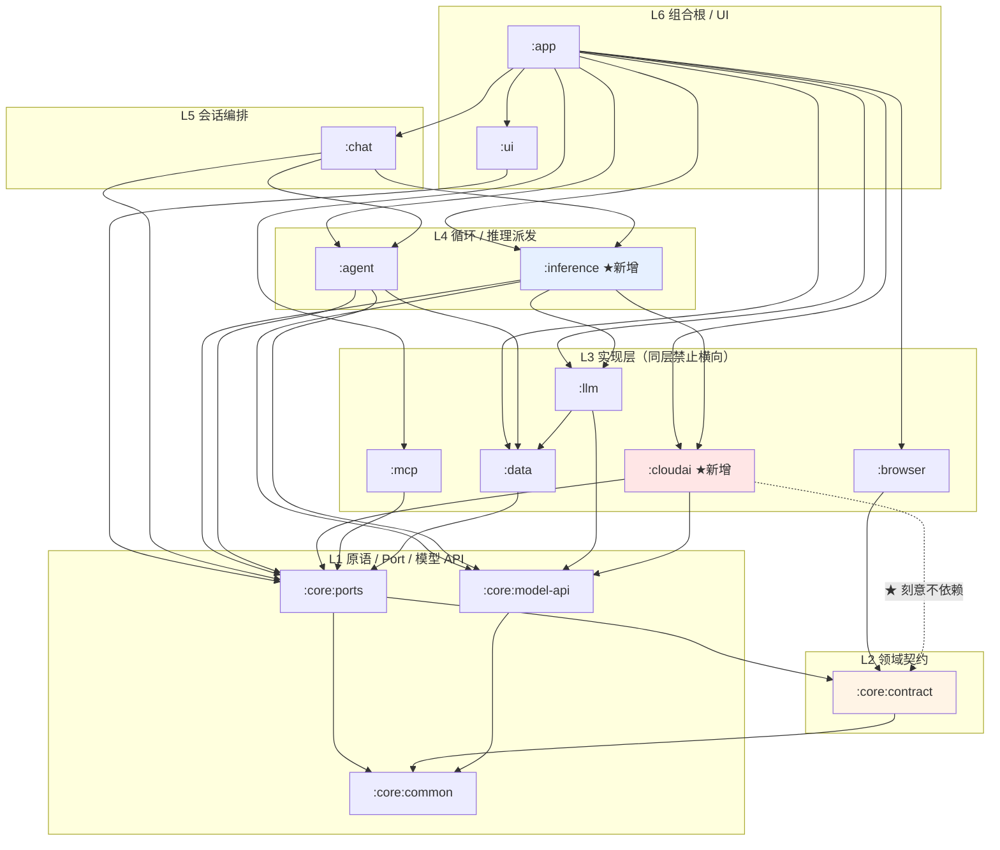

# 《本地端 GUI Agent》· 用户自选云端模型架构设计

> 撰写：顾图南（Silas Frame）· CVE 阿客实验室研发部
> 主理人：岑执衡　调度对象：霍承钧（backend-architect）／邝随行（mobile-app-builder）／苏映棠（frontend-developer）／宋砚秋（database-optimizer）／关千锤（release-gatekeeper）
> 上游：`docs/01-architecture.md`（模块与分层）／`docs/05-chat-agents-design.md` §6（端云协同）／`docs/06-chat-database.md`（表结构）
> **本文只产出设计，不含实现代码本体。** 给到签名级与关键伪码。
> 本轮**不改任何 `.kt` / `.gradle.kts`**；`docs/01` 与 `docs/05` 不覆写。

---

## 0. 阅读须知：核实结论与对任务转述的修正

按项目纪律，先列**以代码为准**核实到的东西，以及**与任务转述不一致**的三处。不一致处请主理人确认，后面所有设计都建立在修正后的事实上。

### 0.1 已核实（属实）

| # | 转述 | 核实结果 |
|---|---|---|
| 1 | `ChatEgress` 三个类；`LocalOnlyRoutingPort.decide()` 硬返回 LOCAL_ONLY | ✅ 属实（`chat/.../egress/ChatEgress.kt` L120-139） |
| 2 | `LocalOnlyEgressGate.screen()` 第一行就 deny，**从未真正放行过一次** | ✅ 属实。更强的说法：`ChatEgress.attempt()` L57 在 `decision.target != CLOUD_ASSISTED` 时**直接 return**，所以 `gate.screen()` 与懒构造的 `payload` lambda **一次都不会被调用** —— 连"构造了但没发出去"的中间态都不存在 |
| 3 | `PocketDom` 在类型上不是 `OutboundPayload` | ✅ 属实。`PocketDom` 在 `:core:contract/Dom.kt` L92；`OutboundPayload` 是 `:core:ports/Chat.kt` L901 的 sealed interface，只有三个 D2 变体 |
| 4 | `route_decision` 表已存在，`egressGateVerdict` 恒 null | ✅ 属实（`RouteDecisionSink.record` 传 `egressGateVerdict = null`） |
| 5 | 12 个 Gradle 模块、六层依赖铁律由 `checkModuleDependencies` 守 | ✅ 属实（`settings.gradle.kts` 12 个 include；根 `build.gradle.kts` L48-102 白名单 + 源码 import 黑名单） |
| 6 | 端侧 token 预算按 memoryTier 夹 4096/8192/16384 | ✅ 属实（`EngineTokenBudget.ceilingFor`） |
| 7 | `ChatEgress.decide()` 先 decision 后 audit，中间崩了没审计 | ✅ 属实（L44-48：`decide()` → `audit.record()` → `return`，三步无事务） |

### 0.2 ★★ 三处与转述不一致（请主理人确认）

#### 不一致 A：**Keystore 封装不是零，是已经有了**

转述说"凭证存储设施为零，没有任何 API Key 落点、没有 Keystore 封装"。**不准确。**

代码里已经有两件：

```kotlin
// :core:common/src/main/java/com/ake/core/common/RedactionGate.kt L18
public interface FieldCipher {
    /** @param aad 附加认证数据。建议传 taskId value 的字节，可防止密文被跨行搬移。 */
    public fun seal(plain: ByteArray, aad: ByteArray? = null): ByteArray
    /** 解密失败返回 null（密钥已被销毁时必然走到这条路径） */
    public fun open(blob: ByteArray, aad: ByteArray? = null): ByteArray?
}
public object SecretEnvelope { VERSION=1; IV_LEN=12; TAG_BITS=128; ... }   // L26
```

```kotlin
// :app/src/main/java/com/ake/app/security/AndroidKeystoreFieldCipher.kt
// AndroidKeyStore + AES-256-GCM + setRandomizedEncryptionRequired + setIsStrongBoxBacked
// alias = "ake.trace.dek.v1"
// 已由 :app/di/PlatformModule.kt L35 @Binds 到 FieldCipher
```

⇒ **修正后的真问题是**：缺的不是"加密设施"，而是三件别的东西 ——
① 凭证的**生命周期 Port**（增删改查 + 枚举 + 与端点配置绑定）；
② 一个**结构上不可能被 log 出来的返回类型**；
③ 与 `WipePort` 的接线（凭证必须在一键清除里被删，且是"先删密钥"那一档）。
**本文 §5 设计的就是这个增量，不重复造 `FieldCipher`。**

#### 不一致 B：**Hosts.kt 现在是"两个文件、一份实现"，不是五份**

转述说"host 归一化有 5 份不等价实现，最终下沉到 `:core:common/Hosts.kt` 唯一实现"。**后半句属实，前半句是历史状态。**

```
core/common/src/main/java/com/ake/core/common/Hosts.kt   87 行  ← 唯一实现
browser/src/main/java/com/ake/browser/Hosts.kt           58 行  ← 转发壳（注释占 55 行）
```

`com.ake.browser.Hosts` 现在是 `import com.ake.core.common.Hosts as SharedHosts` + 一行转发，管道一个字符都不重算。且已经有一条**机械盯住份数**的测试：`browser/.../HostNormalisationTest.kt` 扫全仓 `src/main`，断言"含归一化管道（指标：去 `www.` 前缀那一步）的文件 `containsExactly` 地只剩 1 个"。

⇒ **这件事对本文的方法论价值极大**：它是本仓库唯一一条已经做到"靠结构不靠纪律"的先例，且给出了可复制的三件套形态 —— **唯一实现 + 转发清单 + 扫全仓断言份数**。§4/§5/§6/§8 的四道锁全部照抄这个形态。

#### 不一致 C：**`egressGateVerdict` 有两套互不相认的常量**

```
// :data .../db/entity/ChatEntities.kt L497-498
const val EGRESS_PASS: String = "PASS"
const val EGRESS_BLOCKED: String = "BLOCKED"

// :chat .../egress/ChatEgress.kt L98-99
public const val VERDICT_SCREENED: String = "SCREENED"
public const val VERDICT_GATE_DENIED: String = "GATE_DENIED"
```

MVP 下两边都没被写到库里（恒 null）所以没爆。**一旦上云，`ChatEgress` 会往库里写一个 `route_decision` DAO 层与前端统计都不认识的枚举值** —— 这正是"两份等价实现"的翻版，只是这次是常量。⇒ §6.4 收敛成一份，且同样用"扫全仓断言"盯住。

### 0.3 另外三条影响设计的既有事实

| # | 事实 | 出处 | 对本文的影响 |
|---|---|---|---|
| D1 | `:core:model-api` **刻意不依赖** `:core:contract`（"model-api 对 PocketDom/TaskRecord 一无所知"） | `core/model-api/build.gradle.kts` L4-7 | ★ 这是 §4 的 **DOM 锁 B** 能成立的根本前提：可以让某个模块**只**依赖 model-api 而拿不到 contract，于是 `PocketDom` 在它的编译类路径上根本不存在 |
| D2 | `ktor-client-core` / `ktor-client-okhttp` / `kotlinx-serialization-json` **已在依赖图里**（ktor 3.5.1），`:mcp` 与 `:app` 都在用；`ktor-client-plugins-sse` 坐标不存在（一号红线），**SSE 客户端插件在 `ktor-client-core` 内** | `gradle/libs.versions.toml` + `mcp/build.gradle.kts` L32-36 | ★ 云适配器可做到**零新增第三方坐标** ⇒ APK 体积增量 ≈ 0（只有我们自己的代码）。红线 2（禁官方 SDK）不只"应该"，而且"不需要" |
| D3 | debug APK 实测 **95.62 MB**（不是 60 MB） | `docs/07-device-verify-run-2026-10-28.md` M2 | 红线 2 的约束比预估更紧 |
| D4 | `:core:ports` 自述 L1 但依赖 `:core:contract`（自述 L2），二者不可能同层 | `settings.gradle.kts` L62-63 自述遗留疑问 | 本文**不依赖层号**，只依赖依赖边（与 `settings.gradle.kts` L59-61 的立场一致）。层号只在描述时当路标 |
| D5 | Room 当前 `user_version = 3`、20 张表 | `docs/07` M5 | §6 加列 ⇒ v4 迁移 |

---

## 1. 目标、非目标、两条红线的落地判据

### 1.1 在范围内

用户自填 `BaseURL + Key + 模型名`，一个 OpenAI 兼容适配器覆盖 DeepSeek / 通义 / Kimi / 智谱 / OpenAI / 自建网关。纯对话可走云。

### 1.2 明确不在范围内（写死，防止范围 creep）

- 各家官方 SDK（红线 2）
- 账号体系、订阅计费、云端编排、模板市场（`docs/05` §6.6 已标【纯设计】，且与 `docs/01` §10.2 冲突）
- 云端**工具调用**（`tools` 字段）：见 §2.6 —— 这是兼容性最差的一块，且我们有 `automaticToolCalling=false` 的既有铁律
- 云端多模态、云端 embeddings、云端文件上传
- 端云任务迁移（`CheckpointEnvelope` 仍是【预留接口】）

### 1.3 两条红线 → 可验收的判据

| 红线 | 判据（必须能被外部工具验证，见 §8） |
|---|---|
| **① 聊天可上云，浏览器任务锁死本地** | 在云端为会话目标时执行一次 `builtin.browser_task`，**mitmproxy 抓包不得出现任何一条到用户所填 BaseURL 的连接**；同时任务必须仍被端侧完成（证明不是"功能坏了所以没请求"） |
| **② 只做 OpenAI 兼容单适配器** | `:cloudai` 的 `build.gradle.kts` 里**不得出现任何非 `libs.ktor.*` / `libs.kotlinx.serialization.json` / `libs.coroutines.*` 的外部坐标**；`./gradlew :app:dependencies` 不得新增坐标行 |

红线 ① 的**实现方式**必须是类型级/结构级（主理人已定，不再讨论是否）。§4 给出四道锁，并诚实标注哪一道不是编译期的。

---

## 2. 【问题 1】`ModelPort` 契约：改契约还是加一层

### 2.1 裁决

> **不改 `ModelPort` 本体的一行，不搞"大契约替换"。**
> **加的是：一个能力描述对象 + 两个窄子接口 + 一个装配在 L4 的 Router。**
> **`LiteRtModelPort` 本体的改动量 = 1 行（加一个 `implements`）。**

### 2.2 为什么不改契约（三条理由）

1. **改签名 = 红别人的 CI，本仓库已经为此付过一次学费。**
   `ModelSession.generateStream` 当初加的是**默认实现**而不是抽象方法，注释写得很清楚："契约升级不该以别人的红 CI 为代价"（`Model.kt` L190-196）。这条纪律对本次同样适用。
2. **`:agent` / `:chat` 的测试夹具里已有三个 `FakeModelPort`**（`:chat` 的 `ChatFixtures`，`:agent` 的 `LoopFixtures`）。任何新增抽象方法都会让**不在本模块、也不该由本模块改**的文件当场编译失败。
3. **我们要表达的差异是"能力不同"，不是"行为不同"。**
   云端与端侧在行为上是同构的（开会话 → 生成 → 流 → 关闭）；真正不同的是**能做什么、代价模型是什么**。能力差异用**数据**表达（`ModelCapabilities`）比用**方法签名**表达更轻，也更难被误用 —— 因为数据是"被读取后做判定"，而签名差异会逼着调用方写 `if (port is CloudPort)`。

### 2.3 被否决的备选

| 备选 | 否决理由 |
|---|---|
| **A. 把 `ModelPort` 拆成 `LocalModelPort` / `RemoteModelPort` 两个互不相关的接口，上层自己判** | 会把"判"这件事推给每个调用点 ⇒ 第二份 Hosts.kt。而且 `ChatLoop` 需要一个**统一**的对话入口，否则它要写两遍流式/取消/错误处理 |
| **B. 给 `ModelPort` 加 `isRemote: Boolean`** | ★ 这正是主理人明令禁止的形态。boolean 配置项的结局必然是"某个调用点忘了判"，而它**没有任何编译期信号** |
| **C. 给 `ModelLoadConfig` 加 `endpoint` / `apiKey` 字段，让 `load()` 同时覆盖两种** | `ModelLoadConfig.path` 的契约是"设备文件系统上的绝对路径（官方明示 never in assets/APK）"。塞一个 URL 进去会让这个字段同时有两种语义，而 `LiteRtModelPort.load()` 里那套"同模型同档位就复用 Engine"的判断会开始误判。**语义混在一个字段里 = 必然有人读错** |
| **D. 云端不走 `ModelPort`，单独一套 `CloudChatPort`，`:chat` 里两套代码** | `:chat` 会出现两条并行的流式/取消/落盘/审计路径。本项目已经因为"两条预算算法"吃过一次（`settings.gradle.kts` L51-54 的理由 2），不重蹈 |

### 2.4 最终形状（签名）

```kotlin
// ══════════════════════════════════════════════════════════════════════
// :core:model-api —— 全部为**新增**，既有类型一字不改
// ══════════════════════════════════════════════════════════════════════

/** 推理发生在哪里。★ 它是 enum 而不是 Boolean：将来可能出现「本机局域网自托管」第三态。 */
public enum class Locality { DEVICE, REMOTE }

/**
 * ★ 上下文上限。**刻意是 sealed 而不是 Int**。
 *
 * 两种上限的**失效方式完全不同**，合成一个 Int 必然有人拿错：
 *  · KvCache  —— 硬上限。超了是 native 层 OOM/abort，**进程直接消失，没有 Outcome 可返回**
 *               （`EngineTokenBudget.kt` L14 的原话）
 *  · Declared —— 软上限。超了是 HTTP 400 `context_length_exceeded`，可预期、可压缩后重试
 */
public sealed interface ContextLimit {
    public val tokens: Int
    /** 端侧：input + output 的 KV cache 总上限（不是输出上限） */
    public data class KvCache(override val tokens: Int) : ContextLimit
    /** 云端：用户声明的窗口。**超过不会崩，只会 400** */
    public data class Declared(override val tokens: Int, val source: DeclaredSource) : ContextLimit
}
public enum class DeclaredSource { USER_INPUT, SERVER_REPORTED, DEFAULT }

public enum class StreamingCapability { NONE, WHOLE_TEXT, INCREMENTAL }

/**
 * ★ 复水语义 —— 这是端侧与云端**代价模型相反**的地方，必须在契约里显式化。
 *  · PREFILL_ONCE  端侧：initialMessages 在 openSession 时灌一次建 KV，之后每轮只付增量
 *                  （`SessionSpec.initialMessages` 的注释：端侧 32 轮约 40k token 冷启差 72 秒）
 *  · REPLAY_EACH_TURN 云端：每次 generate 都要把 system + initialMessages + 本轮全量重放
 *                  ⇒ **历史越长，每一轮出境的字节越多**（这是 §3 预算与 §6 审计的共同输入）
 */
public enum class RehydrationMode { PREFILL_ONCE, REPLAY_EACH_TURN }

public enum class JsonConstraintMode { NONE, JSON_OBJECT, JSON_SCHEMA }
public enum class SystemRoleMode { SEPARATE_FIELD, IN_MESSAGES }
public enum class SamplerParam { TEMPERATURE, TOP_P, TOP_K, SEED }

/** token 从哪来。★ 没有它，"8192" 这个数字的真假无法判断。 */
public enum class UsageAccounting { EXACT, ESTIMATED, NONE }

public data class ModelCapabilities(
    val locality: Locality,
    val contextLimit: ContextLimit,
    val streaming: StreamingCapability,
    val rehydration: RehydrationMode,
    val jsonConstraint: JsonConstraintMode,
    val systemRole: SystemRoleMode,
    val acceptedSamplers: Set<SamplerParam>,
    val usage: UsageAccounting,
    val toolCalls: Boolean,               // ★ 本项目恒 false，见 §2.6
)

/**
 * ★ 加在 `ModelPort` 上的**唯一**新增成员，且带默认实现 ⇒ 既有实现零改动。
 * Kotlin 接口允许属性带默认 getter。
 */
public interface ModelPort {
    // … 既有五个成员一字不改 …
    public val capabilities: ModelCapabilities
        get() = ModelCapabilities.DEVICE_DEFAULT   // = device + KvCache(8192) + PREFILL_ONCE …
}
```

```kotlin
// ══════════════════════════════════════════════════════════════════════
// 两个窄子接口
// ══════════════════════════════════════════════════════════════════════

/**
 * ★★ 「会接触 DOM 的推理」的**唯一**入口类型。
 *
 * 它刻意是**空接口 + 文档**，不加任何方法 —— 加方法反而会给云端实现提供"照着实现一遍"的模板。
 * 它的全部意义是：**让 `AgentLoop` 的形参类型无法被云端适配器满足**（§4 锁 A）。
 */
public interface DeviceModelPort : ModelPort

/**
 * 纯对话入口。**本地与云端共用这一个形状** —— `:chat` 只认它，不认具体实现。
 */
public interface DialogModelPort : ModelPort {
    /**
     * ★ `permit` 是**形参**，不是 `SessionSpec` 里的可选字段。
     *
     * 这个差别是刻意设计的：可选字段会被"顺手传 null"绕过，
     * 而**必填形参**意味着「想开一次云端对话，手上必须先有一条已落库的审计行」（§6）。
     * 本地实现（LocalDialogAdapter）忽略它 —— 但**签名上它仍然必须在场**，
     * 于是"本地路径"与"云端路径"在调用点上长得一模一样，差别只在那一行审计。
     *
     * @param permit null ⇒ 本次走设备内推理；非 null ⇒ 允许出云（且允许的次数/端点由它钉死）
     */
    public suspend fun openDialog(spec: SessionSpec, permit: EgressPermit?): Outcome<ModelSession>
}
```

```kotlin
// :llm —— LiteRtModelPort 的唯一改动
public class LiteRtModelPort @Inject constructor(...) : ModelPort, DeviceModelPort { … }
//                                                                 ^^^^^^^^^^^^^^^ 就这一处
```

```kotlin
// :inference —— 本地对话适配器（把端侧引擎"升格"成对话入口）
public class LocalDialogAdapter(private val device: DeviceModelPort) : DialogModelPort {
    override val capabilities: ModelCapabilities get() = device.capabilities
    override suspend fun openDialog(spec: SessionSpec, permit: EgressPermit?): Outcome<ModelSession> =
        device.openSession(spec)   // permit 被忽略：本地不需要出境许可；签名仍在场以保持一致
    override fun estimateTokens(text: String): Int = device.estimateTokens(text)
    // … 其余转发 …
}
```

⇒ **净效果**：`LiteRtModelPort` 本体 1 行；`FakeModelPort` × 3 零改动；`:agent` 的 `AgentLoop` 形参从 `ModelPort` 改成 `DeviceModelPort`（1 行）；`:chat` 的 `ChatLoop` 从 `model.openSession(spec)` 改成 `dialog.openDialog(spec, permit)`（1 行 + permit 的取得）。

### 2.5 streaming 语义（三条既有语义如何映射到 SSE）

`ModelSession.generateStream` 的三条语义（`Model.kt` L198-210）**一字不改**，云端实现必须逐条满足：

| # | 既有语义 | 云端的实现责任 |
|---|---|---|
| 1 | `onDelta` 的协程上下文 = 调用方的 | SSE 读循环跑在 ktor 的 IO dispatcher 上，实现**必须**经 `channelFlow` / `callbackFlow` 搬回调用方上下文再调 `onDelta` |
| 2 | 入参是**新增的那一段**，空片段不投 | 每个 `choices[0].delta.content` 非 null 且非空 ⇒ 一次 `onDelta`。**首个 chunk 只有 `delta.role="assistant"` 而无 content ⇒ 不投** |
| 3 | 跨 chunk special token 清洗不在这里做 | 同上（`:chat` 的 `DeltaScrubber` 是唯一那一层）。云端**额外**要处理的是 UTF-8 多字节字符被 chunk 边界切断 ⇒ 必须做**字节级**缓冲（不是字符级），否则中文会乱码 |

**取消语义**：`CancellationException` 原样透传，不包成 `Outcome.Err`。云端实现必须**真正关闭响应体并取消协程**（断开 TCP ⇒ 服务端停止生成），而不是只停止收集 —— 只停收集会留下一个后台还在烧钱、还在把用户文本留在服务端缓冲里的请求。

**★ 自写 SSE 行解析，不用 ktor 的 SSE 插件。** 三条理由：

1. 各家的"兼容"是**表层**的（2026-08 的跨厂商实测结论）：部分网关在 `data: [DONE]` 前会多发一个空的 `data: {}` chunk；Kimi 会返回 OpenAI 枚举外的 `finish_reason`；部分厂商在负载高时直接返回 **HTML 错误页**。插件对这三种情况的默认行为不可控。
2. `stream_options: {"include_usage": true}` 的最后一个 chunk 满足 `choices: []` ⇒ 任何"取 `choices[0]`"的写法都会 IndexOutOfBounds。**只有自己写解析器才能把"usage chunk"和"空 chunk"和"错误页"三条路径分干净**（见 §3 的 `SseEvent` sealed）。
3. **可测性**：自写的解析器吃的是 `ByteArray`/行序列 ⇒ JVM 单测里可以用 fixture 字节流跑毫秒级，覆盖上面每一种畸形。真机跑 20 分钟才看得出的 bug，正是 `docs/07` 警告过的东西。

```kotlin
// :cloudai —— 唯一一份 SSE/协议解析（★ 全仓只有这一个实现，见 §8 的份数断言）
internal sealed interface SseEvent {
    data class Delta(val text: String) : SseEvent
    data class Finish(val reasonRaw: String?) : SseEvent          // ★ 存原文，不映射到 enum
    data class Usage(val promptTokens: Int?, val completionTokens: Int?) : SseEvent
    data object EmptyChunk : SseEvent                             // 部分网关在 DONE 前的空 chunk
    data object Done : SseEvent
    data class Malformed(val shape: String) : SseEvent
}
```

### 2.6 云端**不发 `tools` 字段**（一条重要决策）

- 既有铁律 `automaticToolCalling = false`（`LiteRtModelPort` L264 注释：它会绕过 `PolicyPort` 且不产生 trace）。云端沿用 ⇒ **工具的解析与执行永远在我们手里**。
- 跨厂商实测结论：**tool calling 是"兼容"最容易碎的一块** —— DashScope 默认串行、SiliconFlow 部分模型直接忽略 `tool_choice`、函数名含点号会被拒。
- 我们的 Router 本来就用自己的 `OutputShape.JsonSchema(schema)`（见 `ChatLoop` L503-505 的注释），模型只吐 JSON 文本，解析在端侧。
- ⇒ **`ModelCapabilities.toolCalls` 恒 `false`，且云端适配器构造请求时 `tools` 字段一律省略。** 这既保住铁律，也一次性绕开了兼容性最差的一整块。

同理 **`response_format`**：只用 `{"type":"json_object"}` 兜底档（各厂商一致支持），**不用 `json_schema`**（Kimi 部分版本不支持、SiliconFlow 开源模型不支持）。schema 的严格性由端侧 `StepActionParser` 的容错通道保证 —— 这与端侧"schema 不被支持时降级为 false"的处理完全一致（`SessionSpec.enableJsonConstraint` 注释）。

### 2.7 `SessionSpec.initialMessages` 在云端如何等价表达

**这是本次最需要小心的一处，因为两端的代价模型相反。**

| | 端侧（PREFILL_ONCE） | 云端（REPLAY_EACH_TURN） |
|---|---|---|
| `systemInstruction` | `ConversationConfig.systemInstruction` 独立字段，建会话时固定 | 映射成 `messages[0] = {role: system}`（或 `developer`，按 `capabilities.systemRole`） |
| `initialMessages` | 建会话时**一次性**灌回引擎做 prefill，之后 KV 复用 | **每一轮都要全量重放进 messages 数组** |
| 本轮 `userTurn` | 增量 prefill | 追加在 messages 末尾 |
| 成本 | 付一次 | **每轮付一次全量** |

⇒ **唯一映射函数（全仓一份）**：

```kotlin
// :cloudai —— ★ 唯一的 messages 组装实现
public object ChatCompletionsMessages {
    /**
     * @param system      SessionSpec.systemInstruction
     * @param history     SessionSpec.initialMessages（仅此一处来源）
     * @param currentTurn GenerationRequest.userTurn
     *
     * ★★ 入参只有这三个。**没有任何一个参数能携带 DOM / 网页原文**（§4 锁 D）。
     *
     * 三条必须做的归一化（漏一条就是一条真实故障）：
     *  ① 连续同角色合并：部分网关严格要求 user/assistant 严格交替，
     *     连续两条 user 会被 400 拒。合并用 "\n" 连接。
     *  ② 空 text 丢弃：role 存在但 content 为空串的消息，多数网关会 400。
     *  ③ 首条必须是 system 或 user：若 system 为空而首条是 assistant ⇒ 丢弃该 assistant 轮。
     */
    public fun of(
        system: String?,
        history: List<ConversationTurn>,
        currentTurn: String,
    ): List<OutboundMessage>

    /** ★ 出口只有这两个形状。**没有第三个变体能装别的东西**。 */
    public sealed interface OutboundMessage {
        public data class System(val text: String) : OutboundMessage
        public data class Turn(val role: TurnRole, val text: String) : OutboundMessage
    }
}
```

`TurnRole` 复用既有的 `USER / MODEL`（`Model.kt` L108，注释明写"与 chat template 的两个角色一一对应，没有 SYSTEM"），映射 `MODEL → "assistant"`。

### 2.8 端侧 token 预算与云端 context window 如何统一表达

**不统一成一个数字 —— 统一成一个"取哪个"的判定，且判定只有一份。**

```kotlin
// :inference
public object EffectiveWindow {
    /**
     * @param local 端侧档位上限（4096/8192/16384，来自 DeviceHealthPort.memoryTier）
     * @param cloud 用户声明的云端窗口（默认 8192，夹到 [2048, 131072]）
     *
     * ★ 返回的是**组装 prompt 时用的那个数**，不是"模型能力"。
     *   判据：云端的 context 不占设备内存 ⇒ 不受端侧档位夹；
     *   但**重放体积**（每轮出境字节）受端侧 UI/落盘/流量约束 ⇒ 有一个独立上限。
     */
    public fun forPrompt(target: DialogTarget, local: Int, cloud: Int): Int
    /** ★ 每轮最大重放 token（云端独有）。超过 ⇒ 触发 DeterministicCompactor 压缩历史再发。 */
    public fun maxReplayTokens(target: DialogTarget, declared: Int): Int
}
```

三条必须写死的语义：

1. **`ContextLimit.KvCache` 永远不能来自用户输入。** 用户填的 32768 在端侧会被夹到档位上限并记 warning（`EngineTokenBudget.plan` 已实现）；在云端它是**软的** —— 超了是 400 而不是 OOM。**把这两个数混用是本次最容易出的 P0。**
2. **云端每轮重放有硬顶**（默认 4096 token，用户可调，硬顶 16384）。超过 ⇒ 复用 `:agent` 的 `DeterministicCompactor` 压一轮再发。理由：不设顶的话，一个 60 轮的会话每轮都会把几十 KB 原文送出去 —— 用户设置了"用云端"不等于同意"每轮把整段历史再发一遍"。
3. **估算 vs 真值分开。** `ModelPort.estimateTokens` 的契约是"必须快、禁止跑模型"（`Model.kt` L171-176）。云端不能问服务端 ⇒ 仍用本地 `TokenEstimator`，但对云端**乘一个保守系数 1.15**（各家 tokenizer 与中英混排差异）。服务端 `usage.prompt_tokens` 回来后用真值校准并写进审计。`InferenceStats` 增加：

```kotlin
public data class InferenceStats(
    val prefillTokens: Int, val decodeTokens: Int,
    val ttftMs: Int, val decodeTps: Double,
    val tokenSource: TokenSource = TokenSource.ESTIMATED,   // ★ 新增，有默认值
)
public enum class TokenSource { ESTIMATED, REPORTED }
```

---

## 3. 【问题 2】"切换"的粒度

### 3.1 裁决

> **会话级（session-level）。会话创建时选定目标，会话内不可变。**
> **全局默认只决定新会话的初值。**
> **不做单轮临时切换。**

### 3.2 理由（核心是"历史形态不一致"）

中途切换已有会话时，两端的**历史载体**根本不是一种东西：

```
端侧：历史活在 LiteRT Conversation 的 KV cache 里（字节级的注意力状态）
云端：历史活在 messages 数组的 JSON 文本里（每次全量重放）
```

⇒ 一次中途切换意味着：① 把端侧 KV 丢弃；② 把"压缩后的历史"（`DeterministicCompactor` 的产物，形状是 `#3 click([12]销量)→ok [dom+18]`）**整段出境重放一次**。
这不只是慢 —— 它是**一次用户没有预期的大体积出境**，而且发生在"我只是换了个模型"这个动作之下。

另外两条：
- **审计粒度**：单轮临时会让"这一轮有没有出境"变成运行时状态，`ChatEvent` 与 UI 徽标都要跟着运行时判；会话级则让"这个会话是云的"成为一个**可以一次读出来、一次显示、一次审计**的事实。
- **`enterFlight` 并发保护**：既有实现按 session 拒绝并发轮次（`ChatTerminalReason.IN_FLIGHT`）。会话级目标不会与它冲突；单轮临时会让"这一轮的目标"需要在飞行中被读取，多一个可变状态。

### 3.3 中途切换怎么办（用户真的想换）

**换 = 开一个新会话。** 旧会话保留、只读、可回溯。`chat_session` 加一列 `model_target`（`LOCAL` / `CLOUD:<credentialRef>`）与 `model_label`。UI 明示：

> 「切换模型会开启一个新会话，原会话保留。这个会话里的对话不会自动带过去 —— 你需要在新会话里重新说一遍。」

这句话必须说，因为不说用户会以为"切了模型，前面聊的还在"（端侧切人格尚且要重灌 KV，跨端云更不可能）。

### 3.4 代价（诚实列出）

| 代价 | 说明 |
|---|---|
| 用户不能"就这一句用云端" | 想要 ⇒ 开新会话。这是一次点击 + 一句重述 |
| 切换有冷启成本 | 端侧切回本地要重建 Engine（秒级，`LiteRtModelPort.lastEngineBuildMs` 就是为这个场景留的） |
| 会话列表会变多 | 「同一个话题、两个模型」会出现两条会话 |

### 3.5 被否决的备选

| 备选 | 否决理由 |
|---|---|
| **全局默认** | 缺点不是性能而是**默认姿势**：一旦默认是云，绝大多数会话默认出境，而 `docs/05` §6.2 裁决 1 要求"三件事同时成立才上云"（设置开启 + 本次允许 + gate 通过）。全局默认会把"本次允许"这一条稀释掉 |
| **单轮临时** | 见 §3.2。额外一点：单轮临时会让 `route_decision` 出现"同一会话内 target 反复横跳"的行，事后无法回答"这个会话到底有没有出过境" |
| **消息级（一条消息一个目标）** | 等于把出境粒度碎到不可审计 ⇒ 直接否 |

### 3.6 一个受控的例外（可选，非必须）

允许会话级设置里开「**每轮询问**」（`perTurnConfirm = true`）：目标仍是会话级的，但每一轮出境前弹一次确认（复用既有的 `HumanGate`）。这不破坏粒度 —— 目标没变，只是把"本次允许"从会话级降到了轮次级，且**每一次都有独立的 permit 与审计行**。

---

## 4. 【问题 3】`ModelRouter` 门面：派发者、层次、失败降级

### 4.1 谁派发、放哪一层

```kotlin
// :core:model-api（与 ModelPort 同层，因为 :chat 与 :app 都要看见它）
public interface ModelRouter {
    /**
     * 按会话选定的目标给出**一个**对话入口。
     * ★ 返回的是 DialogModelPort —— 调用方**看不出**它背后是 native 引擎还是 HTTP。
     */
    public suspend fun dialogFor(sessionId: String): Outcome<DialogModelPort>
}

// :core:ports（Chat.kt 新增）—— 目标的领域表达
public sealed interface DialogTarget {
    public data object Device : DialogTarget
    /** ★ credentialRef 而不是 key：目标里**装不下**密钥（§5） */
    public data class Remote(val credentialRef: CredentialRef) : DialogTarget
}
```

**实现放新增的 `:inference`（L4）。** 为什么不能放别处：

| 候选位置 | 结论 |
|---|---|
| `:llm`（L3） | ❌ 它需要看见 `:cloudai` ⇒ L3 横向依赖，铁律禁止 |
| `:cloudai`（L3） | ❌ 它需要看见 `:llm` ⇒ 同上 |
| `:chat`（L5） | ❌ 它需要看见两个 L3 的实现类 ⇒ 要新开 `:chat → :llm` / `:chat → :cloudai` 两条边，而 `:chat` 目前刻意**一条 L3 边都没有**（连 `:data` 都没有，见 `chat/build.gradle.kts` 的"刻意没有的东西"）。为了 Router 破坏它不值 |
| `:app`（L6 组合根） | ⚠️ 合法但不对：Router 有真实的策略逻辑（目标选择、失败分相、重放上限），放进组合根等于把业务逻辑塞进装配层，半年后它会有 800 行 |
| **`:inference`（新 L4）** | ✅ 向下依赖两个 L3（与既有的 `:agent → :data`、`:chat → :agent` 同向同构）；纯 JVM 模块 ⇒ 派发/分相/重试逻辑可毫秒级单测 |

### 4.2 ★★ 失败降级裁决：**你的怀疑是对的，禁止静默回落**

> **裁决：云端失败时禁止"静默回落本地"。**
> 分界线不是错误类型，而是**字节有没有发出去**。

理由（三条，按严重性）：

1. **用户心智模型被破坏。** 用户看到的终态是"本地完成了"。如果字节已经出境，这句话是假的 —— 而且**用户没有任何办法发现它是假的**。这比"云端失败了报错"糟糕一个数量级：前者是一个无法被察觉的隐私事件，后者只是一次功能失败。
2. **它会腐蚀审计。** 静默回落会产生一条 `decided=CLOUD_ASSISTED`、用户却以为没出境的 `route_decision` 行。半年后有人查"为什么这张表有云记录但用户说没用过云"，**没有任何数据能回答** —— 因为"用户是否被诚实告知"这件事没有被记录在任何地方。
3. **`docs/05` §6.2 裁决 4 那句话（"云不可用时自动降级 LOCAL"）是在"云 = 我们自己的服务"这个前提下的。** 现在的前提变了：云是**用户自己填的第三方端点**，我们也不知道它把数据留了多久。前提变了，结论必须跟着变。这条是对上游文档的一处**显式修正**，请主理人确认。

### 4.3 二分法：`EgressPhase`

```kotlin
// :core:ports（Chat.kt 新增）
public enum class EgressPhase {
    /** ★ 一个字节都没发出去。用户"数据还在本地"的认知是**真的**。 */
    PRE,
    /** ★ 请求体已经发出（哪怕服务端一个 token 都没回）。数据**已经出境**。 */
    POST,
}
```

**判据（写死，不得凭直觉）：**

```
PRE  = DNS 失败 | 连接超时 | TLS 握手失败 | 401 | 403 | 407
POST = 请求体已写完 ⇒ 其后的任何失败：
       首字节超时 | 流空闲超时 | 4xx(非401/403) | 5xx | 流截断 | 空 delta | 乱入 HTML 错误页
```

★ **最容易搞错的一点**：**"首字节超时"是 POST，不是 PRE。** 请求体早就发完了，服务端只是没开始吐字。很多人会本能地把它当"没连上"而回落本地 —— 那一刻用户的整段历史已经在对方的服务器上了。

### 4.4 精确语义表（这是要照着写代码的那一节）

超时三段（必须分开配置，因为归属的 phase 不同）：

| 超时 | 建议值 | phase | 说明 |
|---|---|---|---|
| `connectTimeoutMillis` | 8 s | PRE | 含 DNS 与 TCP |
| TLS 握手 | 含在 connect 内 | PRE | |
| `firstByteTimeoutMs` | 15 s | **POST** | 请求体写完到收到第一个 SSE 字节 |
| `streamIdleTimeoutMs` | 30 s | POST | 流中两个 chunk 之间的最大间隔 |
| 总 `deadlineMs` | 来自 `GenerationRequest.deadlineMs` | POST | 契约已定"超时由调用方管理，引擎不自行判断" |

| 情形 | phase | 自动重试 | **允许自动回落本地？** | 必须告知用户 | 审计 |
|---|---|---|---|---|---|
| DNS 失败 / 连接超时 / TLS 失败 | PRE | 1 次（同一端点） | ✅ **允许** | ✅ 必须：「未上云，已由本机完成」 | `outcome=NOT_SENT` |
| HTTP 401 / 403 | PRE | 0 | ✅ 允许 | ✅ 必须：「凭证被服务端拒绝」+ 引导去设置 | `outcome=NOT_SENT` |
| HTTP 407（代理） | PRE | 0 | ✅ 允许 | ✅ 必须 | `outcome=NOT_SENT` |
| HTTP 404 / `model_not_found` | **POST** | 0 | ❌ **禁止** | ✅ 必须：「模型名不存在」+ 引导改模型名 | `outcome=FAILED`，`finish_reason_raw` 记服务端原文 |
| HTTP 400 `context_length_exceeded` | **POST** | 0（先压缩再让用户决定） | ❌ 禁止 | ✅ 必须：「云端窗口不足」+ 提供"压缩后重试"/"换本地"两个按钮 | `outcome=FAILED` |
| HTTP 429 | **POST** | ≤ 2，尊重 `Retry-After` | ❌ 禁止 | ✅ 必须 | ★ **每次重试都是一个独立的出境 ⇒ 每次都要新 permit + 新审计行**（`retry_of` 指向上一行） |
| HTTP 5xx | **POST** | ≤ 1 | ❌ 禁止 | ✅ 必须：「云端返回错误，这段文字已发给 X」 | `outcome=FAILED` |
| 首字节超时 | **POST** | 0 | ❌ 禁止 | ✅ 必须 | `outcome=FAILED`（**不能**标 NOT_SENT） |
| 流空闲超时 | **POST** | 0 | ❌ 禁止 | ✅ 必须 | `outcome=PARTIAL`（已收到的内容保留） |
| **流被截断**（无 `data: [DONE]` 就 EOF） | **POST** | 0 | ❌ 禁止 | ✅ 必须 | `outcome=PARTIAL`；已收文本照常落盘，消息状态 `ABORTED` 而非 `COMPLETE` |
| **返回空 delta**（收到 `[DONE]` 但 content 全空） | **POST** | 0 | ❌ **禁止** | ✅ 必须：「云端返回了空回复」 | `outcome=FAILED`；★ **绝不允许"云端空了就用本地补一段"** —— 那正是静默回落的变体 |
| 只收到 `usage` chunk、无 content | POST | 0 | ❌ 禁止 | 同上 | 同上 |
| 收到 HTML 错误页（非 JSON） | POST | 0 | ❌ 禁止 | ✅ 必须 | `outcome=FAILED`，记录 `content-type` 但**不记录 body** |
| 未知 `finish_reason` 取值（如 Kimi 私有值） | POST | — | — | 不需要用户侧提示 | 不报错；`finish_reason_raw` 原文落审计，映射不到枚举时按 `STOP` 处理 |
| `data: {}` 空 chunk | POST | — | — | — | `SseEvent.EmptyChunk` 忽略 |

**★ 一条总原则**：`POST` 阶段的任何失败，**UI 上必须出现一句话，其字面包含"已经发给 <归一化 host>"**。不显示这句话的失败提示等于没提示（`docs/05` §6.2 裁决 3 的原话："不显示摘要的'上云了'等于没告知"）。

### 4.5 门面的其余语义

```kotlin
// :inference
public class DefaultModelRouter(
    private val device: DeviceModelPort,          // LiteRt
    private val localDialog: DialogModelPort,     // LocalDialogAdapter(device)
    private val remote: DialogModelPort,          // OpenAiCompatibleDialogPort
    private val targets: DialogTargetStore,       // 读 chat_session.model_target
    private val creds: CloudCredentialPort,
    private val permits: EgressPermitSink,        // §6
) : ModelRouter {
    public override suspend fun dialogFor(sessionId: String): Outcome<DialogModelPort>
    // 伪码：
    //   target = targets.of(sessionId) ?: return Err(NO_TARGET)      ← 不猜，没有就报错
    //   when (target) {
    //     Device        -> Ok(localDialog)
    //     is Remote     -> if (!creds.exists(target.credentialRef)) return Err(CRED_MISSING)
    //                      else Ok(remote)      ← 注意：permit 不在这里开，见 §6
    //   }
}
```

- `ModelRouter` **不拥有降级策略**。降级判定发生在 `openDialog` 之后的生成调用里，且**只有 `:inference` 一个地方写它**（`FallbackPolicy` 对象，纯函数：`(phase, httpStatus, sseShape) -> FallbackAction`）。理由同 Hosts.kt：**判定只有一份，才会只有一份正确。**
- `ModelRouter` **不做重试**。重试在 `:cloudai` 的 HTTP 层，但**重试计数与 permit 的关系**由 `:inference` 管（每次重试都要新 permit）。

---

## 5. 【问题 4】DOM 锁死：**四道锁** + 诚实评估

> 主理人的要求：「让"浏览器任务不可能用云端模型"成为编译器能抓的错」。
> **先给结论：四道锁里，三道是编译期/构建期，第四道是运行期。**
> 「浏览器任务 ⇒ LOCAL_ONLY」这条**判定本身**，我无法做到编译期。理由与替代方案见 §4.6。

### 5.1 为什么今天这件事是"漏的"

```
:app 的 Hilt 图里只有一个 ModelPort 绑定
        ↓
  ┌─────┴──────┐
AgentLoop(:agent)   ChatLoop(:chat)
  （DOM 进 prompt）   （纯对话）
```

`AgentLoop` 与 `ChatLoop` 拿到的是**同一个 `ModelPort` 实例**。今天它只能是 LiteRT，所以没事；一旦把云端实现绑上去，**两条路径同时获得云端能力**。这就是"boolean 配置项"的根源 —— 不是有人写了 flag，而是**类型上根本没区分这两条路**。

### 5.2 锁 A（编译期）：任务侧与对话侧是**两个不同类型**

```kotlin
// :agent —— AgentLoop 形参改一个字
public class AgentLoop(
    private val model: DeviceModelPort,   // ← 原为 ModelPort
    …
)

// :cloudai —— 云端适配器**只** implements DialogModelPort
public class OpenAiCompatibleDialogPort @Inject constructor(…) : DialogModelPort { … }
```

⇒ `AgentLoop(model = cloudPort)` **编译不过**（`cloudPort` 的类型不是 `DeviceModelPort`）。
⇒ Hilt 侧：`@Binds fun bindDevice(impl: LiteRtModelPort): DeviceModelPort` 与 `@Binds fun bindDialog(impl: OpenAiCompatibleDialogPort): DialogModelPort` 是两条独立的绑定；把云端绑到 `DeviceModelPort` ⇒ **返回值类型不匹配 ⇒ 编译不过**。

**剩下的唯一漏洞**：有人去改 `OpenAiCompatibleDialogPort` 的类声明，让它 `implements DeviceModelPort`。⇒ 由锁 D 兜。

### 5.3 锁 B（构建期 · 唯一一条我能说"结构上不可能"的）：**`:cloudai` 拿不到 `PocketDom`**

```
archAllowedEdges[":cloudai"] = { ":core:common", ":core:model-api", ":core:ports" }
                                                    ★ 刻意不含 ":core:contract"
```

`PocketDom` 定义在 `:core:contract/Dom.kt`。`:cloudai` 的依赖白名单里没有 `:core:contract` ⇒ **`PocketDom` 这个符号在 `:cloudai` 的编译类路径上根本不存在**。

```kotlin
// :cloudai 里写这句 ⇒ unresolved reference ⇒ 编译失败
val dom: PocketDom = …
```

这不是"禁止 import"（那是纪律），这是**类路径上没有**（这是结构）。要破它必须改根 `build.gradle.kts` 的 `archAllowedEdges`，而那条路已经被 `checkModuleDependencies` 守死：改了要写理由、要走 PR。

再加一条**源码黑名单双保险**（与 `:llm` 那条同一手法）：

```kotlin
":cloudai" to setOf(
    "com.ake.core.contract.", "com.ake.agent.", "com.ake.browser.",
    "com.ake.data.persist.db.", "androidx.room.", "com.ake.ui.",
),
```

⇒ 即便有人先加了 Gradle 边，源码断言仍会红。**两道都要改才过得去。**

### 5.4 锁 C（编译期 · sealed 穷尽性）：`PromptContext` 让"这一轮带不带页面上下文"成为类型

```kotlin
// :core:model-api —— 新增到 GenerationRequest
public data class GenerationRequest(
    val stepId: StepId,
    val userTurn: String,                       // ← 保留（纯文本）
    /** ★ 新增。取代将来"把 DOM 拼进 userTurn"的任何想法。 */
    val context: PromptContext = PromptContext.TextOnly,
    … // 其余不变
)

/**
 * ★ 本轮 prompt 的性质。**sealed ⇒ 每个后端实现必须显式处理每一个变体**。
 *
 * 这就是它比 boolean 强的地方：将来若新增一种形态（比如 `WithScreenshot`），
 * Kotlin 的 `when` 穷尽性会让**所有**后端实现当场编译失败，
 * 逼每一个后端对新形态表态 —— 而不是让新形态悄悄走默认分支。
 */
public sealed interface PromptContext {
    public data object TextOnly : PromptContext

    /**
     * ★ 本轮 prompt 含页面上下文（DOM 或对 DOM 的操作意图）。
     *
     * ★★ 它**不携带 DOM 原文**。携带的是元数据：
     *     host（已过 `Hosts.normalise`）、字符数、元素数。
     *     与 `route_decision` 表"没有任何一列能装原文"同一手法 ——
     *     **让"顺手把原文塞进来"在字段上就无处可放**。
     *     DOM 原文仍然只在 :agent 的 PocketDomSerializer 里被序列化进 userTurn，
     *     那条路径由锁 A（AgentLoop 拿不到云端）与锁 C 的穷尽性共同约束。
     */
    public data class WithPageContext(
        val host: String,
        val domChars: Int,
        val elementCount: Int,
    ) : PromptContext
}
```

云端实现必须写：

```kotlin
// :cloudai
override suspend fun generate(req: GenerationRequest, …): Outcome<GenerationResult> = when (req.context) {
    is PromptContext.TextOnly        -> doGenerate(req)
    is PromptContext.WithPageContext -> Outcome.Err(CloudFailure.PageContextRefused …)  // 硬失败
}
```

★ **注意 `when` 没有 `else`**。这就是穷尽性保证的来源。

### 5.5 锁 D（CI · 扫全仓断言份数）：照抄 Hosts.kt 那一套

`browser/HostNormalisationTest` 已经在做的事：扫全仓 `src/main`，断言"含归一化管道的文件只剩 1 个"。照抄三条：

| 断言 | 内容 | 防的是什么 |
|---|---|---|
| **D1** | 扫全仓 `src/main/*.kt`，断言 `implements`/`:` 后出现 `DeviceModelPort` 的类集合 ⊆ 白名单（`LiteRtModelPort` + 测试假件）。`:cloudai` 与 `:inference` 下的任何类出现 ⇒ 红 | 锁 A 的唯一漏洞（"顺手加个 implements"） |
| **D2** | 断言 `:cloudai` 的 `build.gradle.kts` 的依赖集合 `containsExactly` 白名单，且**不含 `:core:contract`** | 锁 B 被人改 |
| **D3** | 断言全仓 `EgressVerdict` 常量只有一份（§6.4）；断言全仓实现 `ChatCompletionsMessages` 的只有一处（§2.7）；断言全仓 `Hosts.normalise` 的调用点都在转发清单内（既有） | 不一致 C 那种"两套常量"重演 |

这三条都是**纯文本断言，秒级出结果**，与项目既有的 `checkModuleDependencies` 同一选型理由（不用插件、不解析依赖图）。

### 5.6 ★ 诚实评估：明天有人写了把 DOM 送云端的代码，它在哪一步失败？

| # | 违规代码 | 失败在哪一步 | 强度 |
|---|---|---|---|
| 1 | 在 `:cloudai` 里 `import com.ake.core.contract.PocketDom` / `val d: PocketDom` | **编译期**（unresolved reference）+ **CI**（锁 D2） | ★★★ 结构级 |
| 2 | `AgentLoop(model = cloudPort)` | **编译期**（类型不匹配） | ★★★ |
| 3 | Hilt `@Binds fun bindDevice(impl: OpenAiCompatibleDialogPort): DeviceModelPort` | **编译期**（返回类型不是 `DeviceModelPort` 的子类型） | ★★★ |
| 4 | 让 `OpenAiCompatibleDialogPort : DeviceModelPort` | **CI**（锁 D1 扫全仓断言红） | ★★☆ 需改白名单才过 |
| 5 | 把 DOM 文本拼进 `userTurn` 走云端（绕开 `PromptContext`） | **运行期**（走不到 —— 锁 A 让 `AgentLoop` 拿不到云端；若强行 new 一个云端 port 则**测试期**：契约测试 + **外部 oracle**：抓包，见 §8） | ★☆☆ |
| 6 | 用 `PromptContext.WithPageContext` 调云端 | **运行期**（锁 C 硬失败 `PageContextRefused`）+ **测试期**（`when` 穷尽性保证这个分支必须被写出来 ⇒ 必然有测试） | ★★☆ |
| 7 | 把 `TaskKind.PageTask` 伪造成 `PureDialog` 骗过路由 | **测试期**（`:inference` 的路由单测）+ **外部 oracle**（抓包） | ★☆☆ |
| 8 | **改根 `build.gradle.kts` 的 `archAllowedEdges`，给 `:cloudai` 加上 `:core:contract`** | **不会失败。** 只能靠 PR review | ★☆☆ **我只能保证到这里** |
| 9 | 在 `:app` 里手写一段不经过任何 Port 的裸 HTTP 调用 | **不会失败**（组合根能看见一切）。只能靠 PR review + 抓包 | ★☆☆ **我只能保证到这里** |

### 5.7 关于「是否要区分 `ChatSession` / `BrowserTask` 两个不同类型入口」

**是的，但区分的位置不在 `ModelPort`，而在 `RouteContext` 的任务性质参数上。** 具体：

```kotlin
// :core:ports/Chat.kt —— RouteContext 增两个字段（都有默认值 ⇒ 既有构造点不破）
public data class RouteContext(
    … // 既有八个字段不动
    /** ★ 任务性质。**有默认值 ⇒ 既有调用点零改动**；新调用点必须显式给。 */
    val kind: TaskKind = TaskKind.PureDialog,
    /** ★ 页面元数据。**不含 DOM 原文**（同 PromptContext 的手法）。 */
    val page: PageRef? = null,
)

public sealed interface TaskKind {
    public data object PureDialog : TaskKind
    /** ★ 一旦取这个值，路由实现**必须**返回 LocalOnly（由唯一实现 + 测试 + 抓包保证） */
    public data object PageTask : TaskKind
}

public data class PageRef(val host: String, val domChars: Int, val elementCount: Int)

/** 两个构造器工厂 ⇒ 「造一个 PageTask 的 ctx」必须显式走这里，不能靠改字段蒙混 */
public companion object {
    public fun pureDialog(…): RouteContext
    public fun pageTask(…, page: PageRef): RouteContext   // ★ page 必填
}
```

以及 **`InferenceTarget` 从 enum 升级为 sealed**（这是"红线不能是 boolean"最直接的落地）：

```kotlin
// :core:ports/Chat.kt
public sealed interface InferenceTarget {
    public data object LocalOnly : InferenceTarget

    /**
     * ★★ 「允许出云」这件事**必须携带一张 permit**。
     *    构造 CloudAssisted 的唯一办法就是给一个 permit，
     *    而 permit 只能由 `EgressPermitSink.open()`（已落库）产出（§6）。
     *    ⇒ 「想上云但没审计行」这种状态**构造不出来**。
     */
    public data class CloudAssisted(val permit: EgressPermit) : InferenceTarget
}
```

**影响面（请主理人知悉）**：`InferenceTarget` 从 enum 改 sealed ⇒ ① `RouteDecisionEntity.decided` 从 `.name` 改成 `InferenceTarget.codeOf(...)`（一个伴生函数，DAO 侧 1 行）；② `RouteDecisionSink.shouldAudit` 的 `!= LOCAL_ONLY` 改成 `!is LocalOnly`；③ `ChatEgress` 两处比较；④ `ChatLoop`。**四处，都在可控范围内**，换来的是"没有 permit 就没有 CLOUD_ASSISTED"这条编译期保证。

**被否决的备选**：`RouteContext` 加 `val allowCloud: Boolean`（这正是主理人禁止的形态）；`RoutingPort` 加一个 `decideForPageTask()` 独立方法（会变成两条路由入口 ⇒ 两条不等价的策略，第二份 Hosts.kt）。

### 5.8 与端侧硬约束的关系（不破坏）

| 硬约束 | 云端接入后的状态 |
|---|---|
| **+551MB RSS 逼近 OOM** | 云端不占 native 内存 ⇒ **不恶化**。但需明确 `MemoryReleaser` 的释放优先级：**浏览器任务 > 云端会话 > 端侧 Engine**（云端会话是最可丢弃的：它没有任何 KV 需要保） |
| **LiteRT 单 Engine 只允许一个 Conversation（InferenceFocus 租约）** | ★ **云端会话不申请推理焦点**（它不碰 Engine）。这实际上**缓解**了 F3。但同一会话的并发轮次仍由既有 `enterFlight` 拒绝（`IN_FLIGHT`） |
| **`automaticToolCalling = false`** | 云端同样 false，且 `tools` 字段一律省略（§2.6） |

---

## 6. 【问题 5】凭证抽象：放哪一层、接口、能力集、什么绝对不能出现

### 6.1 放 `:core:ports`（与其它 Port 一致）

理由三条：
1. `:ui`（只能看见 `:core:*`）要渲染"已配置的模型服务"列表与编辑表单 ⇒ Port 必须在 `:ui` 看得见的层。
2. `:cloudai`、`inference`、`:app` 三方都要看见它 ⇒ **除契约层外没有任何地方能同时被这三者看见**（这正是 `Chat.kt` 落在 L1 的同一条理由）。
3. 放进 `:cloudai` 会让 `:ui` 反向依赖 L3 ⇒ 铁律禁止。

**注意**：`EgressPermit` 也放 `:core:ports`（`:chat` 产出、`:cloudai` 消费、`:data` 落库三方共用）。

### 6.2 接口与能力集

```kotlin
// :core:ports/Credentials.kt（新文件）
/** ★ 凭证引用。**不含任何秘密**，可安全落库、可进日志、可进 Intent。 */
public data class CredentialRef(val id: String)          // ULID

/** ★ 端点配置。**不含密钥**。UI 直接渲染它。 */
public data class EndpointConfig(
    /** 用户填的 BaseURL。★ 展示时只给 `hostOf()`，绝不给原文（见 §6.3） */
    val baseUrl: String,
    val modelName: String,
    val tlsMode: TlsMode,
    /** 用户声明的 context window；null ⇒ 用默认 8192 */
    val declaredContextWindow: Int?,
    val label: String,                                   // 用户起的别名，UI 显示
)
public enum class TlsMode { REQUIRED, ALLOW_INSECURE_LAN }   // ★ 见 §6.5

public interface CloudCredentialPort {
    /** 新建或覆盖。**secret 只在最后一个参数里出现一次**。 */
    public suspend fun upsert(ref: CredentialRef, cfg: EndpointConfig, secret: PlainSecret): Outcome<Unit>

    /** ★ 可枚举 ref（UI 要列"已配置的服务"）。**不含 secret**。 */
    public fun refs(): Flow<List<CredentialRef>>

    /** ★ 读配置（不含 secret）。UI 渲染用这个，不是 upsert 的回读。 */
    public suspend fun configOf(ref: CredentialRef): Outcome<EndpointConfig>

    /**
     * ★ 唯一能拿到明文的地方。**调用点全仓应该只有 :cloudai 里的一处**。
     *   这一点由 §6.4 的 D4 断言（扫全仓 `secretOf(` 的调用点）盯住。
     */
    public suspend fun secretOf(ref: CredentialRef): Outcome<PlainSecret>

    public suspend fun delete(ref: CredentialRef): Outcome<Unit>
    public suspend fun exists(ref: CredentialRef): Boolean

    // ★★ 刻意没有的两个能力：
    //  · testConnection() / validate()
    //      ⇒ 验证必须真的发一次请求（走 ModelRouter 的 probe），
    //        否则"验证"会成为**第二条出境路径**，且它发的往往是一段更难解释的内容。
    //  · listSecrets() / exportAll()
    //      ⇒ 没有任何调用方需要它。有需要就是设计错了。
}
```

### 6.3 返回值与异常信息里**绝对不能出现**的东西（照抄清单）

| # | 禁止项 | 为什么 / 怎么落到结构上 |
|---|---|---|
| 1 | `PlainSecret` 明文 | `PlainSecret` 的 `toString()` 覆盖为 `"***"` ⇒ 即使 `AkeLog.d("$secret")` 也拿不到 |
| 2 | `Authorization` 头原文 | 它只在 `:cloudai` 内部一处被拼装，**不进任何返回值、不进任何 data class** |
| 3 | **BaseURL 的完整 URL** | ★ 自建网关常把 key 放在 query 里（`?key=xxx`）。⇒ 对外只暴露 `Hosts.normalise(baseUrl)`（**唯一实现**）+ 一个路径前缀。**完整 URL 不出现在 `EndpointConfig` 的任何对外方法返回值里** —— 它只作为 `upsert` 的**入参**存在 |
| 4 | 请求体 / 响应体原文 | `CloudFailure`（下）没有 `body` 字段 |
| 5 | **`Throwable`（尤其 ktor 的异常）** | ★★ ktor 的 `message` 常含完整 URL（含 query 里的 key）。⇒ **`CloudFailure` 刻意没有 `cause: Throwable` 字段**（见下） |
| 6 | 服务端返回的 `error.message` | 只允许存在于内存中的一次性对象，**不落盘、不 log、不进 `AppError.reasonKey`** |
| 7 | `reasonKey` 里拼接任何服务端文本 | `reasonKey` 必须是 i18n 常量 |
| 8 | 凭证文件内容进 Room | 见 §6.6 |

**★ 最强的结构性手段：`CloudFailure` 设计成"没有地方可以放秘密"** —— 与"`route_decision` 表没有任何一列能装 payload 原文"完全同一手法：

```kotlin
// :core:ports（或 :core:model-api，取决于错误归属 —— 建议 :core:ports 与 AppError 同处）
/**
 * ★★ 云端失败的**唯一**形状。
 *
 * ★ 它刻意**没有** `message: String`、`cause: Throwable`、`body: String`、`url: String`
 *   任何一个字段。理由：只要有这个字段，就一定会有人在半年后往里塞服务端原文
 *   —— 而服务端原文里可能有 URL、URL 里可能有 key。
 *   **让"想泄漏"在字段层面无处可放**，比在注释里写一百遍"不要 log"有效。
 */
public sealed interface CloudFailure {
    public val code: String                 // 稳定的机器码，见下面枚举
    public val reasonKey: String            // i18n 常量，**不拼接**
    public val phase: EgressPhase           // PRE / POST（§4.3）
    public val retryable: Boolean
}

public object CloudFailureCodes {
    public const val NO_PERMIT: String = "CLOUD_NO_PERMIT"
    public const val CREDENTIAL_MISSING: String = "CLOUD_CRED_MISSING"
    public const val CONNECT_FAILED: String = "CLOUD_CONNECT_FAILED"
    public const val AUTH_REJECTED: String = "CLOUD_AUTH_REJECTED"
    public const val MODEL_NOT_FOUND: String = "CLOUD_MODEL_NOT_FOUND"
    public const val CONTEXT_TOO_LONG: String = "CLOUD_CONTEXT_TOO_LONG"
    public const val RATE_LIMITED: String = "CLOUD_RATE_LIMITED"
    public const val SERVER_ERROR: String = "CLOUD_SERVER_ERROR"
    public const val STREAM_TRUNCATED: String = "CLOUD_STREAM_TRUNCATED"
    public const val EMPTY_DELTA: String = "CLOUD_EMPTY_DELTA"
    public const val MALFORMED_RESPONSE: String = "CLOUD_MALFORMED_RESPONSE"
    public const val PAGE_CONTEXT_REFUSED: String = "CLOUD_PAGE_CONTEXT_REFUSED"   // ★ 锁 C 的产物
    public const val INSECURE_ENDPOINT: String = "CLOUD_INSECURE_ENDPOINT"
}
```

⇒ 于是 **`AppError.cause` 在 `:cloudai` 里恒为 null**。可用一条 CI 文本断言盯住：`:cloudai` 与 `:inference` 的源码里不得出现 `cause =`。

### 6.4 `PlainSecret` 的形状

```kotlin
// :core:common（与 RedactionGate / FieldCipher 同处）
/**
 * ★ **刻意不是 data class**。
 *
 * data class 会自动生成 `toString()` 打印全部字段 —— 那等于给秘密配了一个
 * "随时可打印"的默认实现。用 value class + 手写 toString 覆盖掉它。
 */
@JvmInline
public value class PlainSecret private constructor(private val value: String) {
    public override fun toString(): String = REDACTED          // "***"
    public fun useAsBearer(block: (String) -> Unit) {          // ★ 唯一的读取口
        try { block(value) } finally { /* ByteArray 场景另行 fill(0) */ }
    }
    public companion object {
        public const val REDACTED: String = "***"
        public fun of(raw: String): PlainSecret = PlainSecret(raw)
    }
}
```

`useAsBearer` 的意义：**明文在内存里的生命周期被框在一个 lambda 里**。这不是绝对保证（见 §8 的"无法证伪"），但把"secret 逃逸到局部变量"的路径从无数条收敛到一条。

### 6.5 BaseURL 的处理（★ 历史教训的直接应用）

```
① 唯一归一化：Hosts.normalise(baseUrl)          ← :core:common 全仓唯一实现
                                                  （大写 / 尾点 / userinfo / 端口 / query 全部处理）
② 唯一拼接：CloudEndpoints.chatCompletionsUrl(baseUrl)
                                                  ← 各家的路径前缀不一致：
                                                    DeepSeek  …/v1、通义 …/compatible-mode/v1、
                                                    智谱 …/api/paas/v4、Kimi …/v1
                                                  ★ 用户填的可能已含 /v1，也可能不含
                                                  ⇒ 幂等拼接（已以 /chat/completions 结尾则不重复加）
③ 唯一安全判定：CloudEndpointPolicy.check(normalisedHost, tlsMode)
                                                  ← https 强制；
                                                    例外仅限 RFC1918 / .local 且用户显式勾
                                                    ALLOW_INSECURE_LAN
```

★ **这三件事各只有一份实现**，由 §5.5 的 D3 断言（扫全仓份数）盯住。理由直接来自 `Hosts.kt` 头部注释：**"实现的份数要被机械地盯住，而不是靠注释担保。"**
这是本次设计里唯一一处"如果我们不这么做，就会重演那个真实安全 bug"的地方 —— 域名黑名单被大写/尾点绕过的根因就是多份不等价实现；现在多了"云端端点"这个新的安全判定面，份数必须同样被盯住。

### 6.6 存储落点

```
:app/security/CloudCredentialStore.kt        implements CloudCredentialPort
   ├── 复用既有 FieldCipher（AndroidKeystoreFieldCipher，AES-256-GCM + StrongBox）
   ├── 密文落 filesDir/credentials/v1/<ref>.bin   （★ 不进 Room）
   └── 接进 WipePort：顺序上属于「⑤ 删 DataStore / 配置」之后、
                      「⑥ 删 WebView 痕迹」之前；且 Erase 时先删 Keystore 别名
```

**为什么是独立文件而不是 Room**：
- Room 有导出 / 备份 / 迁移 / `bugreport` 的 DB dump 路径；独立文件可 `MODE_PRIVATE`，且**不在 DB dump 里**。
- `WipePort` 的顺序纪律（① 先删密钥）天然适配：删掉 Keystore 别名后，文件还在但已不可读（既有 `FieldCipher.open()` 注释："密钥被销毁时必然走到这条路径 —— 这是设计内的路径，不是异常"）。
- 加列/改结构不需要 Room 迁移。
- **代价**：凭证不享受 Room 的事务与 Flow 通知 ⇒ `refs()` 的 Flow 由 store 自己维护一个 `MutableStateFlow`。

**实现放 `:app`**：`:app` 是组合根，已持有 `AndroidKeystoreFieldCipher` 与全部 L3 ⇒ **零新增依赖边**。

### 6.7 与 UI 的契约（给苏映棠）

- 录入表单里 Key 输入框：`imeOptions` 关闭自动填充建议、`autofill` 关、**禁止**把内容写进剪贴板历史。
- 列表页显示 `label` + `EndpointConfig.hostOf()`（**归一化后的 host**），**不显示完整 URL**。
- 删除凭证时：若该凭证正被某个会话的 `DialogTarget.Remote` 引用 ⇒ 提示"有 N 个会话正在用它"，并把那些会话的 `model_target` 置回 `Device`（**不静默**，写一条 MODE_NOTE 消息）。

---

## 7. 【问题 6】`route_decision` 审计闭环

### 7.1 现在的问题（确认属实）

```kotlin
// ChatEgress.decide() L44-48 —— 三步，无事务
val decision = routing.decide(ctx)                                    // ① 决策
audit.record(ctx, decision, chatMessageId = null, payloadBytes = 0,   // ② 记账
             egressGateVerdict = null)
return decision                                                       // ③ 返回
```

①②之间崩 ⇒ **决策存在、审计不存在**。且 `RouteDecisionSink.record` 内部是 `runCatching { dao.insert(row) }.onFailure { AkeLog.w(...) ; null }` ⇒ **审计写失败只是 warning，调用方拿到 null，主流程照跑**。

MVP 下这是可接受的（恒 LOCAL，丢了也不算事）。上云后不可接受。

### 7.2 ★ 结构性保证：`EgressPermit` —— 没有审计行就没有出境能力

```kotlin
// :core:ports/Credentials.kt（或 Chat.kt）
/**
 * ★★ 出境许可。**它的存在本身就是一条已落库的审计行**。
 *
 * 与 `ChatEgress` 的懒构造 payload 同一手法，但更强一档：
 * 懒构造是"裁决不允许时 payload 不会被造出来"；
 * permit 是"**没有已落库的审计行，就构造不出一个 CLOUD_ASSISTED 目标**"（§5.7）。
 */
public data class EgressPermit(
    val auditRowId: String,        // route_decision.id
    val decidedAt: Long,
    val endpointHost: String,      // ★ 已过 Hosts.normalise
    val credentialRef: CredentialRef,
    /** ★ 本次许可允许的出境次数。重试必须重新申请 ⇒ 每次重试都有独立审计行 */
    val allowedAttempts: Int = 1,
)

public interface EgressPermitSink {
    /**
     * ★ **先落一行 `outcome = PENDING`，同步返回 permit**。然后才允许发字节。
     *
     * 与现在"先 decision 后 audit"的差别是**方向**：
     *   现在  决策 → 记账        ⇒ 中间崩了：有决策、无记账（缺口不可见）
     *   本设计 记账(PENDING) → 决策 → 执行 → UPDATE 终态
     *         ⇒ 中间崩了：有一行 PENDING，而 **PENDING 是可被发现、可被报警、可被 sweep 的状态**
     *
     * ★ 这个差别是全部的收益所在：**把"审计缺口"变成"一行未收敛的 PENDING"**。
     *   前者事后无法察觉，后者冷启动一扫就知道。
     */
    public suspend fun open(ctx: RouteContext, decision: RoutingDecision): Outcome<EgressPermit>

    /** 收敛终态。★ 必须被调用；不调用的 permit 会在 sweep 里变成 UNKNOWN。 */
    public suspend fun close(
        permit: EgressPermit,
        outcome: AuditOutcome,
        phase: EgressPhase,
        deliveredBytes: Int,
        finishReasonRaw: String?,
    ): Outcome<Unit>

    /** 冷启动 sweep：把超时未收敛的 PENDING → UNKNOWN，返回条数（UI 必须显示）。 */
    public suspend fun sweepPending(olderThanMs: Long = PENDING_TTL_MS): Int
}

public enum class AuditOutcome {
    PENDING,     // 已申请，未收敛
    NOT_SENT,    // PRE 阶段失败 ⇒ 一个字节都没发出
    SENT,        // 请求已发出，等待响应
    DELIVERED,   // 完整收到 [DONE]
    PARTIAL,     // 流被截断，但已收到部分内容
    FAILED,      // POST 阶段失败
    UNKNOWN,     // ★ 进程死了 / 没收敛 ⇒ 诚实标注，不伪装成 NOT_SENT
}
```

⇒ 于是 `InferenceTarget.CloudAssisted(permit)` 的构造与"已落一行 PENDING"是**同一件事**，编译期绑死（§5.7）。

### 7.3 加列（v4 迁移，全部可空或带 default）

| 新列 | 类型 | 说明 |
|---|---|---|
| `attempt_phase` | TEXT | `PRE` / `POST`。★ 决定"能不能静默回落"（§4.4） |
| `outcome` | TEXT | `AuditOutcome`。★ 冷启动 sweep 的判据 |
| `credential_ref` | TEXT NULL | `CredentialRef.id`。**不是 key** |
| `endpoint_host` | TEXT NULL | ★ `Hosts.normalise(baseUrl)` 的结果（唯一实现） |
| `model_name` | TEXT NULL | 用户填的模型名 |
| `request_id` | TEXT NULL | 服务端返回的 `id`（对账用） |
| `delivered_bytes` | INTEGER | 实际发出的请求体字节数 |
| `finish_reason_raw` | TEXT NULL | ★ 原文（Kimi 等私有值不映射，避免丢信息） |
| `retry_of` | TEXT NULL | 指向上一行 id ⇒ 重试链完整 |

★ **没有任何一列能装 payload 原文**（沿用 §5.1 的设计），这条在加列时必须继续成立。`delivered_bytes` 是数字，`endpoint_host` 是归一化 host。

### 7.4 「任何一次 CLOUD_ASSISTED 决策必有一条审计行」= 结构性？

**是，但只在"决策 → 执行"这一段上是结构性的。**

```
① EgressPermitSink.open()  → INSERT PENDING（同步，不可丢泳道）
       ↓ 拿到 permit
② InferenceTarget.CloudAssisted(permit)   ← ★ 没有 permit 就构造不出（编译期）
       ↓
③ ChatEgress.attempt(ctx) { payload }     ← 懒构造：不是 CloudAssisted ⇒ lambda 不调
       ↓
④ :cloudai 发字节                          ← ★ 走到这里必然已有 PENDING 行
       ↓
⑤ EgressPermitSink.close()  → UPDATE 终态
```

**缺口在哪**：① 的 INSERT 本身失败（磁盘满 / 事务被打回）⇒ `open()` 返回 `Err` ⇒ **拿不到 permit ⇒ 拿不到 CloudAssisted ⇒ 发不了字节** ⇒ 缺口表现为"这次没能上云"，而不是"上云了没记账"。⇒ **这个失败方向是安全的**（fail-closed）。

**剩下的真实缺口**：⑤ 的 UPDATE 失败 / 进程在 ④⑤ 之间被杀 ⇒ 行仍在，但停在 `PENDING`/`SENT` ⇒ 冷启动 `sweepPending()` 标 `UNKNOWN` + UI 显示"上次有 N 次出云记录未完成"。
⇒ **这不是"无缺口"，是"缺口可见"。** 见 §8 的如实标注。

### 7.5 统一两套常量（不一致 C 的收口）

```kotlin
// :core:ports/Chat.kt —— ★ 全仓唯一一份
public object EgressVerdict {
    public const val SCREENED: String = "SCREENED"
    public const val GATE_DENIED: String = "GATE_DENIED"
    public const val NOT_SENT: String = "NOT_SENT"
    public const val DELIVERED: String = "DELIVERED"
    public const val PARTIAL: String = "PARTIAL"
    // ★ 由 D3 断言盯住：全仓不得再有第二处定义这些字面量
}
```

`RouteDecisionEntity` 的 `EGRESS_PASS` / `EGRESS_BLOCKED` 与 `ChatEgress` 的 `VERDICT_*` **同时删除**，改引用 `EgressVerdict`。

### 7.6 `shouldAudit` 判据要不要改

**判据本身不改**（`ctx.requested != LOCAL_ONLY || decision.target != LOCAL_ONLY || forceAudit` 已经覆盖了"有人想出云"和"实际出云了"两种情形，上云后自动生效）。
**改的是写法**：`InferenceTarget` 变 sealed 后改成 `ctx.requested !is LocalOnly || decision.target !is LocalOnly || forceAudit`。

另外一条：**上云后每轮一条审计行是可接受的量级**（只在云会话的轮次上产生），`retentionSweep`（90 天 / 5000 行上限）继续有效。

---

## 8. 【问题 7】新增依赖边清单（逐条理由）

### 8.1 新增模块

| 模块 | 插件 | 层 | 职责 |
|---|---|---|---|
| **`:cloudai`** | `kotlinJvm` | L3 | OpenAI 兼容适配器：URL 拼接、SSE 行解析、请求/响应模型、HTTP 重试。**不含任何策略** |
| **`:inference`** | `kotlinJvm` | L4 | `ModelRouter` 实现、`DialogTarget` 选择与持久化、`FallbackPolicy`、路由分相、`LocalDialogAdapter` |

**为什么都是 `kotlinJvm` 而不是 `androidLibrary`**：这两块是本次**最需要被单测**的部分（协议畸形、重试、分相、降级判定），而它们**不需要任何 Android API**。`:mcp` 已经是这个先例（ktor 是 KMP 产物、无 Android 绑定，所以它虽在实现层仍是 JVM 模块）。⇒ 毫秒级 JVM 单测，不依赖真机 20 分钟。

### 8.2 新增 Gradle 边（逐条）

| # | 边 | 方向 | 为什么不可避免 |
|---|---|---|---|
| **E1** | `:cloudai → :core:common` | L3 → L1 | `Outcome` / `AppError` / `Hosts`（唯一归一化）/ `PlainSecret` |
| **E2** | `:cloudai → :core:model-api` | L3 → L1 | `ModelPort` / `SessionSpec` / `GenerationRequest` / `PromptContext` |
| **E3** | `:cloudai → :core:ports` | L3 → L1 | `CloudCredentialPort` / `EgressPermit` / `CloudFailure` / `EgressPhase` |
| **E4** | `:cloudai → :core:contract` | — | ★★ **刻意不加。** 这就是 §5.3 的 DOM 锁 B。加了它，`PocketDom` 就进了 `:cloudai` 的类路径 |
| **E5** | `:inference → :core:*`（四个全加） | L4 → L1/L2 | 标准向下依赖 |
| **E6** | **`:inference → :llm`** | **L4 → L3** | ★ 不可避免：`ModelRouter` 要把 `LiteRtModelPort` 装配成 `DeviceModelPort` / `LocalDialogAdapter`，必须看见那个类型。与既有的 `:agent → :data` 同向同构（不是横向） |
| **E7** | **`:inference → :cloudai`** | **L4 → L3** | ★ 同上：Router 要装配 `OpenAiCompatibleDialogPort` |
| **E8** | **`:chat → :inference`** | **L5 → L4** | `:chat` 的 `ChatLoop` 要从 `ModelRouter` 取 `DialogModelPort`。与既有的 `:chat → :agent` 完全同向；`:chat` 仍然**一条 L3 边都没有** |
| **E9** | `:app → :inference, :cloudai` | L6 → L3/L4 | 组合根，已覆盖（`archLeafModules` 需把两个新模块加进去） |

**没有新增的边**：
- `:agent` 无新边（只改形参类型名 `ModelPort` → `DeviceModelPort`，它已依赖 `:core:model-api`）
- `:llm` 无新边（本体只加一个 `implements`）
- `:core:*` 无新边（只在既有文件里加类型）
- `:data` 无新边（v4 迁移在模块内）
- `:ui` 无新边（消费 `:core:ports`）

### 8.3 新增源码 import 黑名单（补进 `archForbiddenImports`）

```kotlin
":cloudai" to setOf(
    "com.ake.core.contract.",      // ★ DOM 锁 B 的第二道
    "com.ake.agent.", "com.ake.browser.", "com.ake.chat.",
    "com.ake.data.", "androidx.room.", "com.ake.ui.", "com.ake.llm.",
),
":inference" to setOf(
    "com.ake.data.persist.db.", "androidx.room.", "com.ake.ui.",
    "com.ake.browser.",
    // ★ 不得直接 import LiteRT 的任何类型 —— Router 只认 DeviceModelPort 接口。
    //   与 ":agent 不得碰 Room" 同一收紧手法。
    "com.google.ai.edge.litertlm.",
),
```

### 8.4 新增第三方坐标

**零。** `libs.ktor.client.core` / `libs.ktor.client.okhttp` / `libs.kotlinx.serialization.json` / `libs.coroutines.core` 全部已在 catalog 且已在依赖图里（`:mcp`、`:app` 在用）。
⇒ **红线 2 不只"应该"，而且"不需要"**：加 SDK 换不来任何新能力，只会加体积。这是可以在 PR 里直接引用的事实。

### 8.5 被否决的替代方案：**不加新模块，全塞进 `:llm`**

| 优点 | 否决理由 |
|---|---|
| 零新模块、零新边 | ① `:llm` 会同时持有 native 引擎、HTTP 客户端、模型分发、文件操作 ⇒ **上帝模块**（本仓库已把 `:agent` 膨胀列为 R10 风险，不新增第二个） |
| | ② `:llm` 是 `androidLibrary` ⇒ 云端协议/重试/截断语义**无法在 JVM 上毫秒级单测**，而它们恰恰是最需要被单测的部分（`docs/07` 的核心教训：真机验证一次 4.7 分钟，且只能覆盖 M0-M6） |
| | ③ ★ **DOM 锁 B 在 `:llm` 内失效** —— `:llm` 已经依赖 `:core:contract`，`PocketDom` 在它的类路径上。把云端代码放进 `:llm` 等于亲手拆掉唯一那条"结构级"的锁 |
| | ④ `:llm → :cloudai` 若分离则是 L3 横向（违规），若合并则回到 ①③ |

---

## 9. 【问题 8】每条契约的证伪方式

> 纪律（本轮新增）：每条契约必须写明**最小实验**与**外部 oracle**。
> **外部 oracle = 非本项目自写的断言**：编译器、Gradle、Android 系统命令、sqlite3 CLI、抓包工具、RFC/官方规范。
> 若某机制无法被证伪 ⇒ 如实标注「**这条我只能保证到这里**」。

### 9.1 外部 oracle 清单（本项目不自写的那些）

| oracle | 是什么 | 用来证伪什么 |
|---|---|---|
| **Kotlin 编译器 / Gradle** | unresolved reference、类型不匹配、`when` 穷尽性 | DOM 锁 A/B/C |
| **Hilt / KSP** | 编译期 DI 图校验 | 云端被绑到任务侧 |
| **mitmproxy / tcpdump** | 抓真机流量（含 CONNECT 与 TLS SNI） | ★ 是否真的没有字节出境 |
| **服务端访问日志** | 自建 mock server 的请求日志 | ★ **审计行数 ≥ 服务端收到的请求数**（交叉验证） |
| **sqlite3 CLI** | `sqlite3 route_decision 'select ...'` | 审计表内容（不经过我们的 DAO） |
| **`adb bugreport` + `grep` / `strings`** | Android 系统命令 | 凭证明文是否进了 bugreport / 文件 |
| **`apkanalyzer`** | Android SDK 自带 | APK 体积与 dex 内容（不含新 SDK） |
| **OpenAI 官方 API 文档 / SSE 规范** | 协议权威 | 我们的解析器是否遵守协议 |
| **`./gradlew checkModuleDependencies`** | 项目既有（但它是**文本断言**，不是自写业务断言，可接受为 oracle） | 依赖边 |

### 9.2 ★ 重点一：DOM 锁死

| # | 最小实验 | 期望 | 外部 oracle | 强度 |
|---|---|---|---|---|
| **T1** | 在 `:cloudai/src/main` 里写一行 `val x: com.ake.core.contract.PocketDom? = null`，跑 `:cloudai:compileKotlin` | **编译失败**（unresolved reference） | Kotlin 编译器 | ★★★ |
| **T2** | 同上，跑 `./gradlew checkModuleDependencies` | 若有人先加了 Gradle 边 ⇒ 源码黑名单断言红 | Gradle | ★★★ |
| **T3** | 真机（或 emulator）：会话目标设为**云端**；执行一次 `builtin.browser_task`（自然语言触发 BrowserTaskSkill） | mitmproxy 抓包：**没有任何一条到所填 BaseURL 的连接**；同时任务被端侧正常完成 | mitmproxy | ★★★ |
| **T4** | ★ **反向对照实验**（不可省）：同一台设备、同一网络、会话目标云端；发一句**纯对话** | mitmproxy **必须抓到**到 BaseURL 的 POST `/chat/completions` | mitmproxy | ★★★ |
| **T5** | 单元：`OpenAiCompatibleDialogPort.generate(req)`，req 的 `context = PromptContext.WithPageContext(...)` | 返回 `Err(PAGE_CONTEXT_REFUSED)`，且 `phase` 为 PRE（**一个字节都没发**） | kotlin.test + 本地 mock server 断言 0 请求 | ★★☆ |
| **T6** | 扫全仓断言（D1）：`:cloudai` / `:inference` 下不得有类 `implements DeviceModelPort` | 红 | Gradle/JUnit | ★★☆ |

**★ T4 为什么必须做**：T3 的阴性结果有两种解释 ——「真的没出境」与「抓包没配好 / 云端根本没配通」。T4 用同一个环境给出阳性对照，把这两种解释分开。**没有对照的阴性实验不算验证**（`docs/07` 已经用过一次这个句式：把「零执行」变成「有执行」）。

> **【这条我只能保证到这里】**
> ① 若有人改根 `build.gradle.kts` 的 `archAllowedEdges` 给 `:cloudai` 加上 `:core:contract`，T1/T2/T6 全部失效 —— 只能靠 PR review。
> ② **DOM 原文是作为 `String` 进 `userTurn` 的**（端侧 `PocketDomSerializer` 就是这么干的）。锁 C 的 `PromptContext.WithPageContext` 只能拦住"显式声明带页面上下文"的请求；**"把 DOM 文本拼进 `userTurn` 并声明 `TextOnly`"这条路径，类型系统拦不住** —— 它由锁 A（`AgentLoop` 拿不到云端 port）+ T3/T4 抓包兜住。
> ③ 在 `:app` 组合根里手写一段绕过所有 Port 的裸 HTTP ⇒ 编译期拦不住，只能靠 PR review + 抓包。

### 9.3 ★ 重点二：凭证不泄漏

| # | 最小实验 | 期望 | 外部 oracle |
|---|---|---|---|
| **T7** | 单测：`val s = PlainSecret.of("sk-live-abcdef123456")`；依次走 `AkeLog.d("$s")` / `"$s"` / `s.toString()` / `listOf(s).toString()` / `Gson`-like 序列化 / 放进 `AppError` / 抛异常后取 `message` | 字符串 `sk-live-abcdef123456` **一次都不出现** | kotlin.test（断言本身）+ **`adb bugreport \| grep -c "sk-live"`** |
| **T8** | 真机：配置一个凭证 → `adb bugreport` → `grep -r "sk-" <bugreport>`；`adb shell run-as com.ake.app cat filesDir/credentials/v1/*.bin \| strings \| grep "sk-"` | **0 命中** | `adb bugreport` / `strings` / `run-as`（Android 系统命令） |
| **T9** | 真机发一轮云端对话，mitmproxy 记录全部 flow；检查 flow 文件里 `Authorization` 头**只出现在目标 host 的请求上** | 命中数 = 1（或 = 重试次数），且 host 正确 | mitmproxy flow 文件 |
| **T10** | 故意让服务端返回 401 + 一个把 key 回显在 `error.message` 里的响应；检查 logcat 与 `route_decision` 表 | **key 不出现在 logcat / 表 / UI 任何一处** | `adb logcat` + `sqlite3 route_decision` |
| **T11** | 扫全仓断言：`:cloudai` + `:inference` 源码不得出现 `cause =`；不得出现 `AkeLog.*` 后跟 `secret` / `body` / `headers` / `url` 标识符 | 红 | Gradle/JUnit |
| **T12** | 一键清除（`WipePort`）后 `adb shell run-as ... ls filesDir/credentials/` + 再发一轮云端对话 | 目录空；对话返回 `CREDENTIAL_MISSING` 且**不回落**（§4.4） | `adb shell ls` |

> **【这条我只能保证到这里】**
> ① **进程内存**：明文在 `useAsBearer` 的 lambda 生命周期内确实在主存里。native crash tombstone / `adb shell dumpsys meminfo` 级别的 dump 可能拿到。**我无法证明它不在**，只能缩短窗口。
> ② **Root / Frida / Xposed 设备**：完全无法防御 —— 攻击者可以直接读 Keystore 的解密结果。这不设计目标内（端侧 Agent 的威胁模型里 root 设备不在内），但**必须在对外文案里说清**。
> ③ **IME / 剪贴板**：用户粘贴 key 时经过的组件不受我们控制。只能在 UI 层关自动填充与建议。
> ④ **`EndpointConfig.baseUrl` 在内存与 `upsert` 入参里是完整的**（可能含 query 里的 key）。我们保证的是"不出现在**返回值**与**日志/落盘**里"，不保证"不出现在进程内存里"。

### 9.4 ★ 重点三：审计无缺口

| # | 最小实验 | 期望 | 外部 oracle |
|---|---|---|---|
| **T13** | **★ 交叉验证（最强的一条）**：本地 mock server 记录收到的请求数 `N`；跑 K 轮云端对话（含 2 次 5xx 重试、1 次流截断）；结束后 `sqlite3 route_decision 'select count(*) from route_decision where outcome in ("DELIVERED","PARTIAL","FAILED","SENT","UNKNOWN")'` = `M` | **`M ≥ N`** | mock server 访问日志（外部） + **sqlite3 CLI**（外部，不经过我们的 DAO） |
| **T14** | **故障注入**：让 `:cloudai` 在 `send()` 之后、`close(permit)` 之前抛异常；检查表 | 存在一行 `outcome = PENDING` 或 `SENT`（**不是"无行"**） | sqlite3 CLI |
| **T15** | **`kill -9` 注入**：在"请求已发、UPDATE 未执行"窗口内 `adb shell kill -9 <pid>`；重启 App；`sqlite3` 查 + UI 检查 | 行仍在（`PENDING`/`SENT`），冷启动 `sweepPending()` 把它标 `UNKNOWN`，UI 显示「上次有 1 次出云记录未完成」 | sqlite3 CLI + 截图 |
| **T16** | **fail-closed 方向**：mock `dao.insert` 抛异常（模拟磁盘满）；尝试发一轮云端对话 | `EgressPermitSink.open()` 返回 `Err` ⇒ **拿不到 permit ⇒ 构造不出 `CloudAssisted` ⇒ 一个字节都没发出**；mock server 收到 **0** 请求 | mock server 日志 |
| **T17** | **phase 正确性**：服务端"接受连接但永不返回任何字节"；等首字节超时 | 审计行 `attempt_phase = POST`、`outcome = FAILED`；UI 显示"已经发给 X"；**不回落本地** | sqlite3 CLI + 截图 + mock server（确认它**收到**了完整请求体） |
| **T18** | **PRE 正确性**：把 BaseURL 指向一个没人监听的端口 | 审计行 `attempt_phase = PRE`、`outcome = NOT_SENT`；**允许**回落本地且 UI 明示 | sqlite3 CLI + mock server（确认 0 请求） |

> **【这条我只能保证到这里】**
> ① **存在一个 `INSERT` 失败 / 进程在 `open()` 与发字节之间被杀的窗口。** 但它被设计成了 fail-closed（T16：拿不到 permit ⇒ 发不出字节），所以"上云了却没记账"这个方向**在结构上被堵住**；剩下的只是"没能上云"。
> ② **UPDATE 失败 / ⑤ 之前进程死**：行停在 `PENDING`/`SENT` ⇒ 由 `sweepPending()` 标 `UNKNOWN`。**这是"缺口可见"而不是"无缺口"。** 我认为这是能达到的最好状态，并建议 UI 不要隐藏它。
> ③ **`UNKNOWN` 行的真实性无法从内部验证**（我们不知道字节到底发出去没有）。唯一能做交叉验证的是 T13 的服务端日志 ⇒ **建议把 `request_id`（服务端返回 id）写进审计行**，未来若需要向服务商取证，这是唯一的抓手。

### 9.5 其余契约的证伪（简）

| 契约 | 最小实验 | 外部 oracle |
|---|---|---|
| 红线 2（无新 SDK） | `./gradlew :app:dependencies --configuration releaseRuntimeClasspath` 的坐标集合与接入前 diff | Gradle 输出 + `apkanalyzer dex packages`（Android SDK 自带） |
| `ChatCompletionsMessages` 只有一份 | 扫全仓 `src/main`，断言含 messages 组装管道（`role` + `assistant` 字面量 + 合并逻辑）的文件 `containsExactly` 1 个 | Gradle/JUnit（照抄 Hosts.kt 的既有手法） |
| `Hosts.normalise` 云端端点也走唯一实现 | 扫全仓断言；且单测用同一批畸形输入（`PASTEBIN.com` / `host.` / `user@host:8443` / `host?x=1`）对拍 `CloudEndpoints.chatCompletionsUrl` 的 host 输出 | 既有 `HostNormalisationTest` / `HostNormalisationParityTest` |
| SSE 解析正确性 | 喂 fixture 字节流：正常流 / `data: {}` 空 chunk / 无 `[DONE]` 截断 / HTML 错误页 / 非标准 `finish_reason` / 中文被 chunk 边界切断 | **OpenAI 官方 streaming 文档**（协议 oracle）+ 各厂商实测差异（2026-08 跨厂商报告） |
| 各家端点可达 | 真机对 DeepSeek / 通义 / Kimi / 自建网关各发一轮（用一次性测试 key） | 各家官方 API 文档 + mitmproxy |
| 会话级切换 | 中途切换 ⇒ 断言产生新 `chat_session` 行且旧行不变；`sqlite3 chat_session` | sqlite3 CLI |
| 端侧硬约束未破 | 云端会话期间 `adb shell dumpsys meminfo` 的 RSS 增量；`InferenceFocus.current()` 不被云端会话占用 | `dumpsys meminfo`（Android 系统命令） |

---

## 10. 交付顺序（建议，非排期）

| 阶段 | 内容 | 可独立验收 |
|---|---|---|
| **P0** | `:core:model-api` 新增能力类型 + 两个子接口；`:core:ports` 新增 `EgressPermit` / `CloudFailure` / `EgressPhase` / `EgressVerdict` 常量收口 | 编译绿 + 既有测试全绿（零行为变化） |
| **P1** | `:cloudai`（无网络，纯协议与解析）+ 全套 JVM 单测（T5/T7 的一部分） | 毫秒级单测全绿 |
| **P2** | `:inference` + `ModelRouter` + `FallbackPolicy` + 路由分相表 | JVM 单测（T13/T16/T17/T18 的 mock server 版） |
| **P3** | `CloudCredentialPort` + `:app/security` 实现 + UI 录入 | T7-T12 |
| **P4** | `route_decision` v4 迁移 + `EgressPermitSink` + `sweepPending` | T13-T18 |
| **P5** | `:chat` 接线（`openDialog(spec, permit)`）+ UI 徽标/告知/撤回 | T3/T4（**必须上真机 + mitmproxy**） |

**★ P5 的 T3/T4 是本轮唯一不可省略的真机实验**，且必须带 T4 反向对照。在它跑出"阴性 + 阳性对照成立"之前，**本文档的所有 DOM 锁死结论都是设计意图，不是已验证事实** —— 这一点请关千锤写进验收报告时照抄 `docs/07` 的句式，不要写成"已通过"。

---

## 11. 待主理人仲裁

| # | 事项 | 选项 | 顾图南的推荐 |
|---|---|---|---|
| **A1** | §0.2-A：是否认可"Keystore 已存在，本次只做生命周期 Port"这个修正 | — | 认可；不改 `FieldCipher` |
| **A2** | §4.2：是否接受对 `docs/05` §6.2 裁决 4（"云不可用自动降级 LOCAL"）的**显式修正** | ① 接受二分法（PRE 可回落 / POST 禁止）② 维持原文 | ①。理由见 §4.2 三条 |
| **A3** | §5.7：`InferenceTarget` 从 enum 改 sealed（影响 4 处 + DAO 存 `code()`） | ① 改（编译期绑死 permit）② 保守（加 `permit` 可选字段 + `init` 里 `require`） | ①。② 是运行期，正是主理人禁止的形态 |
| **A4** | §8：新增 2 个模块、6 条 Gradle 边 | ① 接受 ② 全塞 `:llm` | ①。② 会亲手拆掉唯一的 DOM 结构锁（§8.5 ④） |
| **A5** | §6.6：凭证密文落独立文件而非 Room | ① 独立文件 ② Room | ① |
| **A6** | §3.6：是否做「每轮询问」 | ① 做 ② 不做 | ②（MVP 先不做，会话级 + 徽标已足够告知） |
| **A7** | §5.6-⑧⑨：是否接受"改白名单 / 组合根裸写"这两条**只能靠 PR review** | ① 接受并写进 CONTRIBUTING ② 追加一条 CODEOWNERS 强制 review 路径 | ② 成本低（一个文件），建议做 |

---

## 附：模块依赖图（增量后）



★ 图中 `:cloudai` 与 `:core:contract` 之间是**虚线且标注"刻意不依赖"** —— 这条"没有的边"就是 §5.3 DOM 锁 B 的全部内容，它比任何一条实线都重要。
