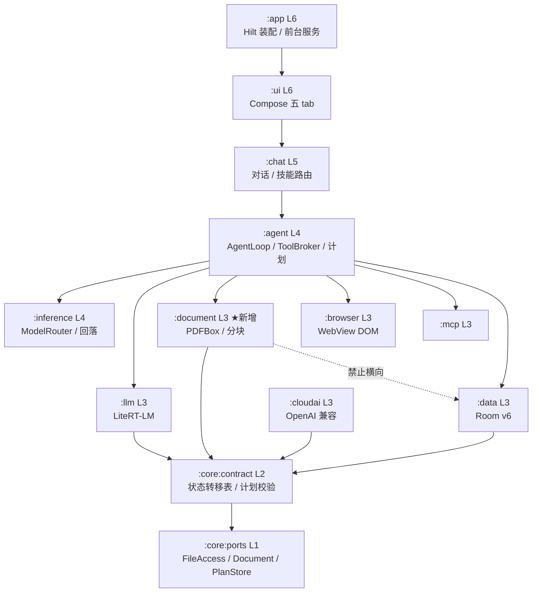

# 15 · Android Personal Agent V1.0 项目交付方案

> 依据：[`13-prd-android-personal-agent.md`](./13-prd-android-personal-agent.md)（PRD V1.0）与 [`14-prd-gap-analysis.md`](./14-prd-gap-analysis.md)（差距分析）。
> 基线：`main@96295c0`，versionName 0.2.0，14 模块 / 443 文件 / 21 表 / 1177 测试。
> 本文由六个专业角色分别产出后汇编：产品策略、系统架构、智能体工程、数据建模、前端体验、后端服务、部署运维、测试验收。**分歧在 §10 显式裁决，不隐藏。**

---

## 1. 一句话定义与成功标准

**给普通 Android 手机装一个"能读你文件、能替你干活、数据不出机"的本地智能体。** V1.0 只证明一件事：用户选一份真实 PDF，它能在 90 秒内给出可逐条回查页码的摘要与待办，并把结果留在手机里。

| 成功标准 | 目标值 | 判定方式 |
|---|---|---|
| 主链路可用 | 20 页文本型 PDF：抽取 ≤6s、摘要 ≤90s、待办召回 ≥0.80 / 误报 ≤1 条 | 20 份金标 + 真机计时 |
| 事实可追溯 | 摘要抽检 5 条事实 ≥4 条能按页码在原文定位 | 人工抽检 + quote 子串校验 |
| 数据不出机 | 文档链路 `bytesSent == 0`（除用户显式开启云端） | mitmproxy + tcpdump |
| 不崩 | 6GB 机型连续 10 次任务 OOM = 0 | 真机压测 |
| 装得上 | universal APK ≤69 MiB，Android 9–16 全可安装 | CI 包体门禁 + 6 台矩阵 |

**V1.0 不追求**：多 Agent 协同、跨应用自动化、定时任务、语音、扫描件 OCR、语义向量检索。这些不是"以后再说"，是**在形态 A（普通应用）下做不出可信体验**，理由见 §10。

---

## 2. 需求范围

### 2.1 V1.0 交付（15 条 P0 + 2 条收尾 / 72 人日）

| ID | 交付物 | 性质 | 人日 |
|---|---|---|---|
| S01 | 五 tab 导航骨架 + 首页「继续上次任务」卡 | 已有·补 UI | 5 |
| S02 | SAF 选文件 + URI 持久授权 | 全新 | 4 |
| S03 | PDF 文本抽取 + 文本/扫描分流 | 全新 | 6 |
| S04 | 旗舰链路：摘要 + 待办结构化 | 全新 | 8 |
| S05 | 3–5 步线性计划 + 确认 | 扩展现有单步 ReAct | 5 |
| S06 | 暂停/继续/取消/重试 + 中断恢复 | 已有·补 UI | 4 |
| S07 | 任务聚合列表（全量/筛选/中断置顶） | 已有·补 UI | 3 |
| S08 | 结果页 + 导出 | 复用 export_records | 3 |
| S09 | ToolBroker 网关（校验/授权/超时/重试/回传） | 补链路 | 6 |
| S10 | 三个新工具入 Registry | 补链路 | 4 |
| S11 | 分级授权 + 敏感操作二次确认 | 复用 PolicyEngine/HumanGate | 4 |
| S12 | 审计写入与查询 | 复用 trace_event | 2 |
| S13 | 提示注入三道代码闸门 | 全新 | 3 |
| S14 | 设备预检 + 本地/云降级门控 | 扩展现有门控页 | 4 |
| S15 | 记忆管理页（列表/搜索/删除/来源） | 已有·补 UI | 4 |
| S16 | 模型管理增强（续传/校验/资源监控） | 部分·补 UI | 3 |
| S17 | 工具中心（只读列表 + 风险等级 + 授权时间） | 已有·补 UI | 2 |
| S18 | 数据生命周期（删任务/记忆并清中间文件） | 全新 | 2 |

> **S07 / S15 / S17 原本在 P1，此处提为 P0。** 理由：五 tab 里的"任务 / 工具 / 记忆"如果没有管理页就是三个空壳，tab 本身不成立。S16 / S18 作为收尾项排在 M4，不阻塞 Demo。

### 2.2 V1.1（≥9 人日）

定时任务（仅幂等清理类，不做用户自定义定时）、语音输入（系统 `SpeechRecognizer`，不引入 ASR 模型）、扫描件 OCR 评估、端侧 embedding 检索评估。S16 / S18 已并入 V1.0 收尾。

### 2.3 明确不做（写进 release note）

| 砍掉 | 理由 |
|---|---|
| 多 Agent 协同 | 单模型规划可靠性都不够，多 Agent 只放大失败面 |
| Skill 市场 / 自定义工具导入 | 无可信来源校验，等于给用户装后门 |
| Shell / Python Worker | 形态 A 无隔离手段；AVF 需 Android 13+ 且厂商开放 |
| 跨应用 UI 自动化 | 需无障碍 + 厂商白名单，易被判外挂 |
| 主动建议 | 无数据源，做出来只能编造用户行为，违反 PRD §4.1.2 |
| 扫描件 OCR | +30MB 包体 + 独立模型常驻，与 2.77GB 主模型争内存 |
| 端侧 embedding 语义检索 | 需额外 90–120MB 模型，与 551MB 峰值余量直接冲突 |

---

## 3. 系统架构

### 3.1 分层与新增模块



**只新增一个模块 `:document`（L3）**，不建 `:memory`：检索打分是纯函数，放 `:core:contract`(L2) 即可被 `:data` 与 `:agent` 共用，另开 L3 模块只会因"L3 禁止横向依赖"而碰不到 Room。

新增依赖边与合法性：

| 新边 | 方向 | 合法性 |
|---|---|---|
| `:agent → :document` | L4→L3 | 与既有 `:agent → :llm` 同构，向下 |
| `:document → :core:contract` | L3→L2 | PDFBox 是外部 SDK，必须止步于 L3，且只能经 `DocumentPort` 暴露 |
| `:data` 实现 `MemoryPort` | L3 内部 | Port 定义在 L1，`:data` 经 contract→ports 已可见，无新横向边 |
| `:document ↔ :data` | — | **禁止**。放开会让 PDFBox 生命周期与数据库事务绑定，无法做内存隔离 |

### 3.2 主链路（Demo）

```
选 PDF → FileAccessPort.openRead → HeavyResourceLease(PdfParse)
      → DocumentPort.extract 逐页 Flow<DocChunk> → 落 doc_chunk
      → 释放租约 → HeavyResourceLease(Inference)
      → 12 chunk map-reduce 摘要 → report_todos（人工确认）
      → PlanStore.transition(COMPLETED) → 结果页
```

**内存铁律**：`InferenceFocus` 泛化为 `HeavyResourceLease{Inference, PdfParse}`，**PDF 解析与模型推理永不重叠**。峰值取 `max(551MB, 抽取)` 而非相加 —— 这是 6GB 机型不 OOM 的唯一前提。

### 3.3 技术选型

| 领域 | 选择 | 否决方案 | 否决理由 | 代价 |
|---|---|---|---|---|
| PDF 抽取 | PDFBox-Android 2.0.27，页级 `PDFTextStripper` | `PdfRenderer`；iText | 前者只出 Bitmap 无文本层；后者 AGPL 传染 | +4.3MB【待实测】；30–60MB 堆/200 页 |
| 文件访问 | `ACTION_OPEN_DOCUMENT` + `takePersistableUriPermission`，>20MB 拷贝入 `filesDir/doc-cache` | `MANAGE_EXTERNAL_STORAGE`；每次重解析 | 上架政策不接受；重解析时授权常已失效 | 50MB 拷贝 0.4–1.2s【待实测】，缓存上限 512MB |
| 分块摘要 | 600–900 token/块、15% 重叠、**12 块硬上限**、map-reduce | 全文入 context；固定 512 切 | 端侧 context 与内存撑不住全文；固定切会切断表格/条款 | 12 次推理 ≈ 78–85s，贴 90s 线【待实测】 |
| 记忆检索 | FTS5 + bm25 + 中文 bigram 预切 | 端侧 embedding + ANN；FTS4 | embedding 需 90–120MB 模型；FTS4 无 bm25 | 索引 +18–38MB（1 万条）【待实测】 |
| 计划表示 | 线性 `List<Step>` 3–5 步 + 声明式转移表 | 通用 DAG 调度器；状态机库 | V1 只有线性计划，DAG 是纯负债；为 10 态引外部库不值 | 0 包体 |
| 任务调度 | 前台服务 `dataSync` + 进程级 CoroutineScope；WorkManager 仅做幂等清理 | WorkManager 承载 step；AlarmManager 驱动 | WorkManager 10 分钟上限、无流式 UI、重试会产生重复副作用 | 常驻通知 +3MB |
| 注入防护 | 代码三道闸门（通道分离/参数来源/副作用预算） | 仅靠 system prompt | 见 §10 决策 6 | 0 |

### 3.4 三个 Port 契约（`:core:ports`）

```kotlin
interface FileAccessPort {
    suspend fun openRead(uri: String): FileHandle
    suspend fun persistGrant(uri: String, mode: GrantMode): GrantToken
    fun meta(uri: String): FileMeta
}
// sealed FileError { PermissionRevoked, NotFound, TooLarge(limit), Io(cause) }

interface DocumentPort {
    suspend fun probe(src: DocumentSource): DocProfile      // pageCount / isTextual / isEncrypted
    fun extract(src: DocumentSource, budget: ChunkBudget): Flow<DocChunk>  // 必须流式
    suspend fun close(handle: DocHandle)
}
// sealed DocError { Encrypted, NotTextual(needsOcr), TooLarge(pages,limit), ParseFailed(page) }

interface PlanStore {
    suspend fun create(goal: String, steps: List<StepDraft>): TaskId
    suspend fun transition(id: TaskId, trigger: PlanTrigger, expectedRev: Long): TransitionOutcome
    fun observe(id: TaskId): Flow<PlanSnapshot>
}
// TransitionOutcome { Applied(rev) | Rejected(currentState) | Conflict(currentRev) }
```

`extract` 返回 `Flow` 而非 `List` 是硬要求：调用方必须在持有租约期间逐页消费并落库，一次性返回全文本等于把 60MB 堆峰值交给 GC 运气。

### 3.5 非功能目标

| 维度 | 目标 | 测法 |
|---|---|---|
| 冷启动 | P50 ≤900ms / P90 ≤1500ms | `am start -W` ×10 |
| 首 token | P50 ≤1.8s（不含排队）/ 排队 P90 ≤3s | 埋点直方图 |
| 20 页 PDF | 抽取 ≤6s；摘要 ≤90s（硬超时 120s 必须有进度） | 端到端埋点 ×10 |
| 内存峰值 | 整机 PSS ≤1.35GB；余量 <120MB 拒绝取租约 | `dumpsys meminfo -d` |
| 包体 | release ≤69MB（当前 61MB + PDFBox 4.3MB） | CI 门禁 |

---

## 4. 数据库设计摘要（v5 → v6）

**新增 2 表 + 1 虚表 + 5 索引，0 新列，0 触发器，不动 21 张老表。**

| 对象 | 关键设计 |
|---|---|
| `doc_chunk` | PK ULID；`UNIQUE(task_id, chunk_seq)` 保证重放幂等；`text_enc` + `text_preview`；`page_no` 1-based 与 `chunk_seq` 0-based 分离；`expires_at` 由 `RetentionJob` 写入；FK CASCADE |
| `plan_revision` | 复合 PK `(task_id, revision)`；append-only，历史行只改 `status`；`steps_json` + `step_count` 冗余；状态 `DRAFT→ACTIVE→SUPERSEDED/DONE/ABORTED` |
| `memory_card_fts` | `CREATE VIRTUAL TABLE`，**不进 Room entities**（避免 FTS5→FTS4 降级改 schema JSON）；rowid 与 `memory_card.rowid` 对齐；索引**解密后明文 bigram** |
| 5 个索引 | `idx_doc_chunk_task_seq`(unique) / `idx_doc_chunk_expires` / `idx_plan_revision_task_status` / `idx_trace_task_time` / `idx_task_status_time` |

**三个必须写进代码的约束：**

1. **FTS 索引明文是裁决，不是疏忽。** `content_preview` 是截断字段，用它建索引会导致"正文后半段永远搜不到"；且 preview 已脱敏，等于把脱敏策略固化成检索上限。代价是删除必须同事务三删（密文 / preview / FTS）+ `PRAGMA secure_delete=ON` + `incremental_vacuum`。
2. **不用 contentless FTS5。** SQLite 3.22（minSdk 28）不支持 `contentless_delete`（3.43+），删不掉等于违反"删除即彻底"。
3. **CAS 用 `UPDATE ... WHERE revision = :expected`**，冲突方不重试写，而是重读最新版本——并发的两个计划不能合并。

容量：20 页 PDF ≈ 88KB；200 页 ≈ 880KB；1 万条记忆 FTS ≈ 18–38MB。清理阈值：`doc_chunk` >64MB 淘汰至 48MB，FTS >32MB 触发 optimize，全库 >256MB 告警。

迁移测试 8 条断言，其中三条最关键：v5 老数据逐表 `COUNT(*)` 不变；`memory_card` 的 `UNIQUE(agent_id,key)` 未被破坏（不重蹈 v3 的 12 步重建）；迁移前后 `step` 连插 1000 行 P95 差 <10%。

---

## 5. 实现要点

### 5.1 智能体（计划 / Prompt / 工具）

**计划是数据，不是 function calling。** `automaticToolCalling=false`，且 function calling 的语义是"立即执行"，无法穿过 `WAITING_HUMAN` 确认门。模型只输出 JSON，`action` 是闭集（`READ_FILE/PDF_EXTRACT/SUMMARIZE/EXTRACT_TODOS/REPORT`），action→工具的映射只存在于代码里。

7 条校验（纯函数，与转移表同层）：步数 3–5、idx 连续、action 闭集、首尾固定、无重复 action、字段长度上限、顺序约束。**失败最多修 2 次**：第 1 次回灌违规规则号，第 2 次不再问模型，直接落模板计划（`source=TEMPLATE`，确认页显示"系统默认计划"）。8 步时的截断顺序：先合并相邻同 action → 保首尾取中间前 3 → 标 `truncated` → 仍超 5 步走模板。**绝不取前 5 步**（会砍掉 REPORT）。

三个新工具：

| 工具 | 用途边界（写进 description） | 风险 | 幂等 | 超时 |
|---|---|---|---|---|
| `read_file` | 只读元信息/纯文本区间；只能传系统下发的 `fileRef`，不接受自造路径 | READ_ONLY | 是 | 5s |
| `pdf_extract` | 逐页抽文本，一次任务只调一次，持 `PdfParse` 租约 | READ_ONLY | 是(key=fileRef+pages) | 8s |
| `report_todos` | 写操作，每条待办必须带原文页码+引文，过人工确认 | LOCAL_WRITE | 是(key=docRef+contentHash) | 2s |

**证据可回溯的硬保证**：`quote` 归一化后必须是 chunk 原文子串，否则丢弃该 point；块内命中率 <50% 重试一次。reduce 阶段只喂已校验 points、不回原文——从结构上消除"reduce 编页码"。

**注入三道代码闸门**（不靠 prompt）：① 文档只能进 `<doc_chunk>` 数据槽，`inputSource==UNTRUSTED_DOC` 时 action 白名单收缩为 4 个只读/上报动作；② fileRef/url/path 只接受用户确认过的字面量，参数里出现文档字符串即拒；③ 每任务副作用预算（`pdf_extract≤1`、`report_todos≤1`），批准令牌绑定参数哈希，参数一变即失效。

### 5.2 前端（五 tab）

| Tab | 根页面 | 二级 |
|---|---|---|
| 首页 | `home` 继续任务卡 + 一句快捷指令 | 对话列表、助手列表/详情/创建 |
| 任务 | `tasks` 筛选 + 任务卡 | 详情（StepTimeline 唯一出口）、计划确认、结果页 |
| 工具 | `tools` 只读列表（能做什么·风险等级·授权时间） | 工具详情 |
| 记忆 | `memory` 搜索 + 记忆卡 | 记忆详情（来源/删除） |
| 我的 | `settings` | 模型、导入、MCP、门控 |

**对话里的步骤卡降级为 `TaskInlineCard`**（一行 + 状态点 + 跳转），完整时间线全应用只保留在任务详情一处——这是消除"同一件事两个真相"的关键。

新增组件 7 个：`TaskCard`、`TaskInlineCard`、`PlanStepEditor`、`RiskLevelChip`、`ResumeBanner`、`SourceTag`、`ExportSheet`。

文案铁律：不用 Port/推理/绑定/异常/挂载；每条错误必须带下一步（"网络断了，点这里重试"）；权限说明写"这个工具只看你选的文件，仅这一次"。

### 5.3 后端（ToolBroker / 文件 / 文档）

```kotlin
suspend fun invoke(call: ToolCall, ctx: ToolContext): ToolResult {
    val tool = reg.find(call.name) ?: return Err(ERR_TOOL_NOT_FOUND, retryable = false)
    val args = tool.spec.validate(call.rawArgs) ?: return Err(ERR_BAD_ARGS, false)
    val key  = call.idemKey ?: idemKey(ctx.taskId, ctx.stepId, tool.name, args)
    idem.replay(key)?.let { return it }                     // 重启/重试短路
    when (policy.decide(tool.spec, args, ctx)) {
        Deny        -> return Err(ERR_PERMISSION_DENIED, false)
        NeedConfirm -> if (gate.await(...) != Granted) return Err(ERR_USER_REJECTED, false)
        Allow       -> Unit
    }
    audit.begin(key, call, ctx)                             // PENDING 与步骤推进同事务
    val r = runGuarded(tool, args, ctx)
    withContext(NonCancellable) { audit.end(key, r) }        // 取消/超时也必须落审计
    return r
}
```

重试只对幂等工具全类型开放；非幂等工具仅在"请求发出前"失败才重试，否则交人工对账（`ERR_NEEDS_RECONCILE`），绝不盲重试。取消必须重抛 `CancellationException`，禁止 `catch (Throwable)` 吞掉。

SAF 三个坑：`GET_CONTENT` 的 URI 不可持久化；授权失效要先用 doc-cache 副本降级再引导重选；`>20MB` 必须拷贝到本地文件，因为 PDFBox 需要可随机访问的长生命周期文件，而 SAF 流不可 seek。

### 5.4 数据（见 §4）

---

## 6. 里程碑与排期

**人力假设**：2 名 Android 工程师（并行）+ 0.5 设计 + 0.5 测试。若单人开发，总工期 ×1.8 ≈ 17 周。以下按 2 人计。

| 里程碑 | 内容 | 人日 | 周 | 出口条件 | 依赖 |
|---|---|---|---|---|---|
| **M0 准备** | 正式 keystore 与 v3 lineage、CI 8 项门禁、6 台真机矩阵、20 份金标 PDF | 6 | 0.5 | CI 在 tag 上全绿；金标可跑 | — |
| **M1 文件闭环** | S02 SAF、S03 抽取、S10 工具、S14 预检、S01 导航骨架 | 23 | 2.0 | 真机对 3 份真实 PDF 抽出文本并落库 | M0 |
| **M2 主链路** | S05 计划、S09 Broker、S04 摘要+待办、S08 结果页 | 22 | 2.0 | Demo 全流程跑通，待办可回查页码 | **M1（关键路径）** |
| **M3 可见性与控制** | S06 任务控制、S07 任务列表、S11 授权、S12 审计、S17 工具中心 | 15 | 1.5 | 用户能回答"它做了什么/为什么被拦" | M2 |
| **M4 安全与硬化** | S13 注入闸门、S15 记忆管理、S16 模型增强、S18 生命周期、深色对比度回填 | 13 | 1.5 | 30 条注入语料 0 漏拦 | M2 |
| **M5 真机与放行** | 六项性能、6 台矩阵、灰度 dry-run、回滚演练 | 10 | 1.0 | §8 Go 门禁全满足 | M3+M4 |

合计 **89 人日 / 约 8.5 周**，含 20% 缓冲到 **10 周**。

**关键路径**：`S02 → S03 → S10 → S09 → S04 → S08`。这条路径上任何一环延期，整个发版延期；S01/S06/S07/S12 是可并行的"补 UI"项，不得占用关键路径人力。

---

## 7. 部署上线方案

### 7.1 环境

| 环境 | 产物 | 签名 | 分发 |
|---|---|---|---|
| 本地 | debug，单 ABI | debug keystore | adb |
| PR 预览 | release 无 R8，包名后缀 `.pr<num>` | 工程验证密钥 | Actions Artifact（7 天） |
| 内测 | universal + arm64 分包，R8 全开 | **正式密钥**（与正式同签，避免覆盖安装失败） | Play Internal / 官网 |
| 正式 | AAB（Play 按 ABI 拆分，用户实收约 40MB） | 正式密钥 + lineage | Play / 官网 APK |

### 7.2 PR 八项门禁（全绿才可 merge）

单测（15m）· `checkModuleDependencies`（5m）· `lintRelease` 零 Error（15m）· `assembleRelease`（25m）· **包体 ≤69MiB** · **`apksigner verify` 证书指纹匹配** · **schema 导出无 diff** · **R8 `missing_rules.txt` 为空**。

### 7.3 签名

`versionCode = MAJOR*10000 + MINOR*100 + PATCH`（1.0.0 → 10000）。工程验证密钥 → 正式密钥走 **v3 轮换**：`apksigner rotate` 生成 lineage → 发 1.0.0 过渡版（仍用旧钥）→ 1.0.1 起用新钥 + lineage。存量 0.2.0 用户必须能覆盖升级，**不能要求卸载重装**。

### 7.4 模型分发

CDN 内容寻址：`models/<sha256>/part-000..NNN`（64MB 分片，immutable）。manifest 含 `rolloutPercent` 与 `sig`（公钥钉在源码）。灰度 1%→10%→50%→100%，每档 ≥24h。回滚 = 改写 manifest 指针，5 分钟全量生效；旧分片保留 90 天，客户端保留上一版模型 7 天，可原地回切不重下 2.77GB。

### 7.5 可观测性（数据不出机）

**选境内自建 Sentry + 用户手动导出诊断包**，否决 Firebase Crashlytics（数据出境，与卖点冲突）。上报前 `beforeSend` 强制剥离 URL、文本、文件路径；`:browser` 与 DOM 相关类从错误上报白名单中排除。8 个埋点全部不含内容：`app_launch`、`model_download_result`、`model_verify_fail`、`doc_parse_end`（格式+大小区间+耗时）、`fgs_session_end`、`chat_first_token_ms`、`memory_kill`、`anr`。

### 7.6 回滚

三条硬指标任一命中即回滚：崩溃率 >1%、文件闭环成功率 <95%、ANR >0.5%。步骤：停止发布 → promote 上一版 → 服务端关开关 → 必要时回滚 manifest → 冒烟 + 通报（目标 15 分钟）。

---

## 8. 测试与验收

### 8.1 先说清楚 1177 条测试证明了什么

**证明了**：状态机无死锁、策略拒绝路径完整、DOM 红线在"带页面上下文"分支 `bytesSent==0`、回落告知存在。
**没证明**：任何真实 I/O（TLS/DNS/超时/断点续传）、任何真实进程生命周期（被杀、关库重开）、任何资源约束（RSS/存储）、任何模型输出质量（全 stub）、任何像素与可达性。

→ **V1.0 的重点不是再补单测，而是补真实性缺口。**

### 8.2 真机矩阵（6 台）

| # | 机型 | RAM | Android | 目的 |
|---|---|---|---|---|
| D1 | Redmi Note 12 | **6GB** | 13 | OOM、降级、后台查杀（高危机） |
| D2 | Pixel 7 | 12GB | **15** | FGS 6h 配额、新权限模型 |
| D3 | Galaxy S21 | 8GB | 14 | 大厂 SAF/深色差异 |
| D4 | Mate 40 | 8GB | 12 | 无 GMS 的下载回退 |
| D5 | 小米 9 SE | 4GB | **9** | minSdk 边界、极低内存 |
| D6 | OPPO Reno | 8GB | 13 | 最激进后台查杀 |

### 8.3 P0 验收（13 条产品 + 6 项非功能 + 5 项安全）

产品侧（节选，完整见 PRD §11.1 与差距分析 §8）：

| 编号 | 断言 |
|---|---|
| A1 | 50 页含 1 页扫描件 → 返回"可解析 49 页"，不阻断任务 |
| A3 | 20 页文档摘要 ≤300 字，抽检 5 条事实 ≥4 条可按页码定位 |
| A4 | 含 3 条明确待办 → 召回 ≥2、误报 ≤1，每条带页码 |
| A8 | 第 2 步被杀进程 → 重开从第 2 步续跑，第 1 步审计仍 1 条 |
| A10 | 首次调用文件工具被拒 → 任务转 Waiting Approval 不判失败 |
| A12 | 文档含"忽略以上指令"→ 写操作工具调用 = 0，原文仅作引用出现 |

非功能：冷启动 P50≤900ms、首 token P50≤1.8s、20 页抽取≤6s、摘要≤90s、PSS≤1.35GB、包体≤69MB。
安全：提示注入 30 条语料 0 漏拦、越权读文件全部 `SecurityException`、DOM 出境 `bytesSent==0`、审计篡改可检出、导出路径不穿越。

### 8.4 Go / No-Go

**全满足才发**：① P0 = P1 = 0；② A1–A13 全绿（AI 类按达标率：20 篇样本摘要定位 ≥90%、待办误报 ≤1/篇）；③ 六项非功能在 D1/D2 各复测达标；④ 30 条注入 0 漏；⑤ 冒烟 7 条在 6 台全过；⑥ 灰度前 dry-run 1 小时无 FATAL。

**允许带缺陷发布**：仅 P2/P3 且总数 ≤5，每条必须有复现步骤、影响面、绕行方案、观测指标、回滚方案，且不触及隐私/数据完整性/注入防线。

---

## 9. 风险清单

| # | 风险 | 概率 | 影响 | 应对 |
|---|---|---|---|---|
| R1 | 2B 模型摘要事实一致率达不到 0.90 | **高** | 高 | 12 块 map + quote 子串校验 + 模板兜底；M2 就用 20 份金标试算，不达标则把目标降到 0.85 并明示"仅供参考" |
| R2 | PDFBox 200 页堆峰值击穿内存 | 中 | 高 | `MemoryUsageSetting.setupMixed(24MB)` + 单页抽取 + 立即释放 contentStream；M1 首日实测，超 120MB 则限 50 页 |
| R3 | FTS5 在 API 28 不可用 | 中 | 中 | 运行时 `PRAGMA compile_options` 探测 + FTS4 降级；两端 DDL 列名一致，DAO 不改 |
| R4 | Android 15 dataSync 6h 配额触顶 | 中 | 高 | 实现 `onTimeout` 落 checkpoint 后停服；单任务预算上限 10 分钟，正常不会触顶 |
| R5 | 58 人日估算偏差（团队无 PDF 经验） | **高** | 中 | M0 用 1 份真实 PDF 做 spike；若 M1 超期 30%，砍 S07/S12 到 V1.1 |
| R6 | 6GB 机型 OOM | **高** | 高 | 8GB 门槛（`min_ram_gb`），6GB 默认云端并明示"本地受限"；PSS 余量 <120MB 拒绝取租约 |
| R7 | 五 tab 推翻上一轮 UX 的返工 | 确定 | 中 | 配色/门控/组件全复用，只重排导航；预算已含 5 人日 |
| R8 | 云端链路仍零真端点验证 | 中 | 中 | V1.0 不把云端作为主链路；发版前用本地 `com.sun.net.httpserver` 起假端点补一次真 HTTP 验证 |

---

## 10. 决策与权衡（被否决的方案都在这）

| # | 决策 | 采纳 | 否决 | 理由与代价 |
|---|---|---|---|---|
| 1 | 导航 | **五 tab（PRD）** | 三 tab（`docs/12`） | 需求基线明确要求五 tab，用户指令是"按需求做"。代价：上一轮导航重构作废（约 5 人日），但配色/门控/组件可复用。**若产品改口，这一项可原地回退，不影响其他模块。** |
| 2 | 任务状态 | **落库 9 态**（Draft/Planning/WaitingApproval/Running/Paused/Completed/Failed/Cancelled/Interrupted），`Ready` 只做 UI 瞬时展示 | 10 态全落库；维持 8 态 | `Ready` 是"授权通过到开始执行"的 <1s 窗口，落库只会制造无法测试的中间态。`IMPOSSIBLE` 归入 `Failed` 子类型，UI 仍显示 PRD 口径。 |
| 3 | 记忆检索 | **FTS5 + bigram** | 端侧 embedding + ANN | 90–120MB 额外模型与 551MB 峰值余量冲突。记忆的信任来自"可看可删"，不来自召回精度。V1.1 若主模型换 ≤1B 量化版再评估。 |
| 4 | 文档模块 | **只建 `:document`** | 独立 `:memory` 模块 | L3 横向依赖禁令使 `:memory` 碰不到 Room，只能复制 DAO；打分是纯函数，放 L2 即可共用。 |
| 5 | 任务调度 | **前台服务 dataSync** | WorkManager 承载 step | 10 分钟上限 + 无流式 UI + 重试产生重复副作用（checkpoint 只能恢复不能去重）。 |
| 6 | 注入防护 | **代码三道闸门** | 仅 system prompt 声明 | 600–900 token 正文 + 强指令下，2B 模型的元规则会被稀释（lost-in-the-middle）。Prompt 只在模型"愿意遵守"时有效，而攻击者要的正是它不遵守。代价：写操作必确认，有摩擦。 |
| 7 | 可观测性 | **境内自建 Sentry + 手动导出** | Firebase Crashlytics | 数据出境与"数据不出机"卖点直接冲突，且无法向用户解释。 |
| 8 | PDF 库 | **PDFBox-Android** | `PdfRenderer` / iText | 前者无文本层（等于必须上 OCR）；后者 AGPL 传染。 |

---

## 11. 下一步（本周可执行）

1. **M0 第 1 天**：拿 3 份真实 PDF（20 页文本 / 50 页混合 / 200 页财报）做 PDFBox spike，测堆峰值与抽取耗时 —— 这是 R2 的唯一解法，也是排期可信度的前提。
2. **M0 第 2 天**：`PRAGMA compile_options` 在 API 28 真机上确认 FTS5；同时确认 PDFBox 2.0.27 是否有 `MemoryUsageSetting` 重载。
3. **M0 第 3 天**：正式 keystore + lineage 生成，CI 八项门禁接上（包体、签名、schema 三项当前没有）。
4. **同步**：20 份金标 PDF 开始标注（每份 8–15 条事实 + 3–12 条待办 + 页码 + 诱饵位置），这是 R1 的唯一裁判。

> 本文是可执行方案，不是立项 PPT。任何一条与代码冲突的地方，以代码为准并回来改本文。

---

## 12. 实施进度

### 2026-11-02 · M1 第 1 批

| 项 | 状态 | 证据 |
|---|---|---|
| `:document`（L3）新建 | ✅ 完成 | 全仓唯一持有 PDFBox（`com.tom-roush:pdfbox-android 2.0.27.0`，包名 `com.tom_roush.*`）；架构白名单 15 模块通过 |
| `DocumentPort` 契约 | ✅ 完成 | `core/ports/Document.kt`：probe 采样 3 页（常数成本）、pages 返回 `Flow<PageEvent>`、单页失败降级为 Skipped |
| 逐页流式抽取 | ✅ 完成 | `PdfBoxDocumentExtractor`：`setupMixed(24MB)` + 单页 `PDFTextStripper` + 立即丢弃 PDPage |
| 12 块分块 | ✅ 完成 | `ChunkAssembler`：页边界优先、超长页按句切、`truncatedFromPage` 记录截断起点 |
| 测试 | ✅ 10 条全绿 | 6 条纯 JVM 分块 + 4 条真实 PDF 抽取（Robolectric 现场生成 PDF，非 mock） |
| `FileAccessPort` 契约 | ✅ 完成 | `core/ports/FileAccess.kt`：openRead / persistGrant / meta / release / trimCache |
| SAF 实现 | ✅ 完成（未真机验证） | `AndroidFileAccess`：持久授权失效返回 `PermissionRevoked`、拷贝后复核字节数、`.part` 残留清理 |
| 缓存策略 | ✅ 完成 | `DocCachePolicy`：20MB 保留阈值、512MB LRU、sha256 稳定键；5 条 JVM 测试 |
| 全局编译 | ✅ `:app:compileDebugKotlin` 通过 | 新增模块未破坏 Hilt 图 |

**两处对方案的偏离（已写进代码注释，需在 M1 实测时复核）：**

1. **统一落盘，不用 fd**（`FileAccessPort` 头部）：方案假设 ≤20MB 可直接吃 `ParcelFileDescriptor`，但云盘 provider 的 fd 不可 seek，PDFBox 需要稳定 `File`。阈值退化为"任务后是否保留"。
2. **不做跨块 15% 重叠**（`ChunkAssembler` 头部）：重叠是给固定窗口切分的补救，按页/句切分时它变成"重复 15% 预算 + reduce 重复计数"的净负债。若金标显示跨页事实被漏，再补。

**下一步（按关键路径）**：S01 五 tab 导航骨架 → S05 计划生成与确认 → S09 ToolBroker。

### 2026-11-02 · M1 第 2 批（S01 五 tab）+ M2 数据层

| 项 | 状态 | 证据 |
|---|---|---|
| 五 tab 导航 | ✅ 完成 | 首页 / 任务 / 工具 / 记忆 / 我的；`startDestination` 改为 `HOME`；对话降为二级页（首页右上角「对话记录」） |
| 任务中心 | ✅ 完成 | `TaskListScreen` + `TaskListViewModel`：Room Flow 实时刷新、四档筛选带计数、可继续任务就地「继续 / 放弃」 |
| 工具中心 | ✅ 只读 | `ToolCenterScreen`：按来源分组、风险标签人话化、MCP 入口；**不做开关**（理由写在 VM 头部：没有使用记录之前，一键开关等于鼓励瞎点） |
| 记忆中心 | ✅ 完成 | `MemoryListScreen`：搜索（内存过滤）、删除二次确认、来源域名 / 使用次数 |
| `TaskRow` 共享模型 | ✅ 完成 | 首页历史与任务中心共用一份映射，`HistoryTaskItem` 改为 typealias，杜绝"同一任务两处说法不一致" |
| `plan_revision`（Room v5→v6） | ✅ 完成 | 复合主键 `(task_id, revision)` + 1 索引；迁移全 Additive；`AkeDatabase.VERSION = 6`，版本钉测试同步 |
| `PlanStorePort` | ✅ 完成 | `saveDraft`（旧草稿置 SUPERSEDED + 冲突自增重试）、`confirm`（CAS，只有 DRAFT 能变 CONFIRMED） |
| 计划解析 | ✅ 完成 | `PlanParser`：闭集校验、连续重复合并、5 步截断、最后一步必须是产出型；11 条测试 |
| 计划 Prompt | ✅ 完成 | `PlanPromptBuilder`：闭集 + 一条 few-shot（2B 模型 prefill 敏感，示例只留一条） |

**三处对方案的偏离：**

1. **`memory_fts` 未建**（原计划 v6 建 FTS5 + bigram）。理由：FTS5 可用性在 API 28 上仍未实测，而当前列表上限 100 条，内存 `contains` 与 SQL LIKE 能搜到的**内容完全相同**（正文是密文，两者都只能搜 `title` / `preview`）。等 FTS 真能搜正文时再上，那时才有收益。
2. **`plan_revision.steps_text` 不是 JSON**。`:data` 拿不到 `:agent` 的 `JsonTolerant`（L3 不能依赖 L4），`org.json` 在纯 JVM 单测里是桩。改成 `kind|target` 行格式，30 行编解码 + 5 条转义测试。
3. **计划确认页与结果页未开工**。它们依赖计划生成链路（模型调用 → 解析 → 落库），而该链路要先接 `InferenceFocus` 租约，不是纯 UI 工作。

**下一步**：S05 计划生成链路（`PlanCoordinator` + 租约）→ 计划确认页 → S09 ToolBroker。

**顺带修掉的一个真缺陷（不在本期计划内）**：`JsonTolerant.normalize` 原先用正则
`([^\\])\n(?!\s*[}\]])` 处理「字符串内的裸换行」，但它**不区分字符串内外** ——
模型输出**美化过的多行 JSON** 时，结构里的换行会被替换成字面的 `\n` 两个字符，
解析器随即把 `\` 当非法 token，**整份输出解析失败**。

这个缺陷影响的不只是新写的计划解析：`StepActionParser` 走同一条 `normalize`，
也就是说**模型只要把动作 JSON 写成多行，主循环就会解析失败并要求重试**。
之所以一直没被发现，是因为历史测试样例几乎全是单行 JSON。

修法：改成逐字符扫描（跟踪 `inStr` / `escaped`），只转义字符串内部的换行。
新增 `JsonTolerantTest` 三条用例（美化 JSON、字符串内换行、围栏+单引号+尾逗号组合）。

